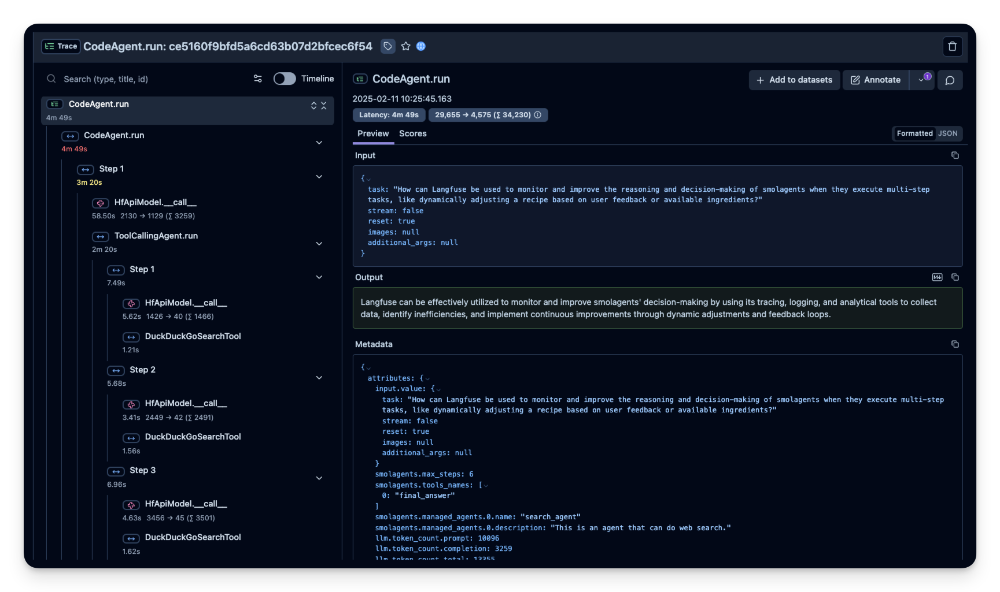
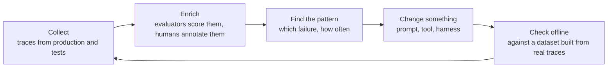
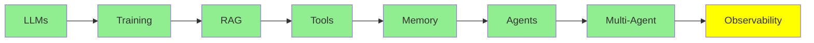

# Observability

In ordinary software, when you want to know what the system does, you read the code. The code describes the behaviour completely, so reading it tells you what the system will do.

With an agent, that stops being true. The code says "call the model, then run whatever tool it asks for, then do it all again". The code does not tell you what actually happened on a given run:

- which tools the agent chose
- in what order it called them
- what came back
- where it went wrong

None of that is in the code at all. It exists only in the record of that run.

That record is a **trace**. This module is about how to keep it and how to use it.

  
*A real trace of one agent run, opened in Langfuse. On the left is the tree of the run: every step, model call and tool call. Each one shows how long it took and how many tokens went in and out. The whole run took 4m 49s, and 3m 20s of that was the first step, where a second agent ran its own web searches. The answer on the right says none of this.*

## What a Trace Holds

A trace is the whole tree of one request. It holds:

- every model call, with its input and its output
- every tool call, with its arguments and its result
- every subagent

On each of these, the trace also records the tokens, the cost and the duration.

That tree shape matters. Agent failures happen in the gaps between steps, not inside any one step. For example, the model asked for the right tool, but with a slightly wrong argument. A tool returned an empty list, and the agent treated the empty list as an answer. The agent looped four times over the same file. It hit the context limit and quietly dropped the instruction it needed. None of that is visible in the final output. The final output is often a confident paragraph. All of it is visible in a trace.

This is why LangChain said it so plainly in [The Agent Improvement Loop Starts with a Trace](https://www.langchain.com/blog/traces-start-agent-improvement-loop). In traditional software, the code documents the behaviour. In an agentic system, the traces do.

## Observability Tools

- **LangSmith** is LangChain's own tool. If you already use anything from [Agent Frameworks](../4_ecosystem/agent_frameworks.md), it is the most integrated choice. It gives you tracing, datasets, evaluators and annotation in one place.
- **[Langfuse](https://github.com/langfuse/langfuse)** is the open-source one. It is the usual choice when the traces must stay on your own infrastructure. It supports OpenTelemetry as well as the framework SDKs, so it can collect traces from almost anything. Next to the traces, it also has evals, prompt management and datasets.
- **[Latitude](https://github.com/latitude-dev/latitude-llm)** is also open source. It focuses clearly on monitoring in production.

Before you pick one, the thing to check is not the feature list. The first check is whether it can collect traces from what you already run. The second check is whether it can keep the traces where your data policy says they must stay. Prompts and tool results are full of customer text. So this choice is part of the same discussion as the data policy from [Inference Providers](../4_ecosystem/inference_providers.md).

## The Loop

Collecting traces is not the point. The point is the cycle that the traces start. That cycle is the main argument of the LangChain article:

*Every stage is attached to the same object, the trace. That is why the loop can close at all. Evaluators score traces. Annotations attach to traces. The offline dataset is made of traces. The regression test replays them. If you take the trace away, none of these steps can reach each other.*

And the gains add up. Each pass produces better data. Better data shows more precisely where the failures are. So the next change is aimed better than the last one. This is the verification loop that [Loop Engineering](../2_intermediate/loop_engineering.md) covers. Here it runs on a longer timescale, and with a human in it.

## Using Agents to Observe Other Agents

Then teams got good at collecting traces, and they ran into a problem at the other end. In [From Traces to Insights](https://www.langchain.com/blog/from-traces-to-insights-understanding-agent-behavior-at-scale), a developer describes their own situation. They record over 100,000 traces every single day. And what are they doing with those traces? Literally nothing.

Nobody reads a hundred thousand of anything. And the usual ways of measuring do not save you. Product analytics and online evaluators both answer questions that you already thought to ask. They tell you the failure rate on the check you wrote. They cannot tell you about a failure mode that you have never imagined. And that is the failure mode that costs you users.

So the newest tool in this module is **an agent that reads the traces**. LangSmith's Insights Agent clusters thousands of conversations. In this way, it finds the usage patterns and the failure modes on its own. Nobody has to say in advance what to look for. It does exploratory analysis on a pile that is too big for a person. And the same technology that produced the pile does the analysis.

This is the direction the whole series is moving in. At the end of [Loop Engineering](../2_intermediate/loop_engineering.md), an agent designs the loop that other agents run in. In this module, an agent checks what other agents produced. Also notice why any of this is necessary. The reason is the same fact that [Harness Engineering](../2_intermediate/harness_engineering.md) starts from. These systems are non-deterministic, which means the same input can give a different result on each run. Their input is natural language, and a person can type almost anything, which means your tests cannot cover every possible input. So most of their failures appear in production, not in your tests.

## Where this fits in the series

## Summary

In ordinary software, the code tells you what the system does. In an agent, it does not, because the code only describes the loop. What happened on a particular run exists only in the trace. The trace holds every model call, every tool call and every subagent, with the tokens, cost and duration on each one.

The trace is where you can see agent failures, because they happen in the gaps between steps. They look like this:

- a slightly wrong argument
- an empty result treated as an answer
- four passes over the same file
- an instruction quietly lost at the context limit

The final output hides all of it.

LangSmith is LangChain's own tool, so it fits most easily if you already build with LangChain. Langfuse is the open-source one, for when traces must stay on your own infrastructure. Latitude is another open-source option, and it focuses on production monitoring.

Collecting traces is not the point. The loop is the point:

- Collect the traces.
- Enrich them with evaluators and annotations.
- Find the pattern.
- Change something.
- Check the change offline, against a dataset made from real traces.
- Start again, with better data than last time.

And once there are a hundred thousand traces a day, nobody reads them. Analytics and evaluators only answer questions that you already thought of. So the newest answer is an agent that clusters the traces. It finds the failure modes that you never imagined.

**Quick Check**: your agent gives a confident, wrong answer. What would a trace show you that the output cannot?

## References

- [The Agent Improvement Loop Starts with a Trace](https://www.langchain.com/blog/traces-start-agent-improvement-loop): why the traces now document the behaviour, and the loop they start
- [From Traces to Insights: Understanding Agent Behavior at Scale](https://www.langchain.com/blog/from-traces-to-insights-understanding-agent-behavior-at-scale): the hundred-thousand-traces problem, and clustering as the way out
- [AI agent evaluation](https://langfuse.com/resources/engineering/ai-agent-evaluation): how to judge an agent by its path, its tool calls, the task it finished and the whole conversation, both before release and on live traffic
- [Langfuse](https://github.com/langfuse/langfuse): open source, OpenTelemetry-compatible, with evals and prompt management next to the traces
- [Agent Graphs](https://langfuse.com/docs/observability/features/agent-graphs): Langfuse draws a run as a graph of its steps, so you see the shape of an agent at a glance
- [Latitude](https://github.com/latitude-dev/latitude-llm): open-source monitoring, made for production
