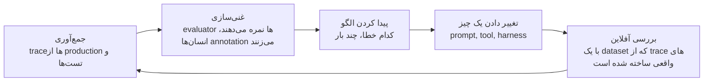
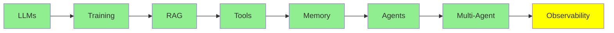

# Observability

در نرم‌افزار معمولی، وقتی می‌خواهید بدانید سیستم چه کاری انجام می‌دهد، کد را می‌خوانید. کد همان رفتار است.

در مورد یک agent، این دیگر درست نیست. کد می‌گوید «model را صدا بزن، بعد هر tool‌ای را که model خواست اجرا کن، و بعد همه‌چیز را دوباره انجام بده». کد به شما نمی‌گوید که در یک اجرای مشخص واقعا چه اتفاقی افتاد:

- کدام tool‌ها را agent انتخاب کرد
- به چه ترتیبی آن‌ها را صدا زد
- چه چیزی برگشت
- کجا اشتباه شد

هیچ‌کدام از این‌ها اصلا در کد نیست. فقط در ثبت آن اجرا وجود دارد.

آن ثبت یک **trace** است. این ماژول درباره‌ی این است که چطور آن را نگه دارید و چطور از آن استفاده کنید.

## آنچه یک Trace در خود دارد

یک trace کل درخت یک درخواست است. در آن این موارد هستند:

- هر model call، همراه با input و output آن
- هر tool call، همراه با argument‌ها و نتیجه‌اش
- هر subagent

روی هر کدام از این‌ها، trace همچنین token‌ها، هزینه و مدت زمان را ثبت می‌کند.

این شکل درختی مهم است. خطاهای agent در فاصله‌ی بین مراحل رخ می‌دهند، نه داخل یکی از آن مراحل. برای مثال، model تool درست را خواست، ولی با یک argument کمی اشتباه. یک tool لیست خالی برگرداند و agent آن لیست خالی را به‌عنوان جواب در نظر گرفت. agent چهار بار دور یک فایل چرخید. به context limit رسید و بی‌صدا دستوری را که به آن نیاز داشت از دست داد. هیچ‌کدام از این‌ها در خروجی نهایی دیده نمی‌شود. خروجی نهایی اغلب یک پاراگراف مطمئن است. همه‌ی این‌ها در یک trace دیده می‌شود.

به همین دلیل است که LangChain این موضوع را این‌قدر صریح در [The Agent Improvement Loop Starts with a Trace](https://www.langchain.com/blog/traces-start-agent-improvement-loop) گفته است. در نرم‌افزار سنتی، کد رفتار را مستند می‌کند. در یک سیستم agentic، این کار را trace‌ها انجام می‌دهند.

## ابزارهای Observability

- **LangSmith** ابزار خود LangChain است. اگر از هر کدام از [Agent Framework‌ها](../4_ecosystem/agent_frameworks_fa.md) استفاده می‌کنید، این یکپارچه‌ترین انتخاب است. این ابزار tracing، dataset‌ها، evaluator‌ها و annotation را در یک جا در اختیار شما می‌گذارد.
- **[Langfuse](https://github.com/langfuse/langfuse)** گزینه‌ی متن‌باز (open source) است. وقتی trace‌ها باید روی زیرساخت (infrastructure) خودتان بمانند، معمولا همین انتخاب است. این ابزار هم از OpenTelemetry و هم از SDK‌های framework پشتیبانی می‌کند، پس تقریبا از هر چیزی می‌تواند trace جمع کند. کنار trace‌ها، eval‌ها، مدیریت prompt و dataset‌ها را هم دارد.
- **[Latitude](https://github.com/latitude-dev/latitude-llm)** هم متن‌باز است. این ابزار به‌طور واضح روی monitoring در production تمرکز دارد.

پیش از انتخاب، چیزی که باید بررسی کنید لیست feature‌ها نیست. اولین بررسی این است که آیا ابزار می‌تواند trace‌ها را از چیزهایی که از قبل اجرا می‌کنید جمع کند. دومین بررسی این است که آیا ابزار می‌تواند trace‌ها را جایی نگه دارد که data policy شما می‌گوید باید آن‌جا بمانند. prompt‌ها و نتیجه‌ی tool‌ها پر از متن مشتری هستند. پس این انتخاب، بخشی از همان بحث درباره‌ی data policy است که در [Inference Provider‌ها](../4_ecosystem/inference_providers_fa.md) آمده است.

## حلقه‌ی Loop

جمع‌آوری trace‌ها هدف نیست. هدف، حلقه‌ای است که trace‌ها آغاز می‌کنند. این حلقه، استدلال اصلی مقاله‌ی LangChain است:

*هر مرحله به یک شیء مشترک متصل است: همان trace. به همین دلیل است که حلقه اصلا می‌تواند بسته شود. evaluator‌ها trace‌ها را نمره می‌دهند. annotation‌ها به trace‌ها وصل می‌شوند. dataset آفلاین از trace‌ها ساخته می‌شود. تست regression آن‌ها را دوباره اجرا می‌کند. اگر trace را برداریم، هیچ‌کدام از این مراحل به هم نمی‌رسند.*

و بهبودها روی هم جمع می‌شوند. هر دور داده‌ی بهتری تولید می‌کند. داده‌ی بهتر، دقیق‌تر نشان می‌دهد خطاها کجا هستند. پس تغییر بعدی، نسبت به تغییر قبلی بهتر هدف گرفته می‌شود. این همان verification loop است که [Loop Engineering](../2_intermediate/loop_engineering_fa.md) آن را پوشش می‌دهد. این‌جا همان حلقه روی یک بازه‌ی زمانی طولانی‌تر اجرا می‌شود و یک انسان هم در آن حضور دارد.

## استفاده از Agent‌ها برای مشاهده‌ی Agent‌های دیگر

بعد، تیم‌ها در جمع‌آوری trace‌ها خوب شدند و به مشکلی در سر دیگرِ کار برخوردند. در [From Traces to Insights](https://www.langchain.com/blog/from-traces-to-insights-understanding-agent-behavior-at-scale)، یک توسعه‌دهنده وضعیت خودش را شرح می‌دهد. آن‌ها هر روز بیش از 100,000 trace ثبت می‌کنند. و با آن trace‌ها چه کار می‌کنند؟ به معنای واقعی کلمه، هیچ کاری.

هیچ‌کس صد هزار چیز را نمی‌خواند. روش‌های معمول اندازه‌گیری هم شما را نجات نمی‌دهند. product analytics و online evaluator‌ها هر دو به سوال‌هایی جواب می‌دهند که قبلا به ذهنتان رسیده بود. آن‌ها نرخ خطا را روی کنترلی که نوشته‌اید به شما می‌گویند. درباره‌ی یک failure mode که هرگز تصورش را نکرده‌اید، نمی‌توانند چیزی بگویند. و همین failure mode است که کاربران شما را از دست می‌دهد.

پس جدیدترین ابزار این ماژول، **یک agent است که trace‌ها را می‌خواند**. Insights Agent در LangSmith هزاران مکالمه را خوشه‌بندی (clustering) می‌کند. به این ترتیب، خودش الگوهای استفاده و failure mode‌ها را پیدا می‌کند. هیچ‌کس مجبور نیست از قبل بگوید دنبال چه باشد. این agent روی انبوهی که برای یک انسان خیلی بزرگ است، تحلیل اکتشافی (exploratory analysis) انجام می‌دهد. و همان فناوری‌ای که این انبوه را ساخته، تحلیلش را هم انجام می‌دهد.

این جایی است که این مجموعه به سمت آن می‌رود. [Loop Engineering](../2_intermediate/loop_engineering_fa.md) به یک agent می‌رسد که خود loop را طراحی می‌کند. agent این ماژول خروجی را بررسی می‌کند. همچنین به این نکته دقت کنید که چرا هر کدام از این‌ها لازم است. دلیلش همان واقعیتی است که [Harness Engineering](../2_intermediate/harness_engineering_fa.md) از آن شروع می‌کند. این سیستم‌ها non-deterministic هستند. آن‌ها زبان طبیعی بدون محدودیت را به‌عنوان input می‌گیرند. پس بیشتر خطاهایشان در production ظاهر می‌شود، نه در تست‌هایتان.

## کجای این مجموعه هستیم

## خلاصه

در نرم‌افزار معمولی، کد به شما می‌گوید سیستم چه کاری انجام می‌دهد. در یک agent این‌طور نیست، چون کد فقط loop را توصیف می‌کند. آنچه در یک اجرای مشخص رخ داده، فقط در trace است. trace هر model call، هر tool call و هر subagent را نگه می‌دارد، همراه با token‌ها، هزینه و مدت زمان روی هر کدام.

trace جایی است که خطاهای agent را می‌بینید، چون این خطاها در فاصله‌ی بین مراحل رخ می‌دهند. ظاهرشان این‌طور است:

- یک argument کمی اشتباه
- یک نتیجه‌ی خالی که به‌عنوان جواب در نظر گرفته شده
- چهار دور چرخیدن روی یک فایل
- یک دستور که بی‌صدا در context limit گم شده است

خروجی نهایی همه‌ی این‌ها را پنهان می‌کند.

LangSmith انتخاب یکپارچه است. Langfuse گزینه‌ی متن‌باز است، برای زمانی که trace‌ها باید روی زیرساخت خودتان بمانند. Latitude گزینه‌ی متن‌باز دیگری است و روی monitoring در production تمرکز دارد.

جمع‌آوری trace‌ها هدف نیست. هدف، حلقه است:

- trace‌ها را جمع کنید.
- آن‌ها را با evaluator‌ها و annotation‌ها غنی کنید.
- الگو را پیدا کنید.
- یک چیز را تغییر دهید.
- تغییر را به‌صورت آفلاین بررسی کنید، با یک dataset که از trace‌های واقعی ساخته شده است.
- با داده‌ای بهتر از دفعه‌ی قبل، دوباره شروع کنید.

و وقتی در روز صد هزار trace وجود دارد، کسی آن‌ها را نمی‌خواند. analytics و evaluator‌ها فقط به سوال‌هایی جواب می‌دهند که قبلا به ذهنتان رسیده است. پس جدیدترین پاسخ، یک agent است که trace‌ها را خوشه‌بندی می‌کند. این agent failure mode‌هایی را پیدا می‌کند که هرگز تصورش را نکرده‌اید.

**بررسی سریع**: agent شما یک جواب مطمئن و اشتباه می‌دهد. یک trace چه چیزی را به شما نشان می‌داد که خروجی نمی‌تواند نشان دهد؟

## منابع

- [The Agent Improvement Loop Starts with a Trace](https://www.langchain.com/blog/traces-start-agent-improvement-loop): اینکه چرا trace‌ها حالا رفتار را مستند می‌کنند، و حلقه‌ای که آغاز می‌کنند
- [From Traces to Insights: Understanding Agent Behavior at Scale](https://www.langchain.com/blog/from-traces-to-insights-understanding-agent-behavior-at-scale): مسئله‌ی صد هزار trace، و خوشه‌بندی به‌عنوان راه خروج
- [Langfuse](https://github.com/langfuse/langfuse): متن‌باز، سازگار با OpenTelemetry، همراه با eval‌ها و مدیریت prompt در کنار trace‌ها
- [Latitude](https://github.com/latitude-dev/latitude-llm): monitoring متن‌باز که برای production ساخته شده است
