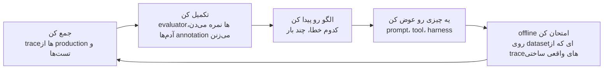
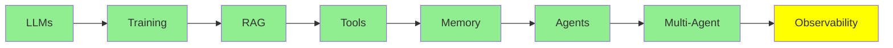

# Observability

توی نرم‌افزار معمولی، اگه بخوای بفهمی سیستم چیکار می‌کنه، می‌ری سراغ کد. رفتار سیستم همونیه که توی کد نوشته شده.

توی agent دیگه این‌جوری نیست. کدش فقط می‌گه «مدل رو صدا بزن، هر tool‌ی رو که خواست اجرا کن، و همین رو باز از اول تکرار کن». از روی این کد نمی‌شه فهمید توی یه اجرای مشخص واقعاً چی گذشته، مثلاً:

- agent کدوم tool‌ها رو انتخاب کرده
- به چه ترتیبی صداشون زده
- هر کدوم چی برگردونده
- از کجا کار خراب شده

هیچ‌کدوم از این‌ها توی کد نیست. فقط توی ردی پیدا می‌شن که همون اجرا از خودش به جا گذاشته.

به این رد می‌گن **trace**، و این درس درباره‌ی اینه که trace رو چطور نگه داری و چطور به کارش ببری.

  
*trace واقعیِ یه اجرای agent که توی Langfuse بازش کردیم. سمت چپ درخت اجراست، یعنی همه‌ی step‌ها و model call‌ها و tool call‌ها، و جلوی هر کدوم نوشته چقدر طول کشیده و چند تا token رفته و چند تا برگشته. کل اجرا 4 دقیقه و 49 ثانیه طول کشیده و 3 دقیقه و 20 ثانیه‌ش فقط مال step اول بوده، همون‌جا که یه agent دوم داشته برای خودش توی وب جست‌وجو می‌کرده. از جوابی که سمت راست می‌بینی، هیچ‌کدوم از این‌ها معلوم نیست.*

## یه trace چی توش داره

trace یعنی کل درخت یه request، از اول تا آخر. توش این‌ها هست:

- هر model call، با ورودی و خروجی‌ش
- هر tool call، با آرگومان‌ها و نتیجه‌ش
- هر subagent

برای هر کدوم هم ثبت می‌کنه چند تا token خرج شده، چقدر هزینه داشته و چقدر طول کشیده.

درختی بودنش خیلی مهمه، چون خطاهای agent معمولاً داخل یه مرحله نیستن، لابه‌لای مرحله‌ها پیش میان. مثلاً مدل tool درست رو خواسته، ولی آرگومانش یه کم غلط بوده. یا یه tool لیست خالی برگردونده و agent همون لیست خالی رو جواب حساب کرده. یا agent چهار بار پشت سر هم رفته سراغ همون فایل. یا به سقف context خورده و دستوری رو که لازم داشت، بی‌سروصدا از دست داده. توی خروجی نهایی هیچ‌کدوم از این‌ها پیدا نیست، چون خروجی معمولاً یه پاراگرافه که با اطمینان کامل نوشته شده. ولی توی trace همه‌ش جلوی چشمته.

برای همینه که LangChain توی [The Agent Improvement Loop Starts with a Trace](https://www.langchain.com/blog/traces-start-agent-improvement-loop) صاف و پوست‌کنده گفته که توی نرم‌افزار سنتی، مستندِ رفتار سیستم خود کده، ولی توی سیستم agentic، این مستند trace‌هان.

## ابزارهای Observability

- **LangSmith** ابزار خود LangChain‌ه. اگه همین الان با یکی از ابزارهای درس [Agent Framework‌ها](../4_ecosystem/agent_frameworks_fa.md) کار می‌کنی، این یکی از همه بهتر با کارت جفت می‌شه، و tracing و dataset و evaluator و annotation رو یه‌جا بهت می‌ده.
- **[Langfuse](https://github.com/langfuse/langfuse)** گزینه‌ی متن‌بازه. وقتی trace‌ها نباید از زیرساخت خودت بیرون برن، معمولاً همین رو انتخاب می‌کنن. هم OpenTelemetry رو پشتیبانی می‌کنه هم SDK‌های framework‌ها رو، برای همین تقریباً از هر چیزی می‌تونه trace جمع کنه. کنار trace‌ها، eval و مدیریت prompt و dataset هم داره.
- **[Latitude](https://github.com/latitude-dev/latitude-llm)** هم متن‌بازه، ولی تمرکزش مشخصاً روی monitoring توی production‌ه.

موقع انتخاب، ملاک اصلی لیست feature‌ها نیست. اول ببین می‌تونه از چیزهایی که همین الان داری اجرا می‌کنی trace جمع کنه یا نه. بعد ببین می‌تونه trace‌ها رو همون‌جایی نگه داره که data policy‌ت می‌گه یا نه. prompt‌ها و نتیجه‌ی tool‌ها پر از متن مشتری‌هاست، پس این انتخاب در واقع ادامه‌ی همون بحث data policy‌ه که توی [Inference Provider‌ها](../4_ecosystem/inference_providers_fa.md) پیش میاد.

## حلقه‌ی بهبود

جمع کردن trace به‌خودی‌خود هدف نیست. هدف چرخه‌ایه که trace‌ها راه می‌ندازن، و حرف اصلی مقاله‌ی LangChain هم سر همین چرخه‌ست:

*همه‌ی مرحله‌ها دور یه چیز می‌چرخن که همون trace‌ه، و فقط به همین خاطره که این حلقه اصلاً کامل می‌شه. evaluator‌ها به trace نمره می‌دن، annotation‌ها روی trace می‌شینن، dataset آفلاین از trace‌ها ساخته می‌شه و regression test هم همون‌ها رو دوباره اجرا می‌کنه. trace رو که برداری، دست هیچ مرحله‌ای به بقیه نمی‌رسه.*

هر دوری هم که این حلقه می‌چرخه، از دور قبل جلوتری. هر دور داده‌ی بهتری درمیاد، داده‌ی بهتر دقیق‌تر نشون می‌ده خرابی‌ها کجان، و برای همین تغییر بعدی‌ت از قبلی دقیق‌تر به هدف می‌خوره. این همون verification loop‌ه که درس [Loop Engineering](../2_intermediate/loop_engineering_fa.md) سراغش می‌ره، فقط این‌جا هر دورش خیلی بیشتر طول می‌کشه و یه آدم هم وسط کار هست.

## agent‌هایی که agent‌های دیگه رو زیر نظر دارن

کم‌کم تیم‌ها توی جمع کردن trace خبره شدن و این بار از اون طرف قضیه به مشکل خوردن. توی مقاله‌ی [From Traces to Insights](https://www.langchain.com/blog/from-traces-to-insights-understanding-agent-behavior-at-scale) یه developer از وضع خودش می‌گه: هر روز بیشتر از 100,000 trace ثبت می‌کنه، و با این همه trace چیکار می‌کنه؟ هیچی، به معنای واقعی هیچی.

هیچ‌کس صد هزار تا از هیچ چیزی رو نمی‌خونه، و روش‌های معمول اندازه‌گیری هم این‌جا گرهی باز نمی‌کنن. product analytics و online evaluator‌ها هر دو فقط جواب سوال‌هایی رو می‌دن که خودت از قبل به فکرت رسیده بپرسی. بهت می‌گن روی همون چکی که نوشتی چند درصد خطا داری، ولی از failure mode‌ای که هیچ‌وقت به ذهنت نرسیده خبری بهت نمی‌دن، در حالی که دقیقاً همون خطاست که کاربرهات رو فراری می‌ده.

برای همین تازه‌ترین ابزار این درس **یه agent‌ه که trace‌ها رو می‌خونه**. ابزار Insights Agent توی LangSmith هزاران مکالمه رو خوشه‌بندی می‌کنه و از همین راه، الگوهای استفاده و failure mode‌ها رو خودش پیدا می‌کنه، بی‌اینکه کسی از قبل بهش گفته باشه دنبال چی بگرده. یعنی روی کوهی از داده که از توان یه آدم خارجه تحلیل اکتشافی می‌کنه، و این تحلیل رو هم همون تکنولوژی‌ای انجام می‌ده که این کوه رو درست کرده.

کل این مجموعه هم کم‌کم داره به همین سمت می‌ره. درس [Loop Engineering](../2_intermediate/loop_engineering_fa.md) آخرش به agent‌ای می‌رسه که loop‌ای رو طراحی می‌کنه که بقیه‌ی agent‌ها توش کار می‌کنن، و کار agent این درس هم اینه که خروجی agent‌های دیگه رو وارسی کنه. این رو هم در نظر داشته باش که اصلاً چرا این همه دردسر لازمه. دلیلش همون واقعیتیه که [Harness Engineering](../2_intermediate/harness_engineering_fa.md) کارش رو ازش شروع می‌کنه: این سیستم‌ها non-deterministic‌ان، یعنی یه ورودی رو دو بار بدی ممکنه دو تا جواب متفاوت بگیری، و ورودی‌شون هم زبان طبیعیه، اون هم بی هیچ حد و مرزی. برای همین سر و کله‌ی بیشتر خطاهاشون توی production پیدا می‌شه، نه توی تست‌هات.

## کجای این مجموعه هستیم

## خلاصه

توی نرم‌افزار معمولی، از روی کد می‌فهمی سیستم چیکار می‌کنه. توی agent نه، چون کد فقط loop رو توصیف می‌کنه و اینکه توی یه اجرای مشخص چی گذشته، فقط توی trace پیدا می‌شه. trace همه‌ی model call‌ها، tool call‌ها و subagent‌ها رو نگه می‌داره و برای هر کدوم token و هزینه و مدت زمان رو هم ثبت می‌کنه.

خطاهای agent رو توی trace می‌شه دید، چون لابه‌لای مرحله‌ها پیش میان. یه چیزهایی از این دست:

- آرگومانی که یه کم غلطه
- نتیجه‌ی خالی‌ای که جواب حساب شده
- چهار بار سر زدن به همون فایل
- دستوری که سر رسیدن به سقف context بی‌سروصدا گم شده

توی خروجی نهایی هیچ‌کدوم از این‌ها پیدا نیست.

LangSmith ابزار خود LangChain‌ه، برای همین اگه از قبل با LangChain کار می‌کنی، راحت‌تر از بقیه با کارت جفت می‌شه. Langfuse گزینه‌ی متن‌بازه، برای وقتی که trace‌ها باید روی زیرساخت خودت بمونن. Latitude هم یه گزینه‌ی متن‌باز دیگه‌ست که تمرکزش روی monitoring توی production‌ه.

جمع کردن trace هدف نیست، هدف این حلقه‌ست:

- trace‌ها رو جمع کن.
- با evaluator‌ها و annotation‌ها تکمیل‌شون کن.
- الگو رو پیدا کن.
- یه چیزی رو عوض کن.
- تغییر رو offline روی یه dataset که از trace‌های واقعی ساختی امتحان کن.
- دوباره از اول شروع کن، این بار با داده‌ای بهتر از دفعه‌ی قبل.

وقتی هم کار به صد هزار trace در روز می‌رسه، دیگه کسی نمی‌خونه‌شون. analytics و evaluator‌ها فقط جواب سوال‌هایی رو می‌دن که خودت از قبل به فکرشون بودی. برای همین تازه‌ترین راه‌حل یه agent‌ه که trace‌ها رو خوشه‌بندی می‌کنه و failure mode‌هایی رو پیدا می‌کنه که حتی به ذهنت هم نرسیده بود.

**بررسی سریع**: agent‌ت با اطمینان کامل یه جواب غلط می‌ده. trace چی رو بهت نشون می‌ده که از خروجی درنمیاد؟

## منابع

- [The Agent Improvement Loop Starts with a Trace](https://www.langchain.com/blog/traces-start-agent-improvement-loop): چرا حالا رفتار سیستم رو trace‌ها مستند می‌کنن، و حلقه‌ای که با trace راه می‌افته
- [From Traces to Insights: Understanding Agent Behavior at Scale](https://www.langchain.com/blog/from-traces-to-insights-understanding-agent-behavior-at-scale): دردسرِ صد هزار trace در روز، و خوشه‌بندی به‌عنوان راه خلاص شدن ازش
- [AI agent evaluation](https://langfuse.com/resources/engineering/ai-agent-evaluation): اینکه چطور یه agent رو از روی مسیری که رفته، tool call‌هاش، کاری که تموم کرده و کل مکالمه بسنجی، هم قبل از انتشار هم روی ترافیک واقعی
- [Langfuse](https://github.com/langfuse/langfuse): متن‌باز، سازگار با OpenTelemetry، با eval و مدیریت prompt کنار trace‌ها
- [Agent Graphs](https://langfuse.com/docs/observability/features/agent-graphs): Langfuse هر اجرا رو به شکل یه گراف از قدم‌هاش می‌کشه، تا شکل کلی agent رو با یه نگاه ببینی
- [Latitude](https://github.com/latitude-dev/latitude-llm): monitoring متن‌باز، مخصوص production
