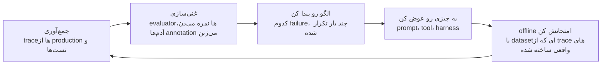
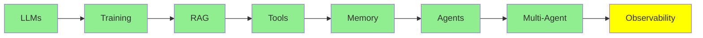

# Observability

توی نرم‌افزار معمولی، اگه بخوای بدونی سیستم دقیقاً چیکار می‌کنه، کد رو می‌خونی. کد همون رفتار سیستمه؛ هر کاری که سیستم انجام بده، از روی همین کد قابل فهمه.

ولی توی agent این دیگه درست نیست. کد می‌گه «مدل رو صدا بزن، بعد هر tool رو که مدل خواست اجرا کن، و همه‌ی این کارها رو دوباره تکرار کن.» اما کد بهت نمی‌گه توی یه اجرای مشخص واقعاً چی شد. مثلاً این موارد رو نمی‌گه:

- کدوم tool‌ها رو agent انتخاب کرده
- به چه ترتیبی اون‌ها رو صدا زده
- هر کدوم چی برگردوندن
- کجا اشتباه کرده

هیچ‌کدوم از این‌ها توی کد نیست، چون فقط توی ثبتی که از همون اجرا مونده پیدا می‌شن. به همین ثبت می‌گن **trace**. این درس درباره‌ی اینه که چه‌جوری trace رو نگه داری و چه‌جوری ازش استفاده کنی.

  
*این trace واقعیِ یه اجرای agent‌ه که توی Langfuse باز شده. سمت چپ درخت کل اجرا رو می‌بینی: هر step، هر model call و هر tool call، و اینکه هر کدوم چقدر طول کشیده و چند تا token رفته و برگشته. کل اجرا 4 دقیقه و 49 ثانیه طول کشیده و 3 دقیقه و 20 ثانیه‌ش مال step اول بوده، جایی که یه agent دیگه داشته جست‌وجوهای خودش رو توی وب انجام می‌داده. جوابی که سمت راست می‌بینی هیچ‌کدوم از این‌ها رو نمی‌گه.*

## توی یه trace چی هست

یه trace کل درخت یه درخواست (request) رو نگه می‌داره. توش این‌ها ثبت می‌شن:

- هر model call، همراه ورودی و خروجی‌اش
- هر tool call، همراه آرگومان‌ها و نتیجه‌اش
- هر subagent

روی هر کدوم از این‌ها، trace تعداد token‌ها، هزینه و مدت زمان رو هم ثبت می‌کنه.

این شکل درختی خیلی مهمه، چون شکست‌های agent معمولاً توی فاصله‌ی بین مراحل رخ می‌دن، نه داخل خود یه مرحله. ممکنه مدل tool درست رو خواسته باشه، ولی آرگومانش یه کم اشتباه باشه. یا یه tool لیست خالی برگردونده باشه و agent اون لیست خالی رو مثل یه جواب قبول کرده باشه. شاید هم agent چهار بار دور همون فایل چرخیده باشه، یا به محدودیت context خورده باشه و بی‌سروصدا یه دستور رو که لازم داشته از دست داده باشه.

خروجی نهایی همه‌ی این‌ها رو پنهون می‌کنه. معمولاً یه پاراگراف محکم و مطمئنه، ولی همه‌ی این جزئیات توی trace دیده می‌شن.

برای همین LangChain توی مقاله‌ی [The Agent Improvement Loop Starts with a Trace](https://www.langchain.com/blog/traces-start-agent-improvement-loop) این رو خیلی صریح گفته. توی نرم‌افزار معمولی، کد رفتار سیستم رو مستند می‌کنه. ولی توی سیستم agentic، این کار رو trace‌ها می‌کنن.

## ابزارهای Observability

- **LangSmith** ابزار خود LangChain‌ه. اگه از یکی از [Agent Framework‌ها](../4_ecosystem/agent_frameworks_fa.md) استفاده می‌کنی، این گزینه از همه راحت‌تر توش جا می‌افته. tracing، dataset، evaluator و annotation رو همه با هم، توی یه جا بهت می‌ده.
- **[Langfuse](https://github.com/langfuse/langfuse)** گزینه‌ی متن‌بازه، و معمولاً وقتی trace‌ها باید حتماً روی زیرساخت خودت بمونن، سراغش می‌رن. هم OpenTelemetry رو پشتیبانی می‌کنه و هم SDK‌های framework‌ها رو، پس تقریباً می‌تونه trace‌ها رو از هر چیزی جمع کنه. کنار trace‌ها، eval‌ها، مدیریت prompt و dataset هم داره.
- **[Latitude](https://github.com/latitude-dev/latitude-llm)** هم متن‌بازه، و واضح‌تر از بقیه روی monitoring توی production تمرکز داره.

قبل از انتخاب، مهم‌ترین چیز لیست feature‌ها نیست. اول باید ببینی آیا می‌تونه trace‌ها رو از چیزهایی که الان اجرا می‌کنی جمع کنه. بعدش باید ببینی آیا می‌تونه trace‌ها رو همون‌جایی نگه داره که data policy‌ت می‌گه. دلیلش هم اینه که prompt‌ها و نتیجه‌ی tool‌ها پر از متن مشتری‌ان. برای همین این انتخاب، با همون بحث data policy‌ای که توی [Inference Provider‌ها](../4_ecosystem/inference_providers_fa.md) مطرح شد، یه ربط نزدیک داره.

## حلقه‌ی بهبود

جمع کردن trace‌ها خودش هدف نیست، هدف اصلی چرخه‌ایه که trace‌ها راهش می‌ندازن. بحث اصلی مقاله‌ی LangChain هم همین چرخه‌ست:

*همه‌ی مرحله‌ها به یه چیز مشترک وصل‌ان، و اون چیز خود trace‌ه. برای همین اصلاً حلقه می‌تونه بسته بشه. evaluator‌ها trace‌ها رو نمره می‌دن، annotation‌ها به trace‌ها وصل می‌شن، dataset آفلاین از trace‌ها ساخته می‌شه، و regression test هم همون trace‌ها رو دوباره اجرا می‌کنه. اگه trace رو از وسط برداریم، هیچ‌کدوم از این مرحله‌ها به بقیه نمی‌رسن.*

و دستاوردها روی هم جمع می‌شن. هر دور داده‌ی بهتری می‌سازه، و داده‌ی بهتر دقیق‌تر نشون می‌ده failure‌ها کجان. برای همین تغییر بعدی هم دقیق‌تر به هدف می‌خوره. این همون verification loop‌ه که [Loop Engineering](../2_intermediate/loop_engineering_fa.md) درباره‌اش حرف می‌زنه. فقط این‌جا بازه‌ی زمانی بلندتره، و یه آدم هم توی حلقه هست.

## استفاده از agent‌ها برای رصد agent‌های دیگه

بعد از اون، تیم‌ها توی جمع کردن trace خیلی خوب شدن، ولی از اون طرف یه مشکل دیگه پیدا شد. توی مقاله‌ی [From Traces to Insights](https://www.langchain.com/blog/from-traces-to-insights-understanding-agent-behavior-at-scale)، یه توسعه‌دهنده وضعیت خودش رو تعریف می‌کنه. اون هر روز بیشتر از 100,000 trace ثبت می‌کنه. حالا با این trace‌ها چیکار می‌کنه؟ واقعاً هیچی.

هیچ آدمی نمی‌تونه صد هزار تا از یه چیز رو بخونه. روش‌های معمول اندازه‌گیری هم معمولاً نجاتت نمی‌دن. product analytics و online evaluator‌ها هر دو فقط به سوال‌هایی جواب می‌دن که قبلاً به ذهنت رسیده. اون‌ها نرخ خطا رو روی کنترلی که خودت نوشتی نشون می‌دن، ولی درباره‌ی یه failure mode که هیچ‌وقت تصورش رو هم نکردی، چیزی نمی‌گن. و همین failure mode‌ه که کاربرهات رو از دست می‌ده.

پس جدیدترین ابزار این درس، یه **agent‌ه که خودش trace‌ها رو می‌خونه**. Insights Agent توی LangSmith هزارها مکالمه رو خوشه‌بندی (clustering) می‌کنه و به این ترتیب، الگوهای استفاده و failure mode‌ها رو خودش پیدا می‌کنه. لازم نیست از قبل بهش بگی دنبال چی بگرده. این agent روی انبوهی از داده تحلیل اکتشافی انجام می‌ده که برای یه آدم خیلی زیاده. و همون فناوری‌ای که این انبوه رو ساخته، حالا خودش تحلیلش هم می‌کنه.

مسیر این مجموعه هم داره به همین‌جا می‌ره. [Loop Engineering](../2_intermediate/loop_engineering_fa.md) به یه agent می‌رسه که خودش loop رو طراحی می‌کنه، ولی agent‌ای که توی همین درس معرفی شد، فقط خروجی‌ها رو چک می‌کنه. یه نکته‌ی دیگه هم هست که ارزش داره بدونی: چرا اصلاً همه‌ی این کارها لازمه؟ دلیلش همون واقعیتیه که [Harness Engineering](../2_intermediate/harness_engineering_fa.md) ازش شروع می‌کنه. این سیستم‌ها non-deterministic‌ان، یعنی با ورودی یکسان همیشه یه جواب واحد نمی‌دن. ورودی‌شون هم زبان طبیعیه، و هیچ حد و مرزی براش نیست. برای همین بیشتر خطاهاشون توی production پیدا می‌شن، نه توی تست‌هاتون.

## کجای این مجموعه هستیم

## خلاصه

توی نرم‌افزار معمولی، کد بهت می‌گه سیستم چیکار می‌کنه. ولی توی agent این‌جوری نیست، چون کد فقط loop رو توصیف می‌کنه. اون چیزی که توی یه اجرای مشخص اتفاق افتاده، فقط توی trace هست. trace هر model call، هر tool call و هر subagent رو نگه می‌داره، همراه token‌ها، هزینه و مدت زمان هر کدوم.

trace جاییه که می‌شه شکست‌های agent رو دید، چون اون‌ها توی فاصله‌ی بین مراحل اتفاق می‌افتن. این شکست‌ها معمولاً این شکلی‌ان:

- یه آرگومان کمی غلط
- یه نتیجه‌ی خالی که agent اون رو جواب گرفته
- چهار بار دور زدن همون فایل
- یه دستور که بی‌سروصدا توی محدودیت context از دست رفته

خروجی نهایی همه‌ی این‌ها رو پنهون می‌کنه.

از بین این‌ها، LangSmith گزینه‌ی یکپارچه‌ست، و Langfuse همون گزینه‌ی متن‌بازه که برای وقتی خوبه که trace‌ها باید روی زیرساخت خودت بمونن. Latitude هم یه گزینه‌ی متن‌باز دیگه‌ست که بیشتر روی monitoring توی production تمرکز داره.

جمع کردن trace‌ها هدف نیست. هدف اصلی خود حلقه‌ست:

- trace‌ها رو جمع کن.
- با evaluator‌ها و annotation‌ها غنی‌شون کن.
- الگو رو پیدا کن.
- یه چیزی رو عوض کن.
- تغییر رو offline امتحان کن، با یه dataset که از trace‌های واقعی ساخته شده.
- دوباره از اول شروع کن، ولی این بار با داده‌ی بهتر از دفعه‌ی قبل.

وقتی روزی صد هزار trace داشته باشی، دیگه کسی اون‌ها رو نمی‌خونه. Analytics و evaluator‌ها فقط به سوال‌هایی جواب می‌دن که قبلاً فکرشون رو کردی. پس جدیدترین جواب، یه agent‌ه که trace‌ها رو خوشه‌بندی می‌کنه. این agent، failure mode‌هایی رو پیدا می‌کنه که هیچ‌وقت تصورشون هم نکردی.

**بررسی سریع**: فرض کن agent یه جواب مطمئن ولی اشتباه می‌ده. trace چه چیزی بهت نشون می‌ده که خروجی نمی‌تونه نشون بده؟

## منابع

- [The Agent Improvement Loop Starts with a Trace](https://www.langchain.com/blog/traces-start-agent-improvement-loop): چرا حالا trace‌ها رفتار رو مستند می‌کنن، و حلقه‌ای که راه می‌ندازن
- [From Traces to Insights: Understanding Agent Behavior at Scale](https://www.langchain.com/blog/from-traces-to-insights-understanding-agent-behavior-at-scale): مشکل صد هزار trace در روز، و خوشه‌بندی به‌عنوان راه بیرون اومدن از اون
- [Langfuse](https://github.com/langfuse/langfuse): متن‌باز، سازگار با OpenTelemetry، با eval‌ها و مدیریت prompt کنار trace‌ها
- [Latitude](https://github.com/latitude-dev/latitude-llm): monitoring متن‌باز که برای production ساخته شده
