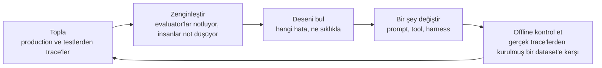
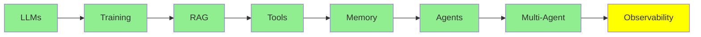

# Observability

Sıradan yazılımda, sistemin ne yaptığını bilmek istediğinde kodu okuyorsun. Kod, davranışın kendisi.

Bir agent'ta bu doğru olmaktan çıkıyor. Kod "modeli çağır, sonra istediği tool'u çalıştır, sonra baştan git" diyor. Kod, herhangi bir çalışmada gerçekte ne olduğunu sana söylemiyor:

- agent'ın hangi tool'ları seçtiği
- onları hangi sırada çağırdığı
- ne geri geldiği
- nerede yanlış gittiği

Bunların hiçbiri kodda yok. Sadece o çalışmanın kaydında var.

O kayıt bir **trace**. Bu modül onu tutmak ve kullanmakla ilgili.

## Bir Trace Neyi Tutuyor

Bir trace, tek bir isteğin bütün ağacı. İçinde şunlar var:

- her model çağrısı, input'u ve output'uyla
- her tool çağrısı, argümanları ve sonucuyla
- her subagent

Trace, bunların her biri için token'ları, maliyeti ve süreyi de kaydediyor.

Bu ağaç şekli önemli. Agent hataları tek bir adımın içinde değil, adımlar arasındaki boşluklarda ortaya çıkıyor. Örneğin model doğru tool'u istedi, ama biraz yanlış bir argümanla. Bir tool boş bir liste döndürdü ve agent bunu cevap saydı. Agent aynı dosyanın üzerinde dört kez döndü. Context limitine çarptı ve ihtiyacı olan talimatı sessizce kaybetti. Bunların hiçbiri son çıktıda görünmüyor. Son çıktı genelde kendinden emin bir paragraf. Hepsi bir trace'te görünüyor.

LangChain'in [The Agent Improvement Loop Starts with a Trace](https://www.langchain.com/blog/traces-start-agent-improvement-loop) yazısında bunu bu kadar açık söylemesinin sebebi de bu. Geleneksel yazılımda davranışı kod dokümante ediyor. Agentic bir sistemde ise trace'ler dokümante ediyor.

## Observability Tool'ları

- **LangSmith** LangChain'in kendi tool'u. [Agent Framework'leri](../4_ecosystem/agent_frameworks_tr.md)'nden bir şey kullanıyorsan, en entegre seçenek o. Tracing, dataset'ler, evaluator'lar ve annotation tek bir yerde.
- **[Langfuse](https://github.com/langfuse/langfuse)** açık kaynak olanı. Trace'lerin kendi altyapında kalması gerektiğinde alışılmış seçenek bu. Framework SDK'larının yanında OpenTelemetry'yi de destekliyor, yani neredeyse her şeyden trace toplayabiliyor. Trace'lerin yanında eval'ler, prompt yönetimi ve dataset'ler de sunuyor.
- **[Latitude](https://github.com/latitude-dev/latitude-llm)** de açık kaynak. Doğrudan production'da izlemeye odaklanıyor.

Seçmeden önce kontrol edilecek şey feature listesi değil. İlk kontrol, zaten çalıştırdığın şeylerden trace toplayıp toplayamadığı. İkinci kontrol, trace'leri veri politikanın istediği yerde tutup tutamadığı. Prompt'lar ve tool sonuçları müşteri metniyle dolu. Bu yüzden bu seçim, [Inference Provider'lar](../4_ecosystem/inference_providers_tr.md)'daki veri politikasıyla aynı konunun parçası.

## Loop

Trace toplamak amaç değil. Amaç, trace'lerin başlattığı döngü. O LangChain yazısının ana argümanı da bu:

*Her aşama aynı nesneye bağlı: trace'e. Loop'un kapanabilmesinin sebebi de bu. Evaluator'lar trace'leri notluyor. Notlar (annotation) trace'lere ekleniyor. Offline dataset trace'lerden yapılıyor. Regression test'i onları yeniden çalıştırıyor. Trace'i çıkarırsan, bu adımların hiçbiri birbirine ulaşamaz.*

Ve kazanımlar birikiyor. Her geçiş daha iyi veri üretiyor. Daha iyi veri, hataların yerini daha kesin gösteriyor. Böylece sonraki değişiklik bir öncekinden daha iyi hedefleniyor. Bu, [Loop Engineering](../2_intermediate/loop_engineering_tr.md)'deki verification loop'un aynısı. Burada daha uzun bir zaman ölçeğinde ve içinde bir insanla çalışıyor.

## Agent'ları Başka Agent'ları Gözlemlemek için Kullanmak

Sonra ekipler trace toplamakta iyileşti ve bu sefer öbür uçta bir sorunla karşılaştı. [From Traces to Insights](https://www.langchain.com/blog/from-traces-to-insights-understanding-agent-behavior-at-scale)'te bir geliştirici kendi durumunu anlatıyor. Her gün 100.000'den fazla trace kaydediyorlar. Peki o trace'lerle ne yapıyorlar? Kelimenin tam anlamıyla hiçbir şey.

Kimse yüz bin şeyi okumuyor. Alışılmış ölçme yöntemleri de seni kurtarmıyor. Ürün analitiği ve online evaluator'lar, ikisi de sormayı zaten düşündüğün soruları cevaplıyor. Yazdığın kontroldeki hata oranını sana söylerler. Hiç hayal etmediğin bir hata modunu söyleyemezler. Oysa sana kullanıcı kaybettiren hata modu o.

Yani bu modüldeki en yeni tool, **trace'leri okuyan bir agent**. LangSmith'in Insights Agent'ı binlerce konuşmayı kümeliyor. Böylece kullanım desenlerini ve hata modlarını kendi başına buluyor. Kimsenin önceden neye bakılacağını söylemesi gerekmiyor. Bir insan için fazla büyük bir yığın üzerinde keşifsel analiz yapıyor. Ve bu analizi, yığını üreten teknolojinin kendisi yapıyor.

Bu serinin gittiği yer de burası. [Loop Engineering](../2_intermediate/loop_engineering_tr.md) loop'u tasarlayan bir agent'a varıyor. Bu modüldeki agent ise çıktıyı denetliyor. Bunların neden gerekli olduğuna da dikkat et. Sebep, [Harness Engineering](../2_intermediate/harness_engineering_tr.md)'in başladığı gerçekle aynı. Bu sistemler non-deterministic. Sınırsız doğal dili input olarak alıyorlar. Bu yüzden hatalarının çoğu testlerinde değil, production'da ortaya çıkıyor.

## Bu serinin neresindeyiz

## Özet

Sıradan yazılımda sistemin ne yaptığını sana kod söylüyor. Bir agent'ta söylemiyor, çünkü kod sadece loop'u anlatıyor. Belirli bir çalışmada ne olduğu sadece trace'te var. Trace her model çağrısını, her tool çağrısını ve her subagent'ı tutuyor; her birinde token, maliyet ve süreyle.

Agent hatalarını gördüğün yer trace, çünkü bu hatalar adımlar arasındaki boşluklarda ortaya çıkıyor. Şöyle görünüyorlar:

- biraz yanlış bir argüman
- cevap sayılan boş bir sonuç
- aynı dosyada dört geçiş
- context limitinde sessizce kaybolan bir talimat

Son çıktı bunların hepsini saklıyor.

LangSmith entegre seçenek. Langfuse açık kaynak olanı; trace'lerin kendi altyapında kalması gerektiğinde kullanılıyor. Latitude de başka bir açık kaynak seçenek ve production izlemeye odaklanıyor.

Trace toplamak amaç değil. Amaç loop:

- Trace'leri topla.
- Onları evaluator'lar ve notlarla zenginleştir.
- Deseni bul.
- Bir şey değiştir.
- Değişikliği gerçek trace'lerden yapılmış bir dataset'e karşı offline kontrol et.
- Geçen seferden daha iyi veriyle yeniden başla.

Ve günde yüz bin trace olduğunda kimse onları okumuyor. Analitik ve evaluator'lar sadece zaten düşündüğün soruları cevaplıyor. Bu yüzden en yeni cevap, trace'leri kümeleyen bir agent. Bu agent, hiç hayal etmediğin hata modlarını buluyor.

**Hızlı Kontrol**: agent'ın kendinden emin, yanlış bir cevap veriyor. Bir trace sana çıktının gösteremeyeceği neyi gösterirdi?

## Kaynaklar

- [The Agent Improvement Loop Starts with a Trace](https://www.langchain.com/blog/traces-start-agent-improvement-loop): davranışı artık neden trace'lerin dokümante ettiği ve başlattıkları loop
- [From Traces to Insights: Understanding Agent Behavior at Scale](https://www.langchain.com/blog/from-traces-to-insights-understanding-agent-behavior-at-scale): yüz bin trace problemi ve çıkış yolu olarak kümeleme
- [Langfuse](https://github.com/langfuse/langfuse): açık kaynak, OpenTelemetry uyumlu, trace'lerin yanında eval ve prompt yönetimiyle
- [Latitude](https://github.com/latitude-dev/latitude-llm): açık kaynak izleme, production'a yönelmiş
