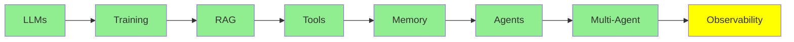

# Observability

Sıradan bir yazılımda sistemin ne yaptığını öğrenmek istiyorsan kodu okursun, çünkü kod sistemin davranışının ta kendisidir.

Agent'larda ise bu geçerli olmaktan çıkar, çünkü kod yalnızca "modeli çağır, sonra modelin istediği tool'u çalıştır, sonra her şeyi baştan yap" der. Ama bu kod, belirli bir çalıştırmada gerçekte neler olduğunu söylemez:

- agent'ın hangi tool'ları seçtiğini
- bunları hangi sırayla çağırdığını
- tool'lardan ne döndüğünü
- nerede yanlış gittiğini

Bunların hiçbiri kodda yer almaz; bu bilgi yalnızca o çalıştırmanın kaydında bulunur.

Bu kayda **trace** denir ve bu modül, o kaydın nasıl tutulacağını ve nasıl kullanılacağını anlatıyor.

## Bir Trace'te Neler Var

Bir trace, tek bir isteğin tüm ağacıdır ve içinde şunlar yer alır:

- her model çağrısı, girdisi ve çıktısıyla birlikte
- her tool çağrısı, argümanları ve sonucuyla birlikte
- her subagent

Trace, bunların her birinde token sayısını, maliyeti ve süreyi de kaydeder.

Bu ağaç yapısı önemlidir, çünkü agent'ların hataları tek tek adımların içinde değil, adımlar arasındaki boşluklarda oluşur. Örneğin model doğru tool'u istemiş, ama argümanını biraz yanlış vermiş olabilir. Bir tool boş bir liste döndürmüş ve agent bu boş listeyi cevap gibi kabul etmiş olabilir. Agent aynı dosya üzerinde dört kez dönüp durmuş olabilir. Ya da context limit'ine dayanıp ihtiyaç duyduğu talimatı sessizce düşürmüş olabilir. Bunların hiçbiri son çıktıda görünmez. Son çıktı çoğu zaman kendinden emin bir paragraftan ibarettir; oysa bütün bu olaylar trace'te açıkça görünür.

İşte bu yüzden LangChain, [The Agent Improvement Loop Starts with a Trace](https://www.langchain.com/blog/traces-start-agent-improvement-loop) yazısında bunu bu kadar açık söyler. Geleneksel yazılımda davranışı kod belgelerken, agent tabanlı bir sistemde bu rolü trace'ler üstlenir.

## Observability Araçları

- **LangSmith**, LangChain'in kendi aracıdır. Zaten [Agent Framework'leri](../4_ecosystem/agent_frameworks_tr.md) modülündeki araçlardan birini kullanıyorsan, en iyi entegre seçenek budur. Tracing, dataset, evaluator ve annotation özelliklerini tek bir yerde sunar.
- **[Langfuse](https://github.com/langfuse/langfuse)** açık kaynaklı olandır. Trace'lerin kendi altyapında kalması gerektiğinde genellikle ilk tercih edilen seçenektir. Hem OpenTelemetry'yi hem de framework SDK'larını desteklediği için neredeyse her şeyden trace toplayabilir. Trace'lerin yanında eval'ler, prompt yönetimi ve dataset'ler de sunar.
- **[Latitude](https://github.com/latitude-dev/latitude-llm)** de açık kaynaklıdır ve üretim ortamını izlemeye (monitoring) özellikle odaklanır.

Birini seçmeden önce bakman gereken şey özellik listesi değildir. İlk kontrol, zaten çalıştırdığın sistemlerden trace toplayıp toplayamadığına bakmaktır. İkinci kontrol ise trace'lerin, veri politikanın gerektirdiği yerde kalıp kalamayacağına bakmaktır. Prompt'lar ve tool sonuçları müşteri metinleriyle doludur; bu yüzden bu seçim, [Inference Provider'lar](../4_ecosystem/inference_providers_tr.md) modülünde ele alınan veri politikasıyla aynı tartışmanın parçasıdır.

## İyileştirme Döngüsü

Trace toplamak tek başına amaç değildir; asıl amaç, trace'lerin başlattığı iyileştirme döngüsüdür (improvement loop). Bu döngü, LangChain yazısının ana argümanıdır:

*Her aşama aynı nesneye, yani trace'e bağlıdır; döngünün kapanabilmesinin nedeni de budur. Evaluator'lar trace'leri puanlar ve annotation'lar trace'lere eklenir. Offline dataset trace'lerden oluşur ve regresyon testi bunları yeniden çalıştırır. Trace'i ortadan kaldırırsan, bu adımların hiçbiri birbirine ulaşamaz.*

Üstelik kazançlar birikir: her turda daha iyi veri üretilir ve daha iyi veri, hataların nerede olduğunu daha kesin gösterir. Böylece bir sonraki değişiklik, bir öncekine göre daha isabetli hedeflenir. Bu, [Loop Engineering](../2_intermediate/loop_engineering_tr.md) modülünün anlattığı doğrulama döngüsüdür; burada ise aynı döngü daha uzun bir zaman ölçeğinde ve içinde bir insanla birlikte işler.

## Agent'ları Başka Agent'larla İzlemek

Ekipler trace toplamada iyice ustalaşınca, bu sefer öbür uçta bir sorunla karşılaştılar. [From Traces to Insights](https://www.langchain.com/blog/from-traces-to-insights-understanding-agent-behavior-at-scale) yazısında bir geliştirici kendi durumunu anlatıyor. Her gün 100,000'den fazla trace kaydediyor. Peki bu trace'lerle ne yapıyor? Kelimenin tam anlamıyla hiçbir şey.

Kimse yüz bin şeyi okuyamaz, üstelik alışılmış ölçüm yöntemleri de seni bu noktada kurtarmaz. Ürün analitiği ve online evaluator'lar, ikisi de zaten sormayı düşündüğün soruları yanıtlar. Yazdığın kontroldeki hata oranını söylerler, ama hiç hayal etmediğin bir hata türü hakkında bir şey söyleyemezler. Kullanıcılarına mal olan hata ise tam da bu türdendir.

Bu yüzden modüldeki en yeni araç, **trace'leri okuyan bir agent**. LangSmith'in Insights Agent'ı binlerce konuşmayı kümeler ve kullanım örüntülerini ve hata türlerini kendi başına bulur; önceden neye bakılacağını kimsenin söylemesi gerekmez. Bu, bir insanın altından kalkamayacağı kadar büyük bir yığın üzerinde keşifsel analiz yapmak demektir ve yığını üreten aynı teknoloji bu analizi de yapar.

Serinin gideceği yön de tam olarak burasıdır: [Loop Engineering](../2_intermediate/loop_engineering_tr.md) döngünün kendisini tasarlayan bir agent'a varır, bu modüldeki agent ise çıktıyı kontrol eder. Bunun neden gerekli olduğu, [Harness Engineering](../2_intermediate/harness_engineering_tr.md) modülünün de yola çıktığı olgudan anlaşılır. Bu sistemler deterministik değildir ve girdi olarak sınırı olmayan doğal dil alırlar. Bu yüzden hatalarının çoğu, kendi testlerinde değil production'da ortaya çıkar.

## Bu serinin neresindeyiz

## Özet

Sıradan yazılımda kod, sistemin ne yaptığını söyler. Agent'ta ise bu geçerli değildir, çünkü kod yalnızca döngüyü tarif eder. Belirli bir çalıştırmada ne olduğu yalnızca trace'te bulunur. Trace; her model çağrısını, her tool çağrısını ve her subagent'ı, her birinin token sayısı, maliyeti ve süresiyle birlikte içerir.

Agent hatalarını görebildiğin yer trace'tir, çünkü bu hatalar adımlar arasındaki boşluklarda oluşur ve genellikle şöyle görünür:

- biraz yanlış bir argüman
- cevap gibi kabul edilen boş bir sonuç
- aynı dosya üzerinde dört tur
- context limit'inde sessizce kaybolan bir talimat

Son çıktı ise bunların hepsini gizler.

LangSmith, entegre seçenektir; Langfuse ise açık kaynaklı olup trace'lerin kendi altyapında kalması gerektiğinde kullanılır. Latitude da bir başka açık kaynaklı seçenektir ve odağı üretim ortamındaki izlemeye yöneliktir.

Trace toplamak tek başına amaç değildir; asıl amaç, aşağıdaki döngüdür:

- Trace'leri topla.
- Evaluator'lar ve annotation'larla zenginleştir.
- Örüntüyü bul.
- Bir şeyi değiştir.
- Değişikliği, gerçek trace'lerden oluşturulmuş bir dataset'e karşı offline kontrol et.
- Bir önceki seferden daha iyi veriyle yeniden başla.

Günde yüz bin trace oluşmaya başladığında onları kimse okumaz. Analitik ve evaluator'lar yalnızca daha önce aklına gelmiş soruları yanıtlar. Bu yüzden en yeni yanıt, trace'leri kümeleyen bir agent'tır ve bu agent, hiç hayal etmediğin hata türlerini bulur.

**Hızlı Kontrol**: Agent'ın kendinden emin bir tonla ama yanlış bir cevap verdiğini düşün. Çıktının gösteremediği neyi bir trace sana gösterebilir?

## Kaynaklar

- [The Agent Improvement Loop Starts with a Trace](https://www.langchain.com/blog/traces-start-agent-improvement-loop): trace'lerin artık davranışı neden belgelediğini ve onların başlattığı döngüyü
- [From Traces to Insights: Understanding Agent Behavior at Scale](https://www.langchain.com/blog/from-traces-to-insights-understanding-agent-behavior-at-scale): yüz bin trace sorunu ve bu sorundan çıkış yolu olarak kümelemeyi
- [Langfuse](https://github.com/langfuse/langfuse): açık kaynaklı, OpenTelemetry ile uyumlu; trace'lerin yanında eval'ler ve prompt yönetimi de var
- [Latitude](https://github.com/latitude-dev/latitude-llm): açık kaynaklı, doğrudan üretim ortamı için tasarlanmış bir izleme aracı
