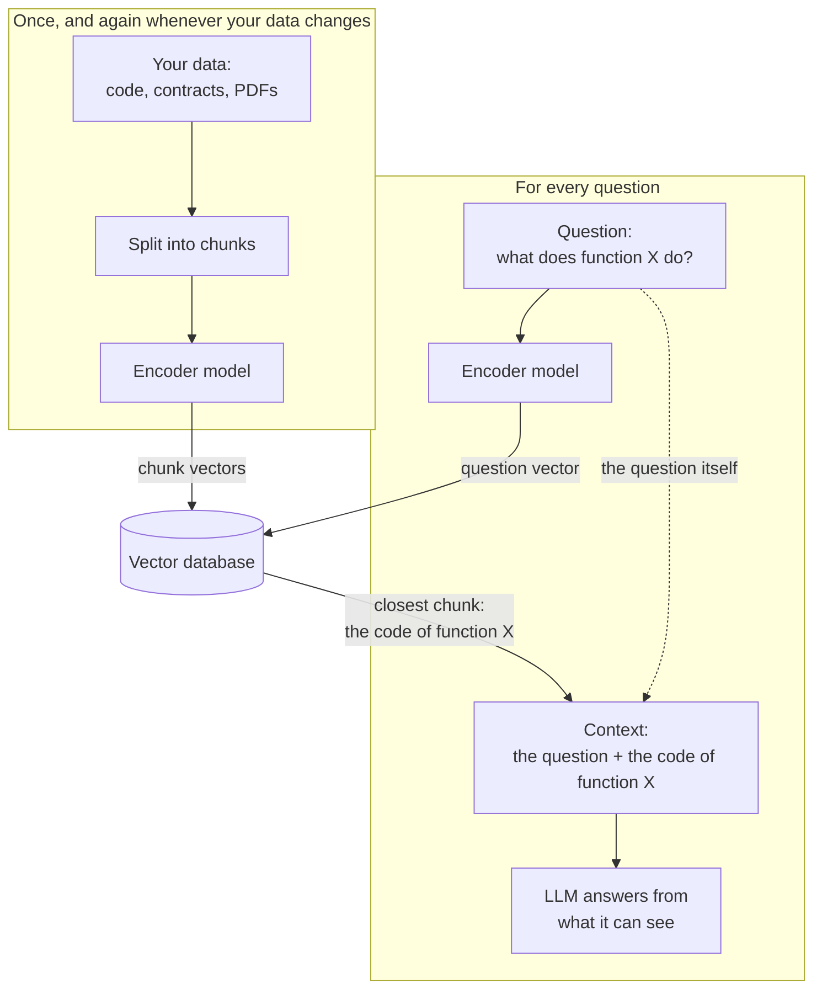
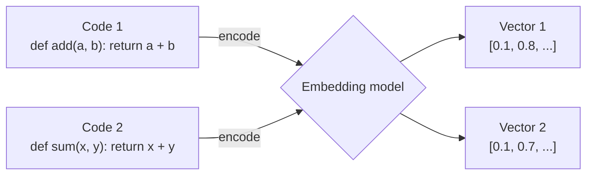
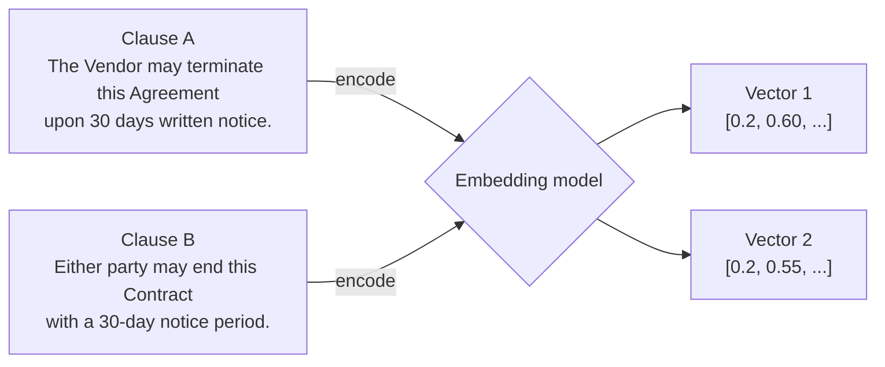
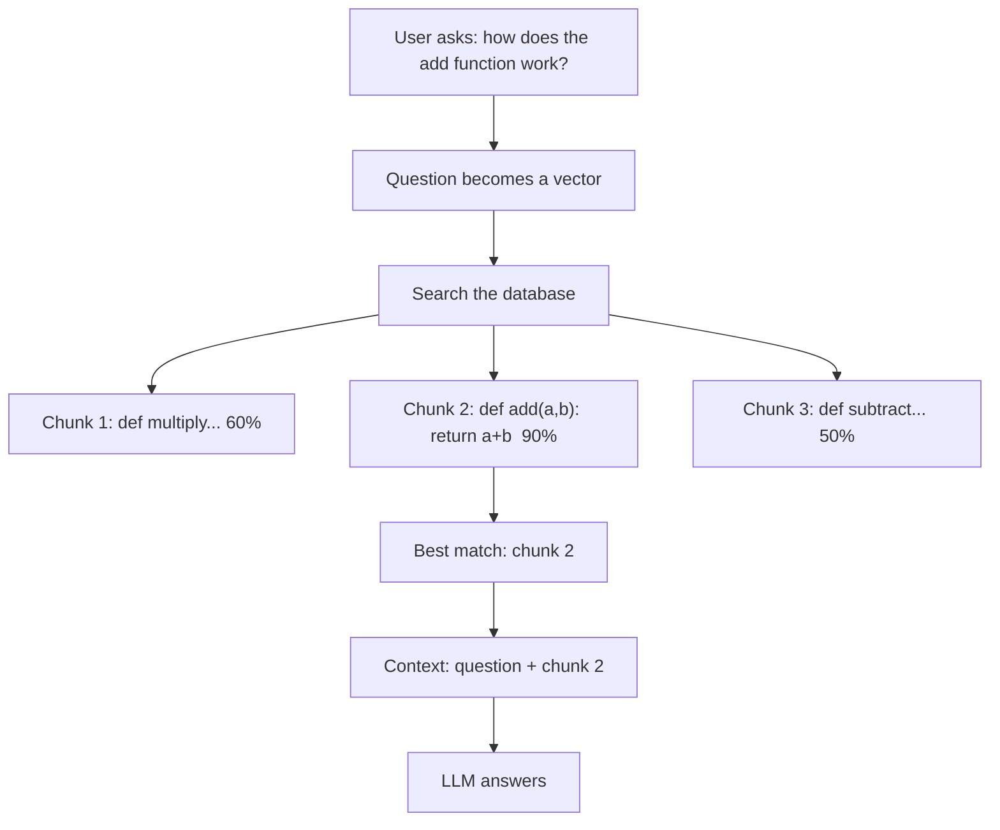
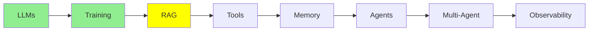

# RAG & Embeddings

[LLM Fundamentals](llms.md) gave you the context window. It is the model's working desk, and
everything on it has to fit. [Training LLMs](training.md) gave you fine-tuning, which changes the
model itself. This module is about the third option. It is also the option you will use most often.

## Why RAG Exists

You have useful data:

- your codebase
- your company's documents
- a folder of contracts
- years of support tickets

There is far more of it than fits in a context window. And the context window is a hard limit.

But this is the important point: **for any one question, you do not need all of it.** Somebody asks
about the termination clause in one vendor contract. That person does not need the other two
hundred contracts. They need one clause.

So that is the whole idea. Keep the data outside the model. When a question comes in, fetch only
the parts that answer it, and put those parts in the context. **Retrieval-Augmented Generation** is
the name for this: retrieve first, then generate.

### The Desktop and the Library

Here is a simple way to think about this.

**The model's weights are a library.** It is enormous, and everything the model learned in
pre-training is in there somewhere. **The context window is your desktop.** It is small, and
whatever you put on it is right in front of you.

Remembering something from a huge library is hard and unreliable. Reading a page that is open on
the desk in front of you is easy and exact.

RAG is choosing which pages to put on the desk.

  
*The basic "naive" RAG flow. The query goes to two places at the same time. One path goes through an embedding model, to search the vector store index. The other path goes straight to the LLM, together with the context that the search returned.*

## What RAG Does



The same trick works for anything made of text, not only code. Say you have a folder of legal
contracts. Somebody asks "what is the termination notice period in the Acme vendor contract?". The
model does not guess from memory. Instead, RAG searches across every contract you have and finds
the clause that answers the question. Then it gives the model only that clause.

This is the mechanism underneath. An encoder model turns text into vector embeddings. You keep
those embeddings in a vector database. Then you turn the question into a vector too, and you find
the closest matches.

## Vector Embeddings

An embedding is a list of numbers that describes a piece of text. Think of it as a fingerprint. A
special model, called an encoder, produces it.

The useful property is this: **similar meaning gives similar numbers.** It works like addresses in
a city, where close addresses mean nearby places. We measure how close two fingerprints are with
**cosine similarity**. A high score means the two are very similar.

The classic picture of this uses four words:

  
*Four words become four vectors, and those vectors become positions in space. "king" lands near "queen", and "man" lands near "woman". Now look at the two arrows. They are parallel, so the step from king to queen is the same move as the step from man to woman. In this way, the meaning of the words has turned into distances and directions in space.*

Look at that parallel for a second. It shows that the numbers are more than a lookup table, which
only gives each word its own fixed entry. The
embedding did more than place similar things together. It also placed the *relationship* between
them in a consistent direction.

Here is one honest simplification. The picture draws three dimensions so that it fits on a page.
Real embeddings have hundreds or thousands of dimensions. That is exactly why we measure closeness
with cosine similarity, instead of looking at it.



Here are two different functions, and their numbers come out close together. That closeness is the
whole point. It is what lets a search find one function when you ask for the other.

The important part is that this catches *meaning*, not matching words:



The two clauses have the same meaning and almost no words in common. The vectors still land next
to each other.

That is why keyword search would miss Clause B, and retrieval finds it.

## Vector Databases

A vector database stores millions of these fingerprints. It keeps each one linked to its original
text, and it searches them fast. You give it a query vector, and it returns the top N closest ones.
Then you pass those to the LLM.

**Free and local:**

- **ChromaDB**: the easiest one to start with.
- **Milvus**: for bigger projects.
- **FAISS**: very fast in-memory search.

**Managed services:**

- **Pinecone**: simple and hosted.
- **Weaviate**: good when your data has a structure that you want to keep.

## The RAG Process

**Setup, done once and then again whenever the data changes:**

1. Load your source data: code files, contracts, policies, PDFs, any text.
2. Break it into small chunks, such as a function, a paragraph or a contract clause.
3. Turn each chunk into an embedding.
4. Store the embeddings in a vector database.

**Answering, done for each question:**

1. Take the user's question.
2. Turn it into an embedding.
3. Search the database for the closest chunks.
4. Get the real text of those chunks.
5. Put that text into the context, together with the question.
6. The LLM answers from what it can now see.



Replace "code chunks" with "contract clauses", and the flow is exactly the same.

## Tools for RAG

You will almost never write the retrieval loop yourself. Pick a level, and let something else do
the rest:

- **[LlamaIndex](https://www.llamaindex.ai/)**: the highest level. Point it at a folder, ask a
  question, and get an answer. It handles chunking, embedding, storing and retrieving.
- **[Haystack](https://haystack.deepset.ai/)**: build the pipeline from ready-made parts. Use it
  when you want to see and change each step.
- **[ChromaDB](https://github.com/chroma-core/chroma)**: a vector database that stores your text
  next to its embeddings. So a search gives you back the original chunk.
- **[FAISS](https://github.com/facebookresearch/faiss)**: the search layer and nothing else. It is
  very fast, and it knows only about numbers.

Here is FAISS. It is the smallest thing worth showing, because it is the raw mechanism that every
option above wraps:

```python
import faiss
import numpy as np

index = faiss.IndexFlatL2(128)                              # 128-dimension vectors
index.add(np.random.random((100, 128)).astype('float32'))   # your 100 chunk embeddings

query = np.random.random((1, 128)).astype('float32')        # the question, embedded
distances, indices = index.search(query, 5)                 # the five nearest chunks
```

That is the search step, and only the search step. FAISS returns positions. So it is your job to
keep the original text somewhere and to look it up by index. The tools above exist to save you from
that bookkeeping. They store the text with the vector, and they give you the chunk itself.

If you prefer to start from a complete RAG system instead of building one yourself, these
open-source projects are ready to use:

- **[RAGFlow](https://github.com/infiniflow/ragflow)** is a full RAG platform with a web interface.
  You run it with Docker. It is good at reading messy documents, including layouts, tables and
  scanned pages. Its answers carry citations back to the source.
- **[LightRAG](https://github.com/HKUDS/LightRAG)** builds a knowledge graph of the people, things
  and relations in your documents. It keeps embeddings beside that graph. So a search can follow
  connections, not only similarity. It is a Python library with a server and a web UI. It is also a
  lighter alternative to Microsoft's GraphRAG.
- **[PageIndex](https://github.com/VectifyAI/PageIndex)** uses no vector database and no chunking.
  It builds a tree of each document, like a table of contents. Then an LLM reasons its way down the
  tree to the right section. Its argument is that a passage that is similar to the question is not
  always the passage that answers it.
- **[RAG-Anything](https://github.com/HKUDS/RAG-Anything)** is built on LightRAG. It handles
  documents that mix text with images, tables and equations. Since 2026, LightRAG itself includes
  this ability too.
- **[DocsGPT](https://github.com/arc53/DocsGPT)** is a self-hosted app. It turns your documents,
  websites and connected apps into assistants, and those assistants answer with cited sources.
- **[MiniRAG](https://github.com/HKUDS/MiniRAG)** is a research project. It makes RAG work with
  small language models, so it can run on a single device.
- **[PixelRAG](https://github.com/StarTrail-org/PixelRAG)** searches screenshots of pages instead of
  the text taken out of them. This way, tables, charts and layout are not lost. It comes from a
  2026 research paper, and it is very new.

## Why Not Just Fine-tune the Model on Your Documents?

You learned about fine-tuning in [Training LLMs](training.md), so this is the obvious question. Why
bother with embeddings and a database at all?

**Because your company's knowledge is alive, and fine-tuning is a snapshot.** Your codebase gets
new commits every day. Contracts get changed, new ones get signed, and policies change. Fine-tuning
takes hours or days, and it costs real money. You cannot run it again every time a file changes.
Fine-tuning a model to hold your company's documents is solving a live problem with a photograph.

**Because fine-tuning is for tasks, not for data.** It is good at teaching a model a *behaviour*:
summarise like this, always answer in this format, classify into these categories. It is bad at
teaching a model *facts*. Your hundred pages land among billions of parameters, and those
parameters are full of everything else the model ever read. So a fine-tuned model can easily
confuse your details with something it half-remembers from pre-training.

**Because you are in a race against a moving target.** Suppose you spend a month fine-tuning a
model on your task. By the time you finish, the next frontier model is out. A lab trained it with resources
that you do not have. Even without any fine-tuning, it is probably better at your task than
your fine-tuned model from the last generation. You cannot win that race. RAG does not take part
in it, because the same retrieval works with whichever model is the newest.

**Because retrieval puts the answer in front of the model.** Go back to the desktop and the
library. Fine-tuning tries to put your documents on a shelf somewhere in a library of billions.
Then it hopes that the model remembers the right shelf. RAG puts the one page you need on the
desk, open, at the moment someone asks the question.

In one line: **fine-tuning changes what the model *knows*; RAG changes what the model *sees*.**

One more point: this is not a choice of one or the other. You can fine-tune a model for how it
should behave, and use RAG for what it should know. That combination is common in production.

## Where this fits in the series



## Summary

RAG keeps your data outside the model, and it fetches only the relevant part for each question.
Text becomes embeddings. The embeddings live in a vector database, and a question finds its matches
by similarity.

Remember the difference. The weights are the library, and the context window is the desk.
Fine-tuning rearranges the library. RAG chooses what goes on the desk.

Next come tools: they are how a model stops reading and starts doing.

**Quick Check**: What are the steps of answering a question with RAG? Why do embeddings find a
clause that shares no words with the question? And why is updating a RAG index cheaper than
fine-tuning again?

## References

- [RAG vs fine-tuning](https://www.redhat.com/en/topics/ai/rag-vs-fine-tuning): Red Hat's comparison, the long version of the section above
- [What is RAG?](https://youtube.com/shorts/KBRvB_NDY-o?si=DIUHt8lihi0EzgxT): the whole idea, in one short video
- [Fine-Tuning vs RAG: Why Not Both?](https://youtube.com/shorts/24jqSMs10zE?si=zuhAbSZcFGkTKVfI): on using the two together
- [Haystack](https://haystack.deepset.ai/): RAG pipelines from ready-made parts
- [LlamaIndex](https://www.llamaindex.ai/): connecting an LLM to your data
- [ChromaDB](https://github.com/chroma-core/chroma): the easiest vector database to start with
- [FAISS](https://github.com/facebookresearch/faiss): the search layer on its own
- [RAGFlow](https://github.com/infiniflow/ragflow), [LightRAG](https://github.com/HKUDS/LightRAG), [PageIndex](https://github.com/VectifyAI/PageIndex), [RAG-Anything](https://github.com/HKUDS/RAG-Anything), [DocsGPT](https://github.com/arc53/DocsGPT), [MiniRAG](https://github.com/HKUDS/MiniRAG) and [PixelRAG](https://github.com/StarTrail-org/PixelRAG): complete RAG systems you can run as they are
