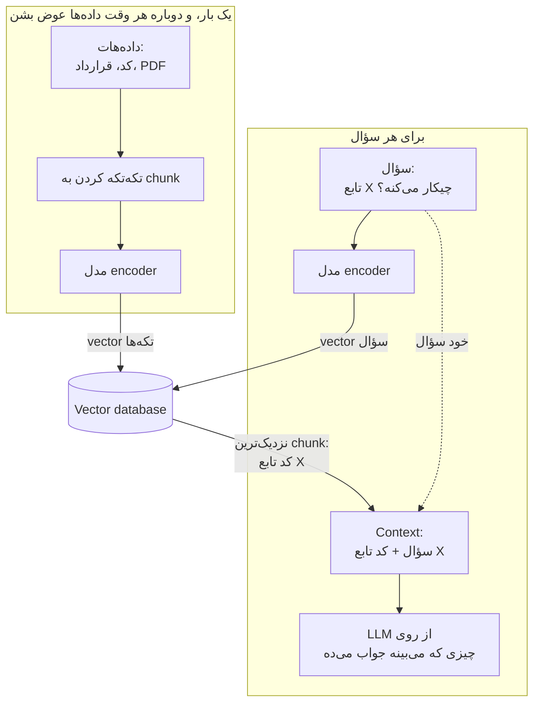
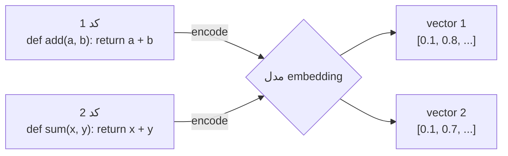
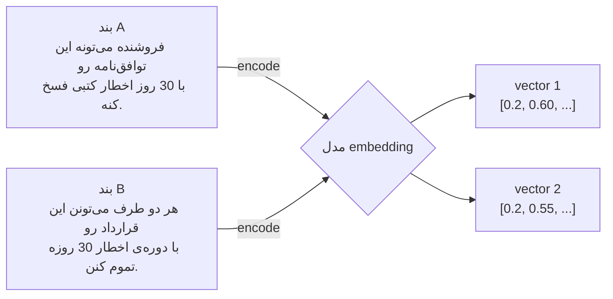
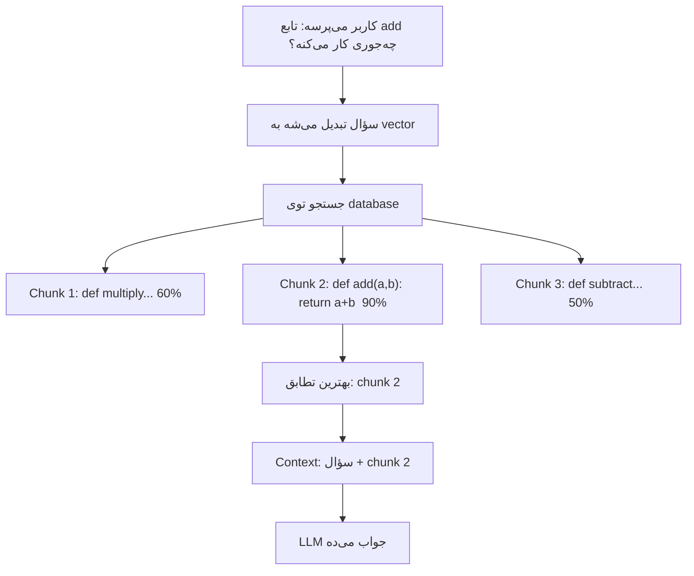
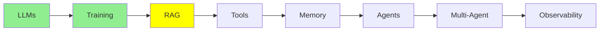

# RAG و Embedding‌ها

توی [مبانی LLM](llms_fa.md) با context window آشنا شدی. همون میز کار مدله، و هر چیزی که روش باشه باید توش جا بشه. توی [Training LLMs](training_fa.md) هم fine-tuning رو دیدی، همون کاری که خود مدل رو عوض می‌کنه. این ماژول درباره‌ی گزینه‌ی سومه، و احتمالاً گزینه‌ای که بیشتر از همه ازش استفاده می‌کنی.

## چرا RAG وجود داره

یه سری داده‌ی مفید داری:

- codebase‌ت
- اسناد شرکتت
- یه پوشه پر از قرارداد
- سال‌ها تیکت پشتیبانی

از این داده‌ها خیلی بیشتر از چیزی داری که توی context window جا بشه، و context window هم یه سقف سخت داره که نمی‌شه ازش رد شد. ولی نکته‌ی مهم اینجاست: برای هر سؤال، لازم نیست همه‌ی داده رو داشته باشی. فرض کن یکی می‌پرسه بند فسخ توی قرارداد یکی از فروشنده‌ها چیه. اون آدم دویست تا قرارداد دیگه رو لازم نداره، فقط همون یه بند به کارش میاد.

پس کل ایده همین‌قدر ساده‌ست: داده رو بیرون از مدل نگه می‌داری. وقتی سؤالی می‌رسه، فقط بخش‌هایی رو می‌یاری که جوابش رو دارن و اون‌ها رو توی context می‌ذاری. به این کار می‌گن **Retrieval-Augmented Generation**، یعنی اول retrieve می‌کنی و بعد generate می‌کنی.

### میز کار و کتابخونه

بیا یه راه ساده برای فکر کردن درباره‌ی این داشته باشیم.

**weights مدل مثل یه کتابخونه‌ست؛** خیلی بزرگه، و هر چیزی که مدل توی pre-training یاد گرفته یه جایی توشه. از اون طرف، **context window میز کار توئه،** که کوچیکه، ولی هر چیزی رو که روش بذاری درست جلوی چشمته.

یادآوری یه چیز از یه کتابخونه‌ی عظیم سخته و قابل اعتماد نیست. ولی خوندن صفحه‌ای که جلوت روی میز بازه، راحت و دقیقه. RAG یعنی تصمیم بگیری کدوم صفحه‌ها روی میز بیان.

  
*این همون جریان پایه‌ی RAG هست که بهش می‌گن «naive». سؤال توی یه لحظه به دو جا می‌ره. یه مسیر از یه مدل embedding می‌گذره تا توی ایندکس vector store دنبال بگرده، و مسیر دیگه مستقیم به LLM می‌ره، همراه با context‌ای که جستجو برگردونده.*

## RAG دقیقاً چیکار می‌کنه



همین ترفند برای هر چیزی که از متن ساخته شده کار می‌کنه، نه فقط کد. فرض کن یه پوشه قرارداد حقوقی داری و یکی می‌پرسه «دوره‌ی اخطار فسخ توی قرارداد فروشنده‌ی Acme چقدره؟». مدل خودش از روی حافظه‌اش حدس نمی‌زنه، بلکه RAG توی همه‌ی قراردادهات می‌گرده، بندی رو که جواب سؤال توشه پیدا می‌کنه، و فقط همون بند رو به مدل می‌ده.

پشت این ماجرا همون مکانیزم ساده‌ای هست که گفتیم. یه مدل encoder، متن رو تبدیل می‌کنه به vector embedding، و این embedding‌ها رو توی یه vector database نگه می‌داری. بعد سؤال رو هم تبدیل می‌کنی به vector، و نزدیک‌ترین‌ها رو پیدا می‌کنی.

## Vector Embedding‌ها

embedding یه لیست از عدده که یه تیکه متن رو توصیف می‌کنه، و می‌شه فکرش رو کرد که یه جور اثر انگشته. این لیست رو یه مدل خاص به اسم encoder می‌سازه.

ویژگی مفیدش اینه: **معنای مشابه، عددهای مشابه می‌ده.** کارش شبیه آدرس‌ها توی یه شهره، که آدرس‌های نزدیک به هم یعنی جاهای نزدیک به هم. نزدیکی دو تا اثر انگشت رو با **cosine similarity** می‌سنجیم، و امتیاز بالا یعنی این دو تا خیلی شبیه‌ن.

تصویر کلاسیکی که این ایده رو نشون می‌ده، چهار کلمه داره:

  
*چهار کلمه می‌شن چهار vector، و این vector‌ها می‌شن موقعیت توی فضا. «king» کنار «queen» می‌افته و «man» کنار «woman». حالا به دو تا فلش نگاه کن که موازی‌ان. این یعنی قدمی که از king به queen می‌ری، همون حرکتیه که از man به woman می‌ری، و معنا تبدیل شده به هندسه.*

یه لحظه به این موازی بودن دقت کن، چون همین چیزه که عددها رو از یه جدول جست‌وجوی ساده بالاتر می‌بره. embedding فقط چیزهای مشابه رو کنار هم نذاشته؛ رابطه‌ی بینشون رو هم توی یه جهت ثابت جا داده.

یه ساده‌سازی رو هم باید صادقانه بگم: عکس سه بعد رو کشیده تا توی یه صفحه جا بشه، ولی embedding‌های واقعی صدها یا هزاران بعد دارن. دقیقاً به همین خاطره که نزدیکی رو با cosine similarity می‌سنجیم، نه با نگاه کردن.



دو تا تابع داریم که ظاهرشون با هم فرق داره، ولی عددهاشون کنار هم می‌افته. همین نزدیکیه که کل ماجرا رو ممکن می‌کنه، چون وقتی یکی‌شون رو بخوای، جستجو اون یکی رو هم پیدا می‌کنه.

نکته‌ی مهم اینه که این روش *معنا* رو می‌گیره، نه کلمه‌های یکسان:



این دو تا بند معنای یکسانی دارن و تقریباً هیچ کلمه‌ی مشترکی ندارن، ولی vector‌هاشون هنوز کنار هم می‌افته. برای همین، جستجوی keyword بند B رو از دست می‌ده، ولی retrieval پیداش می‌کنه.

## Vector Database‌ها

یه vector database میلیون‌ها تا از این اثر انگشت‌ها رو نگه می‌داره. هر کدوم رو به متن اصلی‌اش وصل نگه می‌داره و خیلی سریع توشون جستجو می‌کنه. بهش یه query vector می‌دی، و اون N تا نزدیک‌ترین رو برمی‌گردونه که بعد تو اون‌ها رو به LLM می‌دی.

**رایگان و لوکال:**

- **ChromaDB**: ساده‌ترین گزینه برای شروع.
- **Milvus**: برای پروژه‌های بزرگ‌تر.
- **FAISS**: جستجوی خیلی سریع توی حافظه (in-memory).

**سرویس‌های managed:**

- **Pinecone**: ساده، و روی سرورهای خودش اجرا می‌شه.
- **Weaviate**: وقتی داده‌هات یه ساختاری دارن که دوست داری حفظش کنی، خوبه.

## مراحل RAG

**راه‌اندازی، که یک بار انجام می‌شه و هر وقت داده‌ها عوض شدن دوباره انجام می‌شه:**

1. داده‌ی منبعت رو لود می‌کنی: فایل‌های کد، قراردادها، سیاست‌ها، PDF و هر متن دیگه‌ای.
2. اون رو به chunk‌های کوچیک تقسیم می‌کنی، مثلاً یه تابع، یه پاراگراف یا یه بند قرارداد.
3. هر chunk رو تبدیل می‌کنی به یه embedding.
4. embedding‌ها رو توی یه vector database ذخیره می‌کنی.

**جواب دادن، که برای هر سؤال انجام می‌شه:**

1. سؤال کاربر رو می‌گیری.
2. اون رو تبدیل می‌کنی به embedding.
3. توی database دنبال نزدیک‌ترین chunk‌ها می‌گردی.
4. متن واقعی اون chunk‌ها رو برمی‌داری.
5. اون متن رو همراه سؤال توی context می‌ذاری.
6. حالا LLM از روی چیزی که جلوشه جواب می‌ده.



کافیه به‌جای «chunk‌های کد» بگی «بندهای قرارداد»، و جریان دقیقاً همین می‌مونه.

## ابزارهای RAG

تقریباً هیچ‌وقت خودت حلقه‌ی retrieval رو نمی‌نویسی. یه سطح رو انتخاب کن و بقیه‌ش رو بسپار به یه ابزار دیگه:

- **[LlamaIndex](https://www.llamaindex.ai/)**: بالاترین سطح. یه پوشه بهش می‌دی، یه سؤال می‌پرسی و جواب می‌گیری. chunk کردن، embedding، ذخیره و retrieval رو خودش انجام می‌ده.
- **[Haystack](https://haystack.deepset.ai/)**: pipeline رو از قطعه‌های آماده می‌سازی. وقتی بخوای هر مرحله رو ببینی و عوضش کنی، این گزینه‌ست.
- **[ChromaDB](https://github.com/chroma-core/chroma)**: یه vector database که متن رو کنار embedding‌هاش نگه می‌داره. برای همین جستجو، chunk اصلی رو هم برمی‌گردونه.
- **[FAISS](https://github.com/facebookresearch/faiss)**: فقط لایه‌ی جستجو و بس. خیلی سریعه، ولی فقط با عدد سروکار داره.

حالا بریم سراغ FAISS. کوچیک‌ترین چیزیه که ارزش نشون دادن داره، چون مکانیزم خامیه که همه‌ی گزینه‌های بالا روش ساخته شدن:

```python
import faiss
import numpy as np

index = faiss.IndexFlatL2(128)                              # 128-dimension vectors
index.add(np.random.random((100, 128)).astype('float32'))   # your 100 chunk embeddings

query = np.random.random((1, 128)).astype('float32')        # the question, embedded
distances, indices = index.search(query, 5)                 # the five nearest chunks
```

این فقط مرحله‌ی جستجو هست و بس، چون FAISS فقط position برمی‌گردونه، یعنی جای هر نتیجه توی ایندکس، نه خود متن. پس این با خودته که متن اصلی رو یه جایی نگه داری و با ایندکس دنبالش بگردی. ابزارهای بالا برای همین وجود دارن که این کارهای دست‌وپاگیر رو ازت بگیرن. اون‌ها متن رو کنار vector ذخیره می‌کنن و خود chunk رو بهت می‌دن.

اگه ترجیح می‌دی به جای ساختن خودت، از یه سیستم RAG کامل شروع کنی، این پروژه‌های open-source آماده‌ی استفاده‌ن:

- **[RAGFlow](https://github.com/infiniflow/ragflow)** یه پلتفرم کامل RAG با رابط وبه. با Docker اجراش می‌کنی. خوب از پس اسناد نامرتب برمی‌ای، از جمله چیدمان صفحه، جدول‌ها و صفحه‌های اسکن‌شده. جواب‌هاش هم همراه با ارجاع به منبعشون میاد.
- **[LightRAG](https://github.com/HKUDS/LightRAG)** از آدم‌ها، چیزها و رابطه‌های توی اسنادت یه knowledge graph می‌سازه. کنارش embedding‌ها رو هم نگه می‌داره، پس جستجو می‌تونه دنبال ارتباط‌ها بره، نه فقط شباهت. یه کتابخونه‌ی Python هست که سرور و رابط وب هم داره. یه جایگزین سبک‌تر برای GraphRAG‌ی Microsoft هم محسوب می‌شه.
- **[PageIndex](https://github.com/VectifyAI/PageIndex)** نه vector database داره و نه chunking. برای هر سند یه درخت می‌سازه، درست مثل فهرست مطالب. بعد یه LLM با استدلال می‌ره پایین درخت تا به بخش درست برسه. حرفش اینه که شبیه بودن با مرتبط بودن یکی نیست.
- **[RAG-Anything](https://github.com/HKUDS/RAG-Anything)** روی LightRAG ساخته شده. از پس اسنادی برمی‌یاد که متن رو با عکس، جدول و معادله قاطی کردن. از سال 2026 به بعد، خود LightRAG هم این قابلیت رو داره.
- **[DocsGPT](https://github.com/arc53/DocsGPT)** یه اپ self-hosted هست. اسناد، وب‌سایت‌ها و اپ‌های وصل‌شده‌ت رو تبدیل می‌کنه به دستیار، و این دستیارها با منبع ارجاع‌دار جواب می‌دن.
- **[MiniRAG](https://github.com/HKUDS/MiniRAG)** یه پروژه‌ی تحقیقاتیه. کاری می‌کنه RAG با small language model‌ها کار کنه، برای همین می‌تونه روی یه دستگاه تکی اجرا بشه.
- **[PixelRAG](https://github.com/StarTrail-org/PixelRAG)** به جای متنی که از صفحه‌ها بیرون کشیده شده، دنبال screenshot صفحه‌ها می‌گرده. این‌جوری جدول‌ها، نمودارها و چیدمان گم نمی‌شن. این پروژه از یه مقاله‌ی تحقیقاتی سال 2026 اومده و خیلی تازه‌ست.

## چرا فقط مدل رو روی اسنادت fine-tune نکنیم؟

fine-tuning رو توی [Training LLMs](training_fa.md) یاد گرفتی، پس این سؤال خیلی طبیعیه. اصلاً چرا باید با embedding و database سروکله بزنی؟

**چون دانش شرکتت زنده‌ست و fine-tuning فقط یه snapshot از اونه.** کدبیس‌ت هر روز یه commit جدید می‌گیره، قراردادها عوض می‌شن، قرارداد جدید امضا می‌شه و سیاست‌ها هم تغییر می‌کنن. fine-tuning ساعت‌ها یا روزها طول می‌کشه و هزینه‌ی واقعی داره، پس نمی‌شه هر بار که یه فایل عوض شد دوباره‌ش کرد. fine-tune کردن یه مدل برای نگه داشتن اسناد شرکت، یعنی حل کردن یه مسئله‌ی زنده با یه عکس.

**چون fine-tuning برای کاره، نه برای داده:** مدل برای یاد دادن یه *رفتار* عالیه. مثلاً می‌تونی بهش بگی این‌جوری خلاصه کنه، همیشه با این فرمت جواب بده، یا توی این دسته‌ها دسته‌بندی کنه. ولی برای یاد دادن *حقایق* خوب نیست، چون صد صفحه‌ی اسناد تو لای میلیاردها پارامتر گم می‌شه، و این پارامترها پر از هر چیزی‌ان که مدل تا حالا خونده. برای همین، یه مدل fine-tune شده به راحتی جزئیات تو رو با یه چیزی که نیمه‌حفظه از pre-training قاطی می‌کنه.

**چون داری با یه هدف متحرک مسابقه می‌دی:** فرض کن یه ماه وقت می‌ذاری و مدل رو برای کارت fine-tune می‌کنی. تا کارت تموم شه، مدل frontier بعدی بیرون اومده. یه آزمایشگاه اون رو با منابعی آموزش داده که تو نداری. حتی بدون هیچ fine-tuning، احتمالاً مدل جدید توی کارت از مدل fine-tune شده‌ی نسل قبلی تو بهتره. تو این مسابقه نمی‌تونی برنده بشی، و RAG هم اصلاً وارد این مسابقه نمی‌شه.

**چون retrieval جواب رو جلوی مدل می‌ذاره:** یادت هست که میز کار و کتابخونه رو با هم مقایسه کردیم؟ fine-tuning تلاش می‌کنه اسنادت رو یه جایی توی کتابخونه‌ای با میلیاردها پارامتر بذاره، و بعد امیدواره که مدل قفسه‌ی درست رو یادش بمونه. RAG دقیقاً همون صفحه‌ای که لازمه رو، همون لحظه‌ای که کسی سؤال می‌پرسه، باز روی میز می‌ذاره.

یه جمله‌ش این می‌شه: **fine-tuning چیزی رو عوض می‌کنه که مدل *می‌دونه*؛ RAG چیزی رو عوض می‌کنه که مدل *می‌بینه*.**

یه نکته‌ی دیگه: این یکی یا اون یکی رو انتخاب کردن نیست. می‌تونی مدل رو برای رفتارش fine-tune کنی و برای چیزی که باید بدونه از RAG استفاده کنی، و این ترکیب توی production خیلی رایجه.

## کجای این مجموعه هستیم



## خلاصه

RAG داده‌ت رو بیرون از مدل نگه می‌داره، و برای هر سؤال فقط بخش مرتبط رو می‌آره. متن تبدیل می‌شه به embedding، و embedding‌ها توی یه vector database جا دارن. سؤال هم با شباهت، تطابق‌هاش رو پیدا می‌کنه.

یادت باشه فرقشون چیه؛ weights کتابخونه‌ان و context window میز کاره. fine-tuning کتابخونه رو جابه‌جا می‌کنه، و RAG انتخاب می‌کنه چی روی میز بره.

قدم بعدی ابزارهاست: همون چیزی که باعث می‌شه مدل از خوندن دست بکشه و شروع کنه به کار کردن.

**بررسی سریع**: مراحل جواب دادن به یه سؤال با RAG چیه؟ چرا embedding‌ها یه بند رو پیدا می‌کنن که هیچ کلمه‌ای با سؤال مشترک نداره؟ و چرا به‌روز کردن ایندکس RAG از دوباره fine-tune کردن ارزون‌تره؟

## منابع

- [RAG vs fine-tuning](https://www.redhat.com/en/topics/ai/rag-vs-fine-tuning): مقایسه‌ی Red Hat، نسخه‌ی بلندتر و کامل‌تر بخش بالا
- [What is RAG?](https://youtube.com/shorts/KBRvB_NDY-o?si=DIUHt8lihi0EzgxT): کل ایده، توی یه ویدیوی کوتاه
- [Fine-Tuning vs RAG: Why Not Both?](https://youtube.com/shorts/24jqSMs10zE?si=zuhAbSZcFGkTKVfI): درباره‌ی استفاده از هر دو با هم
- [Haystack](https://haystack.deepset.ai/): pipeline‌های RAG از قطعه‌های آماده
- [LlamaIndex](https://www.llamaindex.ai/): وصل کردن یه LLM به داده‌هات
- [ChromaDB](https://github.com/chroma-core/chroma): ساده‌ترین vector database برای شروع
- [FAISS](https://github.com/facebookresearch/faiss): فقط لایه‌ی جستجو، به‌تنهایی
- [RAGFlow](https://github.com/infiniflow/ragflow)، [LightRAG](https://github.com/HKUDS/LightRAG)، [PageIndex](https://github.com/VectifyAI/PageIndex)، [RAG-Anything](https://github.com/HKUDS/RAG-Anything)، [DocsGPT](https://github.com/arc53/DocsGPT)، [MiniRAG](https://github.com/HKUDS/MiniRAG) و [PixelRAG](https://github.com/StarTrail-org/PixelRAG): سیستم‌های کامل RAG که می‌تونی همون‌طور که هستن اجرا کنی.
