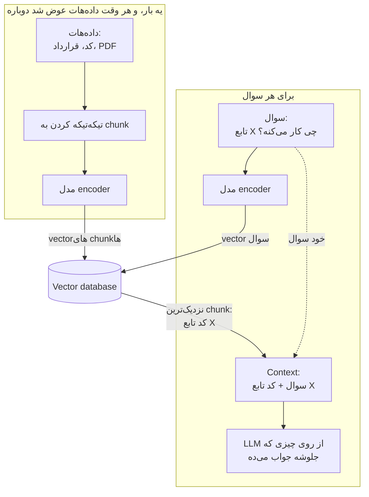
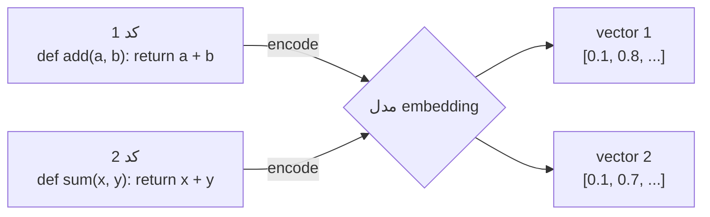
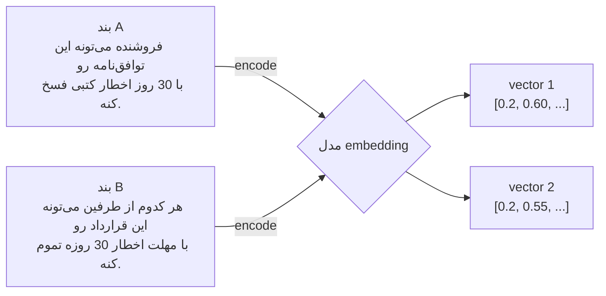
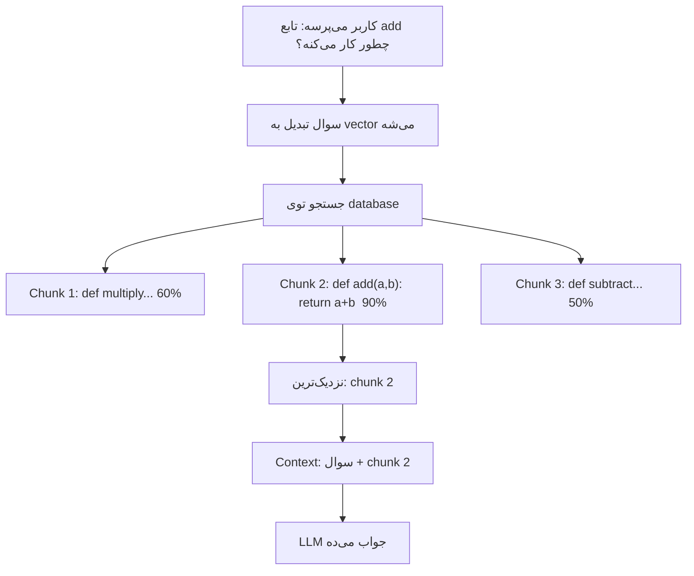
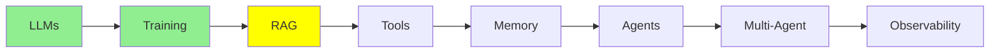

# RAG و Embedding‌ها

توی [مبانی LLM](llms_fa.md) با context window آشنا شدی، همون میز کار مدل که هر چیزی روش می‌ذاری باید جا بشه. توی [Training LLMs](training_fa.md) هم fine-tuning رو دیدی که خود مدل رو تغییر می‌ده. این درس درباره‌ی راه سومه، که اتفاقاً بیشتر از همه سراغش می‌ری.

## چرا RAG لازمه

کلی داده‌ی به‌دردبخور داری:

- codebase‌ت
- سندهای شرکتت
- یه پوشه پر از قرارداد
- تیکت‌های پشتیبانی چند سال

حجمش خیلی بیشتر از اونیه که توی یه context window جا بشه، و از سقف context window هم نمی‌شه رد شد.

ولی نکته این‌جاست که **برای هر سوال، به همه‌ی این داده‌ها احتیاج نداری.** یکی درباره‌ی بند فسخ توی قرارداد با یکی از تأمین‌کننده‌ها سوال می‌کنه؛ اون آدم با دویست تا قرارداد دیگه کاری نداره و فقط همون یه بند رو لازم داره.

ایده‌ی RAG هم همینه: داده رو بیرون از مدل نگه می‌داری، و هر وقت سوالی اومد، فقط تیکه‌هایی رو که جوابش توشونه پیدا می‌کنی و می‌ذاری توی context. اسم این کار **Retrieval-Augmented Generation**‌ه، یعنی اول پیدا کردن (retrieve) و بعد تولید جواب (generate).

### میز کار و کتابخونه

یه تشبیه ساده خیلی کمک می‌کنه.

**weight‌های مدل یه کتابخونه‌ان**؛ یه کتابخونه‌ی غول‌آسا که هر چیزی مدل توی pre-training یاد گرفته، یه گوشه‌ش هست. **context window هم میز کار توئه**؛ کوچیکه، ولی هر چیزی روش بذاری درست جلوی چشمته.

به خاطر آوردن یه چیز از توی یه کتابخونه‌ی به اون بزرگی سخته و نمی‌شه بهش اطمینان کرد، ولی خوندن صفحه‌ای که جلوت روی میز بازه، راحت و دقیقه.

کار RAG اینه که انتخاب کنه کدوم صفحه‌ها روی میز بیان.

  
*مسیر پایه‌ی RAG که بهش «naive» می‌گن. سوال هم‌زمان دو جا می‌ره: یه مسیرش از یه مدل embedding رد می‌شه تا توی vector store index جستجو کنه، و مسیر دیگه‌ش مستقیم می‌ره سراغ LLM، همراه با context‌ای که جستجو پیدا کرده.*

## RAG دقیقاً چی کار می‌کنه



این روش فقط مال کد نیست و برای هر چیزی که از جنس متنه جواب می‌ده. فرض کن یه پوشه قرارداد حقوقی داری و یکی می‌پرسه «مهلت اخطار فسخ توی قرارداد با تأمین‌کننده‌ی Acme چقدره؟». مدل دیگه از روی حافظه‌ش حدس نمی‌زنه؛ RAG کل قراردادهات رو می‌گرده، بندی رو که جواب سوال توشه پیدا می‌کنه و فقط همون بند رو به مدل می‌ده.

سازوکارش اینه: یه مدل encoder متن رو به vector embedding تبدیل می‌کنه و تو این embedding‌ها رو توی یه vector database نگه می‌داری. بعد سوال رو هم به vector تبدیل می‌کنی و نزدیک‌ترین‌ها رو پیدا می‌کنی.

## Vector Embedding‌ها

embedding یه لیست عدده که یه تیکه متن رو توصیف می‌کنه؛ یه جور اثر انگشت برای اون متن. این لیست رو یه مدل مخصوص می‌سازه که بهش می‌گن encoder.

خاصیت به‌دردبخورش اینه که **متن‌های هم‌معنی، عددهای نزدیک به هم می‌گیرن**؛ درست مثل آدرس‌ها توی یه شهر، که آدرس‌های نزدیک یعنی جاهای نزدیک به هم. نزدیکی دو تا اثر انگشت رو با **cosine similarity** می‌سنجیم، و هرچی امتیاز بالاتر باشه، یعنی اون دو تا شبیه‌ترن.

تصویر معروفی که همه برای این ایده میارن، چهار تا کلمه داره:

  
*چهار تا کلمه تبدیل می‌شن به چهار تا vector، و هر vector یه نقطه توی فضا می‌شه. «king» نزدیک «queen» قرار می‌گیره و «man» نزدیک «woman». حالا به اون دو تا فلش نگاه کن: موازی‌ان، یعنی رفتن از king به queen همون حرکتیه که از man به woman می‌ری. این‌جوری معنی کلمه‌ها تبدیل شده به فاصله و جهت توی فضا.*

یه لحظه روی همین موازی بودن مکث کن، چون همین نشون می‌ده که این عددها چیزی بیشتر از یه جدول جستجو (lookup table) هستن، یعنی جدولی که فقط به هر کلمه یه ردیف ثابت می‌ده. embedding فقط چیزهای شبیه رو کنار هم نذاشته؛ *رابطه‌ی بینشون* رو هم توی یه جهت ثابت نشونده.

البته این تصویر یه ساده‌سازی داره که باید بگیم: سه بعد کشیده تا توی صفحه جا بشه، در حالی که embedding‌های واقعی صدها یا هزاران بعد دارن. دقیقاً به همین خاطره که نزدیکی رو با cosine similarity اندازه می‌گیریم، نه با چشم.



این‌جا دو تا تابع متفاوت داریم، ولی عددهاشون نزدیک هم درمیاد. اصل ماجرا همین نزدیکیه، چون باعث می‌شه وقتی دنبال یکی‌شون می‌گردی، جستجو اون یکی رو هم پیدا کنه.

مهم اینه که این روش *معنا* رو تشخیص می‌ده، نه کلمه‌های یکسان رو:



این دو تا بند یه معنی رو می‌رسونن و تقریباً هیچ کلمه‌ی مشترکی ندارن، ولی باز هم vector‌هاشون کنار هم قرار می‌گیره.

واسه همینه که جستجوی keyword بند B رو پیدا نمی‌کنه، ولی retrieval پیداش می‌کنه.

## Vector Database‌ها

vector database جاییه که میلیون‌ها از این اثر انگشت‌ها رو نگه می‌داره، هر کدوم رو به متن اصلی خودش وصل نگه می‌داره و خیلی سریع بینشون جستجو می‌کنه. یه query vector بهش می‌دی و N تا از نزدیک‌ترین‌ها رو تحویلت می‌ده، تا بعد اون‌ها رو بدی به LLM.

**رایگان و local:**

- **ChromaDB**: راحت‌ترین گزینه برای شروع.
- **Milvus**: برای پروژه‌های بزرگ‌تر.
- **FAISS**: جستجوی خیلی سریع توی حافظه (in-memory).

**سرویس‌های managed:**

- **Pinecone**: ساده، و روی سرورهای خودشون میزبانی می‌شه.
- **Weaviate**: وقتی داده‌هات یه ساختاری دارن که نمی‌خوای از دستش بدی، گزینه‌ی خوبیه.

## مراحل RAG

**آماده‌سازی، که یه بار انجام می‌دی و هر وقت داده‌ها عوض شد، دوباره:**

1. داده‌های منبع رو load می‌کنی: فایل‌های کد، قراردادها، سیاست‌های شرکت، PDF‌ها، هر متنی که داری.
2. اون‌ها رو به chunk‌های کوچیک می‌شکنی، مثلاً یه تابع، یه پاراگراف یا یه بند قرارداد.
3. هر chunk رو به یه embedding تبدیل می‌کنی.
4. embedding‌ها رو توی یه vector database ذخیره می‌کنی.

**جواب دادن، که برای هر سوال تکرار می‌شه:**

1. سوال کاربر رو می‌گیری.
2. اون رو به embedding تبدیل می‌کنی.
3. توی database دنبال نزدیک‌ترین chunk‌ها می‌گردی.
4. متن اصلی همون chunk‌ها رو درمیاری.
5. اون متن رو همراه با سوال می‌ذاری توی context.
6. LLM از روی چیزی که حالا جلوشه جواب می‌ده.



اگه به‌جای «chunk‌های کد» بذاری «بندهای قرارداد»، مسیر مو به مو همینه.

## ابزارهای RAG

تقریباً هیچ‌وقت لازم نیست کد retrieval رو از صفر خودت بنویسی. یه سطح انتخاب کن و بقیه‌ش رو بسپار به ابزار:

- **[LlamaIndex](https://www.llamaindex.ai/)**: بالاترین سطح. یه پوشه نشونش می‌دی، سوالت رو می‌پرسی و جواب می‌گیری؛ chunk کردن، embedding، ذخیره و retrieval همه با خودشه.
- **[Haystack](https://haystack.deepset.ai/)**: pipeline رو با قطعه‌های آماده سر هم می‌کنی. وقتی می‌خوای تک‌تک مرحله‌ها رو ببینی و دستشون ببری، سراغ این برو.
- **[ChromaDB](https://github.com/chroma-core/chroma)**: یه vector database که متن رو کنار embedding‌ش ذخیره می‌کنه، واسه همین نتیجه‌ی جستجو خود chunk اصلیه.
- **[FAISS](https://github.com/facebookresearch/faiss)**: فقط لایه‌ی جستجو، نه هیچ چیز دیگه. خیلی سریعه و از هیچی جز عدد سر درنمیاره.

این پایین FAISS رو می‌بینی. کوچیک‌ترین چیزیه که ارزش نشون دادن داره، چون همون سازوکار خامیه که همه‌ی گزینه‌های بالا یه لایه روش کشیدن:

```python
import faiss
import numpy as np

index = faiss.IndexFlatL2(128)                              # 128-dimension vectors
index.add(np.random.random((100, 128)).astype('float32'))   # your 100 chunk embeddings

query = np.random.random((1, 128)).astype('float32')        # the question, embedded
distances, indices = index.search(query, 5)                 # the five nearest chunks
```

این کد فقط مرحله‌ی جستجو رو انجام می‌ده، نه هیچ چیز دیگه. FAISS فقط شماره‌ی جایگاه‌ها رو برمی‌گردونه، پس نگه داشتن متن اصلی یه جای دیگه و پیدا کردنش از روی index با خودته. ابزارهای بالا اومدن که این حساب و کتاب رو از دوشت بردارن: متن رو کنار vector ذخیره می‌کنن و خود chunk رو تحویلت می‌دن.

اگه ترجیح می‌دی به‌جای این‌که خودت بسازی، از یه سیستم RAG کامل شروع کنی، این پروژه‌های open-source آماده‌ی استفاده‌ان:

- **[RAGFlow](https://github.com/infiniflow/ragflow)** یه پلتفرم کامل RAG با رابط وبه که با Docker بالا میاریش. توی خوندن سندهای شلوغ و درهم، با layout و جدول و صفحه‌های اسکن‌شده، دستش قویه، و جواب‌هاش با ارجاع به منبع میاد.
- **[LightRAG](https://github.com/HKUDS/LightRAG)** از آدم‌ها، چیزها و رابطه‌هایی که توی سندهات هست یه knowledge graph می‌سازه و embedding‌ها رو هم کنارش نگه می‌داره؛ این‌جوری جستجو می‌تونه رد ارتباط‌ها رو بگیره، نه فقط شباهت رو. یه کتابخونه‌ی Python‌ه که server و web UI هم داره، و یه جایگزین سبک‌تر برای GraphRAG شرکت Microsoft حساب می‌شه.
- **[PageIndex](https://github.com/VectifyAI/PageIndex)** نه vector database داره، نه chunking. از هر سند یه درخت می‌سازه، شبیه فهرست مطالب، و بعد یه LLM با استدلال از این درخت پایین می‌ره تا به بخش درست برسه. حرف حسابش اینه که تیکه‌ای که شبیه سواله، همیشه همون تیکه‌ای نیست که جواب سوال توشه.
- **[RAG-Anything](https://github.com/HKUDS/RAG-Anything)** روی LightRAG ساخته شده و از پس سندهایی برمیاد که متن رو با عکس و جدول و معادله قاطی کردن. از 2026 به این طرف، خود LightRAG هم این قابلیت رو داره.
- **[DocsGPT](https://github.com/arc53/DocsGPT)** یه اپ self-hosted‌ه که از سندها، سایت‌ها و اپ‌هایی که بهش وصل می‌کنی، دستیار می‌سازه؛ دستیارهایی که جوابشون با ذکر منبع همراهه.
- **[MiniRAG](https://github.com/HKUDS/MiniRAG)** یه پروژه‌ی تحقیقاتیه که RAG رو با small language model‌ها راه می‌ندازه، واسه همین روی یه دستگاه تنها هم اجرا می‌شه.
- **[PixelRAG](https://github.com/StarTrail-org/PixelRAG)** به‌جای متنی که از صفحه‌ها درآوردن، توی screenshot خود صفحه‌ها جستجو می‌کنه تا جدول‌ها، نمودارها و layout از دست نرن. از یه مقاله‌ی تحقیقاتی سال 2026 بیرون اومده و خیلی تازه‌ست.

## چرا فقط مدل رو روی اسنادت fine-tune نکنیم؟

fine-tuning رو توی [Training LLMs](training_fa.md) دیدی، پس طبیعیه که این سوال برات پیش بیاد: اصلاً چرا خودمون رو با embedding و database درگیر کنیم؟

**چون اطلاعات شرکتت مدام عوض می‌شه، ولی fine-tuning یه snapshot از یه لحظه‌ست.** codebase‌ت هر روز commit جدید می‌خوره، قراردادها تغییر می‌کنن، قراردادهای تازه امضا می‌شن و سیاست‌ها عوض می‌شن. fine-tuning ساعت‌ها یا حتی روزها طول می‌کشه و پول درست و حسابی می‌خواد، پس نمی‌تونی با هر تغییر یه فایل از نو اجراش کنی. fine-tune کردن مدل برای نگه داشتن سندهای شرکت یعنی بخوای مسئله‌ای رو که هر روز عوض می‌شه، با یه عکس ثابت حل کنی.

**چون fine-tuning برای یاد دادن کاره، نه داده.** توی یاد دادن یه *رفتار* به مدل خوب جواب می‌ده: این‌جوری خلاصه کن، همیشه با این فرمت جواب بده، توی این دسته‌ها دسته‌بندی کن. ولی برای یاد دادن *اطلاعات* ضعیفه. صد صفحه‌ی تو بین میلیاردها parameter‌ی گم می‌شه که پر از هر چیزیه که مدل تا حالا خونده، و واسه همین یه مدل fine-tune‌شده راحت ممکنه جزئیات تو رو با چیزی که نصفه‌نیمه از pre-training یادشه قاطی کنه.

**چون توی مسابقه‌ای هستی که خط پایانش مدام جابه‌جا می‌شه.** فرض کن یه ماه وقت می‌ذاری و مدل رو برای کارت fine-tune می‌کنی. تا کارت تموم بشه، frontier model بعدی اومده بیرون که یه آزمایشگاه با امکاناتی که تو نداری train‌ش کرده، و این مدل احتمالاً بدون هیچ fine-tuning‌ای، توی کار تو از مدل fine-tune‌شده‌ی نسل قبلت بهتره. این مسابقه رو نمی‌تونی ببری، ولی RAG اصلاً واردش نمی‌شه، چون همون retrieval رو می‌تونی با جدیدترین مدل هم استفاده کنی.

**چون retrieval جواب رو می‌ذاره جلوی چشم مدل.** برگرد سراغ همون میز کار و کتابخونه. fine-tuning سعی می‌کنه سندهای تو رو یه جایی توی قفسه‌های کتابخونه‌ای که میلیاردها parameter داره جا بده، و بعد امیدوار باشه مدل یادش بمونه کدوم قفسه بود. ولی RAG همون یه صفحه‌ای رو که لازم داری، درست همون لحظه‌ای که یکی سوال می‌پرسه، باز می‌ذاره روی میز.

خلاصه‌ش این می‌شه: **fine-tuning چیزی رو عوض می‌کنه که مدل *می‌دونه*؛ RAG چیزی رو عوض می‌کنه که مدل *می‌بینه*.**

یه نکته‌ی دیگه هم بگم: لازم نیست بین این دو تا یکی رو انتخاب کنی. می‌تونی مدل رو برای رفتارش fine-tune کنی و برای چیزهایی که باید بدونه از RAG کمک بگیری؛ این ترکیب توی production خیلی رایجه.

## کجای این مجموعه هستیم



## خلاصه

RAG داده‌هات رو بیرون از مدل نگه می‌داره و برای هر سوال فقط بخش مربوط رو میاره. متن تبدیل به embedding می‌شه، embedding‌ها توی یه vector database نگه داشته می‌شن، و هر سوال از روی شباهت، تیکه‌های مرتبط با خودش رو پیدا می‌کنه.

فرقشون رو یادت بمونه: weight‌ها کتابخونه‌ان و context window میز کار. fine-tuning کتابخونه رو از نو می‌چینه، ولی RAG انتخاب می‌کنه چی روی میز بیاد.

بعد از این می‌ریم سراغ tool‌ها، که باهاشون مدل به‌جای این‌که فقط بخونه، دست به کار می‌شه.

**بررسی سریع**: یه سوال با RAG طی چه مرحله‌هایی جواب داده می‌شه؟ چرا embedding‌ها بندی رو پیدا می‌کنن که هیچ کلمه‌ی مشترکی با سوال نداره؟ و چرا به‌روز کردن index یه RAG از دوباره fine-tune کردن ارزون‌تره؟

## منابع

- [RAG vs fine-tuning](https://www.redhat.com/en/topics/ai/rag-vs-fine-tuning): مقایسه‌ای که Red Hat نوشته؛ نسخه‌ی مفصل بخش بالا
- [What is RAG?](https://youtube.com/shorts/KBRvB_NDY-o?si=DIUHt8lihi0EzgxT): کل ایده، توی یه ویدیوی کوتاه
- [Fine-Tuning vs RAG: Why Not Both?](https://youtube.com/shorts/24jqSMs10zE?si=zuhAbSZcFGkTKVfI): درباره‌ی این‌که چطور این دو تا رو با هم استفاده کنی
- [Haystack](https://haystack.deepset.ai/): pipeline‌های RAG با قطعه‌های آماده
- [LlamaIndex](https://www.llamaindex.ai/): وصل کردن LLM به داده‌های خودت
- [ChromaDB](https://github.com/chroma-core/chroma): راحت‌ترین vector database برای شروع
- [FAISS](https://github.com/facebookresearch/faiss): فقط لایه‌ی جستجو، بدون هیچ چیز اضافه
- [RAGFlow](https://github.com/infiniflow/ragflow)، [LightRAG](https://github.com/HKUDS/LightRAG)، [PageIndex](https://github.com/VectifyAI/PageIndex)، [RAG-Anything](https://github.com/HKUDS/RAG-Anything)، [DocsGPT](https://github.com/arc53/DocsGPT)، [MiniRAG](https://github.com/HKUDS/MiniRAG) و [PixelRAG](https://github.com/StarTrail-org/PixelRAG): سیستم‌های کامل RAG که می‌تونی همین‌طوری که هستن اجرا کنی
