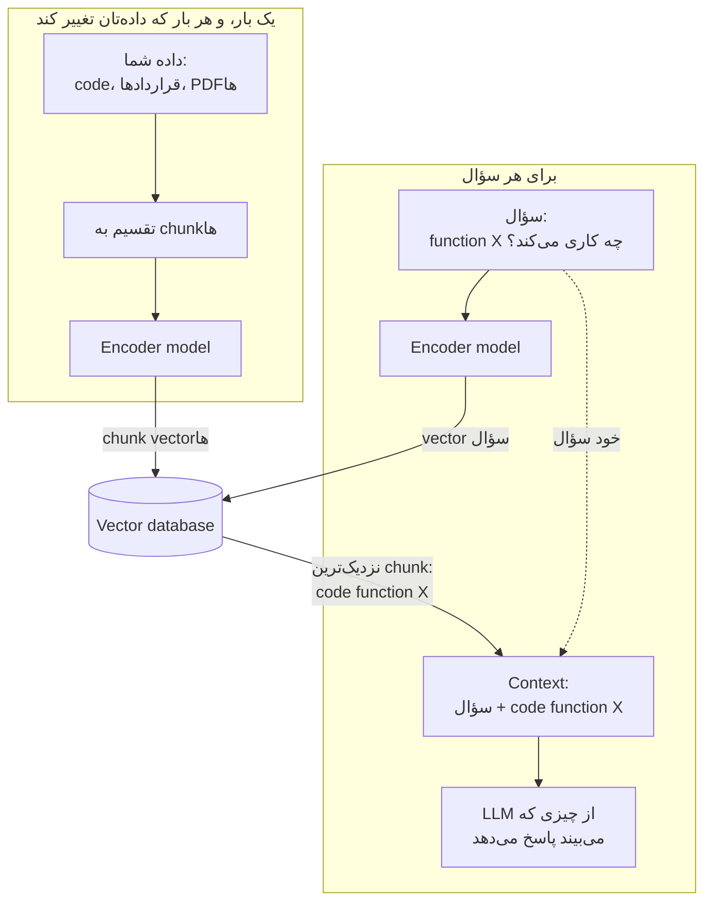
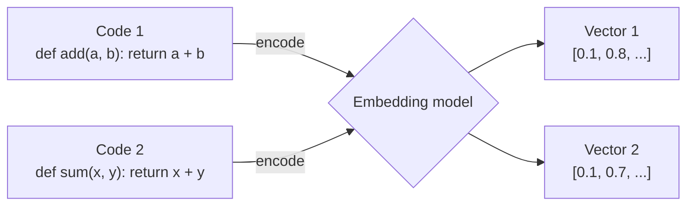
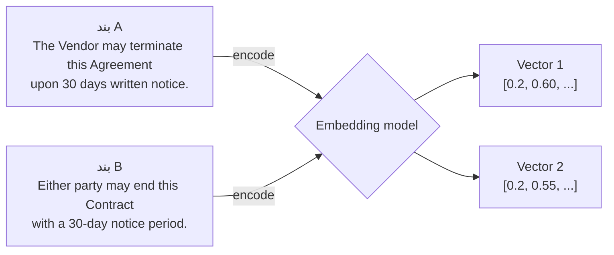
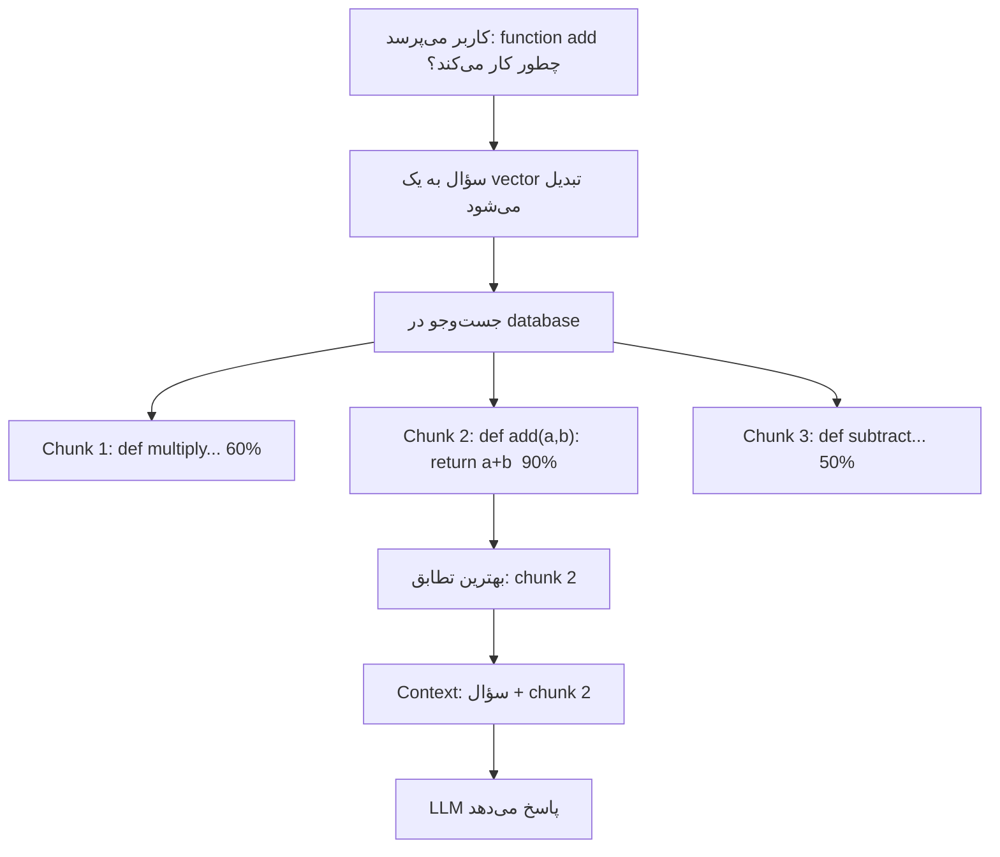
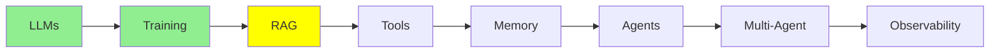

# RAG و Embedding‌ها

[مبانی LLM](llms_fa.md) به شما context window را داد. این میز کار مدل است، و هر چیزی که روی آن است باید در آن جا بگیرد. [Training LLMs](training_fa.md) به شما fine-tuning را داد، که خود مدل را تغییر می‌دهد. این ماژول درباره گزینه سوم است. این هم گزینه‌ای است که بیشتر از همه از آن استفاده می‌کنید.

## چرا RAG وجود دارد

شما داده‌های مفیدی دارید:

- codebase شما
- اسناد شرکت شما
- یک پوشه پر از قرارداد
- سال‌ها ticket پشتیبانی

حجم این داده‌ها خیلی بیشتر از چیزی است که در یک context window جا می‌شود. و context window یک محدودیت سخت است.

اما نکته مهم این است: **برای هر سؤال، همه آن را لازم ندارید.** یک نفر درباره بند فسخ یک قرارداد تأمین‌کننده می‌پرسد. آن شخص دویست قرارداد دیگر را لازم ندارد. او فقط به یک بند نیاز دارد.

پس ایده اصلی همین است. داده را بیرون از مدل نگه دارید. وقتی سؤالی می‌رسد، فقط بخش‌هایی را بیاورید که به آن جواب می‌دهند، و آن بخش‌ها را در context بگذارید. **Retrieval-Augmented Generation** نام این کار است: اول retrieve کنید، بعد generate کنید.

### میز کار و کتابخانه

این یک راه ساده برای فکر کردن به این موضوع است.

**model weights یک کتابخانه است.** کتابخانه بسیار بزرگ است، و هر چیزی که مدل در pre-training یاد گرفته، جایی در آن است. **context window میز کار شماست.** میز کار کوچک است، و هر چیزی که روی آن بگذارید درست جلوی شماست.

یادآوری چیزی از یک کتابخانه بزرگ سخت و غیرقابل اعتماد است. خواندن صفحه‌ای که باز است و روی میز کار جلوی شماست، آسان و دقیق است.

RAG یعنی انتخاب صفحه‌هایی که باید روی میز کار قرار بگیرند.

  
*جریان پایه RAG، یا «naive». query هم‌زمان به دو جا می‌رود. یک مسیر از یک embedding model می‌گذرد تا در vector store index جست‌وجو کند. مسیر دیگر مستقیم به LLM می‌رود، همراه با context که جست‌وجو برگردانده است.*

## RAG چه کاری انجام می‌دهد



همین ترفند برای هر چیزی که از متن ساخته شده کار می‌کند، نه فقط برای code. فرض کنید یک پوشه پر از قرارداد حقوقی دارید. یک نفر می‌پرسد: «دوره اخطار فسخ در قرارداد تأمین‌کننده Acme چقدر است؟» مدل از حافظه‌اش حدس نمی‌زند. در عوض، RAG در همه قراردادهای شما جست‌وجو می‌کند و بندی را پیدا می‌کند که به آن سؤال جواب می‌دهد. بعد فقط همان بند را به مدل می‌دهد.

این مکانیزم زیربنای کار است. یک encoder model متن را به vector embedding تبدیل می‌کند. این embedding‌ها را در یک vector database نگه می‌دارید. بعد سؤال را هم به یک vector تبدیل می‌کنید، و نزدیک‌ترین تطابق‌ها را پیدا می‌کنید.

## Vector Embedding‌ها

یک embedding فهرستی از عددهاست که یک تکه متن را توصیف می‌کند. آن را مثل یک اثر انگشت در نظر بگیرید. یک مدل ویژه، به نام encoder، آن را تولید می‌کند.

ویژگی مفید این است: **معنای مشابه، عددهای مشابه می‌دهد.** این مثل آدرس‌ها در یک شهر کار می‌کند، جایی که آدرس‌های نزدیک یعنی مکان‌های نزدیک. نزدیکی دو اثر انگشت را با **cosine similarity** می‌سنجیم. امتیاز بالا یعنی آن دو خیلی شبیه‌اند.

تصویر کلاسیک این موضوع از چهار کلمه استفاده می‌کند:

  
*چهار کلمه به چهار vector تبدیل می‌شوند، و آن vector‌ها به موقعیت‌هایی در فضا تبدیل می‌شوند. «king» کنار «queen» قرار می‌گیرد، و «man» کنار «woman». حالا به دو فلش نگاه کنید. آن‌ها موازی‌اند، پس قدمی که از king به queen می‌رود، همان حرکتی است که از man به woman می‌رود. معنا به هندسه تبدیل شده است.*

یک لحظه به این موازی بودن نگاه کنید. همین است که عددها را از یک lookup table بیشتر می‌کند. embedding فقط چیزهای مشابه را کنار هم نگذاشته است. بلکه *رابطه* بین آن‌ها را هم در یک جهت ثابت قرار داده است.

این یک ساده‌سازی صادقانه است. تصویر سه بُعد (dimension) نشان می‌دهد تا در یک صفحه جا شود. embedding‌های واقعی صدها یا هزاران بُعد دارند. دقیقاً به همین دلیل است که نزدیکی را با cosine similarity می‌سنجیم، و نه با نگاه کردن به آن.



این دو function متفاوت‌اند و عددهایشان به هم نزدیک درمی‌آیند. این نزدیکی کل نکته است. همین باعث می‌شود وقتی یکی را می‌خواهید، جست‌وجو دیگری را پیدا کند.

نکته مهم این است که این روش *معنا* را می‌گیرد، نه کلمه‌های یکسان:



این دو بند معنای یکسانی دارند، ولی تقریباً هیچ کلمه مشترکی ندارند. با این حال vector‌هایشان کنار هم قرار می‌گیرند.

به همین دلیل جست‌وجوی keyword بند B را از دست می‌داد، ولی retrieval آن را پیدا می‌کند.

## Vector Database‌ها

یک vector database میلیون‌ها از این اثر انگشت‌ها را ذخیره می‌کند. هر کدام را به متن اصلی‌اش وصل نگه می‌دارد و خیلی سریع در آن‌ها جست‌وجو می‌کند. شما به آن یک query vector می‌دهید، و N تای نزدیک‌ترین را برمی‌گرداند. بعد آن‌ها را به LLM می‌دهید.

**رایگان و local:**

- **ChromaDB**: ساده‌ترین گزینه برای شروع.
- **Milvus**: برای پروژه‌های بزرگ‌تر.
- **FAISS**: جست‌وجوی in-memory خیلی سریع.

**سرویس‌های مدیریت‌شده:**

- **Pinecone**: ساده و hosted.
- **Weaviate**: وقتی داده‌تان ساختاری دارد که می‌خواهید حفظش کنید، خوب است.

## فرایند RAG

**راه‌اندازی (setup)، یک بار، و دوباره هر وقت داده تغییر کند:**

1. داده‌های منبع‌تان را بارگذاری کنید: فایل‌های code، قراردادها، سیاست‌ها، PDF‌ها، هر متنی.
2. آن را به chunk‌های کوچک تقسیم کنید، مثل یک function، یک پاراگراف یا یک بند قرارداد.
3. هر chunk را به یک embedding تبدیل کنید.
4. embedding‌ها را در یک vector database ذخیره کنید.

**پاسخ دادن، برای هر سؤال:**

1. سؤال کاربر را بگیرید.
2. آن را به یک embedding تبدیل کنید.
3. در database نزدیک‌ترین chunk‌ها را جست‌وجو کنید.
4. متن واقعی آن chunk‌ها را بگیرید.
5. آن متن را همراه با سؤال در context بگذارید.
6. LLM از چیزی که حالا می‌بیند پاسخ می‌دهد.



«code chunk‌ها» را با «بندهای قرارداد» عوض کنید، و جریان دقیقاً همان است.

## ابزارهای RAG

شما تقریباً هرگز خود retrieval loop را نمی‌نویسید. یک سطح را انتخاب کنید و بگذارید بقیه کار را چیز دیگری انجام دهد:

- **[LlamaIndex](https://www.llamaindex.ai/)**: بالاترین سطح. آن را به یک پوشه وصل کنید، یک سؤال بپرسید، و یک پاسخ بگیرید. chunking، embedding، ذخیره‌سازی و retrieval را خودش انجام می‌دهد.
- **[Haystack](https://haystack.deepset.ai/)**: pipeline را از بخش‌های آماده بسازید. وقتی می‌خواهید هر مرحله را ببینید و تغییر دهید، از آن استفاده کنید.
- **[ChromaDB](https://github.com/chroma-core/chroma)**: یک vector database که متن شما را کنار embedding‌هایش ذخیره می‌کند. پس یک جست‌وجو، chunk اصلی را به شما برمی‌گرداند.
- **[FAISS](https://github.com/facebookresearch/faiss)**: فقط لایه جست‌وجو است و بس. خیلی سریع است، و فقط عددها را می‌شناسد.

این هم FAISS. کوچک‌ترین چیزی است که ارزش نشان دادن دارد، چون مکانیزم خامی است که همه گزینه‌های بالا روی آن ساخته شده‌اند:

```python
import faiss
import numpy as np

index = faiss.IndexFlatL2(128)                              # 128-dimension vectors
index.add(np.random.random((100, 128)).astype('float32'))   # your 100 chunk embeddings

query = np.random.random((1, 128)).astype('float32')        # the question, embedded
distances, indices = index.search(query, 5)                 # the five nearest chunks
```

این فقط مرحله جست‌وجوست، و فقط همین. FAISS موقعیت‌ها را برمی‌گرداند. پس کار شماست که متن اصلی را جایی نگه دارید و با index آن را پیدا کنید. ابزارهای بالا وجود دارند تا شما را از این کار دستی و نگهداری نجات دهند. آن‌ها متن را همراه با vector ذخیره می‌کنند، و خود chunk را به شما می‌دهند.

اگر ترجیح می‌دهید به جای ساختن خودتان، از یک سیستم کامل RAG شروع کنید، این پروژه‌های متن‌باز (open-source) آماده‌ی استفاده‌اند:

- **[RAGFlow](https://github.com/infiniflow/ragflow)** یک پلتفرم کامل RAG با رابط وب است. آن را با Docker اجرا می‌کنید. در خواندن اسناد نامرتب خوب است، از جمله layout‌ها، جدول‌ها و صفحه‌های اسکن‌شده. پاسخ‌هایش citation دارد که به منبع برمی‌گردد.
- **[LightRAG](https://github.com/HKUDS/LightRAG)** از افراد، چیزها و رابطه‌های موجود در اسنادتان یک knowledge graph می‌سازد. embedding‌ها را کنار آن graph نگه می‌دارد. پس یک جست‌وجو می‌تواند ارتباط‌ها را دنبال کند، نه فقط شباهت را. این یک Python library است که یک server و یک web UI دارد. همچنین جایگزین سبک‌تری برای Microsoft's GraphRAG است.
- **[PageIndex](https://github.com/VectifyAI/PageIndex)** از هیچ vector database و هیچ chunking استفاده نمی‌کند. برای هر سند یک درخت می‌سازد، مثل فهرست مطالب. بعد یک LLM با استدلال (reasoning) در درخت پایین می‌رود تا به بخش درست برسد. استدلال آن این است که «شبیه بودن» با «مرتبط بودن» یکی نیست.
- **[RAG-Anything](https://github.com/HKUDS/RAG-Anything)** روی LightRAG ساخته شده است. اسنادی را پردازش می‌کند که متن را با تصویر، جدول و معادله ترکیب کرده‌اند. از سال 2026 به بعد، خود LightRAG هم این توانایی را دارد.
- **[DocsGPT](https://github.com/arc53/DocsGPT)** یک برنامه self-hosted است. اسناد، وب‌سایت‌ها و برنامه‌های متصل شما را به دستیار تبدیل می‌کند، و این دستیارها با منبع‌های ذکرشده پاسخ می‌دهند.
- **[MiniRAG](https://github.com/HKUDS/MiniRAG)** یک پروژه پژوهشی است. این پروژه RAG را با مدل‌های زبانی کوچک (small language models) کار می‌اندازد، تا روی یک دستگاه قابل اجرا باشد.
- **[PixelRAG](https://github.com/StarTrail-org/PixelRAG)** به جای متنی که از صفحه‌ها بیرون کشیده شده، در اسکرین‌شات‌های صفحه‌ها جست‌وجو می‌کند. به این ترتیب جدول‌ها، نمودارها و layout گم نمی‌شوند. این پروژه از یک مقاله پژوهشی در سال 2026 آمده است و خیلی تازه است.

## چرا فقط مدل را روی اسنادتان fine-tune نکنیم؟

شما در [Training LLMs](training_fa.md) درباره fine-tuning یاد گرفتید، پس این سؤال بدیهی است. اصلاً چرا باید با embedding‌ها و یک database دردسر بکشیم؟

**چون دانش شرکت شما زنده است، و fine-tuning یک عکس لحظه‌ای است.** codebase شما هر روز commit‌های تازه دارد. قراردادها تغییر می‌کنند، قراردادهای تازه امضا می‌شوند، و سیاست‌ها عوض می‌شوند. fine-tuning ساعت‌ها یا روزها طول می‌کشد، و هزینه واقعی دارد. نمی‌توانید هر بار که فایلی تغییر می‌کند آن را دوباره اجرا کنید. fine-tune کردن یک مدل برای نگه داشتن اسناد شرکت، یعنی حل کردن یک مسئله زنده با یک عکس.

**چون fine-tuning برای وظیفه (task) است، نه برای داده.** fine-tuning در یاد دادن یک *رفتار* به مدل خوب است: مثلاً این‌طور خلاصه کن، همیشه با این فرمت جواب بده، یا در این دسته‌ها طبقه‌بندی کن. اما در یاد دادن *واقعیت* بد است. صد صفحه شما بین میلیاردها parameter قرار می‌گیرد، و این parameter‌ها پر از هر چیزی است که مدل تا حالا خوانده. پس یک مدل fine-tune شده ممکن است جزئیات شما را با چیزی که نیمه‌به‌یاد دارد از pre-training قاطی کند.

**چون در مسابقه‌ای با یک هدف متحرک هستید.** فرض کنید یک ماه صرف fine-tune کردن یک مدل برای کارتان می‌کنید. تا وقتی کارتان تمام شود، مدل frontier بعدی بیرون آمده است. یک lab آن را با منابعی آموزش داده که شما ندارید. حتی بدون هیچ fine-tuning، آن احتمالاً برای کار شما از مدل fine-tune شده‌ی نسل قبل بهتر است. شما نمی‌توانید آن مسابقه را ببرید، و RAG اصلاً وارد آن نمی‌شود.

**چون retrieval جواب را جلوی مدل می‌گذارد.** به میز کار و کتابخانه برگردید. fine-tuning تلاش می‌کند اسناد شما را روی یک قفسه، جایی در یک کتابخانه‌ی میلیاردی بگذارد. بعد امید دارد که مدل قفسه‌ی درست را به یاد بیاورد. RAG همان یک صفحه‌ای را که لازم دارید، باز و روی میز کار می‌گذارد، درست در لحظه‌ای که کسی سؤال می‌پرسد.

در یک جمله: **fine-tuning آنچه مدل *می‌داند* را تغییر می‌دهد؛ RAG آنچه مدل *می‌بیند* را تغییر می‌دهد.**

یک نکته‌ی دیگر: این انتخاب بین یکی از این دو نیست. می‌توانید مدل را برای نحوه‌ی رفتارش fine-tune کنید، و از RAG برای چیزی که باید بداند استفاده کنید. این ترکیب در production رایج است.

## کجای این مجموعه هستیم



## خلاصه

RAG داده‌های شما را بیرون از مدل نگه می‌دارد، و برای هر سؤال فقط بخش مرتبط را می‌آورد. متن به embedding تبدیل می‌شود. embedding‌ها در یک vector database قرار دارند، و یک سؤال با شباهت، تطابق‌هایش را پیدا می‌کند.

تفاوت را به یاد داشته باشید. model weights کتابخانه‌اند، و context window میز کار است. fine-tuning کتابخانه را دوباره می‌چیند. RAG انتخاب می‌کند که چه چیزی روی میز کار قرار بگیرد.

قدم بعدی ابزارها هستند: با آن‌ها، مدل از خواندن به انجام دادن کار می‌رسد.

**بررسی سریع**: مراحل پاسخ دادن به یک سؤال با RAG چیست؟ چرا embedding‌ها بندی را پیدا می‌کنند که هیچ کلمه‌ی مشترکی با سؤال ندارد؟ و چرا به‌روز کردن یک RAG index ارزان‌تر از دوباره fine-tune کردن است؟

## منابع

- [RAG vs fine-tuning](https://www.redhat.com/en/topics/ai/rag-vs-fine-tuning): مقایسه Red Hat، نسخه طولانی‌تر بخش بالا
- [What is RAG?](https://youtube.com/shorts/KBRvB_NDY-o?si=DIUHt8lihi0EzgxT): کل ایده، در یک ویدیوی کوتاه
- [Fine-Tuning vs RAG: Why Not Both?](https://youtube.com/shorts/24jqSMs10zE?si=zuhAbSZcFGkTKVfI): درباره استفاده از هر دو با هم
- [Haystack](https://haystack.deepset.ai/): pipeline‌های RAG از بخش‌های آماده
- [LlamaIndex](https://www.llamaindex.ai/): وصل کردن یک LLM به داده‌هایتان
- [ChromaDB](https://github.com/chroma-core/chroma): ساده‌ترین vector database برای شروع
- [FAISS](https://github.com/facebookresearch/faiss): فقط لایه جست‌وجو
- [RAGFlow](https://github.com/infiniflow/ragflow)، [LightRAG](https://github.com/HKUDS/LightRAG)، [PageIndex](https://github.com/VectifyAI/PageIndex)، [RAG-Anything](https://github.com/HKUDS/RAG-Anything)، [DocsGPT](https://github.com/arc53/DocsGPT)، [MiniRAG](https://github.com/HKUDS/MiniRAG) و [PixelRAG](https://github.com/StarTrail-org/PixelRAG): سیستم‌های کامل RAG که می‌توانید همان‌طور که هستند اجرا کنید
