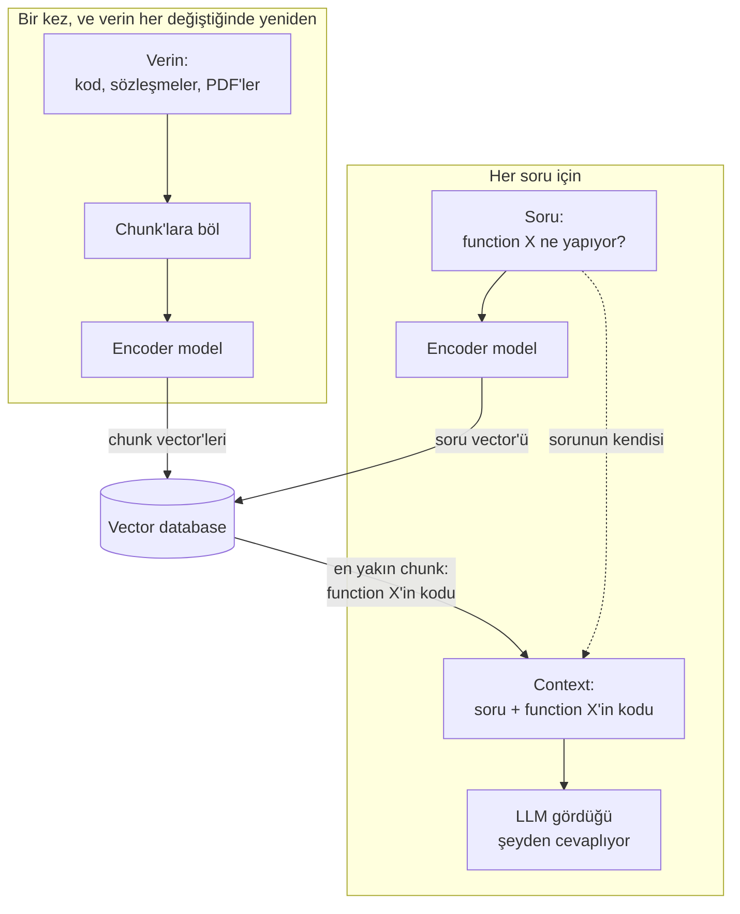
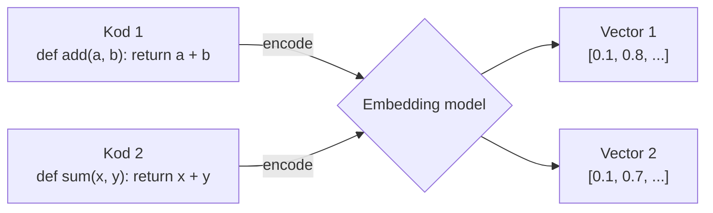
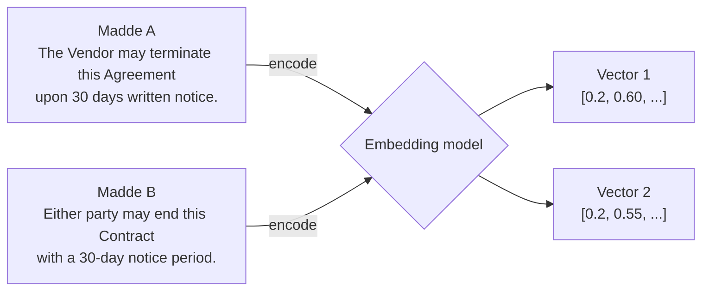
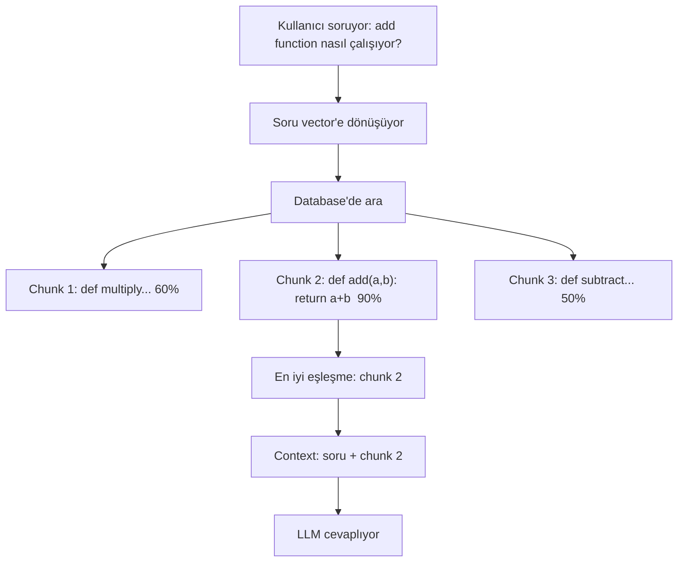
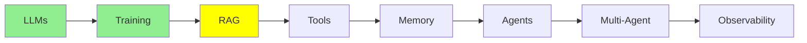

# Retrieval-Augmented Generation (RAG)

[LLM Fundamentals](llms_tr.md) sana context window'u verdi. Context window modelin çalışma masası,
ve üstündeki her şeyin oraya sığması gerekiyor. [Training LLMs](training_tr.md) sana fine-tuning'i
verdi, yani modelin kendisini değiştirmeyi. Bu modül üçüncü seçenekle ilgili. En sık kullanacağın
seçenek de bu.

## RAG Neden Var

Faydalı verin var:

- kendi codebase'in
- şirketinin dokümanları
- bir klasör dolusu sözleşme
- yıllarca birikmiş support ticket'ları

Bu veri bir context window'a sığandan çok daha fazla. Context window da katı bir sınır.

Ama işin özü şu: **tek bir soru için hepsine ihtiyacın yok.** Biri bir vendor sözleşmesindeki fesih
maddesini soruyor. O kişiye diğer iki yüz sözleşme gerekmiyor. Ona tek bir madde gerekiyor.

Bütün fikir bu. Veriyi modelin dışında tut. Bir soru geldiğinde sadece onu cevaplayan parçaları
getir ve onları context'e koy. **Retrieval-Augmented Generation** bunun adı: önce getir (retrieve), sonra
üret (generate).

### Masaüstü ve Kütüphane

Bunu basitçe şöyle düşünebilirsin.

**Modelin weight'leri bir kütüphane.** Çok büyük, ve modelin pre-training'de öğrendiği her şey bir
yerlerde onun içinde. **Context window ise senin masaüstün.** Küçük, ve üstüne ne koyarsan tam önünde duruyor.

Kocaman bir kütüphaneden bir şey hatırlamak zor ve güvenilmez. Masanın üstünde açık duran bir
sayfayı okumak kolay ve kesin.

RAG, masaya hangi sayfaların konacağını seçmek demek.

  
*Temel, "naive" RAG akışı. Query aynı anda iki yere gidiyor. Bir yol, vector store index'inde arama yapmak için bir embedding model'den geçiyor. Diğer yol, aramanın döndürdüğü context ile birlikte doğrudan LLM'e gidiyor.*

## RAG Ne Yapar



Aynı numara metinden oluşan her şey için geçerli, sadece kod için değil. Diyelim bir klasör dolusu
sözleşmen var. Biri "Acme vendor sözleşmesindeki fesih ihbar süresi nedir?" diye soruyor. Model
hafızasından tahmin etmiyor. Onun yerine RAG elindeki bütün sözleşmelerde arama yapıyor ve soruyu
cevaplayan maddeyi buluyor. Sonra modele sadece o maddeyi veriyor.

Altındaki mekanizma şu. Bir encoder model metni vector embedding'lere çeviriyor. Bu embedding'leri
bir vector database'de tutuyorsun. Sonra soruyu da vector'e çeviriyorsun ve en yakın eşleşmeleri
buluyorsun.

## Vector Embedding'ler

Embedding, bir metin parçasını tarif eden bir sayı listesi. Onu bir parmak izi gibi düşün. Bu sayı
listesini encoder denen özel bir model üretiyor.

Faydalı özellik şu: **benzer anlam benzer sayılar veriyor.** Bu, bir şehirdeki adresler gibi
çalışıyor: yakın adresler yakın yerler demek. İki parmak izinin ne kadar yakın olduğunu **cosine
similarity** ile ölçüyoruz. Yüksek skor, ikisinin çok benzer olduğu anlamına geliyor.

Bunun klasik resmi dört kelime kullanıyor:

  
*Dört kelime dört vector'e dönüşüyor, ve o vector'ler uzayda birer konuma dönüşüyor. "king", "queen"in yanına, "man" da "woman"ın yanına düşüyor. Şimdi iki oka bak. Paralel duruyorlar, yani king'den queen'e giden adım, man'den woman'a giden adımın aynısı. Anlam geometriye dönüşmüş.*

O paralelliğe bir saniye bak. Sayıları bir arama tablosundan fazlası yapan şey o. Embedding sadece
benzer şeyleri yan yana koymadı. Aralarındaki *ilişkiyi* de tutarlı bir yöne yerleştirdi.

Burada dürüst bir basitleştirme var. Resim sayfaya sığsın diye üç boyut çiziyor. Gerçek
embedding'lerin yüzlerce ya da binlerce boyutu var. Yakınlığı gözle bakarak değil de cosine
similarity ile ölçmemizin sebebi tam olarak bu.



Bunlar iki farklı function, ve sayıları birbirine yakın çıkıyor. Bütün mesele o yakınlık. Birini
sorduğunda bir aramanın diğerini bulabilmesini sağlayan şey bu.

Önemli olan kısım, bunun eşleşen kelimeleri değil *anlamı* yakalaması:



İki maddenin anlamı aynı, ama neredeyse hiç ortak kelimeleri yok. Vector'ler yine de yan yana
düşüyor.

Keyword arama Madde B'yi bu yüzden kaçırırdı, retrieval ise buluyor.

## Vector Database'ler

Bir vector database bu parmak izlerinden milyonlarcasını saklıyor. Her birini orijinal metnine
bağlı tutuyor ve onları hızlıca arıyor. Ona bir query vector'ü veriyorsun, o da en yakın N tanesini
döndürüyor. Sonra sen onları LLM'e veriyorsun.

**Ücretsiz ve local:**

- **ChromaDB**: başlamak için en kolayı.
- **Milvus**: daha büyük projeler için.
- **FAISS**: bellek içinde çok hızlı arama.

**Yönetilen servisler:**

- **Pinecone**: basit ve hosted.
- **Weaviate**: verinin korumak istediğin bir yapısı olduğunda iyi.

## RAG Süreci

**Kurulum, bir kez ve sonra veri değiştikçe:**

1. Kaynak verini yükle: kod dosyaları, sözleşmeler, politikalar, PDF'ler, her türlü metin.
2. Onu bir function, bir paragraf ya da bir sözleşme maddesi gibi küçük chunk'lara böl.
3. Her chunk'ı bir embedding'e çevir.
4. Embedding'leri bir vector database'de sakla.

**Cevaplama, her soru için:**

1. Kullanıcının sorusunu al.
2. Onu bir embedding'e çevir.
3. Database'de en yakın chunk'ları ara.
4. O chunk'ların gerçek metnini çek.
5. O metni soruyla birlikte context'e koy.
6. LLM artık görebildiği şeyden cevaplıyor.



"Kod chunk'ları" yerine "sözleşme maddeleri" koy, akış birebir aynı.

## RAG Araçları

Retrieval loop'unu neredeyse hiç kendin yazmayacaksın. Bir seviye seç, gerisini başka bir şey
yapsın:

- **[LlamaIndex](https://www.llamaindex.ai/)**: en üst seviye. Bir klasöre yönlendir, soruyu sor,
  cevabı al. Chunk'lama, embedding, saklama ve getirmeyi o hallediyor.
- **[Haystack](https://haystack.deepset.ai/)**: pipeline'ı hazır parçalardan kur. Her adımı görmek
  ve değiştirmek istediğinde bunu kullan.
- **[ChromaDB](https://github.com/chroma-core/chroma)**: metnini embedding'lerinin yanında saklayan
  bir vector database. Böylece bir arama sana orijinal chunk'ı geri veriyor.
- **[FAISS](https://github.com/facebookresearch/faiss)**: sadece arama katmanı, başka bir şey değil.
  Çok hızlı, ve sadece sayılardan haberi var.

Aşağıda FAISS var. Gösterilmeye değer en küçük şey bu, çünkü yukarıdaki bütün seçeneklerin
sardığı ham mekanizma tam olarak bu:

```python
import faiss
import numpy as np

index = faiss.IndexFlatL2(128)                              # 128 boyutlu vector'ler
index.add(np.random.random((100, 128)).astype('float32'))   # senin 100 chunk embedding'in

query = np.random.random((1, 128)).astype('float32')        # soru, embed edilmiş hali
distances, indices = index.search(query, 5)                 # en yakın beş chunk
```

Bu arama adımı, ve sadece arama adımı. FAISS sana pozisyonları döndürüyor. Bu yüzden
orijinal metni bir yerde tutmak ve index'e göre ona bakmak senin işin. Yukarıdaki araçlar seni tam
olarak bu kayıt tutma işinden kurtarmak için var. Metni vector ile birlikte saklıyorlar ve sana
chunk'ın kendisini veriyorlar.

Bir RAG sistemini parça parça kurmak yerine hazır bir sistemle başlamak istersen, bu açık kaynak
projeler olduğu gibi kullanılmaya hazır:

- **[RAGFlow](https://github.com/infiniflow/ragflow)** web arayüzü olan tam bir RAG platformu. Onu
  Docker ile çalıştırıyorsun. Layout'lar, tablolar ve taranmış sayfalar dahil, düzensiz dokümanları
  okumakta iyi. Cevapları kaynağa geri giden alıntılar (citation) taşıyor.
- **[LightRAG](https://github.com/HKUDS/LightRAG)** dokümanlarındaki kişilerden, şeylerden ve
  ilişkilerden bir knowledge graph kuruyor. Embedding'leri de bu graph'ın yanında tutuyor. Böylece
  bir arama sadece benzerliği değil, bağlantıları da takip edebiliyor. Bir server'ı ve web arayüzü
  olan bir Python library'si. Aynı zamanda Microsoft'un GraphRAG'ine daha hafif bir alternatif.
- **[PageIndex](https://github.com/VectifyAI/PageIndex)** vector database ve chunking kullanmıyor.
  Her doküman için içindekiler tablosuna benzeyen bir ağaç kuruyor. Sonra bir LLM ağaçta akıl
  yürüterek doğru bölüme iniyor. Savunduğu fikir şu: benzer olan, ilgili olanla aynı şey değil.
- **[RAG-Anything](https://github.com/HKUDS/RAG-Anything)** LightRAG üzerine kurulu. Metni
  görsellerle, tablolarla ve denklemlerle karıştıran dokümanları işliyor. 2026'dan beri LightRAG'in
  kendisi de bu yeteneği içeriyor.
- **[DocsGPT](https://github.com/arc53/DocsGPT)** kendin barındırdığın (self-hosted) bir uygulama.
  Dokümanlarını, web sitelerini ve bağlı uygulamalarını asistanlara çeviriyor. Bu asistanlar kaynak
  göstererek cevap veriyor.
- **[MiniRAG](https://github.com/HKUDS/MiniRAG)** bir araştırma projesi. RAG'i küçük dil
  modelleriyle çalıştırıyor, böylece tek bir cihazda çalışabiliyor.
- **[PixelRAG](https://github.com/StarTrail-org/PixelRAG)** sayfalardan çıkarılmış metin yerine
  sayfaların ekran görüntülerinde arama yapıyor. Böylece tablolar, grafikler ve layout kaybolmuyor.
  2026 tarihli bir araştırma makalesinden geliyor ve çok yeni.

## Peki Neden Modeli Kendi Dokümanlarınla Fine-tune Etmiyoruz?

Fine-tuning'i [Training LLMs](training_tr.md) modülünde öğrendin, bu yüzden akla ilk gelen soru bu.
Embedding'ler ve bir database'le neden uğraşalım?

**Çünkü şirketinin bilgisi canlı, fine-tuning ise anlık bir fotoğraf.** Codebase'ine her gün commit
geliyor. Sözleşmeler değiştiriliyor, yenileri imzalanıyor, politikalar değişiyor. Fine-tuning
saatler ya da günler sürüyor ve gerçek para tutuyor. Her dosya değiştiğinde onu yeniden
çalıştıramazsın. Şirketinin dokümanlarını tutması için bir modeli fine-tune etmek, canlı bir
problemi bir fotoğrafla çözmeye çalışmak demek.

**Çünkü fine-tuning veri için değil, görev için.** Bir modele bir *davranış* öğretmekte iyi:
şöyle özetle, hep bu formatta cevapla, şu kategorilere ayır. Ama *bilgi* öğretmekte kötü. Senin
yüz sayfan milyarlarca parameter'ın arasına düşüyor, ve bu parameter'lar modelin okuduğu diğer her
şeyle dolu. Bu yüzden fine-tune edilmiş bir model senin detaylarını, pre-training'den yarım
hatırladığı bir şeyle kolayca karıştırabiliyor.

**Çünkü hareketli bir hedefle yarışıyorsun.** Diyelim bir ay boyunca kendi görevin için bir modeli
fine-tune ettin. İşin bittiğinde sıradaki frontier model çıkmış oluyor. Onu, sende olmayan
kaynaklara sahip bir lab eğitmiş. Hiç fine-tuning yapılmadan bile, muhtemelen senin görevinde, bir
önceki nesilden fine-tune ettiğin modelden daha iyi. O yarışı kazanamazsın, ve RAG o yarışa hiç
girmiyor.

**Çünkü retrieval cevabı modelin önüne koyuyor.** Masaüstü ve kütüphaneye dön. Fine-tuning,
dokümanlarını milyarlarca kitaplık bir kütüphanede bir rafa koymaya çalışıyor. Sonra modelin doğru
rafı hatırlamasını umuyor. RAG ise ihtiyacın olan tek sayfayı, soru sorulduğu anda, masanın üstüne açık
olarak koyuyor.

Tek satırla: **fine-tuning modelin *bildiğini* değiştiriyor; RAG modelin *gördüğünü*.**

Bir nokta daha: bu, ikisinden birini seçmek zorunda olduğun bir durum değil. Modeli nasıl
davranması gerektiği için fine-tune edebilir, ne bilmesi gerektiği için de RAG kullanabilirsin. Bu
kombinasyon production'da yaygın.

## Bu serinin neresindeyiz



## Özet

RAG verini modelin dışında tutuyor ve her soru için sadece ilgili parçayı getiriyor. Metin
embedding'lere dönüşüyor. Embedding'ler bir vector database'de yaşıyor, ve bir soru eşleşmelerini
benzerlik üzerinden buluyor.

Farkı hatırla. Weight'ler kütüphane, context window ise masa. Fine-tuning kütüphaneyi yeniden
diziyor. RAG ise masaya ne konacağını seçiyor.

Sırada tools var: model onlarla okumayı bırakıp iş yapmaya başlıyor.

**Hızlı Kontrol**: RAG ile bir soruyu cevaplamanın adımları nelerdir? Embedding'ler soruyla hiç
ortak kelimesi olmayan bir maddeyi neden buluyor? Ve bir RAG index'ini güncellemek neden yeniden
fine-tune etmekten daha ucuz?

## Kaynaklar

- [RAG vs fine-tuning](https://www.redhat.com/en/topics/ai/rag-vs-fine-tuning): Red Hat'in karşılaştırması, yukarıdaki bölümün uzun hali
- [What is RAG?](https://youtube.com/shorts/KBRvB_NDY-o?si=DIUHt8lihi0EzgxT): bütün fikir, kısa bir videoda
- [Fine-Tuning vs RAG: Why Not Both?](https://youtube.com/shorts/24jqSMs10zE?si=zuhAbSZcFGkTKVfI): ikisini birlikte kullanmak üzerine
- [Haystack](https://haystack.deepset.ai/): hazır parçalardan RAG pipeline'ları
- [LlamaIndex](https://www.llamaindex.ai/): bir LLM'i kendi verine bağlamak
- [ChromaDB](https://github.com/chroma-core/chroma): başlamak için en kolay vector database
- [FAISS](https://github.com/facebookresearch/faiss): arama katmanı, tek başına
- [RAGFlow](https://github.com/infiniflow/ragflow), [LightRAG](https://github.com/HKUDS/LightRAG), [PageIndex](https://github.com/VectifyAI/PageIndex), [RAG-Anything](https://github.com/HKUDS/RAG-Anything), [DocsGPT](https://github.com/arc53/DocsGPT), [MiniRAG](https://github.com/HKUDS/MiniRAG) ve [PixelRAG](https://github.com/StarTrail-org/PixelRAG): olduğu gibi çalıştırabileceğin tam RAG sistemleri
