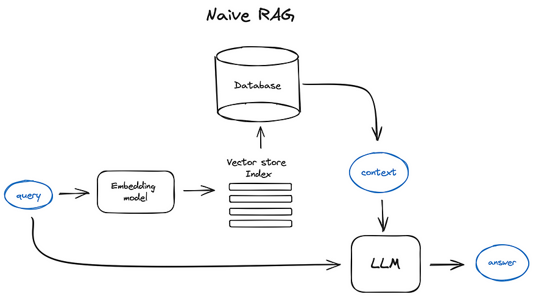
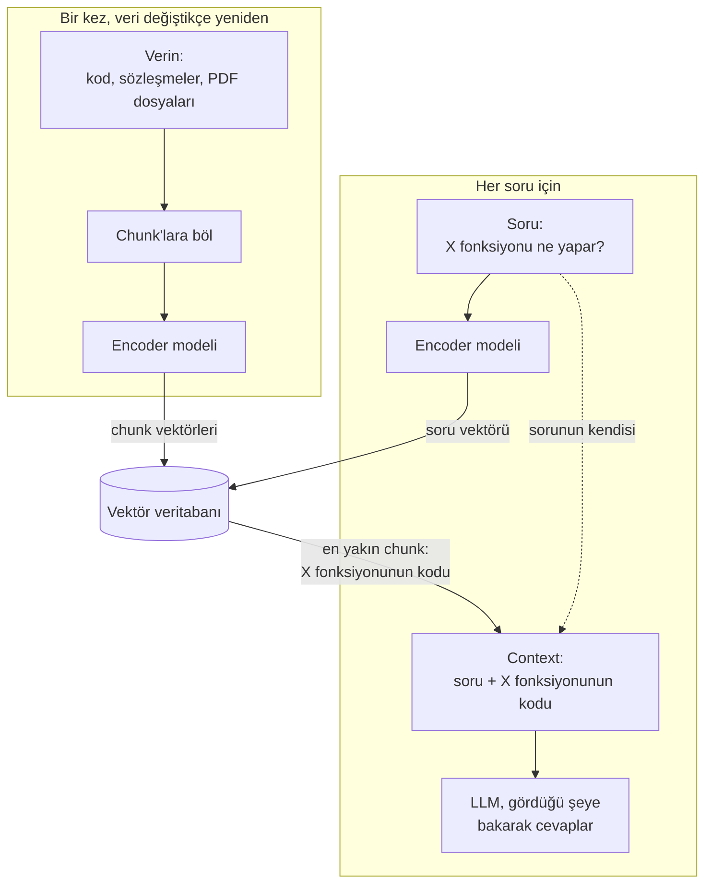
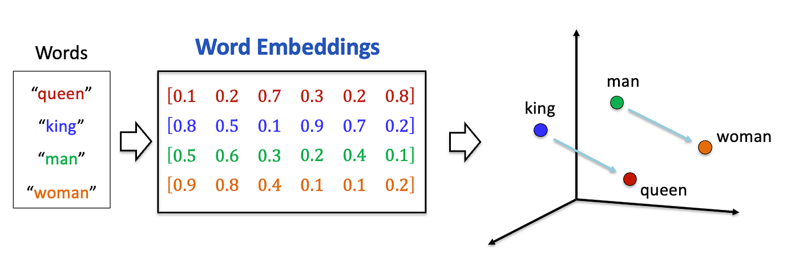
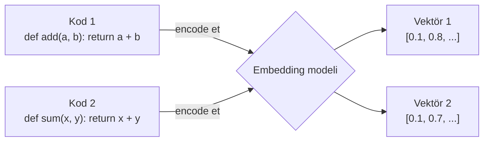
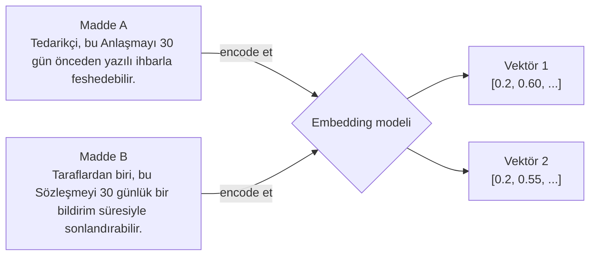
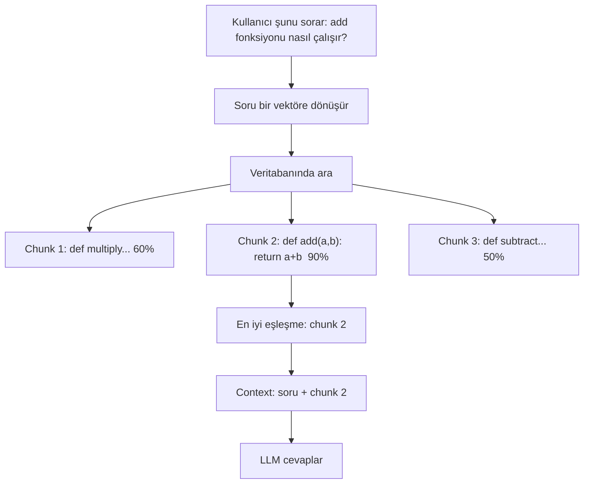
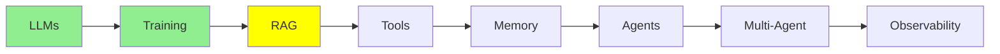

# Retrieval-Augmented Generation (RAG)

[LLM Temelleri](llms_tr.md) modülünde context window'u gördün. Bu, modelin çalışma masası gibidir ve masadaki her şey bu masaya sığmak zorundadır. [Training LLMs](training_tr.md) modülünde de fine-tuning'i öğrendin, yani modelin kendisini değiştiren yöntemi. Bu modül üçüncü bir seçenekten bahsediyor ve bu seçenek, en sık kullanacağın seçenek olacak.

## RAG Neden Gerekli?

Elinde işe yarayan veriler var:

- kod tabanın
- şirketinin belgeleri
- bir klasör dolusu sözleşme
- yıllardır biriken destek talepleri (support tickets)

Bu verinin toplamı, bir context window'a sığabileceğinden çok daha büyük ve context window de kesin bir sınır. Ama asıl önemli nokta şu: tek bir soru için bütün veriye ihtiyacın yok. Diyelim ki biri bir tedarikçi sözleşmesindeki fesih maddesini soruyor. O kişinin diğer iki yüz sözleşmeye ihtiyacı yoktur, ona yalnızca tek bir madde lazımdır.

Fikrin tamamı bu: veriyi modelin dışında tut, bir soru geldiğinde yalnızca ona cevap veren parçaları getir ve bu parçaları context'e koy. Buna **Retrieval-Augmented Generation** (RAG) denir ve adındaki mantık basittir: önce getir, sonra üret.

### Masa ve Kütüphane

Bunu düşünmenin basit bir yolu var. **Modelin ağırlıkları bir kütüphanedir.** Çok büyük bir kütüphanedir ve model pre-training sırasında öğrendiği her şey onun bir yerinde durur. **Context window ise senin masandır.** Küçüktür, ama masana ne koyarsan tam önünde olur.

Büyük bir kütüphanedeki bir şeyi hatırlamak zor ve güvenilmezdir, oysa önündeki masada açık duran bir sayfayı okumak kolay ve kesindir. Yani RAG, masaya hangi sayfaların konacağını seçmektir.

  
*Temel "naif" RAG akışı: sorgu aynı anda iki yere gider. Bir yol, vektör deposu indeksini aramak için bir embedding modelinden geçer. Diğer yol ise arama sonucunda dönen context ile birlikte doğrudan LLM'e gider.*

## RAG Ne Yapar?



Aynı mantık, kod dışında metinden oluşan her şey için de işler. Diyelim ki elinde bir klasör dolusu hukuki sözleşme var ve birisi "Acme tedarikçi sözleşmesindeki fesih bildirim süresi nedir?" diye soruyor. Model bunu hafızasından tahmin etmeye çalışmaz. Bunun yerine RAG, sahip olduğun bütün sözleşmelerde arama yapar, soruyu cevaplayan maddeyi bulur ve modele yalnızca o maddeyi verir.

Altta yatan mekanizma budur: bir encoder modeli metni vektör embedding'lerine çevirir, bu embedding'leri bir vektör veritabanında saklarsın ve soru geldiğinde soruyu da bir vektöre çevirip en yakın eşleşmeleri bulursun.

## Vektör Embedding'leri

Embedding, bir metin parçasını anlatan sayılardan oluşan bir listedir ve bunu bir parmak izi gibi düşünebilirsin. Bu sayıları, encoder adı verilen özel bir model üretir.

Asıl faydalı özellik şu: **benzer anlam, benzer sayılar üretir.** Bu, bir şehirdeki adresler gibi çalışır, çünkü birbirine yakın adresler yakın yerleri anlatır. İki parmak izinin ne kadar yakın olduğunu **cosine similarity** ile ölçeriz ve yüksek bir skor, ikisinin çok benzer olduğu anlamına gelir.

Bunun klasik örneği, dört kelime üzerinden anlatılan bir görseldir:

  
*Dört kelime dört vektöre dönüşür ve bu vektörler uzayda birer konuma yerleşir. King, queen'e yakın düşer, man ise woman'a. İki oka bak: paralel olmaları, king'den queen'e giden adımın man'den woman'a giden adımla aynı olduğunu gösterir. Anlam böylece geometriye dönüşmüştür.*

Şu paralelliğe bir an dikkat et, çünkü sayıları sıradan bir arama tablosundan ayıran da budur. Embedding yalnızca benzer şeyleri yan yana koymakla kalmadı. İkisi arasındaki *ilişkiyi* de tutarlı bir yöne yerleştirdi.

Açıkça söylemek gerekirse burada bir sadeleştirme yaptık: görsel, sayfaya sığsın diye üç boyut çiziyor. Gerçek embedding'ler ise yüzlerce, hatta binlerce boyuttan oluşur ve tam da bu yüzden yakınlığı gözle bakarak değil, cosine similarity ile ölçeriz.



İki farklı fonksiyona bak: sayıları birbirine yakın çıkıyor. Asıl önemli olan da bu yakınlık, çünkü birini sorduğunda diğerini bulmayı mümkün kılan şey tam olarak budur.

Asıl önemli nokta, bunun eşleşen kelimeleri değil *anlamı* yakalamasıdır:



Bu iki maddenin anlamı aynıdır, ama neredeyse hiç ortak kelimeleri yoktur ve yine de vektörler yan yana düşer. Bu yüzden anahtar kelime araması Madde B'yi kaçırırdı, retrieval ise onu bulur.

## Vektör Veritabanları

Bir vektör veritabanı bu parmak izlerinden milyonlarcasını saklar, her birini özgün metnine bağlı tutar ve hepsinde hızlı arama yapar. Ona bir sorgu vektörü verirsin, o da en yakın N tanesini geri döndürür ve sen bunları LLM'e iletirsin.

**Ücretsiz ve yerel çalışan seçenekler:**

- **ChromaDB**: başlamak için en kolay olanı.
- **Milvus**: daha büyük projeler için.
- **FAISS**: bellek içinde çok hızlı arama yapar.

**Yönetilen servisler:**

- **Pinecone**: basit ve bulutta barındırılan.
- **Weaviate**: verinin yapısını korumak istediğinde iyi bir seçenek.

## RAG Süreci

**Kurulum, bir kez yapılır ve veri değiştikçe yeniden yapılır:**

1. Kaynak verini yükle: kod dosyaları, sözleşmeler, politikalar, PDF'ler, her türlü metin.
2. Veriyi küçük chunk'lara böl. Bir chunk bir fonksiyon, bir paragraf ya da bir sözleşme maddesi olabilir.
3. Her chunk'ı bir embedding'e çevir.
4. Embedding'leri bir vektör veritabanına kaydet.

**Cevaplama, her soru için yapılır:**

1. Kullanıcının sorusunu al.
2. Soruyu bir embedding'e çevir.
3. Veritabanında en yakın chunk'ları ara.
4. Bu chunk'ların asıl metnini getir.
5. Bu metni soruyla birlikte context'e koy.
6. LLM, artık gördüğü şeye bakarak cevap verir.



Kod chunk'larını sözleşme maddeleriyle değiştirirsen, akış tamamen aynı kalır.

## RAG için Araçlar

Retrieval döngüsünü neredeyse hiçbir zaman kendin yazmayacaksın. Bu yüzden bir seviye seç ve geri kalanını başka bir şeye bırak:

- **[LlamaIndex](https://www.llamaindex.ai/)**: en üst seviye. Ona bir klasörü gösterirsin, bir soru sorarsın ve cevabı alırsın. Chunk'lara ayırma, embedding üretme, saklama ve getirme işlerinin hepsini o yapar.
- **[Haystack](https://haystack.deepset.ai/)**: pipeline'ı hazır parçalardan kurarsın. Her adımı görmek ve değiştirmek istediğinde bunu kullan.
- **[ChromaDB](https://github.com/chroma-core/chroma)**: metnini embedding'leriyle yan yana saklayan bir vektör veritabanı. Bu yüzden bir arama sana özgün chunk'ı geri verir.
- **[FAISS](https://github.com/facebookresearch/faiss)**: yalnızca arama katmanı, başka bir şey değil. Çok hızlıdır, ama yalnızca sayılardan anlar.

Şimdi FAISS'e bakalım, çünkü gösterilmeye değecek en küçük örnek budur: yukarıdaki her seçeneğin sarmaladığı ham mekanizma tam olarak bu.

```python
import faiss
import numpy as np

index = faiss.IndexFlatL2(128)                              # 128-dimension vectors
index.add(np.random.random((100, 128)).astype('float32'))   # your 100 chunk embeddings

query = np.random.random((1, 128)).astype('float32')        # the question, embedded
distances, indices = index.search(query, 5)                 # the five nearest chunks
```

Bu kod yalnızca arama adımını gösterir, başka bir şeyi değil. FAISS sana yalnızca sıra numaralarını (indeks) döndürür, bu yüzden özgün metni bir yerde tutmak ve indeksle geri bakmak senin işin. Yukarıdaki araçlar seni bu takip işinden kurtarmak için var: metni vektörle birlikte saklarlar ve sana doğrudan chunk'ın kendisini verirler.

Kendin kurmak yerine hazır bir RAG sisteminden başlamayı tercih edersen, şu açık kaynak projeler kullanıma hazır:

- **[RAGFlow](https://github.com/infiniflow/ragflow)**, web arayüzü olan eksiksiz bir RAG platformudur. Docker ile çalıştırırsın. Düzensiz belgeleri okumakta iyidir: sayfa düzenini, tabloları ve taranmış sayfaları da işler. Cevaplarında kaynağa giden atıflar (citation) bulunur.
- **[LightRAG](https://github.com/HKUDS/LightRAG)**, belgelerindeki kişilerin, nesnelerin ve ilişkilerin bir bilgi grafiğini (knowledge graph) kurar. Embedding'leri bu grafiğin yanında tutar, böylece bir arama yalnızca benzerliğe bakmaz, bağlantıları da takip edebilir. Bir Python kütüphanesidir, sunucusu ve web arayüzü de vardır. Ayrıca Microsoft'un GraphRAG'ine daha hafif bir alternatiftir.
- **[PageIndex](https://github.com/VectifyAI/PageIndex)** vektör veritabanı da chunk'lama da kullanmaz. Her belgenin, bir içindekiler tablosu gibi, ağaç yapılı bir yapısını kurar. Sonra bir LLM bu ağacın içinde aşağı doğru ilerleyerek doğru bölüme ulaşır. Projenin temel iddiası şu: benzer olan şey, ilgili olan şey değildir.
- **[RAG-Anything](https://github.com/HKUDS/RAG-Anything)**, LightRAG üzerine kuruludur. Metinle birlikte resim, tablo ve denklem içeren belgeleri işler. 2026'dan beri LightRAG'in kendisi de bu yeteneği içeriyor.
- **[DocsGPT](https://github.com/arc53/DocsGPT)**, kendi sunucunda çalıştırabileceğin bir uygulamadır. Belgelerini, web sitelerini ve bağladığın uygulamaları asistanlara dönüştürür. Bu asistanlar cevaplarını kaynak göstererek verir.
- **[MiniRAG](https://github.com/HKUDS/MiniRAG)** bir araştırma projesidir. RAG'i küçük dil modelleriyle çalışır hale getirir, bu sayede tek bir cihazda da çalışabilir.
- **[PixelRAG](https://github.com/StarTrail-org/PixelRAG)**, metni çıkarıp onda aramak yerine sayfaların ekran görüntülerinde arama yapar. Böylece tablolar, grafikler ve düzen kaybolmaz. 2026'da yayımlanmış bir araştırma makalesinden çıkmıştır ve çok yenidir.

## Neden Modeli Sadece Belgelerin Üzerinde Fine-tune Etmeyelim?

[Training LLMs](training_tr.md) modülünde fine-tuning'i öğrendin, o yüzden akla gelen ilk soru bu. Madem fine-tuning var, neden embedding'lerle ve bir veritabanıyla uğraşasın ki?

**Çünkü şirketinin bilgisi canlıdır, fine-tuning ise bir anlık görüntüdür.** Kod tabanına her gün yeni commit'ler gelir, sözleşmeler değişir, yenileri imzalanır ve politikalar güncellenir. Fine-tuning ise saatler ya da günler sürer, gerçek para tutar ve bir dosya her değiştiğinde yeniden çalıştırılamaz. Şirketinin belgelerini tutması için bir modeli fine-tune etmek, canlı bir sorunu fotoğrafla çözmeye çalışmaya benzer.

**Çünkü fine-tuning görevler için işe yarar, veri için değil.** Modele bir *davranış* öğretmekte iyidir; şöyle özetle, her zaman bu formatta cevap ver, şu kategorilere ayır gibi. Ama modele *gerçekleri* öğretmekte kötüdür. Senin yüz sayfan milyarlarca parametrenin arasına karışır ve bu parametreler modelin okuduğu her şeyle doludur. Bu yüzden fine-tune edilmiş bir model, senin ayrıntılarını pre-training'den yarım yamalak hatırladığı bir şeyle kolayca karıştırabilir.

**Çünkü hareketli bir hedefin peşindesin.** Diyelim ki bir ay boyunca görevin için bir modeli fine-tune ediyorsun. Bitirdiğinde ise bir sonraki öncü (frontier) model çıkmış olacak ve onu, senin sahip olmadığın kaynaklarla bir laboratuvar eğitmiş olacak. Hiç fine-tuning yapmasan bile bu model, büyük ihtimalle görevinde senin geçen kuşaktan fine-tune ettiğin modelden daha iyi olur. Bu yarışı kazanamazsın, RAG ise bu yarışın içine hiç girmez.

**Çünkü retrieval, cevabı modelin önüne koyar.** Masaya ve kütüphaneye geri dönersek, fine-tuning belgelerini milyarlarca kitap barındıran bir kütüphanenin bir yerindeki rafa koymaya çalışır ve sonra modelin doğru rafı hatırlamasını umar. RAG ise birisi soruyu sorduğu anda, ihtiyaç duyulan tek sayfayı masaya açık olarak koyar.

Tek cümleyle özetlersek: **fine-tuning modelin *bildiğini* değiştirir, RAG ise modelin *gördüğünü* değiştirir.**

Bir nokta daha var ve o da şu: bu ikisinden birini seçmek zorunda değilsin. Modelin nasıl davranması gerektiği için fine-tuning yapabilir, neyi bilmesi gerektiği için de RAG kullanabilirsin. Bu kombinasyon production ortamlarında oldukça yaygındır.

## Bu serinin neresindeyiz



## Özet

RAG, verini modelin dışında tutar ve her soru için yalnızca ilgili kısmı getirir. Metinler embedding'lere dönüşür, bu embedding'ler bir vektör veritabanında durur ve bir soru da eşleşmelerini benzerlik yoluyla bulur.

Şu farkı aklında tut: ağırlıklar kütüphane, context window ise masadır. Fine-tuning kütüphaneyi yeniden düzenler, RAG ise masaya ne konacağını seçer.

Sırada araçlar var, çünkü bir modelin yalnızca okuyan olmaktan çıkıp iş yapmaya başlaması araçlar sayesinde olur.

**Hızlı Kontrol**: RAG ile bir soruyu cevaplamanın adımları nelerdir? Embedding'ler, soruyla hiç ortak kelimesi olmayan bir maddeyi nasıl bulur? Bir RAG indeksini güncellemek, yeniden fine-tuning yapmaktan neden daha ucuzdur?

## Kaynaklar

- [RAG vs fine-tuning](https://www.redhat.com/en/topics/ai/rag-vs-fine-tuning): Red Hat'in karşılaştırması, yukarıdaki bölümün daha uzun hali.
- [What is RAG?](https://youtube.com/shorts/KBRvB_NDY-o?si=DIUHt8lihi0EzgxT): bütün fikri tek bir kısa videoda anlatır.
- [Fine-Tuning vs RAG: Why Not Both?](https://youtube.com/shorts/24jqSMs10zE?si=zuhAbSZcFGkTKVfI): ikisini birlikte kullanmak üzerine.
- [Haystack](https://haystack.deepset.ai/): RAG pipeline'larını hazır parçalardan kurmak.
- [LlamaIndex](https://www.llamaindex.ai/): bir LLM'i kendi verinle bağlamak.
- [ChromaDB](https://github.com/chroma-core/chroma): başlamak için en kolay vektör veritabanı.
- [FAISS](https://github.com/facebookresearch/faiss): tek başına arama katmanı.
- [RAGFlow](https://github.com/infiniflow/ragflow), [LightRAG](https://github.com/HKUDS/LightRAG), [PageIndex](https://github.com/VectifyAI/PageIndex), [RAG-Anything](https://github.com/HKUDS/RAG-Anything), [DocsGPT](https://github.com/arc53/DocsGPT), [MiniRAG](https://github.com/HKUDS/MiniRAG) ve [PixelRAG](https://github.com/StarTrail-org/PixelRAG): olduğu gibi çalıştırabileceğin eksiksiz RAG sistemleri.
