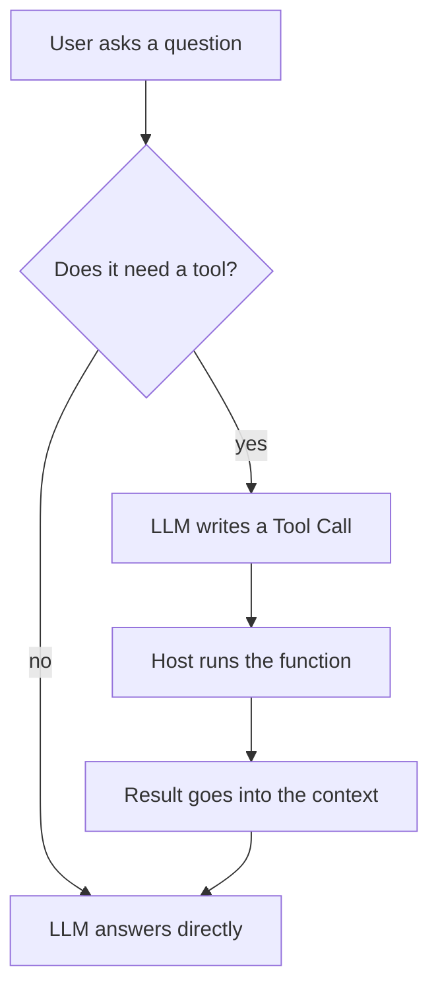
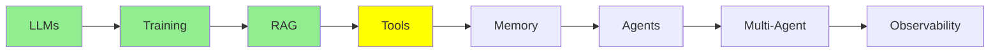

# Tool Calling

[LLM Fundamentals](llms.md), [Training LLMs](training.md) and [RAG & Embeddings](rag.md) covered
three things: what a model is, how it was trained, and how to put your own data in front of it. In
all of that, the model is still only reading. In this module, the model starts *doing* things: it
reads a file, runs a command, or calls an API.

This is the mechanism underneath every agent. So it is worth the effort to understand it exactly.

## What is a Tool?

  
*Tools are how a model reaches outside its own head. It searches the web, does maths or runs code, and then comes back with an answer.*

A **tool** is a function that you write. It is an ordinary Python function with a name, some inputs
and a return value. There is nothing special about it.

This is the part that people get wrong: **the model never runs your function.** It cannot. It has
no computer. The only thing it can do is write a message that says "I would like to call
`read_file` with `filename="main.py"`". Something on your side reads that message and runs the
function. Then it gives the return value back.

## Tool Calls Grow Context

[LLM Fundamentals](llms.md) introduced the context as a stack of messages. A tool call adds two new
kinds of message to that stack. This picture shows the whole flow:

  
*One tool call, in order. The system prompt declares the tool before anyone speaks. Then you ask, and the LLM writes a Tool Call. The host machine runs it and writes the Tool Result. Then the LLM reads that result and writes the answer.*

Follow the four arrows, because it matters who writes each message:

1. **You** write the Human Message.
2. **The LLM** writes the Tool Call. It is asking, not doing.
3. **The host machine** writes the Tool Result. Your laptop or your server is the machine that
   actually has Python installed and a filesystem to read.
4. **The LLM** reads the whole context, which now includes that result. Then it writes the answer.

Both new messages stay in the context. That is why an agent's context grows so much faster than
the context of a chat. One turn can add several messages instead of two.

## Why Tools Exist

A model is trained on fixed data. So, on its own, it cannot know anything new, and it cannot change
anything. Tools remove both limits.

**It cannot search the web.** So you write a function that takes a query, calls a search engine and
returns the results. Now it can.

**It cannot read your files.** So you write a function that takes a filename and returns the
contents. Now it can see your code.

Without tools, a model is a chatbot. With tools, it is an agent.

## Tool Schema

Here is the part that surprises people.

Before the model can choose a tool, somebody has to tell it three things: that the tool exists,
what it does, and what arguments it takes. That description is the **tool schema**. It is written
in JSON.

You almost never write that JSON yourself. You write a normal function, and your framework
generates the schema from it:

```python
@tool
def get_weather(city: str) -> str:
    """Get the current temperature for a city."""
    return requests.get(f"https://api.example.com/weather?city={city}").text
```

From that one decorator, the framework reads:

- the **name** from the function name, `get_weather`
- the **description** from the docstring
- the **parameters** from the type hints, so `city: str` becomes a required string

Then the framework sends that schema with your request. The model receives it at the start, next
to the system prompt. You register the function. The code that connects it to the model is not
yours to write.

**This means that the name and the description are not documentation. They are the interface.**
They are the only information the model has when it decides which tool to use. Take a function
called `get_data` with the docstring "gets data". The model will pick it at the wrong moments and
skip it at the right ones. No amount of prompting fixes that. Give the tool a name that says what
it does. Write the docstring for the model, because the model is the one that has to choose.

## Tool Call in Action

That is enough description. Here is a real exchange with a weather tool.

### What the Model Receives

The instructions and the tool schema arrive together. In the API, they are separate fields. But
from the model's point of view, they are one block at the top of the context:

```text
SYSTEM
You are a helpful assistant with access to tools.
Answer the user's question. If you need information you do not have, call a
tool instead of guessing. Never invent a weather reading.

TOOLS
get_weather
  Get the current temperature for a city.
  city (string, required) - The city name, for example "Istanbul"
```

That readable block is the schema that the framework generated. In the request that goes to the
API, it looks like this:

```json
{
  "type": "function",
  "function": {
    "name": "get_weather",
    "description": "Get the current temperature for a city.",
    "parameters": {
      "type": "object",
      "properties": {
        "city": {
          "type": "string",
          "description": "The city name, for example \"Istanbul\""
        }
      },
      "required": ["city"]
    }
  }
}
```

Notice that both the description and the parameter description came from things that you wrote in
Python.

### What You Ask

```text
USER
What's the weather in Istanbul right now?
```

### What the Model Generates

It does not generate prose. It generates this:

```json
{
  "role": "assistant",
  "content": null,
  "tool_calls": [
    {
      "id": "call_9k2m4Xq7",
      "type": "function",
      "function": {
        "name": "get_weather",
        "arguments": "{\"city\":\"Istanbul\"}"
      }
    }
  ]
}
```

Three things are worth noticing here. First, `content` is empty, because the model has not answered
yet. It has asked. Second, there is an `id`. This `id` is how the result gets matched back to this
specific call. Third, `arguments` is a **string** that contains JSON. It is not a JSON object.
Almost everyone gets this wrong once.

### What the Host Machine Does

When this message arrives, the framework takes over. It parses the arguments and finds the Python
function registered under `get_weather`. Then it calls that function:

```python
get_weather(city="Istanbul")   # -> '{"city":"Istanbul","temp_c":34,"conditions":"clear"}'
```

The return value goes back into the conversation as a new message. The framework tags this message
with the `id` from the call:

```json
{
  "role": "tool",
  "tool_call_id": "call_9k2m4Xq7",
  "content": "{\"city\":\"Istanbul\",\"temp_c\":34,\"conditions\":\"clear\"}"
}
```

### What the Model Answers

Now the whole context goes back to the model:

- the system prompt
- your question
- its own tool call
- the result

The model reads all of it and writes:

```text
ASSISTANT
It's currently 34°C and clear in Istanbul.
```

That is the entire mechanism. Every agent you will ever build is this loop, repeated.

The exact field names differ a little between providers. But the shape does not change:

- a schema that you did not write
- a call that the model writes
- an execution that you perform
- a result that you give back

## Example Tools

Anything that you can write as a function can be a tool. Here are a few real ones:

```python
@tool
def run_command(command: str) -> str:
    """Run a shell command and return its output."""
    return subprocess.run(command, shell=True, capture_output=True, text=True).stdout

@tool
def get_current_time() -> str:
    """Get the current date and time."""
    return datetime.datetime.now().strftime('%Y-%m-%d %H:%M:%S')

@tool
def query_db(sql: str) -> list:
    """Run a read-only SQL query against the application database."""
    with sqlite3.connect('database.db') as conn:
        return conn.execute(sql).fetchall()

@tool
def search_docs(query: str) -> list:
    """Find the most relevant documentation passages for a question."""
    return vector_db.search(encode(query), top_k=5)

@tool
def send_email(to: str, subject: str, body: str) -> str:
    """Send an email from the user's account."""
    return gmail.users().messages().send(userId='me', body=compose(to, subject, body)).execute()
```

**Most useful tools are a wrapper around an API.** That last one is nine tenths Gmail's own API and
one tenth tool. The tool part is a function signature, a docstring, and a call. The same shape can
give an agent access to:

- your Jira (create an issue, search, comment)
- your calendar
- your payment provider
- your internal service

Anything with an API can become something that the model is able to reach. That is usually the
fastest way to make an agent useful at work, because the API you need almost always exists already.

Two things follow from this. First, the tool is exactly as powerful as the credentials that you give
it. So a tool that can send mail from your account can send anything to anyone. Second, you rarely
have to write these tools yourself any more. [Code Agents](../2_intermediate/coding_agents.md)
covers MCP. With MCP, somebody has already wrapped the API that you were about to wrap.

The docs tool is also worth a second look. It is the RAG pipeline from [RAG & Embeddings](rag.md),
turned into a tool. Now the model decides *when* to retrieve. You no longer retrieve on every
question. That small change is most of what separates a RAG app from an agent.



## Where this fits in the series



## Summary

A tool is a function that you write. The model cannot run it. So the model writes a Tool Call, and
your machine runs the function and gives back a Tool Result. Both messages go into the context.
That is why agent contexts grow fast.

You do not write the schema. Your framework generates it from the function, its docstring and its
type hints. This makes the name and the docstring the real interface. They are all the model has
when it decides which tool to use.

Next comes memory: what happens to all these messages as the context fills up.

**Quick Check**: who executes a tool, the model or the host? And why does a tool's docstring matter
more than its implementation?

## References

- [Mastering LLM tool calling](https://machinelearningmastery.com/mastering-llm-tool-calling-the-complete-framework-for-connecting-models-to-the-real-world/): the full framework, with more of the wire format than we needed here
