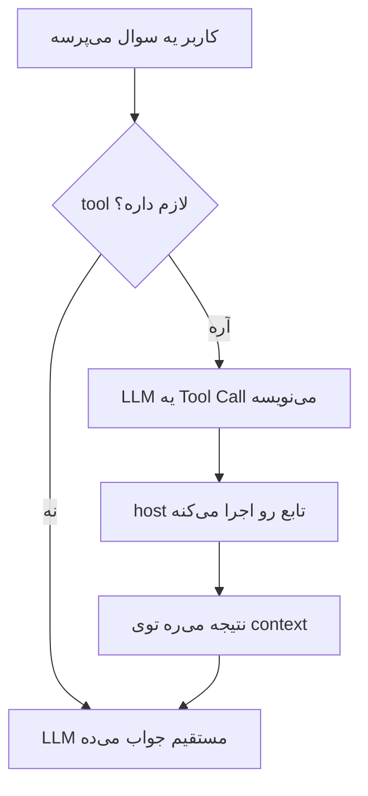
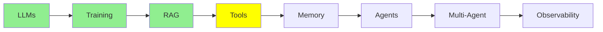

# Tool Calling

توی [مبانی LLM](llms_fa.md)، [Training LLMs](training_fa.md) و [RAG و Embedding‌ها](rag_fa.md) سه تا چیز رو دیدیم: مدل چیه، چطور train شده، و چطور داده‌ی خودت رو بذاری جلوش. ولی توی همه‌ی این‌ها مدل فقط می‌خونه. از این درس به بعد مدل *دست به کار* می‌شه: یه فایل رو باز می‌کنه، یه دستور رو اجرا می‌کنه یا یه API رو صدا می‌زنه.

همه‌ی agent‌ها روی همین سازوکار سوارن، پس می‌ارزه وقت بذاری و دقیق بفهمیش.

## tool چیه؟

  
*مدل با tool‌هاست که دستش به بیرون از ذهن خودش می‌رسه: توی وب می‌گرده، حساب و کتاب می‌کنه یا کد اجرا می‌کنه، و بعد با جواب برمی‌گرده.*

**tool** یه تابعه که خودت می‌نویسی؛ یه تابع معمولی Python با یه اسم، چند تا ورودی و یه مقدار خروجی، و هیچ چیز خاصی هم نداره.

اشتباه رایج همین‌جاست: **مدل هیچ‌وقت تابع تو رو اجرا نمی‌کنه.** اصلاً نمی‌تونه، چون کامپیوتری در اختیار نداره. تنها کاری که از دستش برمیاد اینه که یه پیام بنویسه به این مضمون: «می‌خوام `read_file` رو با `filename="main.py"` صدا بزنم.» بعد یه چیزی سمت تو این پیام رو می‌خونه، تابع رو اجرا می‌کنه و خروجیش رو برمی‌گردونه.

## چرا Tool Call‌ها context رو بزرگ می‌کنن

توی [مبانی LLM](llms_fa.md) گفتیم context یه پشته از پیام‌هاست. هر tool call دو نوع پیام جدید به این پشته اضافه می‌کنه، و این تصویر کل ماجرا رو از اول تا آخر نشون می‌ده:

  
*یه tool call، به ترتیب: system prompt قبل از این‌که کسی حرفی بزنه، tool رو معرفی می‌کنه. بعد تو سوال می‌پرسی و LLM یه Tool Call می‌نویسه. host machine اجراش می‌کنه و Tool Result رو می‌نویسه، و آخر سر LLM اون نتیجه رو می‌خونه و جواب رو می‌نویسه.*

چهار تا فلش رو دنبال کن، چون مهمه هر پیام رو کی نوشته:

1. **تو** Human Message رو می‌نویسی.
2. **LLM** Tool Call رو می‌نویسه. فقط درخواست می‌ده و خودش کاری نمی‌کنه.
3. **host machine** Tool Result رو می‌نویسه، چون لپ‌تاپ یا سرور توئه که Python روش نصبه و فایل‌سیستمی داره که بشه ازش خوند.
4. **LLM** کل context رو، که حالا اون نتیجه هم توشه، می‌خونه و جواب رو می‌نویسه.

هر دو پیام جدید توی context می‌مونن، و واسه همینه که context یه agent خیلی سریع‌تر از context یه چت معمولی بزرگ می‌شه: هر نوبت به‌جای دو تا پیام، ممکنه چند تا پیام اضافه کنه.

## چرا اصلاً tool لازمه؟

مدل روی یه داده‌ی ثابت train شده، پس به‌تنهایی نه از چیز تازه‌ای خبردار می‌شه و نه می‌تونه چیزی رو تغییر بده. tool‌ها هر دوی این محدودیت‌ها رو برمی‌دارن.

**مدل نمی‌تونه توی وب جستجو کنه.** پس یه تابع می‌نویسی که یه query می‌گیره، یه موتور جستجو رو صدا می‌زنه و نتیجه‌ها رو برمی‌گردونه؛ حالا دیگه می‌تونه.

**مدل نمی‌تونه فایل‌هات رو بخونه.** پس یه تابع می‌نویسی که اسم فایل رو می‌گیره و محتواش رو برمی‌گردونه؛ حالا دیگه کدت رو می‌بینه.

مدل بدون tool یه chatbot‌ه، ولی با tool می‌شه یه agent.

## tool schema

این قسمتش برای خیلی‌ها جای تعجب داره.

قبل از این‌که مدل بتونه یه tool رو انتخاب کنه، یکی باید سه چیز رو بهش بگه: این‌که اصلاً همچین tool‌ای هست، چی کار می‌کنه و چه argument‌هایی می‌گیره. به این توضیح می‌گن **tool schema**، که با JSON نوشته می‌شه.

ولی تقریباً هیچ‌وقت این JSON رو خودت نمی‌نویسی؛ یه تابع معمولی می‌نویسی و framework‌ت schema رو از روش می‌سازه:

```python
@tool
def get_weather(city: str) -> str:
    """Get the current temperature for a city."""
    return requests.get(f"https://api.example.com/weather?city={city}").text
```

framework فقط از روی همین یه decorator این‌ها رو درمیاره:

- **اسم** رو از اسم تابع، یعنی `get_weather`
- **description** رو از docstring
- **parameter‌ها** رو از type hint‌ها؛ این‌طوری `city: str` می‌شه یه string اجباری

بعد framework این schema رو همراه درخواستت می‌فرسته و مدل اون رو اول کار، کنار system prompt، تحویل می‌گیره. تو فقط تابع رو register می‌کنی؛ نوشتن کدی که اون رو به مدل وصل می‌کنه کار تو نیست.

**پس اسم و description فقط مستندات نیستن؛ رابط (interface) tool همین‌هان.** مدل موقع انتخاب tool هیچ اطلاعات دیگه‌ای جز این‌ها نداره. یه تابع رو در نظر بگیر به اسم `get_data` با docstring «gets data»: مدل اون رو جاهایی که نباید انتخاب می‌کنه و جاهایی که باید، نادیده‌ش می‌گیره، و هر چقدر هم prompt رو بالا پایین کنی درست نمی‌شه. پس برای tool اسمی بذار که بگه چی کار می‌کنه، و docstring رو برای مدل بنویس، چون انتخاب با مدله.

## یه Tool Call واقعی

دیگه توضیح بسه؛ بیا یه نمونه‌ی واقعی با یه tool آب‌وهوا ببینیم.

### چیزی که به مدل می‌رسه

دستورالعمل‌ها و tool schema با هم به مدل می‌رسن. توی API دو تا field جدان، ولی مدل همه‌ش رو به شکل یه بلوک بالای context می‌بینه:

```text
SYSTEM
You are a helpful assistant with access to tools.
Answer the user's question. If you need information you do not have, call a
tool instead of guessing. Never invent a weather reading.

TOOLS
get_weather
  Get the current temperature for a city.
  city (string, required) - The city name, for example "Istanbul"
```

این بلوک خوانا همون schema‌ایه که framework ساخته. توی درخواستی که به API می‌ره، این شکلیه:

```json
{
  "type": "function",
  "function": {
    "name": "get_weather",
    "description": "Get the current temperature for a city.",
    "parameters": {
      "type": "object",
      "properties": {
        "city": {
          "type": "string",
          "description": "The city name, for example \"Istanbul\""
        }
      },
      "required": ["city"]
    }
  }
}
```

دقت کن که هم description خود tool و هم description پارامترش، از چیزهایی اومدن که خودت توی Python نوشته بودی.

### سوالی که تو می‌پرسی

```text
USER
What's the weather in Istanbul right now?
```

### چیزی که مدل تولید می‌کنه

مدل این‌جا متن معمولی نمی‌نویسه، بلکه این رو تولید می‌کنه:

```json
{
  "role": "assistant",
  "content": null,
  "tool_calls": [
    {
      "id": "call_9k2m4Xq7",
      "type": "function",
      "function": {
        "name": "get_weather",
        "arguments": "{\"city\":\"Istanbul\"}"
      }
    }
  ]
}
```

سه تا نکته این‌جا هست. اول این‌که `content` خالیه، چون مدل هنوز جواب نداده و فقط درخواست کرده. دوم این‌که یه `id` داره و بعداً نتیجه از روی همین `id` به این call مشخص وصل می‌شه. سوم این‌که `arguments` یه **string**‌ه که توش JSON نوشته شده، نه یه JSON object؛ تقریباً همه حداقل یه بار سر این یکی اشتباه می‌کنن.

### کاری که host machine می‌کنه

وقتی این پیام می‌رسه، framework کار رو دستش می‌گیره: arguments رو parse می‌کنه، تابع Python‌ای رو که با اسم `get_weather` register شده پیدا می‌کنه و صداش می‌زنه:

```python
get_weather(city="Istanbul")   # -> '{"city":"Istanbul","temp_c":34,"conditions":"clear"}'
```

خروجی تابع به شکل یه پیام جدید برمی‌گرده توی گفتگو، و framework این پیام رو با همون `id` که توی call بود علامت می‌زنه:

```json
{
  "role": "tool",
  "tool_call_id": "call_9k2m4Xq7",
  "content": "{\"city\":\"Istanbul\",\"temp_c\":34,\"conditions\":\"clear\"}"
}
```

### جوابی که مدل می‌ده

حالا کل context دوباره می‌ره سمت مدل:

- system prompt
- سوال تو
- tool call خودش
- نتیجه

مدل همه‌ش رو می‌خونه و می‌نویسه:

```text
ASSISTANT
It's currently 34°C and clear in Istanbul.
```

کل سازوکار همینه. هر agent‌ی هم که از این به بعد بسازی، چیزی نیست جز همین loop که پشت سر هم تکرار می‌شه.

اسم دقیق field‌ها بین provider‌ها یه کم فرق می‌کنه، ولی اسکلت کار همیشه همینه:

- یه schema که خودت ننوشتی
- یه call که مدل می‌نویسه
- یه اجرا که کار توئه
- یه نتیجه که تو برمی‌گردونی

## چند تا tool نمونه

هر چیزی که بشه به شکل تابع نوشتش، می‌تونه یه tool باشه. این‌ها چند تا نمونه‌ی واقعی‌ان:

```python
@tool
def run_command(command: str) -> str:
    """Run a shell command and return its output."""
    return subprocess.run(command, shell=True, capture_output=True, text=True).stdout

@tool
def get_current_time() -> str:
    """Get the current date and time."""
    return datetime.datetime.now().strftime('%Y-%m-%d %H:%M:%S')

@tool
def query_db(sql: str) -> list:
    """Run a read-only SQL query against the application database."""
    with sqlite3.connect('database.db') as conn:
        return conn.execute(sql).fetchall()

@tool
def search_docs(query: str) -> list:
    """Find the most relevant documentation passages for a question."""
    return vector_db.search(encode(query), top_k=5)

@tool
def send_email(to: str, subject: str, body: str) -> str:
    """Send an email from the user's account."""
    return gmail.users().messages().send(userId='me', body=compose(to, subject, body)).execute()
```

**بیشتر tool‌های به‌دردبخور در اصل یه wrapper دور یه API‌ان.** توی همین آخری، نُه‌دهم کار رو API خود Gmail انجام می‌ده و tool فقط یه‌دهم باقی‌مونده رو اضافه می‌کنه؛ سهم tool یه امضای تابع، یه docstring و یه فراخوانیه. با همین الگو می‌شه به یه agent دسترسی داد به:

- Jira‌ت (ساختن issue، جستجو، کامنت گذاشتن)
- تقویمت
- سرویس پرداختت
- سرویس داخلی خودتون

هر چیزی که API داشته باشه، می‌تونه دم دست مدل قرار بگیره. معمولاً سریع‌ترین راه برای این‌که یه agent سر کار واقعاً به درد بخوره همینه، چون API‌ای که لازم داری تقریباً همیشه از قبل وجود داره.

این دو تا نتیجه داره. اول این‌که قدرت یه tool دقیقاً به اندازه‌ی credential‌هاییه که بهش می‌دی؛ یعنی tool‌ای که بتونه از اکانت تو ایمیل بفرسته، می‌تونه هر چیزی رو برای هر کسی بفرسته. دوم این‌که این روزها کمتر پیش میاد خودت این tool‌ها رو بنویسی. توی [Code Agent‌ها](../2_intermediate/coding_agents_fa.md) با MCP آشنا می‌شی، که یه روش استاندارد برای بسته‌بندی tool‌هاست تا یه tool رو یه بار بنویسی و توی هر agent‌ی کار کنه. با MCP، یکی قبلاً همون API‌ای رو که می‌خواستی wrap کنی، wrap کرده.

tool مربوط به جستجوی docs هم ارزش یه نگاه دوباره رو داره. این در واقع همون RAG pipeline‌ایه که توی [RAG و Embedding‌ها](rag_fa.md) دیدیم، فقط حالا شده یه tool. این‌جوری دیگه مدل تصمیم می‌گیره *کی* retrieve کنه و لازم نیست برای هر سوال retrieval انجام بدی. فرق اصلی یه اپ RAG با یه agent، تقریباً همین تغییر کوچیکه.



## کجای این مجموعه هستیم



## خلاصه

tool یه تابعه که خودت می‌نویسی و مدل نمی‌تونه اجراش کنه؛ واسه همین مدل یه Tool Call می‌نویسه و ماشین تو تابع رو اجرا می‌کنه و یه Tool Result برمی‌گردونه. هر دو پیام هم می‌رن توی context، و به همین خاطره که context agent‌ها این‌قدر سریع بزرگ می‌شه.

schema رو هم تو نمی‌نویسی؛ framework از روی خود تابع، docstring و type hint‌هاش می‌سازدش. پس رابط واقعی tool همون اسم و docstring‌شه، چون مدل موقع انتخاب tool چیزی جز این‌ها دستش نیست.

بعدی نوبت memory‌ه: این‌که وقتی context پر می‌شه، سر این همه پیام چی میاد.

**بررسی سریع**: tool رو کی اجرا می‌کنه، مدل یا host؟ و چرا docstring یه tool از کدی که داخلشه مهم‌تره؟

## منابع

- [Mastering LLM tool calling](https://machinelearningmastery.com/mastering-llm-tool-calling-the-complete-framework-for-connecting-models-to-the-real-world/): کل framework، با جزئیاتی از فرمت پیام‌ها که بیشتر از نیاز این درسه
