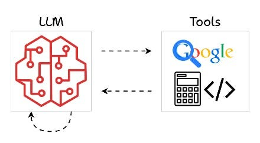
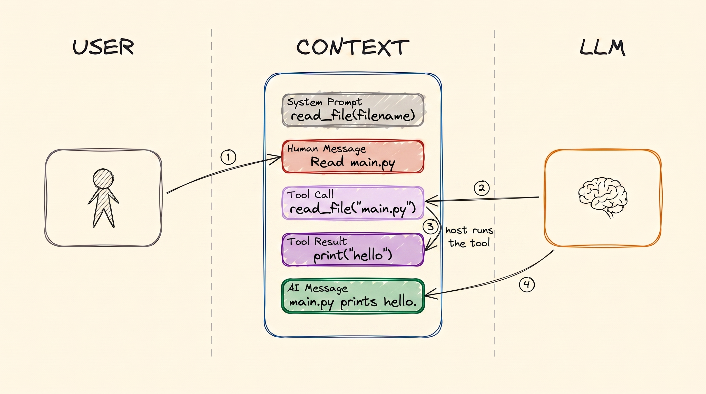
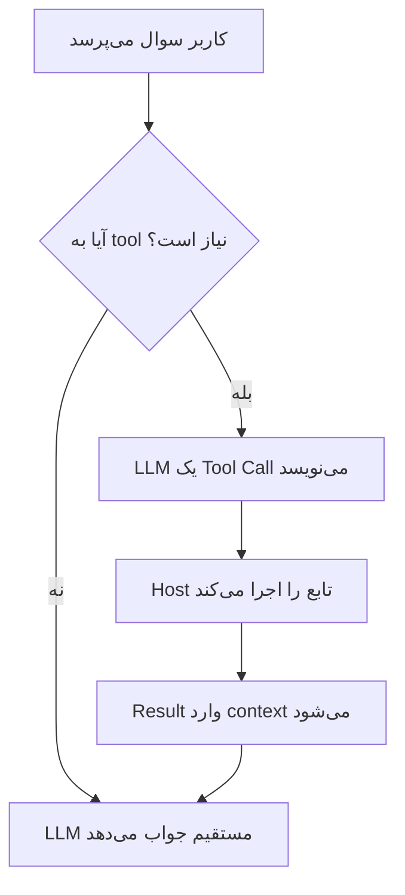
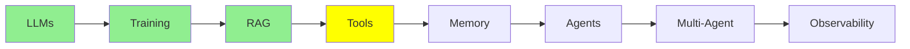

# Tool Calling

[مبانی LLM](llms_fa.md)، [Training LLMs](training_fa.md) و [RAG و Embedding‌ها](rag_fa.md) سه چیز را پوشش دادند: اینکه مدل چیست، چطور آموزش داده می‌شود، و چطور داده‌ی خودتان را جلوی مدل قرار می‌دهید. در همه‌ی این‌ها، مدل هنوز فقط می‌خواند. در این ماژول، مدل شروع می‌کند به *انجام کار*: فایلی را می‌خواند، یک command را اجرا می‌کند یا یک API را صدا می‌زند.

این مکانیزمی است که زیر هر agent قرار دارد. پس ارزش دارد که آن را دقیقاً بفهمید.

## Tool چیست؟

  
*Tool‌ها راهی هستند که مدل از طریق آن به بیرون از ذهن خودش دست می‌زند. مدل وب را جستجو می‌کند، محاسبه‌ی ریاضی انجام می‌دهد یا کد را اجرا می‌کند، و بعد با یک پاسخ برمی‌گردد.*

یک **tool** تابعی است که شما می‌نویسید. این یک تابع معمولی در Python است که یک نام، چند ورودی و یک مقدار بازگشتی دارد. هیچ چیز خاصی در آن نیست.

این بخشی است که مردم اشتباه می‌فهمند: **مدل هرگز تابع شما را اجرا نمی‌کند.** نمی‌تواند. کامپیوتر ندارد. تنها کاری که می‌تواند انجام دهد این است که پیامی بنویسد با این مضمون: «می‌خواهم `read_file` را با `filename="main.py"` صدا بزنم». بخشی در سمت شما این پیام را می‌خواند و تابع را اجرا می‌کند. بعد مقدار بازگشتی را برمی‌گرداند.

## Tool Call‌ها، context را بزرگ می‌کنند

در [مبانی LLM](llms_fa.md)، context به عنوان یک پشته از پیام‌ها معرفی شد. یک tool call دو نوع پیام تازه به آن پشته اضافه می‌کند. این تصویر کل جریان را نشان می‌دهد:

  
*یک tool call، به ترتیب زمانی. system prompt پیش از اینکه کسی حرف بزند، tool را اعلام می‌کند. بعد شما می‌پرسید و LLM یک Tool Call می‌نویسد. host machine آن را اجرا می‌کند و Tool Result را می‌نویسد. بعد LLM آن نتیجه را می‌خواند و جواب را می‌نویسد.*

چهار فلش را دنبال کنید، چون مهم است که هر پیام را چه کسی می‌نویسد:

1. **شما** Human Message را می‌نویسید.
2. **LLM** یک Tool Call می‌نویسد. دارد درخواست می‌کند، انجام نمی‌دهد.
3. **host machine** Tool Result را می‌نویسد. لپ‌تاپ یا سرور شما همان ماشینی است که
   واقعاً Python روی آن نصب است و یک filesystem برای خواندن دارد.
4. **LLM** کل context را می‌خواند، که حالا آن نتیجه را هم دارد. بعد جواب را می‌نویسد.

هر دو پیام تازه در context می‌مانند. به همین دلیل context یک agent خیلی سریع‌تر از context یک chat بزرگ می‌شود. یک نوبت می‌تواند به جای دو پیام، چند پیام اضافه کند.

## چرا Tool‌ها وجود دارند

یک مدل روی داده‌ی ثابت آموزش می‌بیند. پس به تنهایی نمی‌تواند چیز تازه‌ای بداند و نمی‌تواند چیزی را تغییر دهد. Tool‌ها هر دو محدودیت را برمی‌دارند.

**مدل نمی‌تواند وب را جستجو کند.** پس شما تابعی می‌نویسید که یک query می‌گیرد، یک search engine را صدا می‌زند و نتیجه‌ها را برمی‌گرداند. حالا مدل می‌تواند.

**مدل نمی‌تواند فایل‌های شما را بخواند.** پس تابعی می‌نویسید که یک نام فایل می‌گیرد و محتوای آن را برمی‌گرداند. حالا مدل می‌تواند کد شما را ببیند.

بدون tool، مدل یک chatbot است. با tool، یک agent است.

## Tool Schema

این بخشی است که خیلی‌ها را شگفت‌زده می‌کند.

پیش از اینکه مدل بتواند یک tool را انتخاب کند، باید کسی سه چیز به آن بگوید: اینکه tool وجود دارد، چه کاری انجام می‌دهد و چه argument‌هایی می‌گیرد. این توضیح همان **tool schema** است. با JSON نوشته می‌شود.

تقریباً هرگز خودتان آن JSON را نمی‌نویسید. یک تابع عادی می‌نویسید و framework، schema را از روی آن می‌سازد:

```python
@tool
def get_weather(city: str) -> str:
    """Get the current temperature for a city."""
    return requests.get(f"https://api.example.com/weather?city={city}").text
```

از همین یک decorator، framework این‌ها را می‌خواند:

- **name** از نام تابع، یعنی `get_weather`
- **description** از docstring
- **parameters** از type hint‌ها، پس `city: str` تبدیل می‌شود به یک string الزامی

بعد framework آن schema را همراه درخواست شما می‌فرستد. مدل آن را در ابتدای context، کنار system prompt، دریافت می‌کند. شما تابع را ثبت می‌کنید. کدی که آن را به مدل وصل می‌کند، وظیفه‌ی شما نیست.

**یعنی نام و description مستندات نیستند. آن‌ها interface هستند.** آن‌ها تنها اطلاعاتی هستند که مدل هنگام انتخاب tool در اختیار دارد. فرض کنید تابعی به نام `get_data` دارید که docstring آن می‌گوید «gets data». مدل آن را در زمان‌های اشتباه انتخاب می‌کند و در زمان‌های درست از آن رد می‌شود. هیچ مقدار prompt نوشتنی این را درست نمی‌کند. به tool نامی بدهید که بگوید چه کاری انجام می‌دهد. docstring را برای مدل بنویسید، چون این مدل است که باید انتخاب کند.

## Tool Call در عمل

این توضیح کافی است. در ادامه یک تبادل واقعی با یک weather tool را می‌بینید.

### آنچه مدل دریافت می‌کند

دستورالعمل‌ها و tool schema با هم می‌رسند. در API، این‌ها دو field جداگانه‌اند. اما از دید مدل، این‌ها یک بلوک در بالای context هستند:

```text
SYSTEM
You are a helpful assistant with access to tools.
Answer the user's question. If you need information you do not have, call a
tool instead of guessing. Never invent a weather reading.

TOOLS
get_weather
  Get the current temperature for a city.
  city (string, required) - The city name, for example "Istanbul"
```

آن بلوک خوانا همان schema است که framework ساخته است. در درخواستی که به API می‌رود، شکلش این است:

```json
{
  "type": "function",
  "function": {
    "name": "get_weather",
    "description": "Get the current temperature for a city.",
    "parameters": {
      "type": "object",
      "properties": {
        "city": {
          "type": "string",
          "description": "The city name, for example \"Istanbul\""
        }
      },
      "required": ["city"]
    }
  }
}
```

توجه کنید که هم description تابع و هم description پارامتر، از چیزهایی آمده‌اند که خودتان در Python نوشته‌اید.

### آنچه شما می‌پرسید

```text
USER
What's the weather in Istanbul right now?
```

### آنچه مدل تولید می‌کند

مدل متن نثر تولید نمی‌کند. این را تولید می‌کند:

```json
{
  "role": "assistant",
  "content": null,
  "tool_calls": [
    {
      "id": "call_9k2m4Xq7",
      "type": "function",
      "function": {
        "name": "get_weather",
        "arguments": "{\"city\":\"Istanbul\"}"
      }
    }
  ]
}
```

سه نکته اینجا ارزش توجه دارد. اول، `content` خالی است، چون مدل هنوز جواب نداده است. مدل پرسیده است. دوم، یک `id` وجود دارد. این `id` راهی است که نتیجه با آن به همین call مشخص وصل می‌شود. سوم، `arguments` یک **string** است که JSON را در خودش دارد. این یک JSON object نیست. تقریباً همه یک بار این را اشتباه می‌فهمند.

### کاری که host machine انجام می‌دهد

وقتی این پیام می‌رسد، framework کار را به دست می‌گیرد. arguments را parse می‌کند و تابع Python ثبت‌شده با نام `get_weather` را پیدا می‌کند. بعد آن تابع را صدا می‌زند:

```python
get_weather(city="Istanbul")   # -> '{"city":"Istanbul","temp_c":34,"conditions":"clear"}'
```

مقدار بازگشتی به عنوان یک پیام تازه به گفتگو برمی‌گردد. framework این پیام را با `id` همان call برچسب می‌زند:

```json
{
  "role": "tool",
  "tool_call_id": "call_9k2m4Xq7",
  "content": "{\"city\":\"Istanbul\",\"temp_c\":34,\"conditions\":\"clear\"}"
}
```

### آنچه مدل پاسخ می‌دهد

حالا کل context به مدل برمی‌گردد:

- system prompt
- سوال شما
- tool call خودش
- نتیجه

مدل همه‌ی آن را می‌خواند و می‌نویسد:

```text
ASSISTANT
It's currently 34°C and clear in Istanbul.
```

این کل مکانیزم است. هر agent که بسازید، همین loop است که بارها تکرار می‌شود.

نام دقیق field‌ها بین provider‌ها کمی فرق می‌کند. اما شکل کلی تغییر نمی‌کند:

- یک schema که شما ننوشته‌اید
- یک call که مدل می‌نویسد
- یک اجرا که شما انجام می‌دهید
- نتیجه‌ای که شما برمی‌گردانید

## نمونه‌هایی از Tool‌ها

هر چیزی که بتوانید به صورت تابع بنویسید می‌تواند یک tool باشد. در ادامه چند نمونه‌ی واقعی آمده است:

```python
@tool
def run_command(command: str) -> str:
    """Run a shell command and return its output."""
    return subprocess.run(command, shell=True, capture_output=True, text=True).stdout

@tool
def get_current_time() -> str:
    """Get the current date and time."""
    return datetime.datetime.now().strftime('%Y-%m-%d %H:%M:%S')

@tool
def query_db(sql: str) -> list:
    """Run a read-only SQL query against the application database."""
    with sqlite3.connect('database.db') as conn:
        return conn.execute(sql).fetchall()

@tool
def search_docs(query: str) -> list:
    """Find the most relevant documentation passages for a question."""
    return vector_db.search(encode(query), top_k=5)

@tool
def send_email(to: str, subject: str, body: str) -> str:
    """Send an email from the user's account."""
    return gmail.users().messages().send(userId='me', body=compose(to, subject, body)).execute()
```

**بیشتر tool‌های مفید، یک wrapper دور یک API هستند.** آخری، نُه‌دهمش API خودِ Gmail است و یک‌دهمش tool. بخش tool یک function signature، یک docstring و یک call است. همین شکل می‌تواند به یک agent دسترسی بدهد به:

- Jira شما (ساختن issue، جستجو، کامنت گذاشتن)
- تقویم شما
- provider پرداخت شما
- سرویس داخلی شما

هر چیزی که API داشته باشد می‌تواند چیزی شود که مدل به آن دسترسی دارد. معمولاً این سریع‌ترین راه برای مفید کردن یک agent در کار است، چون API مورد نیازتان تقریباً همیشه از قبل وجود دارد.

از این دو چیز نتیجه می‌شود. اول، قدرت یک tool دقیقاً برابر است با credential‌هایی که به آن می‌دهید. پس tool‌ای که می‌تواند ایمیل را از حساب شما بفرستد، می‌تواند هر چیزی را برای هر کسی بفرستد. دوم، دیگر به ندرت لازم است خودتان این tool‌ها را بنویسید. [Code Agent‌ها](../2_intermediate/coding_agents_fa.md) درباره‌ی MCP توضیح می‌دهد. با MCP، کسی از قبل همان API را wrap کرده است که شما قصد داشتید آن را wrap کنید.

tool مربوط به docs هم ارزش یک نگاه دوباره را دارد. این همان RAG pipeline از [RAG و Embedding‌ها](rag_fa.md) است که به یک tool تبدیل شده است. حالا مدل تصمیم می‌گیرد *کی* retrieve کند. دیگر برای هر سوال retrieve نمی‌کنید. همین تغییر کوچک، بخش عمده‌ی تفاوت یک RAG app با یک agent است.



## کجای این مجموعه هستیم



## خلاصه

یک tool تابعی است که شما می‌نویسید. مدل نمی‌تواند آن را اجرا کند. پس مدل یک Tool Call می‌نویسد، و ماشین شما تابع را اجرا می‌کند و یک Tool Result برمی‌گرداند. هر دو پیام وارد context می‌شوند. به همین دلیل context یک agent سریع بزرگ می‌شود.

شما schema را نمی‌نویسید. framework آن را از روی تابع، docstring و type hint‌هایش می‌سازد. به همین دلیل نام و docstring، interface واقعی هستند. آن‌ها تنها چیزی هستند که مدل هنگام انتخاب tool در اختیار دارد.

در ادامه نوبت memory است: وقتی context پر می‌شود، بر سر همه‌ی این پیام‌ها چه می‌آید.

**بررسی سریع**: چه کسی tool را اجرا می‌کند، مدل یا host؟ و چرا docstring یک tool از پیاده‌سازی آن مهم‌تر است؟

## منابع

- [Mastering LLM tool calling](https://machinelearningmastery.com/mastering-llm-tool-calling-the-complete-framework-for-connecting-models-to-the-real-world/): framework کامل، با جزئیات بیشتری از wire format نسبت به آنچه این‌جا لازم داشتیم
