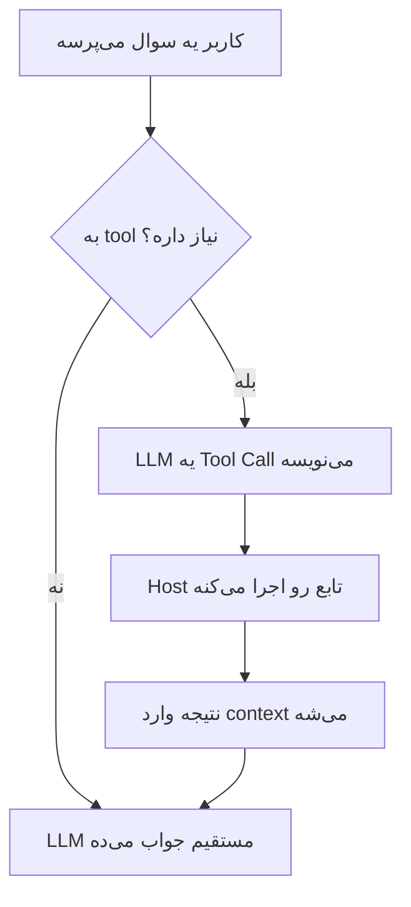
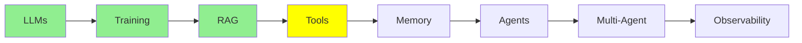

# Tool Calling

تو [مبانی LLM](llms_fa.md)، [Training LLMs](training_fa.md) و [RAG و Embedding‌ها](rag_fa.md) سه چیز رو یاد گرفتی: مدل چیه، چطوری آموزش دیده، و چطوری داده‌ی خودت رو جلوش بذاری. توی همه‌ی اون‌ها، مدل فقط داشت می‌خوند. توی این ماژول، مدل شروع می‌کنه به *کار کردن*: یه فایل رو می‌خونه، یه دستور رو اجرا می‌کنه، یا یه API رو صدا می‌زنه.

این مکانیزم پایه‌ی هر agent هست، پس ارزش داره وقت بذاری و دقیق بفهمیش.

## tool چیه؟

  
*tool‌ها راهی هستن که مدل از طریقشون به دنیای بیرون دست می‌زنه. مدل وب رو جستجو می‌کنه، حساب و کتاب انجام می‌ده یا کد اجرا می‌کنه، و بعد با یه جواب برمی‌گرده.*

یه **tool** یه تابعه که خودت می‌نویسیش. یه تابع معمولی‌ی Python هست، با یه اسم، چندتا ورودی و یه مقدار برگشتی، و هیچ چیز خاصی هم توش نیست.

اینجا همون جاییه که خیلی‌ها اشتباه می‌کنن: **مدل هیچ‌وقت تابع تو رو اجرا نمی‌کنه.** اصلاً نمی‌تونه، چون کامپیوتر نداره. کاری که از دستش برمی‌آد اینه که یه پیام بنویسه با این مضمون: «دوست دارم `read_file` رو با `filename="main.py"` صدا بزنم.» بعد یه چیزی سمت تو این پیام رو می‌خونه، تابع رو اجرا می‌کنه و مقدار برگشتی رو به مدل پس می‌ده.

## چرا Tool Call‌ها context رو بزرگ می‌کنن

تو [مبانی LLM](llms_fa.md) دیدی که context یه پشته از پیام‌هاست. هر tool call دو نوع پیام تازه به اون پشته اضافه می‌کنه. این تصویر کل جریان رو نشون می‌ده:

  
*این یک tool call از اول تا آخره. system prompt قبل از هر حرفی، tool رو معرفی می‌کنه. بعد تو سوال می‌پرسی و LLM یه Tool Call می‌نویسه. host machine اون رو اجرا می‌کنه و Tool Result رو می‌نویسه. در آخر LLM کل نتیجه رو می‌خونه و جواب رو می‌نویسه.*

به چهار تا فلش دقت کن، چون مهمه که هر پیام رو کی می‌نویسه:

1. **تو** Human Message رو می‌نویسی.
2. **LLM** یه Tool Call می‌نویسه. داره درخواست می‌کنه، نه اینکه خودش کاری رو انجام بده.
3. **host machine** یه Tool Result می‌نویسه. لپ‌تاپ یا سرور تو همون جاییه که Python نصبه و فایل‌ها رو می‌خونه.
4. **LLM** کل context رو می‌خونه، که حالا اون نتیجه هم توشه. بعد جواب رو می‌نویسه.

هر دو پیام جدید توی context می‌مونن، و برای همین context یه agent خیلی سریع‌تر از context یه chat بزرگ می‌شه. یه نوبت می‌تونه به جای دو پیام، چندتا پیام اضافه کنه.

## چرا اصلاً tool لازمه؟

یه مدل روی داده‌ی ثابت آموزش دیده، پس خودش به تنهایی نمی‌تونه چیز تازه‌ای بدونه و نمی‌تونه چیزی رو هم عوض کنه. tool‌ها هر دو این محدودیت رو برمی‌دارن.

**مدل نمی‌تونه وب رو جستجو کنه.** پس تو یه تابع می‌نویسی که یه query می‌گیره، یه موتور جستجو رو صدا می‌زنه و نتیجه‌ها رو برمی‌گردونه. حالا دیگه مدل هم می‌تونه جستجو کنه.

**مدل نمی‌تونه فایل‌های تو رو بخونه.** پس یه تابع می‌نویسی که اسم فایل رو می‌گیره و محتواش رو برمی‌گردونه. حالا مدل می‌تونه کد تو رو ببینه.

بدون tool، مدل فقط یه chatbot هست، ولی با tool تبدیل می‌شه به یه agent.

## tool schema

اینجا همون چیزیه که خیلی‌ها رو غافلگیر می‌کنه. قبل از اینکه مدل بتونه یه tool رو انتخاب کنه، یه نفر باید سه چیز رو بهش بگه: اینکه tool وجود داره، چیکار می‌کنه و چه آرگومان‌هایی می‌گیره. به این توضیح می‌گن **tool schema**، و با JSON نوشته می‌شه.

راستش تقریباً هیچ‌وقت لازم نیست خودت این JSON رو بنویسی. یه تابع معمولی می‌نویسی و framework از روش schema رو می‌سازه:

```python
@tool
def get_weather(city: str) -> str:
    """Get the current temperature for a city."""
    return requests.get(f"https://api.example.com/weather?city={city}").text
```

از همین یه decorator، framework این‌ها رو می‌خونه:

- **اسم** رو از اسم تابع برمی‌داره، یعنی `get_weather`
- **description** رو از docstring برمی‌داره
- **parameter‌ها** رو از type hint‌ها برمی‌داره. مثلاً `city: str` می‌شه یه رشته‌ی اجباری

بعد framework این schema رو همراه درخواستت می‌فرسته. مدل اون رو از اول و کنار system prompt می‌گیره. تو فقط تابع رو ثبت می‌کنی، و کدی که این تابع رو به مدل وصل می‌کنه دیگه قرار نیست تو بنویسیش.

**پس اسم و description مستندات نیستن. اون‌ها رابط (interface) هستن.** چون تنها اطلاعاتی که مدل موقع انتخاب tool داره همین‌هاست. فرض کن یه تابع داری به اسم `get_data` که docstring‌ش می‌گه «gets data». مدل این tool رو توی لحظه‌های اشتباه انتخاب می‌کنه و توی لحظه‌های درست ردش می‌کنه. هیچ prompt اضافه‌ای هم این مشکل رو حل نمی‌کنه. پس به tool یه اسمی بده که دقیقاً بگه چیکار می‌کنه، و docstring رو برای مدل بنویس، چون مدله که باید انتخابش کنه.

## یه Tool Call توی عمل

خب، این‌قدر توضیح کافیه، پس بذار یه تبادل واقعی با یه tool آب‌وهوا رو ببینیم.

### مدل چی دریافت می‌کنه

دستورالعمل‌ها و tool schema با هم می‌رسن. توی API این‌ها دو field جدان، ولی از دید مدل، یه بلوک واحد بالای context هستن:

```text
SYSTEM
You are a helpful assistant with access to tools.
Answer the user's question. If you need information you do not have, call a
tool instead of guessing. Never invent a weather reading.

TOOLS
get_weather
  Get the current temperature for a city.
  city (string, required) - The city name, for example "Istanbul"
```

این بلوک قابل‌خوندن، همون schema‌ای هست که framework ساخته. توی درخواستی که به API می‌ره، شکلش این‌جوریه:

```json
{
  "type": "function",
  "function": {
    "name": "get_weather",
    "description": "Get the current temperature for a city.",
    "parameters": {
      "type": "object",
      "properties": {
        "city": {
          "type": "string",
          "description": "The city name, for example \"Istanbul\""
        }
      },
      "required": ["city"]
    }
  }
}
```

به هر دو توضیح دقت کن، هم به description و هم به توضیح پارامتر. هر دوتاشون از چیزهایی اومدن که خودت توی Python نوشتی.

### سوالی که تو می‌پرسی

```text
USER
What's the weather in Istanbul right now?
```

### چیزی که مدل تولید می‌کنه

مدل اصلاً متن جواب نمی‌نویسه، بلکه این رو تولید می‌کنه:

```json
{
  "role": "assistant",
  "content": null,
  "tool_calls": [
    {
      "id": "call_9k2m4Xq7",
      "type": "function",
      "function": {
        "name": "get_weather",
        "arguments": "{\"city\":\"Istanbul\"}"
      }
    }
  ]
}
```

سه تا نکته توی این پیام هست. اول اینکه `content` خالیه، چون مدل هنوز جواب نداده و فقط درخواست کرده. دوم اینکه یه `id` داره، و این `id` باعث می‌شه نتیجه دقیقاً به همین call وصل بشه. سوم اینکه `arguments` یه **رشته** (string) هست که داخلش JSON نوشته شده، نه یه JSON object. تقریباً همه یه بار اینجا اشتباه می‌کنن.

### کاری که host machine انجام می‌ده

وقتی این پیام می‌رسه، framework کار رو دست می‌گیره. arguments رو parse می‌کنه، تابعی رو که زیر اسم `get_weather` ثبت شده پیدا می‌کنه و صداش می‌زنه:

```python
get_weather(city="Istanbul")   # -> '{"city":"Istanbul","temp_c":34,"conditions":"clear"}'
```

مقدار برگشتی به شکل یه پیام تازه برمی‌گرده توی مکالمه. framework این پیام رو با همون `id` تگ می‌زنه:

```json
{
  "role": "tool",
  "tool_call_id": "call_9k2m4Xq7",
  "content": "{\"city\":\"Istanbul\",\"temp_c\":34,\"conditions\":\"clear\"}"
}
```

### جوابی که مدل می‌ده

حالا کل context دوباره برمی‌گرده پیش مدل، و شامل این چیزهاست:

- system prompt
- سوالت
- Tool Call خودش
- نتیجه

مدل همه‌ش رو می‌خونه و این رو می‌نویسه:

```text
ASSISTANT
It's currently 34°C and clear in Istanbul.
```

این کل مکانیزمه، و هر agent‌ی که بعداً بسازی، در واقع همین حلقه‌ست که پشت هم تکرار می‌شه.

اسم field‌ها بین provider‌ها کمی فرق می‌کنه، ولی شکل کلی تغییر نمی‌کنه:

- یه schema که خودت ننوشتی
- یه call که مدل می‌نویسه
- یه اجرا که خودت انجام می‌دی
- یه نتیجه که خودت برمی‌گردونی

## چندتا tool نمونه

هر چیزی رو که بشه به شکل یه تابع نوشت، می‌تونه tool بشه. چندتا tool واقعی رو ببین:

```python
@tool
def run_command(command: str) -> str:
    """Run a shell command and return its output."""
    return subprocess.run(command, shell=True, capture_output=True, text=True).stdout

@tool
def get_current_time() -> str:
    """Get the current date and time."""
    return datetime.datetime.now().strftime('%Y-%m-%d %H:%M:%S')

@tool
def query_db(sql: str) -> list:
    """Run a read-only SQL query against the application database."""
    with sqlite3.connect('database.db') as conn:
        return conn.execute(sql).fetchall()

@tool
def search_docs(query: str) -> list:
    """Find the most relevant documentation passages for a question."""
    return vector_db.search(encode(query), top_k=5)

@tool
def send_email(to: str, subject: str, body: str) -> str:
    """Send an email from the user's account."""
    return gmail.users().messages().send(userId='me', body=compose(to, subject, body)).execute()
```

**بیشتر tool‌های مفید یه wrapper دور یه API هستن.** آخری رو ببین: نُه‌دهمش کار خود Gmail API هست و فقط یه‌دهمش مال tool هست. بخش tool یه امضای تابع، یه docstring و یه call هست. همین شکل می‌تونه به agent دسترسی بده به:

- Jira خودت (ساخت issue، جستجو و کامنت گذاشتن)
- تقویم تو
- provider پرداختت
- سرویس داخلی تو

هر چیزی که API داره می‌تونه چیزی بشه که مدل بهش دسترسی داره. معمولاً سریع‌ترین راه برای اینکه یه agent توی کار مفید بشه همینه، چون API مورد نیازت تقریباً همیشه از قبل وجود داره.

از این موضوع دو نتیجه درمی‌آد. اولی اینکه قدرت یه tool دقیقاً به اندازه‌ی credential‌هاییه که بهش می‌دی. پس tool‌ای که بتونه از اکانت تو ایمیل بفرسته، می‌تونه هر چیزی رو به هر کسی بفرسته. دومی اینکه دیگه خیلی کم پیش میاد که خودت این tool‌ها رو بنویسی. [Code Agent‌ها](../2_intermediate/coding_agents_fa.md) درباره‌ی MCP توضیح می‌ده، و با MCP یه نفر قبلاً API ای رو که قرار بود تو wrap کنی، wrap کرده.

tool‌ای که docs رو جستجو می‌کنه هم ارزش یه نگاه دوباره داره. این همون RAG pipeline از [RAG و Embedding‌ها](rag_fa.md) هست که تبدیل شده به tool. حالا این مدله که تصمیم می‌گیره *کی* retrieve کنه، و دیگه لازم نیست برای هر سوال retrieve کنی. همین تغییر کوچیک، بیشتر چیزیه که یه اپ RAG رو از یه agent جدا می‌کنه.



## کجای این مجموعه هستیم



## خلاصه

tool یه تابعه که خودت می‌نویسیش. مدل نمی‌تونه اجراش کنه، پس یه Tool Call می‌نویسه. بعد ماشین تو تابع رو اجرا می‌کنه و یه Tool Result برمی‌گردونه. هر دو پیام وارد context می‌شن، و به همین خاطره که context یه agent این‌قدر سریع بزرگ می‌شه.

لازم نیست خودت schema رو بنویسی، چون framework اون رو از روی تابع، docstring و type hint ها می‌سازه. پس اسم و docstring عملاً رابط واقعی tool هستن، چون وقتی مدل باید تصمیم بگیره از کدوم tool استفاده کنه، فقط همین‌ها رو در اختیار داره.

ماژول بعدی درباره‌ی memory هست: اینکه وقتی context پر می‌شه، این همه پیام چه سرنوشتی پیدا می‌کنن.

**بررسی سریع**: tool رو کی اجرا می‌کنه، مدل یا host؟ و چرا docstring یه tool از خود کد داخل تابع مهم‌تره؟

## منابع

- [Mastering LLM tool calling](https://machinelearningmastery.com/mastering-llm-tool-calling-the-complete-framework-for-connecting-models-to-the-real-world/): این مقاله کل framework رو توضیح می‌ده و فرمت دقیق پیام‌هایی رو که توی API رد و بدل می‌شن هم بیشتر از اونی که اینجا لازم داشتیم، بررسی می‌کنه.
