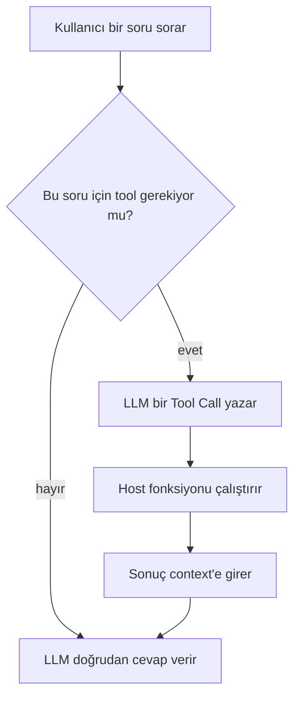
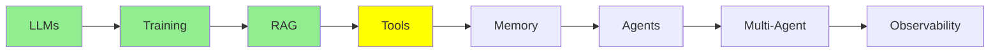

# LLM Tool Calling

[LLM Temelleri](llms_tr.md), [Training LLMs](training_tr.md) ve [Retrieval-Augmented Generation (RAG)](rag_tr.md) modüllerinde üç şeyi ele aldık: model nedir, nasıl eğitilir ve kendi verini modelin önüne nasıl koyarsın. Bu üç modülde model hâlâ yalnızca okuyordu, ama bu modülde bir şeyler *yapmaya* başlıyor: bir dosyayı okuyor, bir komut çalıştırıyor ya da bir API'yi çağırıyor.

Bu, her agent'in altında çalışan mekanizmadır, o yüzden onu tam olarak anlamak için biraz emek harcamaya değer.

## Tool Nedir?

  
*Tool'lar bir modelin kendi dünyasının dışına uzanmasını sağlar. Model web'de arama yapabilir, matematik çözebilir ya da kod çalıştırabilir, sonra bir cevapla geri döner.*

Bir **tool**, senin yazdığın sıradan bir Python fonksiyonudur: bir adı, birkaç girdisi ve bir dönüş değeri vardır. Bunda özel bir şey yoktur.

İnsanların en sık yanlış anladığı nokta tam olarak burasıdır: **model senin fonksiyonunu asla çalıştırmaz**, çünkü bir bilgisayarı yoktur. Yapabildiği tek şey, "`read_file` fonksiyonunu `filename="main.py"` argümanıyla çağırmak istiyorum" diyen bir mesaj yazmaktır. Senin tarafında çalışan bir şey bu mesajı okur, fonksiyonu çalıştırır ve dönüş değerini modele geri verir.

## Tool Call'lar Context'i Büyütür

[LLM Temelleri](llms_tr.md) context'i bir mesaj yığını olarak tanıtmıştı. Bir tool call bu yığına iki yeni tür mesaj ekler, aşağıdaki resim ise bu akışın tamamını gösteriyor:

  
*Tek bir tool call'ın akışı sırayla şöyle: System prompt, kimse konuşmadan önce tool'u tanımlar. Sen soruyu sorarsın ve LLM bir Tool Call yazar. Host makine bunu çalıştırıp bir Tool Result yazar. Son olarak LLM bu sonucu okuyup cevabını yazar.*

Dört oka dikkat et, çünkü her mesajı kimin yazdığı önemli:

1. **Sen** Human Message yazarsın, yani soruyu sen sorarsın.
2. **LLM** Tool Call'ı yazar. Bu bir eylem değil, bir istektir.
3. **Host makine** Tool Result'u yazar. Dizüstü bilgisayarın ya da sunucun, Python'un kurulu olduğu ve okunacak bir dosya sistemi bulunan asıl makinedir.
4. **LLM**, sonucu da içeren tüm context'i okuyup cevabını yazar.

İki yeni mesaj da context'te kalır, bu yüzden bir agent'in context'i normal bir sohbetin context'inden çok daha hızlı büyür. Tek bir tur, iki yerine birkaç mesaj ekleyebilir.

## Tool'lar Neden Var?

Bir model sabit bir veriyle eğitildiği için tek başına yeni bir şey bilemez ve hiçbir şeyi değiştiremez. Tool'lar ise bu iki sınırı birden ortadan kaldırır.

**Model web'de arama yapamaz.** Bu yüzden bir sorgu alan, bir arama motorunu çağıran ve sonuçları döndüren bir fonksiyon yazarsın, böylece model artık arama yapabilir.

**Model senin dosyalarını okuyamaz.** Bu yüzden bir dosya adı alan ve içeriğini döndüren bir fonksiyon yazarsın, böylece model artık senin kodunu görebilir.

Tool'lar olmadan model bir chatbot'tur, tool'larla birlikte ise bir agent olur.

## Tool Şeması

İnsanları şaşırtan kısım şu: model bir tool seçebilmeden önce birinin ona üç şey anlatması gerekir: tool'un var olduğu, ne yaptığı ve hangi argümanları aldığı. Bu açıklamaya **tool schema** denir ve JSON formatında yazılır.

Bu JSON'u neredeyse hiç kendin yazmazsın, çünkü normal bir fonksiyon yazarsın ve framework şemayı bu fonksiyondan üretir:

```python
@tool
def get_weather(city: str) -> str:
    """Get the current temperature for a city."""
    return requests.get(f"https://api.example.com/weather?city={city}").text
```

Framework bu tek dekoratörden şunları okur:

- **Ad**: fonksiyonun adından alınır, `get_weather`
- **Açıklama**: docstring'den gelir
- **Parametreler**: type hint'lerden gelir, yani `city: str` zorunlu bir string olur

Sonra framework bu şemayı isteğinle birlikte gönderir ve model onu, system prompt'un yanında, konuşmanın başında alır; sen ise yalnızca fonksiyonu kaydedersin, onu modele bağlayan kodu ise yazmak zorunda değilsin.

**Bu, adın ve açıklamanın dokümantasyon değil, arayüz olduğu anlamına gelir.** Model hangi tool'u kullanacağına karar verirken elindeki tek bilgi bunlardır. Örneğin docstring'i "gets data" olan `get_data` adlı bir fonksiyon düşün. Model onu yanlış zamanlarda seçer, doğru zamanlarda ise atlar ve bunu hiçbir prompt düzeltemez. Tool'a ne yaptığını anlatan bir ad ver ve docstring'i modele göre yaz, çünkü seçimi yapan taraf odur.

## Bir Örnekte Tool Call

Bu kadar açıklama yeter, şimdi de bir hava durumu tool'uyla gerçek bir alışverişe bakalım.

### Model Neyi Alır?

Talimatlar ile tool şeması API'de ayrı alanlar olarak gelir, ama modelin gözünden bakınca ikisi context'in en üstünde tek bir blok oluşturur:

```text
SYSTEM
You are a helpful assistant with access to tools.
Answer the user's question. If you need information you do not have, call a
tool instead of guessing. Never invent a weather reading.

TOOLS
get_weather
  Get the current temperature for a city.
  city (string, required) - The city name, for example "Istanbul"
```

Bu okunabilir blok, framework'un ürettiği şemadır. API'ye giden istekte ise şöyle görünür:

```json
{
  "type": "function",
  "function": {
    "name": "get_weather",
    "description": "Get the current temperature for a city.",
    "parameters": {
      "type": "object",
      "properties": {
        "city": {
          "type": "string",
          "description": "The city name, for example \"Istanbul\""
        }
      },
      "required": ["city"]
    }
  }
}
```

Hem tool'un açıklamasının hem de parametrenin açıklamasının, Python'da yazdığın şeylerden geldiğine dikkat et.

### Sorduğun Soru

```text
USER
What's the weather in Istanbul right now?
```

### Model Ne Üretir?

Model düzyazı üretmez, şunu üretir:

```json
{
  "role": "assistant",
  "content": null,
  "tool_calls": [
    {
      "id": "call_9k2m4Xq7",
      "type": "function",
      "function": {
        "name": "get_weather",
        "arguments": "{\"city\":\"Istanbul\"}"
      }
    }
  ]
}
```

Burada üç şeye dikkat etmek yararlı. Birincisi, `content` boştur, çünkü model henüz cevap vermedi ve bir şey istedi. İkincisi, bir `id` vardır; sonucu bu belirli çağrıya geri bağlayan şey bu `id`'dir. Üçüncüsü, `arguments` JSON içeren bir **string**'dir, bir JSON nesnesi değildir; neredeyse herkes bu noktada bir kez takılır.

### Host Makine Ne Yapar?

Bu mesaj geldiğinde iş framework'a geçer: framework argümanları ayrıştırır, `get_weather` adıyla kaydedilmiş Python fonksiyonunu bulur ve o fonksiyonu çağırır:

```python
get_weather(city="Istanbul")   # -> '{"city":"Istanbul","temp_c":34,"conditions":"clear"}'
```

Fonksiyonun dönüş değeri yeni bir mesaj olarak konuşmaya geri eklenir ve framework bu mesajı, çağrıdaki `id` ile etiketler:

```json
{
  "role": "tool",
  "tool_call_id": "call_9k2m4Xq7",
  "content": "{\"city\":\"Istanbul\",\"temp_c\":34,\"conditions\":\"clear\"}"
}
```

### Model Ne Cevap Verir?

Şimdi tüm context modele geri gönderilir:

- system prompt
- sorduğun soru
- modelin kendi tool call'ı
- sonuç

Model bunların hepsini okur ve şunu yazar:

```text
ASSISTANT
It's currently 34°C and clear in Istanbul.
```

Mekanizmanın tamamı bu kadar: yapacağın her agent, bu döngünün tekrar tekrar çalışmasından ibarettir.

Alan adları sağlayıcıdan sağlayıcıya biraz değişse de yapı değişmez:

- senin yazmadığın bir şema
- modelin yazdığı bir çağrı
- senin yaptığın bir çalıştırma
- geri verdiğin bir sonuç

## Örnek Tool'lar

Fonksiyon olarak yazabildiğin her şey bir tool olabilir. İşte birkaç gerçekçi örnek:

```python
@tool
def run_command(command: str) -> str:
    """Run a shell command and return its output."""
    return subprocess.run(command, shell=True, capture_output=True, text=True).stdout

@tool
def get_current_time() -> str:
    """Get the current date and time."""
    return datetime.datetime.now().strftime('%Y-%m-%d %H:%M:%S')

@tool
def query_db(sql: str) -> list:
    """Run a read-only SQL query against the application database."""
    with sqlite3.connect('database.db') as conn:
        return conn.execute(sql).fetchall()

@tool
def search_docs(query: str) -> list:
    """Find the most relevant documentation passages for a question."""
    return vector_db.search(encode(query), top_k=5)

@tool
def send_email(to: str, subject: str, body: str) -> str:
    """Send an email from the user's account."""
    return gmail.users().messages().send(userId='me', body=compose(to, subject, body)).execute()
```

**En faydalı tool'ların çoğu bir API'nin sarmalayıcısıdır.** Son örnekte işin onda dokuzunu Gmail'in kendi API'si yapar, tool ise yalnızca kalan onda biri ekler. Tool kısmı bir fonksiyon imzası, bir docstring ve bir çağrıdan ibarettir. Aynı yapı, bir agent'e şunlara erişim verebilir:

- Jira'n (issue açma, arama, yorum ekleme)
- takvimin
- ödeme sağlayıcın
- şirket içi servisin

API'si olan her şey modelin erişebileceği bir şeye dönüşebilir. Bu, bir agent'i işte faydalı hale getirmenin genellikle en hızlı yoludur, çünkü ihtiyacın olan API neredeyse her zaman zaten vardır.

Bundan iki sonuç çıkar. Birincisi, bir tool ona verdiğin kimlik bilgileri kadar güçlüdür: hesabından mail gönderebilen bir tool, herkese her şeyi gönderebilir. İkincisi, bu tool'ları kendin yazmak zorunda kalman artık nadir. [Code Agent'lar](../2_intermediate/coding_agents_tr.md) MCP'yi anlatır. MCP, tool'ları paketlemenin standart bir yoludur ve bir kez yazılan bir tool'un her agent'ta çalışmasını sağlar. MCP ile, sarmalamak üzere olduğun API'yi biri çoktan sarmış olur.

Dokümantasyon araması yapan tool'a da ikinci bir bakmaya değer, çünkü bu, [Retrieval-Augmented Generation (RAG)](rag_tr.md) modülündeki RAG akışının bir tool'a dönüştürülmüş hali. Artık *ne zaman* arama yapılacağına model karar veriyor ve her soruda arama yapmak zorunda değilsin. Bir RAG uygulamasını agent'ten ayıran şeyin büyük kısmı, işte bu küçük değişiklik.



## Bu serinin neresindeyiz



## Özet

Tool, senin yazdığın bir fonksiyondur, ama model onu çalıştıramaz. Bu yüzden model bir Tool Call yazar, senin makinen fonksiyonu çalıştırır ve bir Tool Result geri verir. İki mesaj da context'e girer, bu yüzden agent'ların context'i bu kadar hızlı büyür.

Şemayı sen yazmazsın, framework bunu fonksiyondan, docstring'inden ve type hint'lerinden üretir. Bu da adı ve docstring'i gerçek arayüz haline getirir, çünkü model hangi tool'u kullanacağına karar verirken elindeki her şey bunlardır.

Sırada memory var: context doldukça bu mesajların başına ne geldiğine bakacağız.

**Hızlı Kontrol**: Tool'u kim çalıştırır, model mi yoksa host mu? Peki bir tool'un docstring'i neden implementasyonundan daha önemlidir?

## Kaynaklar

- [Mastering LLM tool calling](https://machinelearningmastery.com/mastering-llm-tool-calling-the-complete-framework-for-connecting-models-to-the-real-world/): tam çerçeve, burada ihtiyacımız olandan daha fazla wire format (mesajların ham biçimi) ayrıntısıyla.
