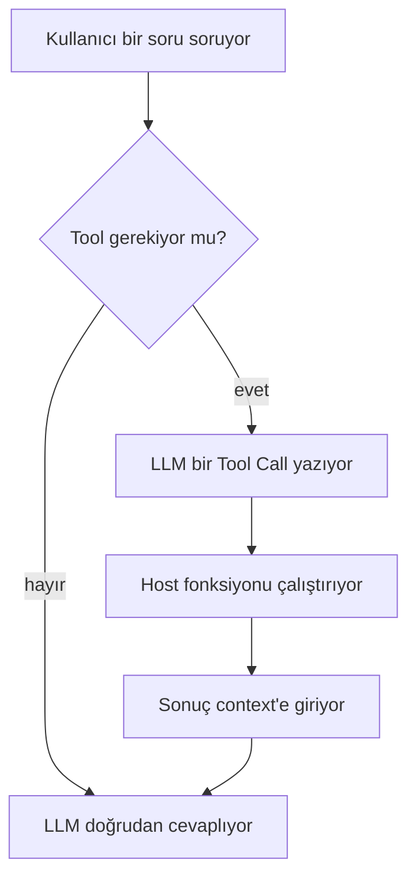
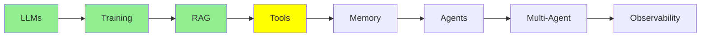

# LLM Tool Calling

[LLM Fundamentals](llms_tr.md), [Training LLMs](training_tr.md) ve [RAG & Embeddings](rag_tr.md)
üç şeyi anlattı: bir modelin ne olduğunu, nasıl eğitildiğini ve kendi verini onun önüne nasıl
koyacağını. Bunların hepsinde model hâlâ yalnızca okuyor. Bu modülde model bir şeyler *yapmaya*
başlıyor: bir dosya okuyor, bir komut çalıştırıyor ya da bir API çağırıyor.

Her agent'ın altındaki mekanizma bu. Bu yüzden onu tam olarak anlamak için emek vermeye değer.

## Tool Nedir?

  
*Tool'lar, bir modelin kendi kafasının dışına uzanma yolu. Model web'de arama yapıyor, matematik yapıyor ya da kod çalıştırıyor, sonra bir cevapla geri dönüyor.*

**Tool**, senin yazdığın bir fonksiyondan başka bir şey değil. Adı, birkaç input'u ve bir dönüş
değeri olan sıradan bir Python fonksiyonu. Özel hiçbir yanı yok.

İnsanların yanlış anladığı kısım şu: **model senin fonksiyonunu asla çalıştırmıyor.**
Çalıştıramaz. Bilgisayarı yok. Yapabildiği tek şey, "`read_file`'ı `filename="main.py"` ile
çağırmak istiyorum" diyen bir mesaj yazmak. Senin tarafındaki bir şey o mesajı okuyor ve
fonksiyonu çalıştırıyor. Sonra dönüş değerini geri veriyor.

## Tool Call'lar Context'i Büyütür

[LLM Fundamentals](llms_tr.md) context'i bir mesaj yığını olarak tanıtmıştı. Bir tool call o yığına
iki yeni mesaj türü ekliyor. Bütün akış bu resimde:

  
*Tek bir tool call, sırayla. Tool, kimse konuşmadan önce system prompt'ta tanımlanıyor. Sonra sen soruyorsun ve LLM bir Tool Call yazıyor. Host makine onu çalıştırıp Tool Result'ı yazıyor. Sonra LLM bu sonucu okuyup cevabı yazıyor.*

Dört oku takip et, çünkü kimin ne yazdığı önemli:

1. **Sen** Human Message'ı yazıyorsun.
2. **LLM** Tool Call'ı yazıyor. İstiyor, yapmıyor.
3. **Host makine** Tool Result'ı yazıyor. Python'un kurulu olduğu ve okunacak bir dosya sistemi
   olan makine, senin laptop'un ya da sunucun.
4. **LLM** bütün context'i okuyor. Bu context artık o sonucu da içeriyor. Sonra LLM cevabı yazıyor.

İki yeni mesaj da context'te kalıyor. Bu yüzden bir agent'ın context'i, bir chat'in context'inden
çok daha hızlı büyüyor. Tek bir tur, iki mesaj yerine birkaç mesaj ekleyebiliyor.

## Tool'lar Neden Var

Bir model sabit veri üzerinde eğitiliyor. Bu yüzden kendi başına ne yeni bir şey bilebiliyor ne de
bir şeyi değiştirebiliyor. Tool'lar iki sınırı da kaldırıyor.

**Web'de arama yapamaz.** O yüzden bir query alıp arama motoruna soran ve sonuçları döndüren bir
fonksiyon yazıyorsun. Artık yapabiliyor.

**Dosyalarını okuyamaz.** O yüzden bir dosya adı alıp içeriğini döndüren bir fonksiyon yazıyorsun.
Artık kodunu görebiliyor.

Tool'lar olmadan bir model, bir chatbot. Tool'larla birlikte bir agent.

## Tool Schema

İnsanları şaşırtan kısım burası.

Modelin bir tool seçebilmesi için birinin ona üç şey söylemesi gerekiyor: tool'un var olduğunu, ne
yaptığını ve hangi argümanları aldığını. Bu tarife **tool schema** deniyor. Tool schema JSON ile
yazılıyor.

O JSON'ı neredeyse hiçbir zaman kendin yazmıyorsun. Sıradan bir fonksiyon yazıyorsun, framework de
schema'yı ondan üretiyor:

```python
@tool
def get_weather(city: str) -> str:
    """Get the current temperature for a city."""
    return requests.get(f"https://api.example.com/weather?city={city}").text
```

O tek decorator'dan framework şunları okuyor:

- **name**, fonksiyonun adından: `get_weather`
- **description**, docstring'den
- **parameters**, type hint'lerden; yani `city: str` zorunlu bir string oluyor

Sonra framework bu schema'yı isteğinle birlikte gönderiyor. Model onu en başta, system prompt'un
yanında alıyor. Sen fonksiyonu kaydediyorsun. Onu modele bağlayan kodu yazmak senin işin değil.

**Bu da şu demek: name ve description dokümantasyon değil. Onlar arayüzün kendisi.** Model hangi
tool'u kullanacağına karar verirken elindeki tek bilgi onlar. `get_data` adında ve "gets data"
docstring'i olan bir fonksiyon düşün. Model onu yanlış anlarda seçer, doğru anlarda atlar. Bunu
hiçbir prompt düzeltemez. Tool'a ne yaptığını anlatan bir isim ver. Docstring'i model için yaz,
çünkü seçim yapmak zorunda olan o.

## Tool Call İş Başında

Tarif yeter. Aşağıda bir weather tool ile gerçek bir mesajlaşma var.

### Modelin Aldığı Şey

Talimatlar ve tool schema birlikte geliyor. API'da bunlar ayrı field'lar. Ama modelin bakış
açısından, context'in tepesindeki tek bir blok:

```text
SYSTEM
You are a helpful assistant with access to tools.
Answer the user's question. If you need information you do not have, call a
tool instead of guessing. Never invent a weather reading.

TOOLS
get_weather
  Get the current temperature for a city.
  city (string, required) - The city name, for example "Istanbul"
```

O okunabilir blok, framework'ün ürettiği schema. API'a giden istekte ise şöyle görünüyor:

```json
{
  "type": "function",
  "function": {
    "name": "get_weather",
    "description": "Get the current temperature for a city.",
    "parameters": {
      "type": "object",
      "properties": {
        "city": {
          "type": "string",
          "description": "The city name, for example \"Istanbul\""
        }
      },
      "required": ["city"]
    }
  }
}
```

Dikkat et: hem description hem de parameter description, senin Python'da yazdığın şeylerden geldi.

### Senin Sorduğun Şey

```text
USER
What's the weather in Istanbul right now?
```

### Modelin Ürettiği Şey

Düz metin üretmiyor. Şunu üretiyor:

```json
{
  "role": "assistant",
  "content": null,
  "tool_calls": [
    {
      "id": "call_9k2m4Xq7",
      "type": "function",
      "function": {
        "name": "get_weather",
        "arguments": "{\"city\":\"Istanbul\"}"
      }
    }
  ]
}
```

Burada dikkat edilecek üç şey var. Birincisi, `content` boş, çünkü model henüz cevaplamadı. Sordu.
İkincisi, bir `id` var. Sonucu tam olarak bu çağrıyla eşleştiren şey bu `id`. Üçüncüsü,
`arguments` bir JSON *string*'i. JSON object'i değil. Neredeyse herkes bunu bir kez yanlış anlıyor.

### Host Makinenin Yaptığı Şey

Bu mesaj gelince işi framework devralıyor. Argümanları parse ediyor ve `get_weather` adıyla kayıtlı
Python fonksiyonunu buluyor. Sonra o fonksiyonu çağırıyor:

```python
get_weather(city="Istanbul")   # -> '{"city":"Istanbul","temp_c":34,"conditions":"clear"}'
```

Dönüş değeri, yeni bir mesaj olarak konuşmaya geri giriyor. Framework bu mesajı çağrıdaki `id` ile
etiketliyor:

```json
{
  "role": "tool",
  "tool_call_id": "call_9k2m4Xq7",
  "content": "{\"city\":\"Istanbul\",\"temp_c\":34,\"conditions\":\"clear\"}"
}
```

### Modelin Cevapladığı Şey

Şimdi bütün context modele geri gidiyor:

- system prompt
- senin sorun
- modelin kendi tool call'ı
- sonuç

Model hepsini okuyup şunu yazıyor:

```text
ASSISTANT
It's currently 34°C and clear in Istanbul.
```

Bütün mekanizma bu. Kuracağın her agent, bu döngünün tekrarı.

Field isimleri sağlayıcılar arasında biraz farklı. Ama şekil değişmiyor:

- senin yazmadığın bir schema
- modelin yazdığı bir çağrı
- senin yaptığın bir çalıştırma
- senin geri verdiğin bir sonuç

## Örnek Tool'lar

Fonksiyon olarak yazabildiğin her şey bir tool olabilir. Aşağıda birkaç gerçek örnek var:

```python
@tool
def run_command(command: str) -> str:
    """Run a shell command and return its output."""
    return subprocess.run(command, shell=True, capture_output=True, text=True).stdout

@tool
def get_current_time() -> str:
    """Get the current date and time."""
    return datetime.datetime.now().strftime('%Y-%m-%d %H:%M:%S')

@tool
def query_db(sql: str) -> list:
    """Run a read-only SQL query against the application database."""
    with sqlite3.connect('database.db') as conn:
        return conn.execute(sql).fetchall()

@tool
def search_docs(query: str) -> list:
    """Find the most relevant documentation passages for a question."""
    return vector_db.search(encode(query), top_k=5)
```

Doküman arayan tool'a da bir kez daha bakmaya değer. Bu, [RAG & Embeddings](rag_tr.md) modülündeki
RAG pipeline'ının tool'a dönüşmüş hali. Artık *ne zaman* retrieval yapılacağına model karar veriyor.
Retrieval'ı her soruda sen yapmıyorsun. Bir RAG uygulamasını bir agent'tan ayıran şeyin büyük kısmı
bu küçük değişiklik.



## Bu serinin neresindeyiz



## Özet

Tool, senin yazdığın bir fonksiyon. Model onu çalıştıramaz. O yüzden model bir Tool Call yazıyor,
senin makinen de fonksiyonu çalıştırıp bir Tool Result geri veriyor. İki mesaj da context'e giriyor.
Agent context'lerinin hızlı büyümesinin sebebi bu.

Schema'yı sen yazmıyorsun. Framework'ün onu fonksiyondan, docstring'inden ve type hint'lerinden
üretiyor. Bu da name ve docstring'i asıl arayüz yapıyor. Model hangi tool'u kullanacağına karar
verirken elinde olan tek şey onlar.

Sırada memory var: context dolarken bütün bu mesajlara ne oluyor?

**Hızlı Kontrol**: bir tool'u kim çalıştırıyor, model mi host mu? Ve bir tool'un docstring'i neden
implementasyonundan daha çok önemli?

## Kaynaklar

- [Mastering LLM tool calling](https://machinelearningmastery.com/mastering-llm-tool-calling-the-complete-framework-for-connecting-models-to-the-real-world/): bütün çerçeve, wire format hakkında burada ihtiyacımız olandan daha fazla ayrıntıyla
