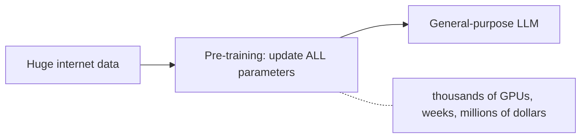
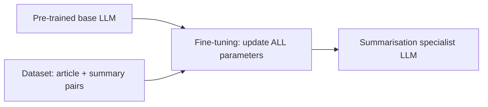
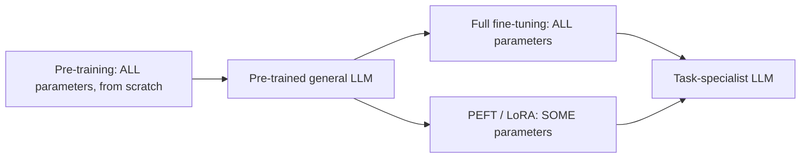
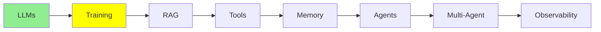

# Training LLMs

[LLM Fundamentals](llms.md) said that an LLM is a network with a huge number of parameters. It
also said that an LLM predicts the next word. This module is about where those parameters come
from.

There are two steps, and they are almost completely different. One step costs millions of
dollars, and only a few labs can do it. You can run the other step tonight on your own GPU.

## What Training Means?

At the start, a model knows nothing. Every parameter is a random number, so its output is
random too.

Training means that you give the model text and change those numbers by a small amount. You do
this again and again, until its guesses stop being random and start being right.

  
*The same network before and after training. The input is "The students opened their". The random weights on the left produce "Sun". The learned weights on the right produce "Laptops". The shape of the network did not change. Only the numbers inside it changed.*

That small change, repeated many times, is all that training does. Training does not add rules or facts in a form that you can open and
read. It only adjusts numbers. The knowledge ends up spread across billions of them. This is why
people still use Andrej Karpathy's description: you can think of training as **compressing the
internet**.

## Pre-training

The first step is **pre-training**, and it is by far the largest.

- The model starts with parameters (its "weights") that are random and untrained.
- It reads a very large part of the internet: books, websites, code and articles. From this
  text, it learns to predict the next word. It does this again and again, billions of times.
- Pre-training updates **all** of the model's parameters. For a large model, that means
  billions of numbers change.
- It needs thousands of GPUs that run for weeks or months. This is why pre-training a large
  model from scratch costs **millions of dollars**. Only a small number of big labs (OpenAI,
  Google, Anthropic, Meta and a few others) can afford it.



The result is a **general-purpose** model: good at many things, specialised in nothing.

> **NOTE, and this one is an advanced topic.** Notice that nobody labelled that internet text.
> There is no answer key. The model makes its own training signal. It hides the next word, makes
> a guess, and checks the guess against the word that was really there. So the data labels
> itself. This is called **self-supervised learning**. Diagrams often label it "unsupervised"
> instead. We explain it fully in
> [Advanced Training](../3_expert/advanced_training.md).

## Why We don't Have to Pre-train?

You do not need to pre-train your own model. Someone else already spent the millions. You can
start from their finished model and **fine-tune** it.

**Fine-tuning** means that you take a model that is already pre-trained, and you continue to
train it. This time the dataset is small and task-specific, so the model gets good at one
particular job.

The clearest way to see the difference is to look at the data that each step eats:

  
*Pre-training takes a pile of unlabelled text, with no human in the loop. It produces general abilities, like completing and understanding text. Fine-tuning takes pairs that a human wrote: a prompt, and the response it should get. It adds specific abilities, like classification or question answering.*

So, in one line each:

- **Pre-training** eats **unlabelled** text, collected from across the whole internet. Nobody
  writes the answers, because the next word *is* the answer.
- **Fine-tuning** eats a **collection of pairs**: input and output, or prompt and response.
  People usually write or check these pairs. That is thousands of pairs, not billions of pages.

That difference is why one costs millions and the other fits on a single GPU.

## Fine-tuning

Imagine that you want a model that is very good at summarising articles.

1. Start with a pre-trained base model.
2. Collect a dataset of examples: `(long article, human-written short summary)` pairs. A few
   thousand is often enough.
3. Continue to train the model on these pairs. This way, it learns the pattern "long text in,
   short and accurate summary out".
4. The result is clearly more consistent at summarising than the generic base model. And you do
   not pay for pre-training.

Here is what a few training rows can look like. This is exactly what the model sees, again and
again, during step 3:

| Article (input) | Human summary (output) |
|---|---|
| "The city opened three new public parks this year, adding over 50 acres of green space. Officials say the parks will host weekend markets and free yoga classes starting next spring." | "The city added 50 acres of new parks, which will host markets and yoga classes." |
| "Scientists discovered a new species of frog in the Amazon rainforest. The frog has bright blue skin and is only 2 cm long, making it one of the smallest amphibians ever recorded." | "A tiny, 2cm blue frog was discovered in the Amazon, one of the smallest amphibians on record." |
| "The company's quarterly earnings report showed a 15% increase in revenue, driven mainly by strong sales in its cloud computing division." | "The company's revenue grew 15% this quarter, led by cloud computing sales." |
| "A new study found that drinking coffee in moderation may reduce the risk of heart disease. Researchers tracked 10,000 participants over five years." | "A 5-year study of 10,000 people found moderate coffee drinking may lower heart disease risk." |
| "The local football team won their championship game 3-1, securing their first title in a decade." | "The team won the championship 3-1, their first title in ten years." |

The model sees thousands of pairs like these, but it does not memorise the answers. It learns
the *pattern*: take the key facts out of a longer text, and compress them into one short, plain
sentence.

### Does it Actually Work?

Let's test it on a new article that the model has never seen. It is not one of the articles in
the table above.

**Test article:**
> "The tech startup announced today that it raised $50 million in Series B funding, led by two
> major venture capital firms. The company plans to use the funds to expand its engineering team
> and launch operations in three new countries by next year."

**Base model, before fine-tuning:**
> "This is an interesting piece of news about a technology startup. The article talks about how
> the company managed to secure a significant amount of funding, specifically $50 million, in
> what is known as a Series B funding round, which was led by two prominent venture capital
> firms. According to the article, the startup intends to allocate this capital towards growing
> its engineering department and expanding its business operations into three additional
> countries within the coming year."

**Fine-tuned model, after:**
> "The startup raised $50 million in Series B funding to grow its engineering team and expand
> into three new countries next year."

Notice the difference. The answer of the base model is long and unfocused. It repeats the
article almost sentence by sentence, and it opens with filler like "This is an interesting piece
of news". The fine-tuned model learned the pattern from the table. Then it applied that pattern to
an article it had never seen.

Here is a tiny, simplified example that uses Hugging Face `transformers`:

```python
from transformers import AutoModelForSeq2SeqLM, AutoTokenizer, Trainer, TrainingArguments

model = AutoModelForSeq2SeqLM.from_pretrained("t5-small")  # already pre-trained
tokenizer = AutoTokenizer.from_pretrained("t5-small")

# dataset = a list of {"article": "...", "summary": "..."} pairs
trainer = Trainer(
    model=model,
    args=TrainingArguments(output_dir="./summarizer", num_train_epochs=3),
    train_dataset=dataset,  # your (article, summary) pairs
)
trainer.train()  # updates ALL of the model's parameters
```

This is called **full fine-tuning**, because it updates every parameter. It is the same
mechanism as pre-training, but on a much smaller dataset. It is cheaper than pre-training. But for
a big model, it still needs a lot of GPU memory.



## Parameter-efficient Fine-tuning (PEFT)

Full fine-tuning updates every parameter. For a big model, this still means large GPUs. Most of
us do not have those.

**PEFT (Parameter-Efficient Fine-Tuning)** solves this problem. It **freezes almost the whole
model**, and it trains only a small number of new, extra parameters.

- The frozen part stays exactly as pre-training left it.
- Only a very small part of the parameters changes. This is often under 1% of the total.
- The most common PEFT technique is **LoRA** (Low-Rank Adaptation). You do not need the maths.
  It is enough to know that LoRA is the cheap fine-tuning trick that almost everyone uses.

This gives you three benefits. It runs on a single consumer GPU. It trains much faster. And it
produces a small file that holds only the extra parameters, instead of a whole new copy of the
model. This is what real projects use most of the time.

Here is a tiny, simplified LoRA example that uses Hugging Face `peft`:

```python
from peft import LoraConfig, get_peft_model
from transformers import AutoModelForSeq2SeqLM

model = AutoModelForSeq2SeqLM.from_pretrained("t5-small")  # frozen base model

lora_config = LoraConfig(r=8, task_type="SEQ_2_SEQ_LM")
model = get_peft_model(model, lora_config)  # freezes the base, adds small trainable layers

model.print_trainable_parameters()
# something like: "trainable params: 0.3M || all params: 60M || trainable%: 0.5%"
```

Do not confuse PEFT with quantization, which [LLM Fundamentals](llms.md) covered. **PEFT is about
training cheaply. Quantization is about running cheaply.** People often use the two together.

## Unsloth

If you write the training loop yourself, you must connect a lot of parts by hand. Making a model
fit in the memory that you have is a separate skill. [Unsloth](https://unsloth.ai/docs) is an
open-source library that does both of these jobs.

What you get from it:

- **Fine-tuning that fits.** It rewrites the parts of the training code that use the most memory
  and time. Because of this, LoRA
  and quantized-LoRA runs need far less GPU memory, and they finish faster. Often, this decides
  whether a job can run on a free Colab GPU or not.
- **Ready-made notebooks.** The [notebook collection](https://unsloth.ai/docs/get-started/unsloth-notebooks)
  covers the popular open models. You open one, give it your dataset, and run it. This is the
  fastest honest way to go from "I have some pairs" to "I have a fine-tuned model".
- **Pre-quantized models for running, not only for training.** [LLM Fundamentals](llms.md)
  mentioned that you rarely quantize anything yourself. These are the releases it meant. So the
  same project covers both jobs: compressing a model and training one.
- **A guide, and a reality check.** The
  [fine-tuning guide](https://unsloth.ai/docs/get-started/fine-tuning-llms-guide) explains the
  whole process, step by step. Read the FAQ,
  [is fine-tuning right for me](https://unsloth.ai/docs/get-started/fine-tuning-for-beginners/faq-+-is-fine-tuning-right-for-me),
  **before** you start, because the honest answer is often no. Many problems look like
  fine-tuning problems. A better prompt, or the retrieval in [RAG & Embeddings](rag.md), solves a
  lot of them.

## Comparing Side-by-side

| | Pre-training | Full fine-tuning | PEFT (e.g. LoRA) |
|---|---|---|---|
| Starting point | Random weights | Pre-trained model | Pre-trained model |
| Data needed | The whole internet, unlabelled | Task-specific pairs | Task-specific pairs |
| Parameters updated | ALL, from scratch | ALL | SOME, often under 1% |
| Typical cost | Millions of dollars | Expensive, but far below pre-training | Cheap, fits on one GPU |
| Who does it | A few big AI labs | Companies with real budgets | Most of us, most of the time |



## When Not to Fine-tune

Most people who think they need fine-tuning do not need it. So it is useful to know the three
cases where the answer is no.

**Do not fine-tune to teach a model your company's knowledge.** That knowledge is alive. The
codebase gets new commits, contracts get updated, and policies change. Fine-tuning is a snapshot:
it captures what your data said on one day, and it does not change after that.
It takes hours and real money, so you cannot run it again every time a file changes. What you want
there is retrieval, which is the topic of [RAG & Embeddings](rag.md).

**Fine-tune for tasks, not for facts.** Fine-tuning is good at teaching a *behaviour*, like
summarising in a particular format or classifying text into your categories. It is poor at
teaching *facts*. Your few hundred pages land among billions of parameters, and those parameters
hold everything else the model ever read.

**And remember who you are racing against.** Imagine that you spend a month fine-tuning a model
for your task. By the time you finish, the next frontier model is out. A lab trained it with
resources that you do not have. There is a good chance that this new model, with no changes, is
better at your task than your fine-tuned version of the previous generation. Fine-tuning still
wins when the task is genuinely yours and genuinely narrow. It loses when you try to beat the labs
at training.

## What is Hugging Face?

Both code examples above import from it, so it is worth one paragraph.

[Hugging Face](https://huggingface.co/) is the place where the open-source machine learning
community keeps its work. Its **Models** page is, in practice, the central registry for open
models of every kind, not only LLMs. It has models for computer vision, speech and audio, and many
other areas. When a research group releases an open model, this is usually where it appears.

Hugging Face also publishes the libraries that everyone uses to work with those models. The main
one is **`transformers`**. It loads a model by name and runs it in a few lines of code. There are
also companion libraries for the parts around it, such as `peft` for the LoRA training above, and
`datasets` for the data that you give the model.

## Where this fits in the series



## Summary

Training is just the adjusting of a model's parameters. Pre-training starts from random weights,
uses unlabelled internet text, and costs millions of dollars. Fine-tuning starts from someone
else's finished model, uses pairs that a human wrote, and costs very little. PEFT does the same job
but changes under 1% of the parameters. That is why most projects use it.

But even a fine-tuned model still knows nothing about your private codebase or about today's data.
RAG fills exactly that gap, and it is the next module.

**Quick Check**: what is the difference between full fine-tuning and PEFT? And why is pre-training
so expensive?

## References

- [Unsloth documentation](https://unsloth.ai/docs): the full documentation of the library
- [Unsloth: is fine-tuning right for me?](https://unsloth.ai/docs/get-started/fine-tuning-for-beginners/faq-+-is-fine-tuning-right-for-me): read this before you fine-tune anything
- [Unsloth notebooks](https://unsloth.ai/docs/get-started/unsloth-notebooks): ready-made notebooks for training and for running quantized models
- [Unsloth fine-tuning guide](https://unsloth.ai/docs/get-started/fine-tuning-llms-guide): the whole process, from start to finish
- [Hugging Face](https://huggingface.co/): the model registry, and the `transformers` library
- [Fine-tuning AI models](https://cloud.google.com/use-cases/fine-tuning-ai-models?hl=en#fine-tuning-llms-and-ai-models): Google Cloud's overview, useful for the vocabulary
- [What is LLM Fine-Tuning? (Explained Simply)](https://youtube.com/shorts/Ei4E2lWStqw?si=q0PttlRmBsARGHZU): a short video, if you want the whole idea in under a minute
