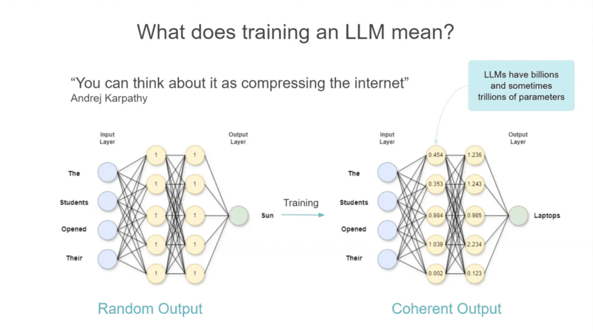
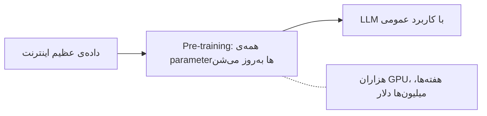
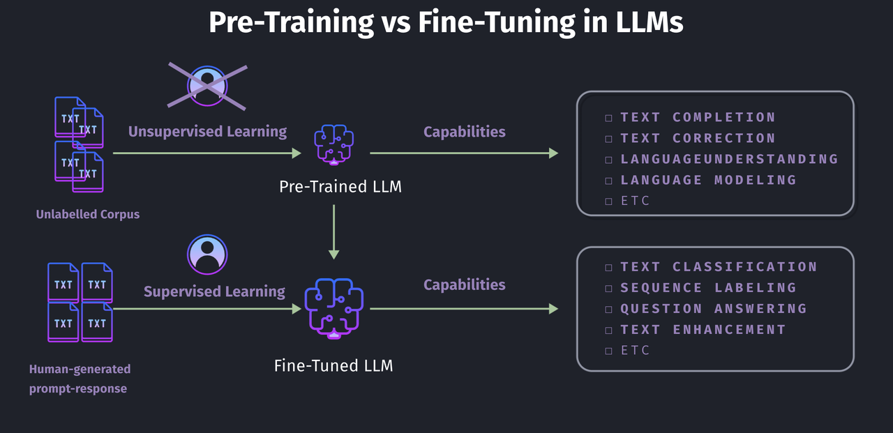
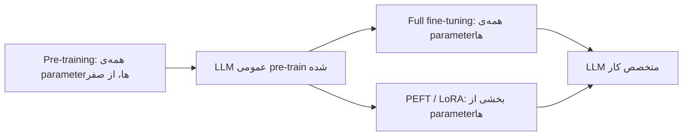
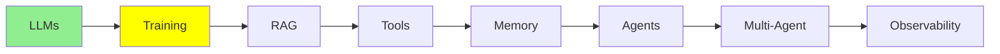

# Training LLMs

توی [مبانی LLM](llms_fa.md) گفتیم که LLM یه شبکه‌ی عصبی با تعداد عظیمی parameter هست، و اینکه کلمه‌ی بعدی رو پیش‌بینی می‌کنه. این ماژول درباره‌ی این هست که اون parameter‌ها دقیقاً از کجا میان.

training دو تا مرحله داره، و این دو تا تقریباً هیچ شباهتی به هم ندارن. مرحله‌ی اول میلیون‌ها دلار خرج برمی‌داره و فقط چند تا آزمایشگاه بزرگ از پسش برمیان. ولی مرحله‌ی دوم رو می‌تونی همین امشب روی GPU خودت اجرا کنی.

## training یعنی چی؟

اول کار، مدل هیچی بلد نیست. هر parameter یه عدد تصادفیه، و به همین خاطر خروجی مدل هم تصادفیه.

training یعنی بهش متن بدی و عددهاش رو یه‌کم عوض کنی. این کار رو بارها و بارها تکرار می‌کنی، تا جایی که حدس‌هاش دیگه تصادفی نباشن و شروع کنن به درست درآمدن.

  
*همون شبکه، یه بار قبل از training و یه بار بعدش. ورودی این جمله‌ست: «The students opened their». weight‌های تصادفیِ سمت چپ «Sun» رو تولید می‌کنن، و weight‌های یادگرفته‌شده‌ی سمت راست «Laptops» رو. شکل شبکه عوض نشده. فقط عددهای داخلش عوض شدن.*

همین کل ماجراست. training قانون یا واقعیتی رو به شکلی که بتونی بازش کنی و بخونی اضافه نمی‌کنه. فقط عددها رو تنظیم می‌کنه، و دانش در نهایت توی میلیاردها عدد پخش می‌شه. برای همین هنوز هم آدم‌ها همون توصیفی رو تکرار می‌کنن که Andrej Karpathy داده: می‌تونی training رو **فشرده کردن اینترنت** ببینی.

## مرحله‌ی اول: Pre-training

مرحله‌ی اول **pre-training** هست، و با فاصله بزرگ‌ترین مرحله‌ست.

- مدل با parameter‌هایی شروع می‌کنه که بهشون «weight» هم می‌گن. این parameter‌ها تصادفی‌ان و هنوز چیزی یاد نگرفتن.
- مدل بخش خیلی بزرگی از اینترنت رو می‌خونه: کتاب، وب‌سایت، کد و مقاله. از روی همین متن یاد می‌گیره کلمه‌ی بعدی رو پیش‌بینی کنه، و این کار رو میلیاردها بار، پشت سر هم، تکرار می‌کنه.
- توی pre-training **همه‌ی** parameter‌های مدل عوض می‌شن. برای یه مدل بزرگ، یعنی میلیاردها عدد تغییر می‌کنن.
- این کار هزاران GPU می‌خواد که هفته‌ها یا حتی ماه‌ها کار کنن. برای همین pre-training یه مدل بزرگ از صفر **میلیون‌ها دلار** خرج داره. فقط چند تا آزمایشگاه بزرگ مثل OpenAI، Google، Anthropic، Meta و چند تای دیگه از پسش برمیان.



نتیجه‌ش یه مدل **با کاربرد عمومی** هست: توی خیلی کارها خوبه، ولی روی هیچ‌کدومشون متخصص نیست.

> **نکته، این یکی یه موضوع پیشرفته‌ست.** دقت کن که هیچ‌کس اون متن اینترنتی رو برچسب‌گذاری نکرده. کلید جوابی هم در کار نیست. مدل خودش سیگنال یادگیری‌اش رو می‌سازه: کلمه‌ی بعدی رو مخفی می‌کنه، یه حدس می‌زنه، و بعد حدسش رو با کلمه‌ی واقعی مقایسه می‌کنه. پس داده خودش برچسب خودش رو می‌سازه. به این می‌گن **self-supervised learning**. توی دیاگرام‌ها اغلب به‌جاش «unsupervised» نوشته می‌شه. کامل‌ترش رو توی [Advanced Training](../3_expert/advanced_training.md) توضیح می‌دیم.

## چرا لازم نیست خودمون pre-train کنیم؟

لازم نیست خودت یه مدل رو pre-train کنی. اون میلیون‌ها دلار رو یکی دیگه قبلاً خرج کرده. تو می‌تونی از مدل آماده‌شده‌ی اون‌ها شروع کنی و **fine-tune‌ش** کنی.

**Fine-tuning** یعنی یه مدل pre-train شده رو برمی‌داری و training رو ادامه می‌دی. این بار dataset کوچیک‌تره و مخصوص یه کار مشخصه، پس مدل توی همون یه کار خاص خوب می‌شه.

بهترین راه برای دیدن فرق این دو اینه که ببینی هر مرحله چه داده‌ای رو می‌خوره:

  
*pre-training یه مشت متن بدون برچسب رو می‌گیره و هیچ آدمی وسط این کار نیست. نتیجه‌ش توانایی‌های عمومی مثل ادامه دادن و فهمیدن متنه. fine-tuning جفت‌هایی رو می‌گیره که یه آدم نوشته، یعنی یه prompt و پاسخی که مدل باید بده. نتیجه‌ش توانایی‌های مشخص‌تری مثل دسته‌بندی یا جواب دادن به سؤاله.*

خب، هر کدوم رو در یک خط ببینیم:

- **Pre-training** متن **بدون برچسب** می‌خوره، که از کل اینترنت جمع شده. کسی جواب‌ها رو نمی‌نویسه، چون کلمه‌ی بعدی *خودش* جوابه.
- **Fine-tuning** یه **مجموعه‌ای از جفت‌ها** می‌خوره: ورودی و خروجی، یا prompt و پاسخ. معمولاً آدم‌ها این جفت‌ها رو می‌نویسن یا چک می‌کنن. یعنی هزاران جفت، نه میلیاردها صفحه.

همین فرق باعث می‌شه یکی میلیون‌ها دلار هزینه برداره و اون یکی روی یه GPU جا بشه.

## Fine-tuning چطور کار می‌کنه؟

فرض کن می‌خوای یه مدل داشته باشی که توی خلاصه کردن مقاله‌ها خیلی خوب باشه.

1. از یه مدل پایه‌ی pre-train شده شروع کن.
2. یه dataset از مثال جمع کن، یعنی جفت‌های `(long article, human-written short summary)`. معمولاً چند هزار تا کافیه.
3. با همین جفت‌ها training رو ادامه بده. این‌جوری مدل الگوی «متن بلند ورودی، خلاصه‌ی کوتاه و دقیق خروجی» رو یاد می‌گیره.
4. نتیجه این می‌شه که توی خلاصه کردن، خیلی منسجم‌تر از مدل پایه‌ی عمومی کار می‌کنه. اون‌وقت هم لازم نیست هزینه‌ی pre-training رو بدی.

یه نمونه از چند ردیف training این شکلیه. دقیقاً همین چیزیه که مدل توی مرحله‌ی 3 بارها و بارها می‌بینه:

| متن (ورودی) | خلاصه‌ی انسانی (خروجی) |
|---|---|
| "The city opened three new public parks this year, adding over 50 acres of green space. Officials say the parks will host weekend markets and free yoga classes starting next spring." | "The city added 50 acres of new parks, which will host markets and yoga classes." |
| "Scientists discovered a new species of frog in the Amazon rainforest. The frog has bright blue skin and is only 2 cm long, making it one of the smallest amphibians ever recorded." | "A tiny, 2cm blue frog was discovered in the Amazon, one of the smallest amphibians on record." |
| "The company's quarterly earnings report showed a 15% increase in revenue, driven mainly by strong sales in its cloud computing division." | "The company's revenue grew 15% this quarter, led by cloud computing sales." |
| "A new study found that drinking coffee in moderation may reduce the risk of heart disease. Researchers tracked 10,000 participants over five years." | "A 5-year study of 10,000 people found moderate coffee drinking may lower heart disease risk." |
| "The local football team won their championship game 3-1, securing their first title in a decade." | "The team won the championship 3-1, their first title in ten years." |

مدل هزاران جفت مثل این‌ها می‌بینه، ولی جواب‌ها رو حفظ نمی‌کنه. اون *الگو* رو یاد می‌گیره: نکته‌های اصلی رو از یه متن بلندتر بیرون می‌کشه و توی یه جمله‌ی کوتاه و ساده فشرده‌شون می‌کنه.

### آیا واقعاً کار می‌کنه؟

بیا روی یه مقاله‌ی تازه امتحانش کنیم، یه مقاله‌ای که مدل تا حالا ندیده. این مقاله هم از اون‌هایی نیست که توی جدول بالا دیدیم.

**مقاله‌ی آزمایشی:**
> "The tech startup announced today that it raised $50 million in Series B funding, led by two
> major venture capital firms. The company plans to use the funds to expand its engineering team
> and launch operations in three new countries by next year."

**مدل پایه، قبل از fine-tuning:**
> "This is an interesting piece of news about a technology startup. The article talks about how
> the company managed to secure a significant amount of funding, specifically $50 million, in
> what is known as a Series B funding round, which was led by two prominent venture capital
> firms. According to the article, the startup intends to allocate this capital towards growing
> its engineering department and expanding its business operations into three additional
> countries within the coming year."

**مدل fine-tune شده، بعد از اون:**
> "The startup raised $50 million in Series B funding to grow its engineering team and expand
> into three new countries next year."

به فرقشون دقت کن. جواب مدل پایه طولانیه و پراکنده، و تقریباً جمله‌به‌جمله‌ی مقاله رو تکرار می‌کنه. با یه جمله‌ی پرکن مثل «This is an interesting piece of news» شروع می‌شه. ولی مدل fine-tune شده الگو رو از جدول یاد گرفته، و بعد همون الگو رو روی یه مقاله‌ی تازه به کار گرفته.

این یه نمونه‌ی کوچیک و ساده‌شده‌ست که از Hugging Face و کتابخونه‌ی `transformers` استفاده می‌کنه:

```python
from transformers import AutoModelForSeq2SeqLM, AutoTokenizer, Trainer, TrainingArguments

model = AutoModelForSeq2SeqLM.from_pretrained("t5-small")  # already pre-trained
tokenizer = AutoTokenizer.from_pretrained("t5-small")

# dataset = a list of {"article": "...", "summary": "..."} pairs
trainer = Trainer(
    model=model,
    args=TrainingArguments(output_dir="./summarizer", num_train_epochs=3),
    train_dataset=dataset,  # your (article, summary) pairs
)
trainer.train()  # updates ALL of the model's parameters
```

به این می‌گن **full fine-tuning**، چون همه‌ی parameter‌ها رو به‌روز می‌کنه. از نظر کار، همون کاریه که توی pre-training انجام می‌شه، فقط روی یه dataset خیلی کوچیک‌تر. پس ارزون‌تر از pre-training هست، ولی برای یه مدل بزرگ هنوز حافظه‌ی GPU زیادی لازم داره.


## Parameter-efficient Fine-tuning (PEFT)

full fine-tuning همه‌ی parameter‌ها رو عوض می‌کنه. برای یه مدل بزرگ، این هنوز یعنی GPU‌های خیلی قوی لازمه. بیشترمون هم همچین GPU‌هایی رو نداریم.

**PEFT (Parameter-Efficient Fine-Tuning)** این مشکل رو حل می‌کنه. تقریباً کل مدل رو **freeze می‌کنه**، یعنی دست‌نخورده نگهش می‌داره، و فقط یه تعداد کمی parameter جدید و اضافه رو train می‌کنه.

- بخشی که freeze شده، دقیقاً همون‌طوری می‌مونه که pre-training گذاشته بودش.
- فقط یه بخش خیلی کوچیک از parameter‌ها عوض می‌شه. معمولاً کمتر از 1% کل parameter‌ها رو تشکیل می‌ده.
- رایج‌ترین تکنیک PEFT اسمش **LoRA** (Low-Rank Adaptation) هست. لازم نیست ریاضیاتش رو بلد باشی. همین که بدونی LoRA یه ترفند ارزونه برای fine-tuning که تقریباً همه ازش استفاده می‌کنن، کافیه.

این کار سه تا مزیت داره. اولینش اینه که روی یه GPU معمولی هم اجرا می‌شه. دومی اینه که خیلی سریع‌تر train می‌شه، و سومی اینکه یه فایل کوچیک تولید می‌کنه که فقط parameter‌های اضافه رو نگه می‌داره، نه یه کپی کامل و جدید از کل مدل. پروژه‌های واقعی بیشتر وقت‌ها همین روش رو به کار می‌برن.

این یه نمونه‌ی کوچیک و ساده‌شده از LoRA هست که با کتابخونه‌ی `peft` از Hugging Face کار می‌کنه:

```python
from peft import LoraConfig, get_peft_model
from transformers import AutoModelForSeq2SeqLM

model = AutoModelForSeq2SeqLM.from_pretrained("t5-small")  # frozen base model

lora_config = LoraConfig(r=8, task_type="SEQ_2_SEQ_LM")
model = get_peft_model(model, lora_config)  # freezes the base, adds small trainable layers

model.print_trainable_parameters()
# something like: "trainable params: 0.3M || all params: 60M || trainable%: 0.5%"
```

PEFT رو با quantization قاطی نکن. quantization همون چیزیه که توی [مبانی LLM](llms_fa.md) گفتیم. **PEFT برای ارزون train کردنه. Quantization برای ارزون اجرا کردنه.** آدم‌ها اغلب این دو تا رو با هم به کار می‌برن.

## Unsloth

اگه training loop رو خودت بنویسی، باید خیلی از قطعه‌ها رو دستی به هم وصل کنی. جا کردن مدل توی حافظه‌ای که داری هم یه مهارت جداست. [Unsloth](https://unsloth.ai/docs) یه کتابخونه‌ی متن‌باز هست که هر دو کار رو با هم انجام می‌ده.

ازش این چیزها گیرت میاد:

- **fine-tuning‌ای که توی حافظه جا می‌شه.** بخش‌های گرون training رو از نو می‌نویسه. برای همین، اجرای LoRA و quantized-LoRA خیلی کمتر حافظه‌ی GPU لازم داره و سریع‌تر تموم می‌شه. خیلی وقت‌ها همین تعیین می‌کنه که یه کار روی GPU رایگان Colab اجرا بشه یا نه.
- **notebook‌های آماده.** [مجموعه‌ی notebook‌ها](https://unsloth.ai/docs/get-started/unsloth-notebooks) مدل‌های باز و معروف رو پوشش می‌ده. یکی‌شون رو باز می‌کنی، dataset خودت رو بهش می‌دی و اجراش می‌کنی. این سریع‌ترین راه واقعیه برای اینکه از «یه سری جفت دارم» برسی به «یه مدل fine-tune شده دارم».
- **مدل‌های pre-quantized برای اجرا، نه فقط برای training.** [مبانی LLM](llms_fa.md) گفته بود که کمتر کسی خودش چیزی رو quantize می‌کنه. همین نسخه‌ها منظورش بودن. یعنی همین پروژه هر دو کار رو پوشش می‌ده: هم فشرده کردن یه مدل، هم train کردنش.
- **یه راهنما، و یه چک واقعیت.** [راهنمای fine-tuning](https://unsloth.ai/docs/get-started/fine-tuning-llms-guide) کل فرایند رو قدم‌به‌قدم توضیح می‌ده. **قبل از شروع** حتماً این FAQ رو بخون: [is fine-tuning right for me](https://unsloth.ai/docs/get-started/fine-tuning-for-beginners/faq-+-is-fine-tuning-right-for-me)، چون جواب صادقانه‌ش اغلب «نه» هست. خیلی از مشکل‌ها شبیه مشکل fine-tuning به نظر می‌رسن. یه prompt بهتر، یا retrieval‌ای که توی [RAG و Embedding‌ها](rag_fa.md) گفتیم، خیلی‌هاشون رو حل می‌کنه.

## مقایسه‌ی سه روش کنار هم

| | Pre-training | Full fine-tuning | PEFT (مثلاً LoRA) |
|---|---|---|---|
| نقطه‌ی شروع | weight‌های تصادفی | مدل pre-train شده | مدل pre-train شده |
| داده‌ی لازم | کل اینترنت، بدون برچسب | جفت‌های مخصوص کار | جفت‌های مخصوص کار |
| parameter‌های به‌روزشده | همه، از صفر | همه | بخشی، معمولاً کمتر از 1% |
| هزینه‌ی معمول | میلیون‌ها دلار | گرون، ولی خیلی کمتر از pre-training | ارزون، روی یه GPU جا می‌شه |
| کی انجامش می‌ده | چند تا آزمایشگاه بزرگ هوش مصنوعی | شرکت‌هایی با بودجه‌ی واقعی | بیشترِ ما، بیشتر وقت‌ها |



## کی نباید fine-tune کنیم؟

بیشتر آدم‌هایی که فکر می‌کنن به fine-tuning نیاز دارن، اصلاً لازمش ندارن. برای همین خوبه سه تا موردی رو بدونی که جوابشون «نه» هست.

**برای یاد دادن دانشِ شرکتت به مدل، fine-tune نکن.** این دانش زنده‌ست. codebase commit‌های تازه می‌گیره، قراردادها آپدیت می‌شن و سیاست‌ها عوض می‌شن. fine-tuning یه snapshot هست، یعنی یه عکس از یه لحظه‌ی خاص. ساعت‌ها طول می‌کشه و پول واقعی می‌خواد، پس نمی‌شه هر بار که یه فایل عوض شد دوباره انجامش داد. اونجا چیزی که لازم داری retrieval هست، و موضوع [RAG و Embedding‌ها](rag_fa.md) همینه.

**برای کار fine-tune کن، نه برای واقعیت.** fine-tuning برای یاد دادن یه *رفتار* خوبه، مثل خلاصه کردن با یه فرمت مشخص، یا دسته‌بندی متن توی دسته‌های خودت. ولی برای یاد دادن *واقعیت* خوب نیست. چند صد صفحه‌ی تو بین میلیاردها parameter گم می‌شه، و همون parameter‌ها دارن همه‌ی چیزهایی رو نگه می‌دارن که مدل تا حالا خونده.

**و یادت باشه که با کی داری مسابقه می‌دی.** فرض کن یه ماه روی یه مدل برای کارت fine-tune می‌کنی. تا تموم کنی، مدل frontier بعدی بیرون اومده. یه آزمایشگاه اون مدل رو با منابعی train کرده که تو نداری. احتمال خوبی هست که همین مدل جدید، بدون هیچ تغییری، توی کارت از نسخه‌ی fine-tune شده‌ی تو از نسل قبل بهتر باشه. fine-tuning هنوز وقتی برنده‌ست که کار واقعاً مال خودت باشه و واقعاً محدود باشه. ولی وقتی می‌خوای توی training از آزمایشگاه‌ها جلو بزنی، می‌بازی.

## Hugging Face چیست؟

هر دو نمونه کدی که بالاتر دیدی، از Hugging Face import می‌کنن، پس ارزش داره یه پاراگراف بهش اختصاص بدیم.

[Hugging Face](https://huggingface.co/) جاییه که جامعه‌ی متن‌باز machine learning کارهاش رو اونجا نگه می‌داره. صفحه‌ی **Models** توش عملاً رجیستری مرکزی مدل‌های باز از هر نوعیه، نه فقط LLM‌ها. مدل‌هایی هم برای computer vision، گفتار و صدا و خیلی حوزه‌های دیگه داره. وقتی یه گروه تحقیقاتی یه مدل باز منتشر می‌کنه، معمولاً اول اونجا پیداش می‌شه.

Hugging Face هم کتابخونه‌هایی منتشر می‌کنه که همه برای کار با این مدل‌ها ازشون استفاده می‌کنن. مهم‌ترینشون **`transformers`** هست. با اسمِ مدل لودش می‌کنه و با چند خط کد اجراش می‌کنه. کتابخونه‌های کمکی دیگه‌ای هم هستن برای بخش‌های اطرافش، مثل `peft` برای همون LoRA بالا، و `datasets` برای داده‌ای که به مدل می‌دی.

## کجای این مجموعه هستیم



## خلاصه

training در واقع تنظیم parameter‌های یه مدله. pre-training از weight‌های تصادفی شروع می‌کنه، از متن بدون برچسب اینترنت استفاده می‌کنه و میلیون‌ها دلار خرج داره. fine-tuning از مدل آماده‌ی یه نفر دیگه شروع می‌کنه، از جفت‌هایی استفاده می‌کنه که آدم نوشته، و هزینه‌ش خیلی کمه. PEFT همون کار fine-tuning رو انجام می‌ده، ولی کمتر از 1% parameter‌ها رو عوض می‌کنه. برای همین بیشتر پروژه‌ها ازش استفاده می‌کنن.

ولی حتی یه مدل fine-tune شده هم از codebase خصوصی تو یا داده‌ی امروز خبر نداره. RAG دقیقاً همین شکاف رو پر می‌کنه، و ماژول بعدی هم درباره‌ی همینه.

**بررسی سریع**: فرق fine-tuning کامل با PEFT چیه؟ و چرا pre-training
این‌قدر گرونه؟

## منابع

- [Unsloth documentation](https://unsloth.ai/docs): مستندات کامل کتابخونه
- [Unsloth: is fine-tuning right for me?](https://unsloth.ai/docs/get-started/fine-tuning-for-beginners/faq-+-is-fine-tuning-right-for-me): قبل از اینکه هر چیزی رو fine-tune کنی، این رو بخون
- [Unsloth notebooks](https://unsloth.ai/docs/get-started/unsloth-notebooks): notebook‌های آماده برای training و برای اجرای مدل‌های quantized
- [Unsloth fine-tuning guide](https://unsloth.ai/docs/get-started/fine-tuning-llms-guide): کل فرایند، از اول تا آخر
- [Hugging Face](https://huggingface.co/): رجیستری مدل‌ها، و کتابخونه‌ی `transformers`
- [Fine-tuning AI models](https://cloud.google.com/use-cases/fine-tuning-ai-models?hl=en#fine-tuning-llms-and-ai-models): مرور کلی Google Cloud، برای یاد گرفتن اصطلاحات مفیده
- [What is LLM Fine-Tuning? (Explained Simply)](https://youtube.com/shorts/Ei4E2lWStqw?si=q0PttlRmBsARGHZU): یه ویدیوی کوتاه، اگه بخوای کل ایده رو توی کمتر از یه دقیقه بفهمی
