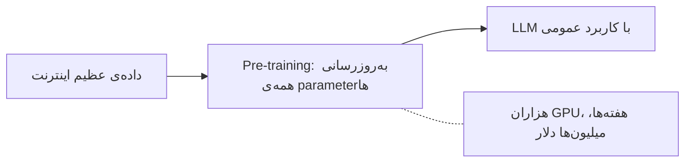
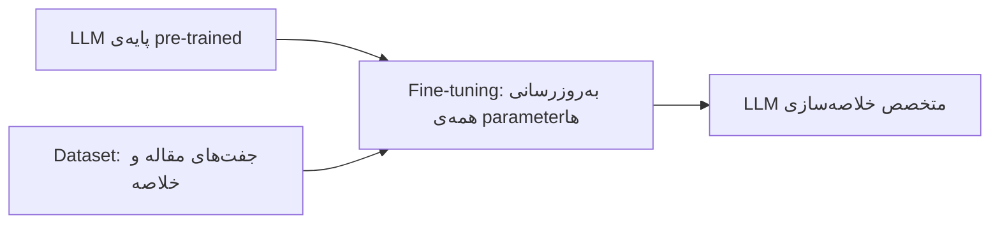
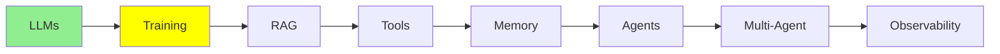

# Training LLMs

[مبانی LLM](llms_fa.md) گفت که LLM یک network با تعداد بسیار زیادی parameter است. همچنین گفت که LLM کلمه‌ی بعدی را پیش‌بینی می‌کند. این ماژول درباره‌ی این است که آن parameter‌ها از کجا می‌آیند.

دو مرحله وجود دارد و این دو تقریباً کاملاً با هم فرق دارند. یک مرحله میلیون‌ها دلار هزینه دارد و فقط چند lab می‌توانند آن را انجام دهند. مرحله‌ی دیگر را می‌توانید امشب روی GPU خودتان اجرا کنید.

## Training یعنی چه؟

در ابتدا، یک مدل هیچ چیزی نمی‌داند. هر parameter یک عدد تصادفی است، پس خروجی‌اش هم تصادفی است.

Training یعنی به مدل متن می‌دهید و آن عددها را کمی تغییر می‌دهید. این کار را بارها و بارها تکرار می‌کنید، تا حدس‌های مدل دیگر تصادفی نباشند و درست شوند.

  
*همان network، پیش و پس از training. ورودی این است: "The students opened their". weight‌های تصادفی سمت چپ "Sun" را تولید می‌کنند. weight‌های یادگرفته‌شده سمت راست "Laptops" را تولید می‌کنند. شکل network تغییر نکرد. فقط عددهای داخل آن تغییر کردند.*

این کل ترفند است. Training قانون یا واقعیتی را به شکلی که بتوانید آن را باز کنید و بخوانید اضافه نمی‌کند. فقط عددها را تنظیم می‌کند. دانش در میلیاردها عدد پخش می‌شود. به همین دلیل، مردم هنوز از توصیف Andrej Karpathy استفاده می‌کنند: می‌توانید training را **فشرده‌سازی اینترنت** بدانید.

## Pre-training

اولین مرحله **pre-training** است و با فاصله، بزرگ‌ترین مرحله است.

- مدل با parameter‌هایی (همان "weights" خودش) شروع می‌کند که تصادفی و بدون training هستند.
- بخش بسیار بزرگی از اینترنت را می‌خواند: کتاب‌ها، وب‌سایت‌ها، کد و مقاله‌ها. از این متن یاد می‌گیرد کلمه‌ی بعدی را پیش‌بینی کند. این کار را بارها و بارها انجام می‌دهد، میلیاردها بار.
- Pre-training **همه‌ی** parameter‌های مدل را به‌روز می‌کند. برای یک مدل بزرگ، یعنی میلیاردها عدد تغییر می‌کنند.
- به هزاران GPU نیاز دارد که هفته‌ها یا ماه‌ها کار می‌کنند. به همین دلیل، pre-training یک مدل بزرگ از صفر، **میلیون‌ها دلار** هزینه دارد. فقط تعداد کمی lab بزرگ (OpenAI، Google، Anthropic، Meta و چند lab دیگر) توان پرداخت آن را دارند.



نتیجه، یک مدل **با کاربرد عمومی** است: در خیلی کارها خوب است و در هیچ کاری تخصص ندارد.

> **نکته، و این یک موضوع پیشرفته است.** توجه کنید که هیچ‌کس آن متن اینترنت را برچسب‌گذاری نکرده است.
> کلید پاسخی وجود ندارد. مدل سیگنال training خودش را می‌سازد. کلمه‌ی بعدی را پنهان می‌کند، حدس می‌زند،
> و حدس را با کلمه‌ای که واقعاً آنجا بود مقایسه می‌کند. پس داده خودش را برچسب می‌زند. به این کار
> **self-supervised learning** می‌گویند. دیاگرام‌ها اغلب آن را به جای آن "unsupervised" برچسب می‌زنند.
> این موضوع را در
> [Advanced Training](../3_expert/advanced_training.md) کامل توضیح می‌دهیم.

## چرا لازم نیست Pre-train کنیم؟

لازم نیست مدل خودتان را pre-train کنید. کس دیگری از قبل آن میلیون‌ها دلار را خرج کرده است. می‌توانید از مدل تمام‌شده‌ی آن‌ها شروع کنید و **fine-tune** کنید.

**Fine-tuning** یعنی مدلی را که از قبل pre-train شده است بردارید و training را ادامه دهید. این بار dataset کوچک و مخصوص یک کار است، پس مدل در همان کار مشخص خوب می‌شود.

روشن‌ترین راه برای دیدن تفاوت، نگاه کردن به داده‌ای است که هر مرحله مصرف می‌کند:

  
*Pre-training یک انبوه متن بدون برچسب را می‌گیرد و هیچ انسانی در این فرایند نیست. توانایی‌های عمومی تولید می‌کند، مثل کامل کردن و فهمیدن متن. Fine-tuning جفت‌هایی را می‌گیرد که یک انسان نوشته است: یک prompt و پاسخی که باید بگیرد. توانایی‌های مشخصی، مثل classification یا question answering، اضافه می‌کند.*

پس، هر کدام در یک خط:

- **Pre-training** متن **بدون برچسب** را مصرف می‌کند که از کل اینترنت جمع شده است. کسی پاسخ‌ها را نمی‌نویسد، چون کلمه‌ی بعدی *خودش* پاسخ است.
- **Fine-tuning** یک مجموعه از جفت‌ها را مصرف می‌کند: input و output، یا prompt و پاسخ. معمولاً آدم‌ها این جفت‌ها را می‌نویسند یا بررسی می‌کنند. یعنی هزاران جفت، نه میلیاردها صفحه.

همین تفاوت باعث می‌شود که یکی میلیون‌ها دلار هزینه داشته باشد و دیگری روی یک GPU جا شود.

## Fine-tuning

فرض کنید می‌خواهید مدلی داشته باشید که در خلاصه‌کردن مقاله‌ها خیلی خوب باشد.

1. با یک base model که pre-train شده است شروع کنید.
2. یک dataset از نمونه‌ها جمع کنید: جفت‌های `(long article, human-written short summary)`. معمولاً چند هزار جفت کافی است.
3. training مدل را روی این جفت‌ها ادامه دهید. به این ترتیب، مدل الگوی «متن بلند می‌گیرد و خلاصه‌ی کوتاه و دقیق می‌دهد» را یاد می‌گیرد.
4. نتیجه، در خلاصه‌کردن، به‌وضوح یکدست‌تر از base model عمومی است. و هزینه‌ی pre-training را هم پرداخت نمی‌کنید.

در ادامه چند ردیف training را می‌بینید. این دقیقاً همان چیزی است که مدل در مرحله‌ی 3، بارها و بارها می‌بیند:

| مقاله (input) | خلاصه‌ی انسانی (output) |
|---|---|
| "The city opened three new public parks this year, adding over 50 acres of green space. Officials say the parks will host weekend markets and free yoga classes starting next spring." | "The city added 50 acres of new parks, which will host markets and yoga classes." |
| "Scientists discovered a new species of frog in the Amazon rainforest. The frog has bright blue skin and is only 2 cm long, making it one of the smallest amphibians ever recorded." | "A tiny, 2cm blue frog was discovered in the Amazon, one of the smallest amphibians on record." |
| "The company's quarterly earnings report showed a 15% increase in revenue, driven mainly by strong sales in its cloud computing division." | "The company's revenue grew 15% this quarter, led by cloud computing sales." |
| "A new study found that drinking coffee in moderation may reduce the risk of heart disease. Researchers tracked 10,000 participants over five years." | "A 5-year study of 10,000 people found moderate coffee drinking may lower heart disease risk." |
| "The local football team won their championship game 3-1, securing their first title in a decade." | "The team won the championship 3-1, their first title in ten years." |

مدل هزاران جفت مثل این‌ها می‌بیند، اما پاسخ‌ها را حفظ نمی‌کند. مدل *الگو* را یاد می‌گیرد: نکته‌های اصلی را از یک متن بلندتر بیرون می‌کشد و آن‌ها را در یک جمله‌ی کوتاه و ساده فشرده می‌کند.

### آیا واقعاً کار می‌کند؟

بیایید مدل را روی یک مقاله‌ی تازه امتحان کنیم که هرگز آن را ندیده است. این مقاله یکی از مقاله‌های جدول بالا نیست.

**مقاله‌ی آزمون:**
> "The tech startup announced today that it raised $50 million in Series B funding, led by two
> major venture capital firms. The company plans to use the funds to expand its engineering team
> and launch operations in three new countries by next year."

**base model، پیش از fine-tuning:**
> "This is an interesting piece of news about a technology startup. The article talks about how
> the company managed to secure a significant amount of funding, specifically $50 million, in
> what is known as a Series B funding round, which was led by two prominent venture capital
> firms. According to the article, the startup intends to allocate this capital towards growing
> its engineering department and expanding its business operations into three additional
> countries within the coming year."

**مدل fine-tune شده، پس از آن:**
> "The startup raised $50 million in Series B funding to grow its engineering team and expand
> into three new countries next year."

به تفاوت دقت کنید. پاسخ base model طولانی و بی‌تمرکز است. تقریباً جمله به جمله مقاله را تکرار می‌کند و با یک جمله‌ی پرکننده مثل "This is an interesting piece of news" شروع می‌کند. مدل fine-tune شده الگوی جدول را یاد گرفت. سپس آن الگو را روی مقاله‌ای به کار برد که هرگز ندیده بود.

در ادامه یک مثال کوچک و ساده با Hugging Face `transformers` آمده است:

```python
from transformers import AutoModelForSeq2SeqLM, AutoTokenizer, Trainer, TrainingArguments

model = AutoModelForSeq2SeqLM.from_pretrained("t5-small")  # already pre-trained
tokenizer = AutoTokenizer.from_pretrained("t5-small")

# dataset = a list of {"article": "...", "summary": "..."} pairs
trainer = Trainer(
    model=model,
    args=TrainingArguments(output_dir="./summarizer", num_train_epochs=3),
    train_dataset=dataset,  # your (article, summary) pairs
)
trainer.train()  # updates ALL of the model's parameters
```

به این کار **full fine-tuning** می‌گویند، چون هر parameter را به‌روز می‌کند. مکانیزم آن همان مکانیزم pre-training است، اما روی یک dataset خیلی کوچک‌تر. از pre-training ارزان‌تر است. اما برای یک مدل بزرگ، هنوز به GPU memory زیادی نیاز دارد.



## Parameter-efficient Fine-tuning (PEFT)

Full fine-tuning هر parameter را به‌روز می‌کند. برای یک مدل بزرگ، این هنوز یعنی GPU‌های بزرگ. بیشتر ما آن‌ها را نداریم.

**PEFT (Parameter-Efficient Fine-Tuning)** این مشکل را حل می‌کند. **تقریباً کل مدل را freeze می‌کند**، و فقط تعداد کمی parameter جدید و اضافی را train می‌کند.

- بخش freeze‌شده دقیقاً همان‌طور می‌ماند که pre-training آن را گذاشته بود.
- فقط بخش خیلی کوچکی از parameter‌ها تغییر می‌کند. این معمولاً کمتر از 1% از کل است.
- رایج‌ترین تکنیک PEFT، **LoRA** (Low-Rank Adaptation) است. لازم نیست ریاضی‌اش را بدانید. کافی است بدانید که LoRA همان ترفند ارزان fine-tuning است که تقریباً همه از آن استفاده می‌کنند.

این کار سه مزیت دارد. روی یک GPU مصرفی معمولی اجرا می‌شود. خیلی سریع‌تر training می‌شود. و یک فایل کوچک تولید می‌کند که فقط parameter‌های اضافی را نگه می‌دارد، به جای یک کپی کامل و تازه از کل مدل. پروژه‌های واقعی بیشتر وقت‌ها از همین استفاده می‌کنند.

در ادامه یک مثال کوچک و ساده از LoRA با Hugging Face `peft` آمده است:

```python
from peft import LoraConfig, get_peft_model
from transformers import AutoModelForSeq2SeqLM

model = AutoModelForSeq2SeqLM.from_pretrained("t5-small")  # frozen base model

lora_config = LoraConfig(r=8, task_type="SEQ_2_SEQ_LM")
model = get_peft_model(model, lora_config)  # freezes the base, adds small trainable layers

model.print_trainable_parameters()
# something like: "trainable params: 0.3M || all params: 60M || trainable%: 0.5%"
```

PEFT را با quantization اشتباه نگیرید، که در [مبانی LLM](llms_fa.md) توضیح داده شد. **PEFT درباره‌ی training ارزان است. Quantization درباره‌ی اجرای ارزان است.** اغلب این دو را با هم استفاده می‌کنند.

## Unsloth

اگر training loop را خودتان بنویسید، باید خیلی از بخش‌ها را دستی به هم وصل کنید. جا دادن یک مدل در memory‌ای که دارید، مهارت جداگانه‌ای است. [Unsloth](https://unsloth.ai/docs) یک کتابخانه‌ی open-source است که هر دو کار را انجام می‌دهد.

آنچه از آن می‌گیرید:

- **Fine-tuning که جا می‌شود.** بخش‌های گران training را دوباره می‌نویسد. به همین دلیل، اجراهای LoRA و quantized-LoRA به GPU memory خیلی کمتری نیاز دارند و سریع‌تر تمام می‌شوند. اغلب، همین تعیین می‌کند که یک کار روی GPU رایگان Colab اجرا شود یا نه.
- **notebook‌های آماده.** [مجموعه‌ی notebook‌ها](https://unsloth.ai/docs/get-started/unsloth-notebooks) مدل‌های باز و محبوب را پوشش می‌دهد. یکی را باز می‌کنید، dataset خودتان را به آن می‌دهید و اجرایش می‌کنید. این صادقانه‌ترین و سریع‌ترین راه از «چند جفت دارم» به «یک مدل fine-tune شده دارم» است.
- **مدل‌های pre-quantized برای اجرا، نه فقط برای training.** [مبانی LLM](llms_fa.md) گفته بود که شما به‌ندرت خودتان چیزی را quantize می‌کنید. این همان release‌هایی است که آن ماژول منظور داشت. پس همین پروژه هر دو کار را پوشش می‌دهد: فشرده‌کردن یک مدل و training یک مدل.
- **یک راهنما و یک بررسی واقعیت.** [راهنمای fine-tuning](https://unsloth.ai/docs/get-started/fine-tuning-llms-guide) کل فرایند را گام به گام توضیح می‌دهد. FAQ مربوط به [is fine-tuning right for me](https://unsloth.ai/docs/get-started/fine-tuning-for-beginners/faq-+-is-fine-tuning-right-for-me) را **پیش از** شروع بخوانید، چون پاسخ صادقانه اغلب «نه» است. خیلی از مشکل‌ها شبیه مشکل‌های fine-tuning به نظر می‌رسند. یک prompt بهتر، یا retrieval در [RAG و Embedding‌ها](rag_fa.md)، خیلی از آن‌ها را حل می‌کند.

## مقایسه‌ی کنار هم

| | Pre-training | Full fine-tuning | PEFT (مثلاً LoRA) |
|---|---|---|---|
| نقطه‌ی شروع | weight‌های تصادفی | مدل pre-trained | مدل pre-trained |
| داده‌ی لازم | کل اینترنت، بدون برچسب | جفت‌های مخصوص کار | جفت‌های مخصوص کار |
| parameter‌های به‌روزشده | همه، از صفر | همه | بخشی، معمولاً کمتر از 1% |
| هزینه‌ی معمول | میلیون‌ها دلار | گران، اما خیلی کمتر از pre-training | ارزان، روی یک GPU جا می‌شود |
| چه کسانی انجامش می‌دهند | چند lab بزرگ AI | شرکت‌هایی با بودجه‌ی واقعی | بیشتر ما، بیشتر وقت‌ها |


## کی نباید fine-tune کرد

بیشتر کسانی که فکر می‌کنند به fine-tuning نیاز دارند، در واقع به آن نیازی ندارند. پس دانستن سه موردی که جواب در آن‌ها «نه» است، مفید است.

**برای یاد دادن دانش شرکت‌تان به یک مدل، fine-tune نکنید.** آن دانش زنده است. codebase commit‌های تازه می‌گیرد، قراردادها به‌روز می‌شوند و سیاست‌ها عوض می‌شوند. Fine-tuning یک snapshot است. ساعت‌ها وقت و پول واقعی می‌گیرد، پس نمی‌توانید هر بار که یک فایل عوض می‌شود دوباره آن را اجرا کنید. آنچه آنجا لازم دارید retrieval است که موضوع [RAG و Embedding‌ها](rag_fa.md) است.

**برای کار fine-tune کنید، نه برای واقعیت‌ها.** Fine-tuning در یاد دادن یک *رفتار* خوب است، مثل خلاصه‌کردن با یک قالب مشخص یا دسته‌بندی متن در دسته‌های خودتان. در یاد دادن *واقعیت‌ها* ضعیف است. چند صد صفحه‌ی شما در میان میلیاردها parameter گم می‌شود، و آن parameter‌ها همه‌ی چیزهای دیگری را نگه می‌دارند که مدل تا به حال خوانده است.

**و به یاد داشته باشید با چه کسی رقابت می‌کنید.** فرض کنید یک ماه برای کار خودتان یک مدل را fine-tune می‌کنید. تا وقتی کارتان تمام شود، frontier model بعدی منتشر شده است. یک lab آن را با منابعی آموزش داده که شما ندارید. احتمال زیادی وجود دارد که این مدل جدید، بدون هیچ تغییری، در کار شما بهتر از نسخه‌ی fine-tune شده‌ی خودتان از نسل قبل باشد. Fine-tuning هنوز برنده است وقتی که کار واقعاً مال شما باشد و واقعاً محدود باشد. وقتی بخواهید در training از lab‌ها پیشی بگیرید، می‌بازد.

## Hugging Face چیست؟

هر دو مثال کد بالا از آن import می‌کنند، پس ارزش یک پاراگراف را دارد.

[Hugging Face](https://huggingface.co/) جایی است که جامعه‌ی open-source machine learning کارهایش را نگه می‌دارد. صفحه‌ی **Models** آن، در عمل، رجیستری مرکزی مدل‌های باز از هر نوعی است، نه فقط LLM‌ها. مدل‌هایی برای computer vision، گفتار و صدا و خیلی حوزه‌های دیگر دارد. وقتی یک گروه پژوهشی یک مدل باز منتشر می‌کند، معمولاً همین‌جا ظاهر می‌شود.

Hugging Face همچنین کتابخانه‌هایی را منتشر می‌کند که همه برای کار با این مدل‌ها استفاده می‌کنند. اصلی‌ترین آن‌ها **`transformers`** است. این کتابخانه یک مدل را با نامش بارگذاری می‌کند و با چند خط کد اجرایش می‌کند. کتابخانه‌های همراهی هم برای بخش‌های اطرافش وجود دارند، مثل `peft` برای training با LoRA که بالاتر آمد، و `datasets` برای داده‌ای که به مدل می‌دهید.

## کجای این مجموعه هستیم



## خلاصه

Training فقط تنظیم parameter‌های یک مدل است. Pre-training از weight‌های تصادفی شروع می‌کند، از متن بدون برچسب اینترنت استفاده می‌کند و میلیون‌ها دلار هزینه دارد. Fine-tuning از مدل تمام‌شده‌ی کس دیگری شروع می‌کند، از جفت‌هایی که یک انسان نوشته استفاده می‌کند و هزینه‌ی خیلی کمی دارد. PEFT همان کار را انجام می‌دهد، اما کمتر از 1% از parameter‌ها را تغییر می‌دهد. به همین دلیل، بیشتر پروژه‌ها از آن استفاده می‌کنند.

اما حتی یک مدل fine-tune شده هم درباره‌ی codebase خصوصی شما یا داده‌ی امروز هیچ چیزی نمی‌داند. RAG دقیقاً همین شکاف را پر می‌کند، و ماژول بعدی همین است.

**بررسی سریع**: تفاوت full fine-tuning و PEFT چیست؟ و چرا pre-training این‌قدر گران است؟

## منابع

- [Unsloth documentation](https://unsloth.ai/docs): مستندات کامل کتابخانه
- [Unsloth: is fine-tuning right for me?](https://unsloth.ai/docs/get-started/fine-tuning-for-beginners/faq-+-is-fine-tuning-right-for-me): این را پیش از fine-tune کردن هر چیزی بخوانید
- [Unsloth notebooks](https://unsloth.ai/docs/get-started/unsloth-notebooks): notebook‌های آماده برای training و برای اجرای مدل‌های quantized
- [Unsloth fine-tuning guide](https://unsloth.ai/docs/get-started/fine-tuning-llms-guide): کل فرایند، از ابتدا تا انتها
- [Hugging Face](https://huggingface.co/): رجیستری مدل‌ها و کتابخانه‌ی `transformers`
- [Fine-tuning AI models](https://cloud.google.com/use-cases/fine-tuning-ai-models?hl=en#fine-tuning-llms-and-ai-models): نمای کلی Google Cloud، که برای آشنایی با واژگان مفید است
- [What is LLM Fine-Tuning? (Explained Simply)](https://youtube.com/shorts/Ei4E2lWStqw?si=q0PttlRmBsARGHZU): یک ویدیوی کوتاه، اگر می‌خواهید کل ایده را در کمتر از یک دقیقه ببینید
