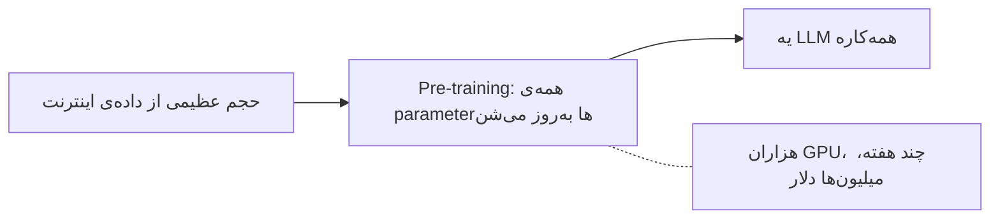
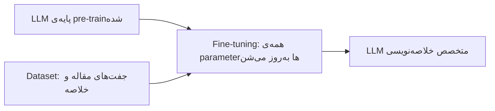
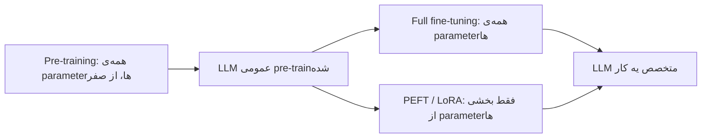
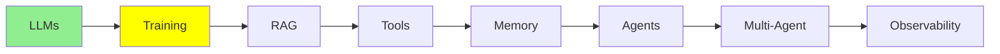

# Training LLMs

توی [مبانی LLM](llms_fa.md) دیدیم که LLM یه شبکه با تعداد خیلی زیادی parameter‌ه که کلمه‌ی بعدی رو حدس می‌زنه. این درس سراغ این سوال می‌ره که اون parameter‌ها از کجا اومدن.

این کار دو مرحله داره که تقریباً هیچ ربطی به هم ندارن: یکی میلیون‌ها دلار خرج داره و فقط از دست چند تا آزمایشگاه برمیاد، ولی اون یکی رو همین امشب می‌تونی روی GPU خودت اجرا کنی.

## training یعنی چی؟

مدل اولش هیچی بلد نیست. همه‌ی parameter‌هاش عددهای تصادفی‌ان، پس خروجیش هم تصادفیه.

training یعنی به مدل متن بدی و هر بار این عددها رو یه ذره تغییر بدی، و این کار رو اون‌قدر تکرار کنی که حدس‌هاش دیگه شانسی نباشن و کم‌کم درست از آب دربیان.

  
*همون شبکه، یه بار قبل از training و یه بار بعدش. ورودی جمله‌ی «The students opened their» هست. weight‌های تصادفی سمت چپ «Sun» رو بیرون می‌دن و weight‌های یادگرفته‌ی سمت راست «Laptops» رو. شکل شبکه هیچ فرقی نکرده؛ فقط عددهای داخلش عوض شدن.*

کل کار training همینه: عددها رو هر بار یه ذره تغییر می‌ده و این رو بارها و بارها تکرار می‌کنه. training هیچ قانون یا اطلاعاتی رو به شکلی که بشه بازش کرد و خوندش به مدل اضافه نمی‌کنه؛ فقط عددها رو تنظیم می‌کنه و دانش مدل آخرش بین میلیاردها عدد پخش می‌شه. واسه همینه که هنوز هم خیلی‌ها از تعبیر Andrej Karpathy استفاده می‌کنن: training رو می‌شه **فشرده کردن اینترنت** دونست.

## مرحله‌ی اول: Pre-training

مرحله‌ی اول **pre-training** هست، که با اختلاف، سنگین‌ترین بخش کاره.

- مدل با parameter‌هایی شروع می‌کنه که بهشون «weight» هم می‌گن، و هنوز تصادفی‌ان و چیزی یاد نگرفتن.
- یه تیکه‌ی خیلی بزرگ از اینترنت رو می‌خونه، از کتاب و سایت گرفته تا کد و مقاله، و از روی همین متن‌ها یاد می‌گیره کلمه‌ی بعدی رو پیش‌بینی کنه؛ اون هم نه یه بار و دو بار، میلیاردها بار.
- pre-training **همه‌ی** parameter‌های مدل رو به‌روز می‌کنه؛ توی یه مدل بزرگ یعنی میلیاردها عدد عوض می‌شن.
- برای این کار هزاران GPU لازمه که هفته‌ها یا حتی ماه‌ها یک‌سره کار کنن. واسه همین pre-train کردن یه مدل بزرگ از صفر **میلیون‌ها دلار** آب می‌خوره و فقط چند تا آزمایشگاه بزرگ (OpenAI، Google، Anthropic، Meta و چند تای دیگه) از پس هزینه‌ش برمیان.



نتیجه‌ش یه مدل **general-purpose** می‌شه که توی خیلی کارها خوبه، ولی توی هیچ‌کدوم تخصص نداره.

> **نکته: این یه بحث پیشرفته‌ست.** دقت کن که هیچ‌کس اون متن‌های اینترنت رو برچسب نزده و هیچ پاسخ‌نامه‌ای هم در کار نیست. مدل سیگنال training رو خودش برای خودش می‌سازه: کلمه‌ی بعدی رو قایم می‌کنه، یه حدس می‌زنه و حدسش رو با کلمه‌ای که واقعاً اون‌جا بوده مقایسه می‌کنه. یعنی داده خودش به خودش برچسب می‌زنه. به این می‌گن **self-supervised learning**، هرچند توی دیاگرام‌ها معمولاً اسمش رو «unsupervised» می‌ذارن. توی [Advanced Training](../3_expert/advanced_training.md) مفصل درباره‌ش حرف می‌زنیم.

## چرا لازم نیست خودمون pre-train کنیم؟

لازم نیست خودت مدل pre-train کنی، چون اون میلیون‌ها دلار رو یکی دیگه قبلاً خرج کرده. می‌تونی از مدل آماده‌ی اون‌ها شروع کنی و **fine-tune‌ش** کنی.

**Fine-tuning** یعنی یه مدل pre-train‌شده رو برداری و training‌ش رو ادامه بدی، ولی این بار با یه dataset کوچیک که مخصوص یه کار مشخصه، تا مدل توی همون کار خبره بشه.

بهترین راه برای دیدن فرقشون اینه که ببینی خوراک هر مرحله چه داده‌ایه:

  
*خوراک pre-training یه عالمه متن بدون برچسبه و هیچ آدمی وسط کار نیست؛ خروجیش توانایی‌های عمومیه، مثل کامل کردن و فهمیدن متن. خوراک fine-tuning جفت‌هاییه که آدم نوشته، یعنی یه prompt و جوابی که باید براش بیاد؛ و توانایی‌های مشخص‌تری مثل دسته‌بندی یا جواب دادن به سوال رو به مدل اضافه می‌کنه.*

پس اگه بخوایم هر کدوم رو توی یه خط بگیم:

- **Pre-training** متن **بدون برچسب** می‌خوره که از سرتاسر اینترنت جمع شده. کسی جوابی نمی‌نویسه، چون جواب *خود* کلمه‌ی بعدیه.
- **Fine-tuning** یه **مجموعه از جفت‌ها** می‌خوره: ورودی و خروجی، یا prompt و جواب. این جفت‌ها رو معمولاً آدم‌ها می‌نویسن یا بررسی می‌کنن، و صحبت از چند هزار جفته، نه میلیاردها صفحه.

به خاطر همین فرقه که یکی میلیون‌ها دلار خرج داره و اون یکی روی یه دونه GPU جا می‌شه.

## Fine-tuning چطور کار می‌کنه؟

فرض کن یه مدل می‌خوای که مقاله‌ها رو خیلی خوب خلاصه کنه.

1. از یه مدل پایه‌ی pre-train‌شده شروع کن.
2. یه dataset از نمونه‌ها جمع کن، یعنی جفت‌های `(long article, human-written short summary)`. معمولاً چند هزار تا کافیه.
3. training مدل رو روی همین جفت‌ها ادامه بده تا الگوی «متن بلند می‌ره تو، خلاصه‌ی کوتاه و دقیق میاد بیرون» رو یاد بگیره.
4. مدلی که به دست میاد، خلاصه‌هاش به‌وضوح یکدست‌تر از مدل پایه‌ی عمومیه، و هزینه‌ی pre-training هم گردن تو نیست.

چند ردیف از داده‌ی training می‌تونه این شکلی باشه؛ مدل توی مرحله‌ی 3 دقیقاً همین‌ها رو بارها و بارها می‌بینه:

| مقاله (ورودی) | خلاصه‌ای که آدم نوشته (خروجی) |
|---|---|
| "The city opened three new public parks this year, adding over 50 acres of green space. Officials say the parks will host weekend markets and free yoga classes starting next spring." | "The city added 50 acres of new parks, which will host markets and yoga classes." |
| "Scientists discovered a new species of frog in the Amazon rainforest. The frog has bright blue skin and is only 2 cm long, making it one of the smallest amphibians ever recorded." | "A tiny, 2cm blue frog was discovered in the Amazon, one of the smallest amphibians on record." |
| "The company's quarterly earnings report showed a 15% increase in revenue, driven mainly by strong sales in its cloud computing division." | "The company's revenue grew 15% this quarter, led by cloud computing sales." |
| "A new study found that drinking coffee in moderation may reduce the risk of heart disease. Researchers tracked 10,000 participants over five years." | "A 5-year study of 10,000 people found moderate coffee drinking may lower heart disease risk." |
| "The local football team won their championship game 3-1, securing their first title in a decade." | "The team won the championship 3-1, their first title in ten years." |

مدل هزاران جفت مثل این‌ها می‌بینه، ولی جواب‌ها رو حفظ نمی‌کنه، بلکه *الگو* رو یاد می‌گیره: این‌که نکته‌های اصلی یه متن بلند رو بیرون بکشه و توی یه جمله‌ی کوتاه و ساده جمعشون کنه.

### واقعاً جواب می‌ده؟

بیا روی یه مقاله‌ی جدید امتحانش کنیم که مدل تا حالا ندیده و جزو مقاله‌های جدول بالا هم نیست.

**مقاله‌ی آزمایشی:**
> "The tech startup announced today that it raised $50 million in Series B funding, led by two
> major venture capital firms. The company plans to use the funds to expand its engineering team
> and launch operations in three new countries by next year."

**مدل پایه، قبل از fine-tuning:**
> "This is an interesting piece of news about a technology startup. The article talks about how
> the company managed to secure a significant amount of funding, specifically $50 million, in
> what is known as a Series B funding round, which was led by two prominent venture capital
> firms. According to the article, the startup intends to allocate this capital towards growing
> its engineering department and expanding its business operations into three additional
> countries within the coming year."

**همون مدل، بعد از fine-tuning:**
> "The startup raised $50 million in Series B funding to grow its engineering team and expand
> into three new countries next year."

فرقشون رو می‌بینی؟ جواب مدل پایه طولانی و پراکنده‌ست؛ تقریباً جمله به جمله مقاله رو تکرار می‌کنه و با یه جمله‌ی اضافه و بی‌خاصیت مثل «This is an interesting piece of news» شروع می‌شه. ولی مدل fine-tune‌شده الگو رو از جدول یاد گرفته و همون رو روی مقاله‌ای پیاده کرده که هیچ‌وقت ندیده بود.

این هم یه نمونه‌ی خیلی کوچیک و ساده‌شده با `transformers` از Hugging Face:

```python
from transformers import AutoModelForSeq2SeqLM, AutoTokenizer, Trainer, TrainingArguments

model = AutoModelForSeq2SeqLM.from_pretrained("t5-small")  # already pre-trained
tokenizer = AutoTokenizer.from_pretrained("t5-small")

# dataset = a list of {"article": "...", "summary": "..."} pairs
trainer = Trainer(
    model=model,
    args=TrainingArguments(output_dir="./summarizer", num_train_epochs=3),
    train_dataset=dataset,  # your (article, summary) pairs
)
trainer.train()  # updates ALL of the model's parameters
```

به این می‌گن **full fine-tuning**، چون همه‌ی parameter‌ها رو به‌روز می‌کنه. سازوکارش همون pre-training‌ه، فقط روی یه dataset خیلی کوچیک‌تر؛ برای همین از pre-training ارزون‌تر درمیاد، ولی برای یه مدل بزرگ هنوز هم حافظه‌ی GPU زیادی می‌خواد.



## Parameter-efficient Fine-tuning (PEFT)

full fine-tuning همه‌ی parameter‌ها رو عوض می‌کنه، و برای یه مدل بزرگ یعنی هنوز GPU‌های گنده لازمه که دست بیشترمون بهشون نمی‌رسه.

**PEFT (Parameter-Efficient Fine-Tuning)** برای حل همین مشکله. تقریباً کل مدل رو **freeze می‌کنه**، یعنی دست‌نخورده نگهش می‌داره، و فقط یه تعداد کمی parameter جدید و اضافه رو train می‌کنه.

- بخش freeze‌شده دقیقاً همون‌جوری می‌مونه که pre-training تحویلش داده بود.
- فقط یه بخش خیلی کوچیک از parameter‌ها عوض می‌شه، که معمولاً زیر 1% کل parameter‌هاست.
- معروف‌ترین تکنیک PEFT اسمش **LoRA** (Low-Rank Adaptation) هست. لازم نیست ریاضیش رو بدونی؛ همین‌قدر که بدونی LoRA همون ترفند ارزون fine-tuning‌ه که تقریباً همه ازش استفاده می‌کنن، کافیه.

این روش سه تا فایده داره: روی یه دونه GPU معمولی اجرا می‌شه، خیلی سریع‌تر train می‌شه، و خروجیش یه فایل کوچیکه که فقط parameter‌های اضافه توشه، نه یه کپی کامل و جدید از کل مدل. پروژه‌های واقعی هم بیشتر وقت‌ها همین رو استفاده می‌کنن.

این هم یه نمونه‌ی کوچیک و ساده‌شده از LoRA با `peft` از Hugging Face:

```python
from peft import LoraConfig, get_peft_model
from transformers import AutoModelForSeq2SeqLM

model = AutoModelForSeq2SeqLM.from_pretrained("t5-small")  # frozen base model

lora_config = LoraConfig(r=8, task_type="SEQ_2_SEQ_LM")
model = get_peft_model(model, lora_config)  # freezes the base, adds small trainable layers

model.print_trainable_parameters()
# something like: "trainable params: 0.3M || all params: 60M || trainable%: 0.5%"
```

PEFT رو با quantization که توی [مبانی LLM](llms_fa.md) دیدیم قاطی نکن. **PEFT برای اینه که ارزون train کنی، quantization برای اینه که ارزون اجرا کنی.** خیلی وقت‌ها هم این دو تا رو با هم استفاده می‌کنن.

## Unsloth

اگه training loop رو خودت بنویسی، باید کلی تیکه رو دستی به هم وصل کنی، و جا دادن مدل توی حافظه‌ای که داری هم خودش یه مهارت جداست. [Unsloth](https://unsloth.ai/docs) یه کتابخونه‌ی open-source‌ه که هر دوی این کارها رو برات انجام می‌ده.

چیزهایی که ازش گیرت میاد:

- **fine-tuning‌ای که توی حافظه جا می‌شه.** اون قسمت‌هایی از کد training رو که بیشترین حافظه و وقت رو می‌گیرن از نو نوشته، واسه همین LoRA و quantized-LoRA باهاش خیلی کمتر حافظه‌ی GPU لازم دارن و زودتر هم تموم می‌شن. خیلی وقت‌ها همین فرقه که تعیین می‌کنه یه کار روی GPU رایگان Colab اجرا می‌شه یا نه.
- **notebook‌های آماده.** [مجموعه‌ی notebook‌هاش](https://unsloth.ai/docs/get-started/unsloth-notebooks) مدل‌های open معروف رو پوشش می‌ده: یکی رو باز می‌کنی، dataset‌ت رو بهش می‌دی و اجراش می‌کنی. این سریع‌ترین راه درست و حسابیه که از «یه سری جفت دارم» برسی به «یه مدل fine-tune‌شده دارم».
- **مدل‌های pre-quantized برای اجرا، نه فقط برای training.** توی [مبانی LLM](llms_fa.md) گفتیم که به‌ندرت خودت چیزی رو quantize می‌کنی؛ منظورمون دقیقاً همین نسخه‌ها بود. پس یه پروژه هر دو کار رو پوشش می‌ده: هم فشرده کردن مدل، هم train کردنش.
- **یه راهنما، و یه تلنگر.** [راهنمای fine-tuning](https://unsloth.ai/docs/get-started/fine-tuning-llms-guide) کل کار رو قدم به قدم توضیح می‌ده. ولی **قبل از شروع** حتماً این FAQ رو بخون: [is fine-tuning right for me](https://unsloth.ai/docs/get-started/fine-tuning-for-beginners/faq-+-is-fine-tuning-right-for-me)، چون جواب صادقانه خیلی وقت‌ها منفیه. خیلی از مسئله‌ها ظاهرشون شبیه مسئله‌ی fine-tuning‌ه، ولی یه prompt بهتر یا همون retrieval‌ای که توی [RAG و Embedding‌ها](rag_fa.md) می‌بینیم، خیلی‌هاشون رو حل می‌کنه.

## مقایسه‌ی سه روش کنار هم

| | Pre-training | Full fine-tuning | PEFT (مثلاً LoRA) |
|---|---|---|---|
| نقطه‌ی شروع | weight‌های تصادفی | مدل pre-train‌شده | مدل pre-train‌شده |
| داده‌ی لازم | کل اینترنت، بدون برچسب | جفت‌های مخصوص همون کار | جفت‌های مخصوص همون کار |
| parameter‌هایی که عوض می‌شن | همه، از صفر | همه | بخشی، معمولاً زیر 1% |
| هزینه‌ی معمول | میلیون‌ها دلار | گرون، ولی خیلی کمتر از pre-training | ارزون، روی یه GPU جا می‌شه |
| کی سراغش می‌ره | چند تا آزمایشگاه بزرگ AI | شرکت‌هایی که بودجه‌ی درست و حسابی دارن | بیشتر ما، بیشتر وقت‌ها |



## کی نباید fine-tune کنیم؟

بیشتر کسایی که فکر می‌کنن fine-tuning لازم دارن، در واقع لازمش ندارن. پس خوبه این سه موقعیت رو بشناسی که جوابشون منفیه.

**برای یاد دادن اطلاعات شرکتت به مدل، fine-tune نکن.** این اطلاعات مدام در حال تغییره: codebase هر روز commit جدید می‌خوره، قراردادها به‌روز می‌شن و سیاست‌ها عوض می‌شن. fine-tuning ولی یه snapshot‌ه، یعنی عکسی از یه لحظه؛ ساعت‌ها طول می‌کشه و پول درست و حسابی می‌خواد، پس نمی‌تونی هر بار که یه فایل عوض شد از نو اجراش کنی. چیزی که این‌جا لازم داری retrieval‌ه، که درس [RAG و Embedding‌ها](rag_fa.md) درباره‌ی همونه.

**fine-tune برای یاد دادن کاره، نه اطلاعات.** fine-tuning توی یاد دادن یه *رفتار* خوب جواب می‌ده، مثل این‌که با یه فرمت خاص خلاصه کنه یا متن‌ها رو توی دسته‌بندی‌های خودت بچینه. ولی برای یاد دادن *اطلاعات* خوب نیست، چون چند صد صفحه‌ی تو بین میلیاردها parameter‌ی که هر چیز دیگه‌ای که مدل تا حالا خونده رو نگه می‌دارن، مثل قطره‌ای توی دریاست.

**و یادت نره با کی داری مسابقه می‌دی.** فرض کن یه ماه وقت می‌ذاری و یه مدل رو برای کارت fine-tune می‌کنی. تا کارت تموم بشه، frontier model بعدی اومده بیرون، که یه آزمایشگاه با امکاناتی که تو نداری train‌ش کرده. احتمالش زیاده که همین مدل جدید، بدون هیچ تغییری، توی کار تو از نسخه‌ی fine-tune‌شده‌ات، که روی نسل قبل ساخته شده، بهتر باشه. fine-tuning هنوز جایی برنده‌ست که کار واقعاً مال خودت باشه و واقعاً محدود و مشخص باشه؛ ولی اگه بخوای توی training رو دست آزمایشگاه‌ها بلند شی، می‌بازی.

## Hugging Face چیست؟

هر دو تا کد بالا از Hugging Face import می‌کنن، پس بد نیست یه پاراگراف هم به خودش بدیم.

[Hugging Face](https://huggingface.co/) پاتوق جامعه‌ی open-source توی machine learning‌ه و همه کارهاشون رو اون‌جا می‌ذارن. صفحه‌ی **Models**‌ش عملاً مرجع اصلی مدل‌های open از هر نوعیه، نه فقط LLM‌ها؛ برای computer vision، گفتار و صوت و کلی حوزه‌ی دیگه هم مدل داره. هر وقت یه گروه تحقیقاتی یه مدل open منتشر می‌کنه، معمولاً همین‌جا سر و کله‌ش پیدا می‌شه.

Hugging Face کتابخونه‌هایی هم منتشر می‌کنه که همه برای کار با این مدل‌ها ازشون استفاده می‌کنن. اصلی‌ترینش **`transformers`** هست که یه مدل رو با اسمش load می‌کنه و با چند خط کد اجراش می‌کنه. کنارش کتابخونه‌های دیگه‌ای هم برای کارهای جانبی هست، مثل `peft` برای همون training با LoRA که بالا دیدیم، و `datasets` برای داده‌ای که به مدل می‌دی.

## کجای این مجموعه هستیم



## خلاصه

training چیزی جز تنظیم parameter‌های مدل نیست. pre-training از weight‌های تصادفی شروع می‌کنه، با متن بدون برچسب اینترنت جلو می‌ره و میلیون‌ها دلار خرج داره. fine-tuning از مدل آماده‌ی یکی دیگه شروع می‌کنه، با جفت‌هایی که آدم نوشته کار می‌کنه و خرج زیادی نداره. PEFT هم همین کار رو می‌کنه، ولی به کمتر از 1% parameter‌ها دست می‌زنه، و واسه همینه که بیشتر پروژه‌ها سراغش می‌رن.

ولی حتی یه مدل fine-tune‌شده هم از codebase خصوصی تو یا داده‌های امروز هیچ خبری نداره. RAG دقیقاً جای خالی همین رو پر می‌کنه، و موضوع درس بعدیه.

**بررسی سریع**: فرق full fine-tuning با PEFT چیه؟ و چرا pre-training این‌قدر گرونه؟

## منابع

- [Unsloth documentation](https://unsloth.ai/docs): مستندات کامل این کتابخونه
- [Unsloth: is fine-tuning right for me?](https://unsloth.ai/docs/get-started/fine-tuning-for-beginners/faq-+-is-fine-tuning-right-for-me): قبل از این‌که چیزی رو fine-tune کنی، این رو بخون
- [Unsloth notebooks](https://unsloth.ai/docs/get-started/unsloth-notebooks): notebook‌های آماده، هم برای training و هم برای اجرای مدل‌های quantize‌شده
- [Unsloth fine-tuning guide](https://unsloth.ai/docs/get-started/fine-tuning-llms-guide): کل مسیر، از اول تا آخر
- [Hugging Face](https://huggingface.co/): مرجع مدل‌ها، و کتابخونه‌ی `transformers`
- [Fine-tuning AI models](https://cloud.google.com/use-cases/fine-tuning-ai-models?hl=en#fine-tuning-llms-and-ai-models): مرور کلی Google Cloud؛ برای آشنا شدن با اصطلاحات به درد می‌خوره
- [What is LLM Fine-Tuning? (Explained Simply)](https://youtube.com/shorts/Ei4E2lWStqw?si=q0PttlRmBsARGHZU): یه ویدیوی کوتاه، اگه می‌خوای کل ایده رو توی کمتر از یه دقیقه بگیری
