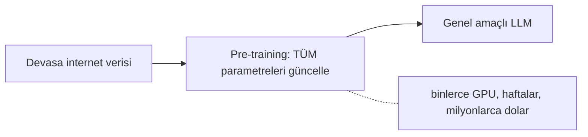
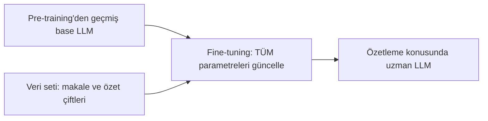
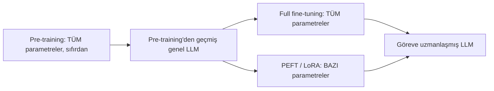
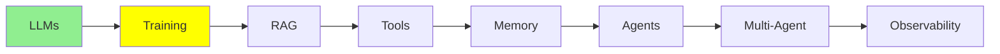

# Training LLMs

[LLM Temelleri](llms_tr.md) modülü, bir LLM'in çok sayıda parametreden oluşan bir ağ olduğunu ve
bir sonraki kelimeyi tahmin ettiğini anlatmıştı. Bu modül ise o parametrelerin nereden geldiğini
anlatıyor.

Bu işin iki adımı var ve bu iki adım neredeyse tamamen birbirinden farklı. Birinci adım milyonlarca
dolara mal oluyor ve bunu yalnızca birkaç laboratuvar yapabiliyor. İkinci adımı ise bu gece kendi
GPU'nda çalıştırabilirsin.

## Training Ne Demek?

Başlangıçta model hiçbir şey bilmez. Her parametre rastgele bir sayıdır, bu yüzden modelin çıktısı
da rastgeledir.

Training, modele metin vermek ve o sayıları küçük miktarlarla değiştirmek demektir. Bunu tekrar
tekrar yaparsın, tahminler rastgele olmaktan çıkıp doğru olmaya başlayana kadar.

  
*Aynı ağ, eğitimden önce ve sonra. Girdi "The students opened their". Soldaki rastgele ağırlıklar "Sun" üretiyor, sağdaki öğrenilmiş ağırlıklar ise "Laptops". Ağın yapısı değişmedi. Değişen yalnızca içindeki sayılar.*

İşin püf noktası şu: training, açıp okuyabileceğin kurallar ya da gerçekler eklemez, yalnızca
sayıları ayarlar. Bilgi milyarlarca sayının içine yayılır. Bu yüzden insanlar hâlâ Andrej
Karpathy'nin tarifini kullanır: training'i **internetin sıkıştırılması** olarak düşünebilirsin.

## Pre-training

İlk adım **pre-training**'dir ve açık ara en büyük adım budur.

- Model, rastgele ve eğitilmemiş parametrelerle (*weights*, yani ağırlıklarla) başlar.
- İnternetin çok büyük bir kısmını okur: kitapları, web sitelerini, kodu ve makaleleri. Bu metinden bir sonraki kelimeyi tahmin etmeyi öğrenir ve bunu milyarlarca kez, tekrar tekrar yapar.
- Pre-training, modelin **tüm** parametrelerini günceller. Büyük bir model için bu, milyarlarca sayının değişmesi demektir.
- Binlerce GPU gerekir ve bunlar haftalarca ya da aylarca çalışır. Bu yüzden büyük bir modeli sıfırdan pre-training etmek **milyonlarca dolara** mal olur. Bu bedeli yalnızca birkaç büyük laboratuvar ödeyebilir: OpenAI, Google, Anthropic, Meta ve birkaç diğeri.



Ortaya çıkan şey **genel amaçlı** bir model: birçok işte iyi, ama hiçbirinde uzmanlaşmış değil.

> **NOT, bu konu ileri düzey.** Dikkat et, o internet metnini kimse etiketlemedi ve ortada bir
> cevap anahtarı da yok. Model, kendi eğitim sinyalini kendisi üretiyor: bir sonraki kelimeyi
> gizliyor, bir tahmin yapıyor ve bu tahmini gerçekte orada olan kelimeyle karşılaştırıyor. Yani
> veri kendi kendini etiketliyor ve buna **self-supervised learning** denir. Diyagramlarda ise bu
> çoğu zaman "unsupervised" diye geçer. Bunu tam olarak
> [İleri Seviye Training](../3_expert/advanced_training_tr.md) modülünde anlatıyoruz.

## Pre-training Yapmak Zorunda Değil misin?

Pre-training'i kendin yapmak zorunda değilsin, çünkü milyonları harcayan biri bunu zaten yaptı. Sen
onun bitmiş modelinden başlayıp **fine-tuning** yapabilirsin.

**Fine-tuning**, pre-training'den geçmiş bir modeli alıp eğitime devam etmek demek. Bu kez veri seti
küçük ve göreve özel oluyor, böylece model belirli bir işte iyi hale geliyor.

Farkı görmenin en net yolu, her adımın hangi veriyle beslendiğine bakmak:

  
*Pre-training, insan müdahalesi olmadan etiketsiz bir metin yığınını alır. Bu, metni tamamlama ve anlama gibi genel yetenekler kazandırır. Fine-tuning ise bir insanın yazdığı çiftleri alır: bir prompt ve modelin vermesi gereken yanıt. Bu da sınıflandırma ya da soru cevaplama gibi belirli yetenekler ekler.*

Kısaca, ikisi şöyle özetlenir:

- **Pre-training**, internetin her yerinden toplanan **etiketsiz** metni yer. Cevapları kimse yazmaz, çünkü bir sonraki kelimenin *kendisi* cevaptır.
- **Fine-tuning**, bir **çiftler koleksiyonu** yer: girdi ve çıktı, ya da prompt ve yanıt. Bu çiftleri genellikle insanlar yazar ya da kontrol eder. Yani bu, milyarlarca sayfa değil, binlerce çift demek.

Bu fark, birinin neden milyonlara mal olduğunu ve ötekinin neden tek bir GPU'ya sığdığını açıklıyor.

## Fine-tuning

Diyelim ki makaleleri çok iyi özetleyen bir model istiyorsun.

1. Pre-training'den geçmiş bir base model ile başla.
2. Örneklerden oluşan bir veri seti topla: `(long article, human-written short summary)` çiftleri. Çoğu zaman birkaç bin çift yeter.
3. Modeli bu çiftler üzerinde eğitmeye devam et. Böylece model "uzun metin gir, kısa ve doğru özet çıkar" kalıbını öğrenir.
4. Sonuç, genel base modelden belirgin biçimde daha tutarlı özetler. Üstelik pre-training için para ödemiyorsun.

Aşağıda birkaç eğitim satırının nasıl göründüğü var. Model, 3. adımda tam olarak bunları tekrar tekrar görür:

| Makale (girdi) | İnsan özeti (çıktı) |
|---|---|
| "The city opened three new public parks this year, adding over 50 acres of green space. Officials say the parks will host weekend markets and free yoga classes starting next spring." | "The city added 50 acres of new parks, which will host markets and yoga classes." |
| "Scientists discovered a new species of frog in the Amazon rainforest. The frog has bright blue skin and is only 2 cm long, making it one of the smallest amphibians ever recorded." | "A tiny, 2cm blue frog was discovered in the Amazon, one of the smallest amphibians on record." |
| "The company's quarterly earnings report showed a 15% increase in revenue, driven mainly by strong sales in its cloud computing division." | "The company's revenue grew 15% this quarter, led by cloud computing sales." |
| "A new study found that drinking coffee in moderation may reduce the risk of heart disease. Researchers tracked 10,000 participants over five years." | "A 5-year study of 10,000 people found moderate coffee drinking may lower heart disease risk." |
| "The local football team won their championship game 3-1, securing their first title in a decade." | "The team won the championship 3-1, their first title in ten years." |

Model bu çiftlerden binlerce tanesini görür, ama cevapları ezberlemez. *Kalıbı* öğrenir: uzun bir
metinden temel bilgileri çıkarıp bunları kısa ve sade tek bir cümleye sıkıştırır.

### Gerçekten İşe Yarıyor mu?

Modeli, hiç görmediği yeni bir makaleyle test edelim. Bu makale, yukarıdaki tablodakilerden biri
değil.

**Test makalesi:**
> "The tech startup announced today that it raised $50 million in Series B funding, led by two
> major venture capital firms. The company plans to use the funds to expand its engineering team
> and launch operations in three new countries by next year."

**Fine-tuning öncesi base model:**
> "This is an interesting piece of news about a technology startup. The article talks about how
> the company managed to secure a significant amount of funding, specifically $50 million, in
> what is known as a Series B funding round, which was led by two prominent venture capital
> firms. According to the article, the startup intends to allocate this capital towards growing
> its engineering department and expanding its business operations into three additional
> countries within the coming year."

**Fine-tuning sonrası model:**
> "The startup raised $50 million in Series B funding to grow its engineering team and expand
> into three new countries next year."

Farka dikkat et. Base modelin cevabı uzun ve odaksız. Makaleyi neredeyse cümle cümle tekrar ediyor
ve "This is an interesting piece of news" gibi bir dolgu cümleyle açılıyor. Fine-tune edilmiş model
ise kalıbı tablodan öğrendi ve sonra bu kalıbı, hiç görmediği bir makaleye uyguladı.

Hugging Face `transformers` kullanan, küçük ve sadeleştirilmiş bir örnek:

```python
from transformers import AutoModelForSeq2SeqLM, AutoTokenizer, Trainer, TrainingArguments

model = AutoModelForSeq2SeqLM.from_pretrained("t5-small")  # already pre-trained
tokenizer = AutoTokenizer.from_pretrained("t5-small")

# dataset = a list of {"article": "...", "summary": "..."} pairs
trainer = Trainer(
    model=model,
    args=TrainingArguments(output_dir="./summarizer", num_train_epochs=3),
    train_dataset=dataset,  # your (article, summary) pairs
)
trainer.train()  # updates ALL of the model's parameters
```

Buna **full fine-tuning** denir, çünkü her parametreyi günceller. Mekanizma pre-training ile aynıdır,
ama çok daha küçük bir veri seti üzerinde çalışır ve pre-training'den daha ucuzdur. Yine de büyük bir
model için hâlâ çok fazla GPU belleği gerektirir.



## Parametre Açısından Verimli Fine-tuning (PEFT)

Full fine-tuning her parametreyi günceller ve büyük bir model için bu hâlâ büyük GPU'lar demektir.
Oysa çoğumuzun bu tür GPU'ları yok.

**PEFT (Parameter-Efficient Fine-Tuning)** bu sorunu çözer. Modelin **neredeyse tamamını dondurur**
ve yalnızca az sayıda yeni, ek parametre eğitir.

- Donmuş kısım, pre-training'in bıraktığı haliyle olduğu gibi kalır.
- Yalnızca çok küçük bir parça değişir ve bu genellikle toplam parametrelerin %1'inin altındadır.
- En yaygın PEFT tekniği **LoRA**'dır (Low-Rank Adaptation). Matematiğine girmene gerek yok; yalnızca LoRA'nın, neredeyse herkesin kullandığı ucuz bir fine-tuning yöntemi olduğunu bilmen yeterli.

Bunun üç faydası var: tek bir tüketici GPU'sunda çalışır, çok daha hızlı eğitilir ve modelin
tamamının yeni bir kopyası yerine yalnızca ek parametreleri tutan küçük bir dosya üretir. Gerçek
projelerin çoğu bu yüzden bu yöntemi kullanır.

İşte Hugging Face `peft` kütüphanesini kullanan, küçük ve sadeleştirilmiş bir LoRA örneği:

```python
from peft import LoraConfig, get_peft_model
from transformers import AutoModelForSeq2SeqLM

model = AutoModelForSeq2SeqLM.from_pretrained("t5-small")  # frozen base model

lora_config = LoraConfig(r=8, task_type="SEQ_2_SEQ_LM")
model = get_peft_model(model, lora_config)  # freezes the base, adds small trainable layers

model.print_trainable_parameters()
# something like: "trainable params: 0.3M || all params: 60M || trainable%: 0.5%"
```

PEFT ile, [LLM Temelleri](llms_tr.md) modülünde anlatılan kuantizasyonu karıştırma. **PEFT ucuza
eğitmekle ilgilidir. Kuantizasyon ise ucuza çalıştırmakla.** İkisi sık sık birlikte kullanılır.

## Unsloth

Training döngüsünü kendin yazarsan, pek çok parçayı elle birbirine bağlaman gerekir. Elindeki
bellekte bir modeli sığdırmak da ayrı bir beceri. [Unsloth](https://unsloth.ai/docs), bu iki işi de
yapan açık kaynaklı bir kütüphane.

Kütüphanenin sana verdikleri şunlar:

- **Sığan fine-tuning.** Eğitim kodunun en çok bellek ve zaman harcayan kısımlarını yeniden yazar. Bunun sonucunda LoRA ve quantized-LoRA çalıştırmaları çok daha az GPU belleğine ihtiyaç duyar ve daha hızlı biter. Çoğu zaman bir işin ücretsiz bir Colab GPU'sunda çalışıp çalışamayacağını bu belirler.
- **Hazır notebook'lar.** [notebook koleksiyonu](https://unsloth.ai/docs/get-started/unsloth-notebooks) popüler açık modelleri kapsıyor. Birini açıp kendi veri setini ona verirsin ve çalıştırırsın. Bu, "elimde birkaç çift var" diyen birinin "elimde fine-tune edilmiş bir model var" diyebilmesinin en hızlı ve en dürüst yolu.
- **Yalnızca eğitim için değil, çalıştırma için de önceden kuantize edilmiş modeller.** [LLM Temelleri](llms_tr.md) modülü, kuantizasyonu kendin nadiren yaptığını söylemişti. Modülün kastettiği sürümler de bunlardır. Yani aynı proje iki işi birden kapsıyor: bir modeli sıkıştırmak ve bir model eğitmek.
- **Bir rehber ve gerçekçi bir kontrol.** [fine-tuning rehberi](https://unsloth.ai/docs/get-started/fine-tuning-llms-guide) tüm süreci adım adım anlatıyor. Ama başlamadan **önce** FAQ'i, yani [is fine-tuning right for me](https://unsloth.ai/docs/get-started/fine-tuning-for-beginners/faq-+-is-fine-tuning-right-for-me) sayfasını oku. Dürüst cevap çoğu zaman hayırdır. Birçok problem fine-tuning problemi gibi görünür, ama daha iyi bir prompt ya da [Retrieval-Augmented Generation (RAG)](rag_tr.md) modülündeki retrieval bunların çoğunu çözer.

## Yan Yana Karşılaştırma

| | Pre-training | Full fine-tuning | PEFT (örneğin LoRA) |
|---|---|---|---|
| Başlangıç noktası | Rastgele ağırlıklar | Pre-training'den geçmiş model | Pre-training'den geçmiş model |
| Gereken veri | Tüm internet, etiketsiz | Göreve özel çiftler | Göreve özel çiftler |
| Güncellenen parametreler | TÜMÜ, sıfırdan | TÜMÜ | BAZILARI, çoğunlukla %1'in altında |
| Tipik maliyet | Milyonlarca dolar | Pahalı, ama pre-training'e göre çok daha ucuz | Ucuz, tek bir GPU'ya sığar |
| Bunu kim yapar? | Birkaç büyük AI laboratuvarı | Gerçek bütçesi olan şirketler | Çoğumuz, çoğu zaman |



## Ne Zaman Fine-tuning Yapmamalısın

Fine-tuning'e ihtiyacı olduğunu düşünenlerin çoğu aslında buna ihtiyaç duymaz. Bu yüzden cevabın
hayır olduğu üç durumu bilmek faydalı.

**Şirketinin bilgisini modele öğretmek için fine-tuning yapma.** Bu bilgi yaşayan bir şeydir. Kod
tabanına yeni commit'ler gelir, sözleşmeler güncellenir, politikalar değişir. Fine-tuning ise bir
anlık görüntüdür: verinin belirli bir gündeki halini yakalar ve sonra hiç değişmez. Saatler sürer ve gerçek para gerektirir, bu yüzden bir dosya her değiştiğinde
yeniden yapamazsın. Bu nedenle burada ihtiyacın olan şey retrieval'dır ve bu konu,
[Retrieval-Augmented Generation (RAG)](rag_tr.md) modülünde işleniyor.

**Fine-tuning'i görevler için yap, gerçekler için değil.** Fine-tuning, bir *davranışı* öğretmekte
iyidir; örneğin belirli bir biçimde özetlemeyi ya da metinleri kendi kategorilerine ayırmayı
öğretebilir. *Gerçekleri* öğretmekte ise zayıftır, çünkü birkaç yüz sayfan milyarlarca parametrenin
arasında kaybolur ve bu parametreler modelin okuduğu diğer her şeyi zaten tutar.

**Ve kiminle yarıştığını unutma.** Diyelim ki görevin için bir ay boyunca bir modeli fine-tune
ediyorsun. Bitirdiğinde bir sonraki öncü (frontier) model çıkmış olur. Bu modeli bir laboratuvar,
senin sahip olmadığın kaynaklarla eğitmiştir. Büyük ihtimalle bu yeni model, hiçbir değişiklik
yapılmadan bile, önceki nesil modelden fine-tune ettiğin sürümünden senin görevinde daha iyi olur.
Fine-tuning, görev gerçekten sana ait ve gerçekten dar olduğunda hâlâ kazanır. Laboratuvarları
training'de geçmeye çalıştığında ise kaybeder.

## Hugging Face Nedir?

Yukarıdaki iki kod örneği de ondan import yapıyor, o yüzden ona bir paragraf ayırmak yerinde olur.

[Hugging Face](https://huggingface.co/), açık kaynaklı makine öğrenmesi topluluğunun çalışmalarını
tuttuğu yer. Pratikte **Models** sayfası, yalnızca LLM'ler değil, her türden açık modelin merkezi
kaydıdır. Bilgisayarlı görü, konuşma ve ses gibi birçok alanda da modelleri var. Bir araştırma grubu
açık bir model yayınladığında, bu model genellikle burada görünür.

Hugging Face ayrıca bu modellerle çalışmak için herkesin kullandığı kütüphaneleri yayınlıyor. En
önemlisi **`transformers`**: bir modeli adıyla yükleyip birkaç satır kodla çalıştırır. Etrafındaki
parçalar için de yardımcı kütüphaneler var: yukarıdaki LoRA eğitimi için `peft`, modele verdiğin
veri için ise `datasets`.

## Bu serinin neresindeyiz



## Özet

Training, özünde modelin parametrelerini ayarlamaktır. Pre-training rastgele ağırlıklardan başlar,
etiketsiz internet metnini kullanır ve milyonlara mal olur. Fine-tuning ise başkasının bitmiş
modelinden başlar, bir insanın yazdığı çiftleri kullanır ve çok az maliyetlidir. PEFT aynı işi yapar,
ama parametrelerin %1'inin altını değiştirir. Projelerin çoğu bu yüzden PEFT kullanır.

Ama fine-tune edilmiş bir model bile özel kod tabanın hakkında ve bugünün verileri hakkında hiçbir
şey bilmez. RAG tam da bu boşluğu doldurur ve bir sonraki modül bu konuya ayrılmış.

**Hızlı Kontrol**: Full fine-tuning ile PEFT arasındaki fark nedir? Peki pre-training neden bu kadar
pahalı?

## Kaynaklar

- [Unsloth documentation](https://unsloth.ai/docs): kütüphanenin tam dokümantasyonu
- [Unsloth: is fine-tuning right for me?](https://unsloth.ai/docs/get-started/fine-tuning-for-beginners/faq-+-is-fine-tuning-right-for-me): fine-tuning yapmadan önce mutlaka oku
- [Unsloth notebooks](https://unsloth.ai/docs/get-started/unsloth-notebooks): eğitim için ve kuantize modelleri çalıştırmak için hazır notebook'lar
- [Unsloth fine-tuning guide](https://unsloth.ai/docs/get-started/fine-tuning-llms-guide): başından sonuna tüm süreç
- [Hugging Face](https://huggingface.co/): model kaydı ve `transformers` kütüphanesi
- [Fine-tuning AI models](https://cloud.google.com/use-cases/fine-tuning-ai-models?hl=en#fine-tuning-llms-and-ai-models): Google Cloud'un genel bakışı, terimleri öğrenmek için faydalı
- [What is LLM Fine-Tuning? (Explained Simply)](https://youtube.com/shorts/Ei4E2lWStqw?si=q0PttlRmBsARGHZU): fikrin tamamını bir dakikadan kısa sürede görmek istersen kısa bir video
