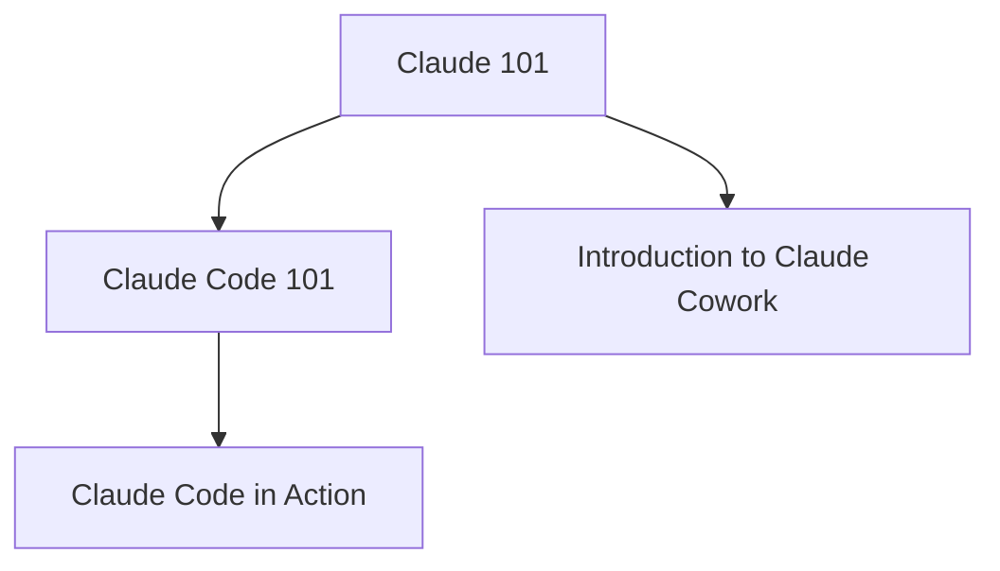

# Agents in Practice

[Code Agents](coding_agents.md) took a coding agent apart: AGENTS.md, slash commands, MCP,
subagents, skills, hooks and plugins. You now know what each part is for. This module is about
using them. The best way to learn that is a short course where you do the work yourself, with the
real tool open in front of you.

> [!WARNING]
> **🛑 STOP. Take the courses first, then come back.**
>
> Reading this page is not the lesson. It points you to four free courses, and taking them is the lesson. Together they take about seven and a half hours.
>
> ⏱️ About seven and a half hours in total · ✅ All four are required
>
> Plan the time, take the courses in the order below, and return to this page when you are done.

## Why Take These Courses

Reading about an agent and working with one are different skills. When you read, everything goes
right. When you work, the agent misreads a file or runs out of context. Sometimes it goes in the wrong
direction. Then you have to notice it and steer it back. Only practice teaches that part.

The four courses below are free, short and hands-on. The people who build the tools wrote them.
Each one ends with a short quiz and a completion badge.

Why **Claude**? At the time of writing, we think it is the best place
to practise, for three reasons:

- **The most capable**: for agent work, and especially for code, we think no other model family is
  stronger today.
- **The most trusted**: Anthropic puts safety first, and its tools ask you before they do something
  risky.
- **The most feature-rich**: one subscription gives you chat, Claude Code, Cowork and more, and
  most of the features this series has described are already in them.

Everything you learn here is also useful with other agents. The parts have different names in different
tools, but they do the same jobs.

## Which Order to Take Them In

We suggest that you start with Claude 101, because it gives you the basics that the other three
build on. After that there are two branches: the Claude Code branch for code (Claude Code 101,
then Claude Code in Action) and the Cowork branch for work with documents, files and apps. As an
engineer, take both branches.

## Claude 101

> [!IMPORTANT]
> **🛑 Course 1 of 4: stop here and take it now**
>
> **Claude 101**: Claude for everyday work, from your first conversation to projects, skills and deep research.
>
> ⏱️ About two and a half hours · ✅ Required · 🏅 Free course, with a quiz and a badge
>
> Open the course, finish it, then come back to this page and carry on.
>
> **[Open Claude 101](https://academy.claude.com/courses/claude-101)**

[Claude 101](https://academy.claude.com/courses/claude-101) teaches Claude for everyday work. It
starts with your first conversation and how to get better answers. Then it covers projects,
artifacts such as documents and designs, skills, connectors to your other tools, and deep research.
It ends with use cases by role and a tour of the other Claude products.

**Who it is for:** anyone who is starting to use Claude at work, and anyone who uses it already
but never had a structured tour. You need a Claude account on any plan, including the free one, and
no experience with AI. Two parts, Cowork and Research, need a paid plan if you want to try them
yourself. It takes about two and a half hours.

Much of it is [Prompt Engineering](prompt_engineering.md) and
[Context Engineering](context_engineering.md) in practice: a project is a context that you set up
once and use again.

## Claude Code 101

> [!IMPORTANT]
> **🛑 Course 2 of 4: stop here and take it now**
>
> **Claude Code 101**: Claude Code, the coding agent in your terminal, from the install to subagents and hooks.
>
> ⏱️ About one and a half hours · ✅ Required · 🏅 Free course, with a quiz and a badge
>
> Open the course, finish it, then come back to this page and carry on.
>
> **[Open Claude Code 101](https://academy.claude.com/courses/claude-code-101)**

[Claude Code 101](https://academy.claude.com/courses/claude-code-101) teaches Claude Code, the
coding agent that lives in your terminal. You install it and write your first prompt. Then you
learn the daily workflow: explore, plan, code and commit. After that, you learn to manage the
context and to review the code it writes. The last part customises the agent with CLAUDE.md,
subagents, skills, MCP and hooks.

**Who it is for:** developers who have not used a coding agent yet, both new and experienced. You
need to be comfortable with a code editor and the command line, and you need a paid Claude plan or
an API key. It takes about an hour and a half.

You will recognise most of it. It is [Code Agents](coding_agents.md), with your hands on the
keyboard.

## Claude Code in Action

> [!IMPORTANT]
> **🛑 Course 3 of 4: stop here and take it now**
>
> **Claude Code in Action**: Long Claude Code sessions that run with less supervision, and that you can still trust.
>
> ⏱️ About one hour · ✅ Required · 🏅 Free course, with a quiz and a badge
>
> Open the course, finish it, then come back to this page and carry on.
>
> **[Open Claude Code in Action](https://academy.claude.com/courses/claude-code-in-action)**

[Claude Code in action](https://academy.claude.com/courses/claude-code-in-action) is the next step:
long sessions that run with less supervision, and that you can still trust. It covers four things:

- **Steering**: how to scope the work, guide a summary of the context, and rewind a session that
  went wrong.
- **Configuration**: a short CLAUDE.md, skills, permission modes, and hooks that enforce your rules.
- **Automation**: scheduled tasks in the cloud, headless mode in your own pipelines, and code review
  on pull requests.
- **Verification**: how to check a run that nobody watched, and how to share a team setup as a
  plugin.

**Who it is for:** developers who already use Claude Code for single prompts, and who want longer
and more automatic runs. You need Git and the command line. It takes about an hour.

This course is where [Harness Engineering](harness_engineering.md) and
[Loop Engineering](loop_engineering.md) become things you set up yourself.

## Introduction to Claude Cowork

> [!IMPORTANT]
> **🛑 Course 4 of 4: stop here and take it now**
>
> **Introduction to Claude Cowork**: Claude working with your files, folders and apps, and how to hand it work in many steps.
>
> ⏱️ About two and a half hours · ✅ Required · 🏅 Free course, with a quiz and a badge
>
> Open the course, finish it, then come back to this page for the summary.
>
> **[Open Introduction to Claude Cowork](https://academy.claude.com/courses/introduction-to-claude-cowork)**

**Claude Cowork** is Claude working directly with your files, folders and apps. It is part of the
main Claude app. You start the work: you give it a goal, a file or a schedule. Claude makes a plan,
carries it out on your computer, and you steer it along the way. The result is real output, such as
a report, a spreadsheet or a sorted folder, not only an answer in a chat.

[Introduction to Claude Cowork](https://academy.claude.com/courses/introduction-to-claude-cowork)
teaches you to hand it multi-step work. You set up a workspace and give it standing context with
instructions and projects. You extend it with skills and plugins, and use Claude in Chrome and in
Word, Excel, PowerPoint and Outlook. The last part is about safety: how to review a plan and its
output before you trust them, and how to share plugins with a team.

**Who it is for:** anyone whose work moves between files, apps and tools. You do not need to code.
You need a paid Claude plan, and the Claude desktop app for the lessons that work with folders on
your computer. It takes about two and a half hours.

For an engineer, Cowork is the same idea as Claude Code, pointed at documents instead of a
repository. It is an agent loop with tools, context and a plan.

(Do not confuse Cowork with **Claude Duet**. With Cowork, you start the work. With Duet, Claude
starts it: Duet runs on its own computer in the cloud, watches the apps you connect, and comes to
you with a brief every morning. [Personal Agents](personal_agents.md) covers it.)

## Where this fits in the series

```mermaid
graph LR
    A[Prompt Engineering] --> B[Context Engineering]
    B --> C[Code Agents]
    C --> D[Agents in Practice]
    D --> E[Harness Engineering]
    E --> F[Loop Engineering]
    F --> G[Generative UI]
    G --> H[Security]
    H --> I[Personal Agents]
    style A fill:#90EE90
    style B fill:#90EE90
    style C fill:#90EE90
    style D fill:#FFFF00
```

## Summary

You learn to work with an agent by working with one. Four free courses on Claude Academy take you
there. Claude 101 is the start for everyone. Claude Code 101 teaches the coding agent from
[Code Agents](coding_agents.md), and Claude Code in Action teaches long, trusted runs with less
supervision. Introduction to Claude Cowork teaches the same kind of agent for documents, files and
apps. With Cowork, you start the work. With Claude Duet, Claude starts it.

Next: harness engineering, which is what you configure in Claude Code in Action, explained from
the start.

**Quick Check**: which course do you take first, and why do the other three come after it? What is
the difference between Cowork and Duet?

## References

### 📄 Articles

- [Claude 101](https://academy.claude.com/courses/claude-101): Claude for everyday work, from the first conversation to projects
- [Claude Code 101](https://academy.claude.com/courses/claude-code-101): the coding agent in your terminal, from install to hooks
- [Claude Code in action](https://academy.claude.com/courses/claude-code-in-action): long, hands-off sessions you can trust
- [Introduction to Claude Cowork](https://academy.claude.com/courses/introduction-to-claude-cowork): handing multi-step work on files and apps to Claude

### 🧭 Modules

- [Code Agents](coding_agents.md): the parts that these courses put to work
- [Harness Engineering](harness_engineering.md): what comes next
- [Personal Agents](personal_agents.md): Claude Duet and the agents that start the work themselves
