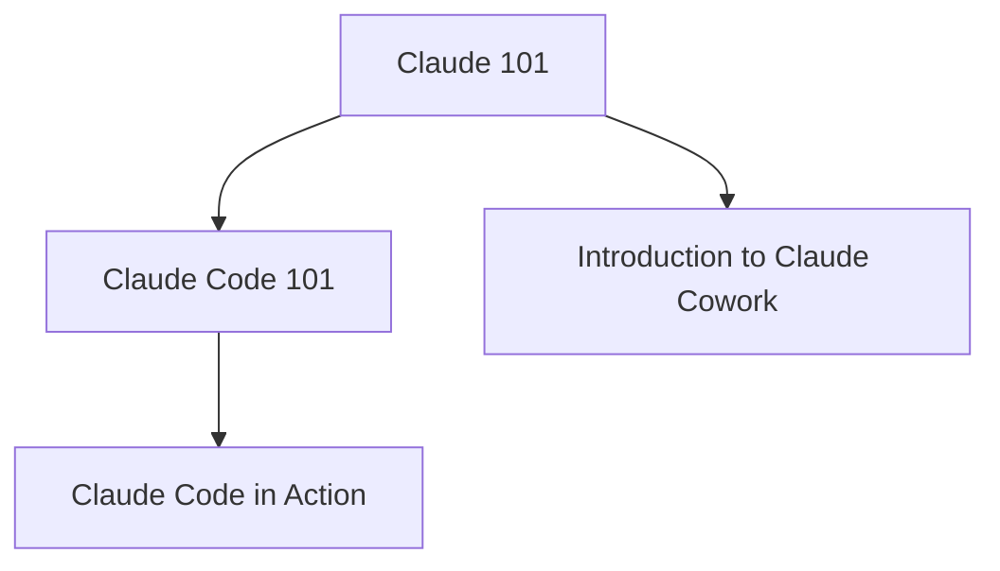

# Agent‌ها در عمل

توی [Code Agent‌ها](coding_agents_fa.md) یه coding agent رو تیکه‌تیکه کردیم: AGENTS.md، slash command‌ها، MCP، subagent‌ها، skill‌ها، hook‌ها و plugin‌ها. حالا می‌دونی هر تیکه به چه دردی می‌خوره. این درس درباره‌ی اینه که واقعاً ازشون استفاده کنی، و بهترین راه یاد گرفتنش یه دوره‌ی کوتاهه که توش خودت کار رو انجام می‌دی، اونم وقتی ابزار واقعی جلوی چشمت بازه.

> [!WARNING]
> **🛑 ایست. اول دوره‌ها رو بگذرون، بعد برگرد این‌جا.**
>
> درس اصلی این صفحه نیست. این صفحه تو رو می‌فرسته سراغ چهار تا دوره‌ی رایگان، و یاد گرفتن واقعی موقع گذروندن همون دوره‌هاست. روی هم حدود هفت ساعت و نیم طول می‌کشن: Claude 101 و Introduction to Claude Cowork هر کدوم حدود دو ساعت و نیم، Claude Code 101 حدود یه ساعت و نیم، و Claude Code in Action حدود یه ساعت.
>
> ⏱️ روی هم حدود هفت ساعت و نیم · ✅ هر چهار تاش الزامیه
>
> برای وقتش برنامه بریز، دوره‌ها رو به ترتیبی که پایین اومده بگذرون، و وقتی تموم شد برگرد این‌جا.

## چرا این دوره‌ها رو بگذرونی

خوندن درباره‌ی یه agent با کار کردن باهاش دو تا مهارت جدان. وقتی می‌خونی، همه‌چی درست پیش می‌ره. ولی وقتی کار می‌کنی، agent یه فایل رو اشتباه می‌خونه، context‌ش تموم می‌شه یا راه رو کج می‌ره، و این تویی که باید متوجه بشی و دوباره به مسیر درستش برش گردونی. این بخش رو فقط تمرین یادت می‌ده.

چهار تا دوره‌ی پایین رایگان، کوتاه و عملی‌ان. همون آدم‌هایی که این ابزارها رو می‌سازن نوشتنشون، و ته هر کدوم یه quiz کوتاه و یه نشان (badge) پایان دوره هست.

حالا چرا **Claude**؟ ما فکر می‌کنیم الان، موقع نوشتن این متن، بهترین جا برای تمرینه، به سه دلیل:

- **از همه توانمندتره**: به نظر ما برای کارهای agent، و مخصوصاً برای کد، فعلاً هیچ خانواده‌ی مدلی ازش قوی‌تر نیست.
- **از همه قابل‌اعتمادتره**: Anthropic امنیت رو اولویت اول می‌ذاره و ابزارهاش قبل از هر کار پرریسکی ازت می‌پرسن.
- **از همه پرامکانات‌تره**: با یه اشتراک، هم چت داری، هم Claude Code، هم Cowork و چیزهای دیگه، و بیشتر امکاناتی که این مجموعه تا حالا ازشون حرف زده همین الان توشونه.

هر چی این‌جا یاد بگیری، با agent‌های دیگه هم به کارت میاد. اسم تیکه‌ها از یه ابزار به ابزار دیگه فرق می‌کنه، ولی کارشون همونه.

## به چه ترتیبی بگذرونیشون

پیشنهاد ما اینه که با Claude 101 شروع کنی، چون پایه‌هایی رو یادت می‌ده که سه تای دیگه روشون ساخته می‌شن. بعد برو سراغ شاخه‌ای که لازمش داری: شاخه‌ی Claude Code برای کد، و شاخه‌ی Cowork برای کار با سندها، فایل‌ها و اپ‌ها. تو که engineer هستی، هر دوش رو بگذرون.

## Claude 101

> [!IMPORTANT]
> **🛑 دوره‌ی اول از چهار تا: همین‌جا وایسا و الان بگذرونش**
>
> **Claude 101**: Claude برای کارهای روزمره، از اولین گفت‌وگو تا project‌ها، skill‌ها و تحقیق عمیق.
>
> ⏱️ حدود دو ساعت و نیم · ✅ الزامی · 🏅 دوره‌ی رایگان، با یه quiz و یه نشان
>
> دوره رو باز کن، تمومش کن، بعد برگرد این‌جا و ادامه بده.
>
> **[رفتن به دوره‌ی Claude 101](https://academy.claude.com/courses/claude-101)**

[Claude 101](https://academy.claude.com/courses/claude-101) یادت می‌ده Claude رو برای کارهای روزمره به کار ببری. از اولین گفت‌وگو و راه‌های گرفتن جواب‌های بهتر شروع می‌کنه. بعد می‌ره سراغ project‌ها، artifact‌هایی مثل سند و طراحی، skill‌ها، connector‌هایی که به بقیه‌ی ابزارهات وصل می‌شن، و تحقیق عمیق. آخرش هم نمونه‌کاربردها بر اساس نقش و یه گشت کوتاه توی بقیه‌ی محصول‌های Claude هست.

**به درد کی می‌خوره:** هر کسی که تازه می‌خواد سر کار از Claude استفاده کنه، و کسایی که ازش استفاده می‌کنن ولی هیچ‌وقت یه گشت مرتب و منظم توش نزدن. یه حساب Claude روی هر پلنی کافیه، حتی پلن رایگان، و هیچ تجربه‌ای با هوش مصنوعی لازم نیست. فقط اگه بخوای بخش‌های Cowork و Research رو خودت امتحان کنی، پلن پولی لازم داری. حدود دو ساعت و نیم طول می‌کشه.

بیشترش همون [Prompt Engineering](prompt_engineering_fa.md) و [Context Engineering](context_engineering_fa.md) توی عمله: یه project در واقع یه context‌ه که یه بار راهش می‌ندازی و بارها ازش استفاده می‌کنی.

## Claude Code 101

> [!IMPORTANT]
> **🛑 دوره‌ی دوم از چهار تا: همین‌جا وایسا و الان بگذرونش**
>
> **Claude Code 101**: Claude Code، همون coding agent‌ی که توی terminal‌ت زندگی می‌کنه، از نصب تا subagent‌ها و hook‌ها.
>
> ⏱️ حدود یه ساعت و نیم · ✅ الزامی · 🏅 دوره‌ی رایگان، با یه quiz و یه نشان
>
> دوره رو باز کن، تمومش کن، بعد برگرد این‌جا و ادامه بده.
>
> **[رفتن به دوره‌ی Claude Code 101](https://academy.claude.com/courses/claude-code-101)**

[Claude Code 101](https://academy.claude.com/courses/claude-code-101) یادت می‌ده با Claude Code کار کنی، همون coding agent‌ی که توی terminal‌ت زندگی می‌کنه. نصبش می‌کنی و اولین prompt‌ت رو می‌نویسی. بعد روال کار روزانه رو یاد می‌گیری: بگرد، برنامه بریز، کد بزن و commit کن. بعدش یاد می‌گیری context رو مدیریت کنی و کدی رو که می‌نویسه review کنی. بخش آخر هم درباره‌ی اینه که agent رو با CLAUDE.md، subagent‌ها، skill‌ها، MCP و hook‌ها برای خودت تنظیم کنی.

**به درد کی می‌خوره:** developer‌هایی که هنوز با یه coding agent کار نکردن، چه تازه‌کار باشن چه باتجربه. باید با یه code editor و command line راحت باشی، و یه پلن پولی Claude یا یه API key هم لازم داری. حدود یه ساعت و نیم طول می‌کشه.

بیشترش برات آشناست: همون [Code Agent‌ها](coding_agents_fa.md)‌ست، فقط این‌بار دستت روی کیبورده.

## Claude Code in Action

> [!IMPORTANT]
> **🛑 دوره‌ی سوم از چهار تا: همین‌جا وایسا و الان بگذرونش**
>
> **Claude Code in Action**: session‌های طولانی Claude Code که با نظارت کمتر اجرا می‌شن و هنوز می‌تونی بهشون اعتماد کنی.
>
> ⏱️ حدود یه ساعت · ✅ الزامی · 🏅 دوره‌ی رایگان، با یه quiz و یه نشان
>
> دوره رو باز کن، تمومش کن، بعد برگرد این‌جا و ادامه بده.
>
> **[رفتن به دوره‌ی Claude Code in Action](https://academy.claude.com/courses/claude-code-in-action)**

[Claude Code in action](https://academy.claude.com/courses/claude-code-in-action) قدم بعدیه: session‌های طولانی‌ای که با نظارت کمتر اجرا می‌شن ولی هنوز می‌تونی بهشون اعتماد کنی. چهار تا موضوع داره:

- **هدایت کردن**: این‌که دامنه‌ی کار رو مشخص کنی، خلاصه‌ی context رو هدایت کنی، و یه session رو که خراب شده به عقب برگردونی (rewind).
- **پیکربندی**: یه CLAUDE.md کوتاه، skill‌ها، permission mode‌ها، و hook‌هایی که قانون‌هات رو اجرا می‌کنن.
- **خودکارسازی**: کارهای زمان‌بندی‌شده توی cloud، headless mode توی pipeline‌های خودت، و code review روی pull request‌ها.
- **راستی‌آزمایی**: این‌که یه اجرایی رو که هیچ‌کس نگاهش نکرده چطور چک کنی، و تنظیمات یه تیم رو چطور به شکل plugin به اشتراک بذاری.

**به درد کی می‌خوره:** developer‌هایی که الان از Claude Code برای prompt‌های تکی استفاده می‌کنن و اجراهای طولانی‌تر و خودکارتری می‌خوان. Git و command line رو باید بلد باشی. حدود یه ساعت طول می‌کشه.

این دوره جاییه که [Harness Engineering](harness_engineering_fa.md) و [Loop Engineering](loop_engineering_fa.md) تبدیل می‌شن به چیزهایی که خودت با دست خودت راه می‌ندازی.

## Introduction to Claude Cowork

> [!IMPORTANT]
> **🛑 دوره‌ی چهارم از چهار تا: همین‌جا وایسا و الان بگذرونش**
>
> **Introduction to Claude Cowork**: کار کردن Claude با فایل‌ها، پوشه‌ها و اپ‌هات، و این‌که کارهای چندمرحله‌ای رو چطور بسپری بهش.
>
> ⏱️ حدود دو ساعت و نیم · ✅ الزامی · 🏅 دوره‌ی رایگان، با یه quiz و یه نشان
>
> دوره رو باز کن، تمومش کن، بعد برای خلاصه برگرد این‌جا.
>
> **[رفتن به دوره‌ی Introduction to Claude Cowork](https://academy.claude.com/courses/introduction-to-claude-cowork)**

**Claude Cowork** یعنی Claude مستقیم با فایل‌ها، پوشه‌ها و اپ‌هات کار کنه، و بخشی از خود اپ اصلی Claude‌ه. کار رو تو شروع می‌کنی: یه هدف، یه فایل یا یه زمان‌بندی بهش می‌دی. Claude یه برنامه می‌ریزه، روی کامپیوتر خودت اجراش می‌کنه، و تو هم وسط راه هدایتش می‌کنی. نتیجه‌ش فقط یه جواب توی چت نیست؛ یه خروجی واقعیه، مثل یه گزارش، یه spreadsheet یا یه پوشه‌ی مرتب‌شده.

[Introduction to Claude Cowork](https://academy.claude.com/courses/introduction-to-claude-cowork) یادت می‌ده کارهای چندمرحله‌ای رو بسپری بهش. یه workspace راه می‌ندازی و با دستورالعمل‌ها و project‌ها یه context ثابت بهش می‌دی. با skill‌ها و plugin‌ها گسترشش می‌دی، و Claude رو توی Chrome و توی Word، Excel، PowerPoint و Outlook به کار می‌بری. بخش آخر هم درباره‌ی امنیته: این‌که قبل از اعتماد به یه برنامه و خروجی‌ش، چطور بررسی‌شون کنی، و plugin‌ها رو چطور با یه تیم به اشتراک بذاری.

**به درد کی می‌خوره:** هر کسی که کارش مدام بین فایل‌ها، اپ‌ها و ابزارها رفت‌وآمد داره. لازم نیست کدنویسی بلد باشی؛ فقط یه پلن پولی Claude لازم داری، و برای درس‌هایی که با پوشه‌های کامپیوترت کار می‌کنن، اپ دسکتاپ Claude. حدود دو ساعت و نیم طول می‌کشه.

برای یه engineer، Cowork همون منطق Claude Code‌ه، فقط به‌جای یه repository روی سندها کار می‌کنه: یه agent loop با tool‌ها، context و یه برنامه.

(Cowork رو با **Claude Duet** قاطی نکن. توی Cowork کار رو تو شروع می‌کنی. توی Duet، خود Claude شروعش می‌کنه: Duet روی یه کامپیوتر مخصوص خودش توی cloud کار می‌کنه، حواسش به اپ‌هایی که بهش وصل کردی هست، و هر روز صبح با یه خلاصه میاد سراغت. توی [Personal Agent‌ها](personal_agents_fa.md) درباره‌ش حرف زدیم.)

## کجای این مجموعه هستیم

```mermaid
graph LR
    A[Prompt Engineering] --> B[Context Engineering]
    B --> C[Code Agents]
    C --> D[Agents in Practice]
    D --> E[Harness Engineering]
    E --> F[Loop Engineering]
    F --> G[Generative UI]
    G --> H[Security]
    H --> I[Personal Agents]
    style A fill:#90EE90
    style B fill:#90EE90
    style C fill:#90EE90
    style D fill:#FFFF00
```

## خلاصه

کار کردن با agent رو با کار کردن با agent یاد می‌گیری، و چهار تا دوره‌ی رایگان Claude Academy تو رو به همون‌جا می‌رسونن. Claude 101 نقطه‌ی شروع همه‌ست. Claude Code 101 همون coding agent‌ی رو یادت می‌ده که توی [Code Agent‌ها](coding_agents_fa.md) دیدی، و Claude Code in Action اجراهای طولانی و قابل‌اعتمادی رو که نظارت کمتری لازم دارن. Introduction to Claude Cowork هم همین جور agent رو برای سندها، فایل‌ها و اپ‌ها یادت می‌ده. توی Cowork کار رو تو شروع می‌کنی، توی Claude Duet خود Claude.

قدم بعدی harness engineering‌ه: همون چیزی که توی Claude Code in Action تنظیمش می‌کنی، این‌بار از پایه توضیح داده شده.

**بررسی سریع**: اول کدوم دوره رو می‌گذرونی، و اگه اصلاً کد نمی‌نویسی کدوم رو کنار می‌ذاری؟ فرق Cowork با Duet چیه؟

## منابع

### 📄 مقاله‌ها

- [Claude 101](https://academy.claude.com/courses/claude-101): Claude برای کارهای روزمره، از اولین گفت‌وگو تا project‌ها
- [Claude Code 101](https://academy.claude.com/courses/claude-code-101): coding agent توی terminal‌ت، از نصب تا hook‌ها
- [Claude Code in action](https://academy.claude.com/courses/claude-code-in-action): session‌های طولانی و بدون نظارتی که می‌شه بهشون اعتماد کرد
- [Introduction to Claude Cowork](https://academy.claude.com/courses/introduction-to-claude-cowork): سپردن کارهای چندمرحله‌ای روی فایل‌ها و اپ‌ها به Claude

### 🧭 ماژول‌ها

- [Code Agent‌ها](coding_agents_fa.md): تیکه‌هایی که این دوره‌ها به کارشون می‌گیرن
- [Harness Engineering](harness_engineering_fa.md): درس بعدی
- [Personal Agent‌ها](personal_agents_fa.md): Claude Duet و agent‌هایی که خودشون کار رو شروع می‌کنن
