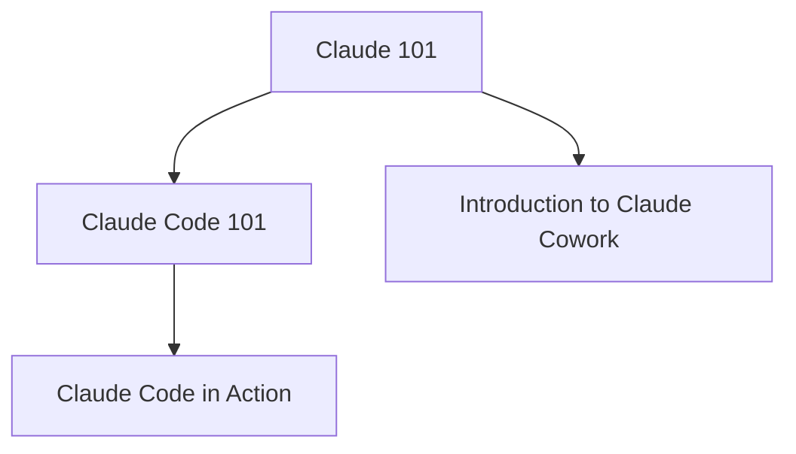

# Agent'lar Pratikte

[Code Agent'lar](coding_agents_tr.md) modülünde bir coding agent'ı parçalarına ayırdık: AGENTS.md, slash command'lar, MCP, subagent'lar, skill'ler, hook'lar ve plugin'ler. Artık her parçanın ne işe yaradığını biliyorsun. Bu modül ise onları kullanmakla ilgili. Bunu öğrenmenin en iyi yolu, gerçek aracı önünde açıkken işi kendi elinle yaptığın kısa bir kurs.

> [!WARNING]
> **🛑 DUR. Önce kursları al, sonra buraya dön.**
>
> Asıl ders bu sayfada değil. Bu sayfa seni dört ücretsiz kursa yönlendiriyor; öğrenme o kursları yaparken oluyor. Hepsi birlikte yaklaşık yedi buçuk saat sürüyor.
>
> ⏱️ Toplam yaklaşık yedi buçuk saat · ✅ Dördü de zorunlu
>
> Zamanını ayır, kursları aşağıdaki sırayla al ve bitirince bu sayfaya dön.

## Bu Kursları Neden Almalısın

Bir agent hakkında okumak ile bir agent'la çalışmak ayrı becerilerdir. Okurken her şey yolunda gider. Çalışırken ise agent bir dosyayı yanlış okur, context'i tükenir ya da yanlış yöne sapar; bunu fark edip onu yeniden doğru yola sokmak sana düşer. Bu kısmı ancak pratik öğretir.

Aşağıdaki dört kurs ücretsiz, kısa ve uygulamalı. Hepsini, bu araçları geliştiren ekip yazdı ve her biri kısa bir quiz ve bir tamamlama rozetiyle bitiyor.

Peki neden **Claude**? Bu yazıyı yazdığımız sırada pratik yapmak için en iyi yerin Claude olduğunu düşünüyoruz ve bunun üç sebebi var:

- **En yetenekli olanı**: agent işlerinde, özellikle de kodda, bugün ondan daha güçlü bir model ailesi olmadığını düşünüyoruz.
- **En güvenilir olanı**: Anthropic güvenliği en başa koyuyor ve araçları riskli bir şey yapmadan önce sana soruyor.
- **En zengin özelliklere sahip olanı**: tek bir abonelikle sohbet, Claude Code, Cowork ve daha fazlası geliyor; bu serinin anlattığı özelliklerin çoğu da zaten bunların içinde.

Burada öğrendiğin her şey başka agent'larla çalışırken de işine yarar. Parçaların adı araçtan araca değişir, ama yaptıkları iş aynıdır.

## Hangi Sırayla Almalısın

Claude 101 ile başlamanı öneriyoruz, çünkü diğer üçünün üzerine kurulduğu temelleri veriyor. Ondan sonra iki dal var: kod için Claude Code dalı (önce Claude Code 101, sonra Claude Code in Action) ve dokümanlar, dosyalar ve uygulamalarla yapılan işler için Cowork dalı. Bir mühendis olarak ikisini de almalısın.

## Claude 101

> [!IMPORTANT]
> **🛑 Kurs 1 / 4: burada dur ve şimdi al**
>
> **Claude 101**: günlük işlerde Claude: ilk sohbetinden project'lere, skill'lere ve derinlemesine araştırmaya.
>
> ⏱️ Yaklaşık iki buçuk saat · ✅ Zorunlu · 🏅 Ücretsiz kurs, quiz ve rozetle bitiyor
>
> Kursu aç, bitir, sonra bu sayfaya dönüp devam et.
>
> **[Kursu aç: Claude 101](https://academy.claude.com/courses/claude-101)**

[Claude 101](https://academy.claude.com/courses/claude-101), Claude'u günlük işlerde kullanmayı öğretiyor. İlk sohbetinle ve daha iyi cevaplar almanın yollarıyla başlıyor. Ardından project'leri, doküman ve tasarım gibi artifact'leri, skill'leri, diğer araçlarına bağlanan connector'ları ve derinlemesine araştırmayı anlatıyor. Sonunda rollere göre kullanım örnekleri ve diğer Claude ürünlerinin kısa bir turu var.

**Kimin için:** Claude'u iş yerinde kullanmaya yeni başlayan herkes ve onu zaten kullanan ama hiç düzenli bir tur almamış olanlar için. Ücretsiz olan da dahil herhangi bir plandaki bir Claude hesabı yeterli; yapay zekâ deneyimi gerekmiyor. Yalnızca Cowork ve Research bölümlerini kendin denemek istersen ücretli bir plan gerekiyor. Yaklaşık iki buçuk saat sürüyor.

Büyük kısmı [Prompt Engineering](prompt_engineering_tr.md) ve [Context Engineering](context_engineering_tr.md) konularının pratikteki hali: bir project, bir kez kurup tekrar tekrar kullandığın bir context'tir.

## Claude Code 101

> [!IMPORTANT]
> **🛑 Kurs 2 / 4: burada dur ve şimdi al**
>
> **Claude Code 101**: terminalinde yaşayan coding agent Claude Code, kurulumdan subagent'lara ve hook'lara kadar.
>
> ⏱️ Yaklaşık bir buçuk saat · ✅ Zorunlu · 🏅 Ücretsiz kurs, quiz ve rozetle bitiyor
>
> Kursu aç, bitir, sonra bu sayfaya dönüp devam et.
>
> **[Kursu aç: Claude Code 101](https://academy.claude.com/courses/claude-code-101)**

[Claude Code 101](https://academy.claude.com/courses/claude-code-101), terminalinde yaşayan coding agent olan Claude Code'u öğretiyor. Onu kurup ilk prompt'unu yazıyorsun. Sonra günlük iş akışını öğreniyorsun: keşfet, planla, kodla ve commit et. Ardından context'i yönetmeyi ve yazdığı kodu review etmeyi öğreniyorsun. Son kısım agent'ı CLAUDE.md, subagent'lar, skill'ler, MCP ve hook'larla kendine göre ayarlamakla ilgili.

**Kimin için:** daha önce bir coding agent kullanmamış geliştiriciler için, yeni olsun deneyimli olsun. Bir kod editöründe ve komut satırında rahat olman, bir de ücretli bir Claude planına ya da bir API key'e sahip olman gerekiyor. Yaklaşık bir buçuk saat sürüyor.

Çoğunu tanıyacaksın: bu, ellerin klavyedeyken [Code Agent'lar](coding_agents_tr.md) modülünün ta kendisi.

## Claude Code in Action

> [!IMPORTANT]
> **🛑 Kurs 3 / 4: burada dur ve şimdi al**
>
> **Claude Code in Action**: daha az gözetimle çalışan ama yine de güvenebileceğin uzun Claude Code oturumları.
>
> ⏱️ Yaklaşık bir saat · ✅ Zorunlu · 🏅 Ücretsiz kurs, quiz ve rozetle bitiyor
>
> Kursu aç, bitir, sonra bu sayfaya dönüp devam et.
>
> **[Kursu aç: Claude Code in Action](https://academy.claude.com/courses/claude-code-in-action)**

[Claude Code in action](https://academy.claude.com/courses/claude-code-in-action) bir sonraki adım: daha az gözetimle çalışan ama yine de güvenebileceğin uzun oturumlar. Dört konuyu kapsıyor:

- **Yönlendirme**: işin kapsamını belirlemek, context'in özetini yönlendirmek ve yanlış giden bir oturumu geri sarmak.
- **Yapılandırma**: kısa bir CLAUDE.md, skill'ler, permission modları ve kurallarını uygulatan hook'lar.
- **Otomasyon**: bulutta zamanlanmış görevler, kendi pipeline'larında headless mod ve pull request'lerde code review.
- **Doğrulama**: kimsenin izlemediği bir çalışmayı nasıl kontrol edeceğin ve bir ekip kurulumunu nasıl plugin olarak paylaşacağın.

**Kimin için:** Claude Code'u zaten tek prompt'lar için kullanan ve daha uzun, daha otomatik çalışmalar isteyen geliştiriciler için. Git ve komut satırını bilmen gerekiyor. Yaklaşık bir saat sürüyor.

Bu kurs, [Harness Engineering](harness_engineering_tr.md) ve [Loop Engineering](loop_engineering_tr.md) konularının kendi elinle kurduğun şeylere dönüştüğü yer.

## Introduction to Claude Cowork

> [!IMPORTANT]
> **🛑 Kurs 4 / 4: burada dur ve şimdi al**
>
> **Introduction to Claude Cowork**: Claude'un dosyaların, klasörlerin ve uygulamalarınla çalışması ve ona çok adımlı işleri nasıl devredeceğin.
>
> ⏱️ Yaklaşık iki buçuk saat · ✅ Zorunlu · 🏅 Ücretsiz kurs, quiz ve rozetle bitiyor
>
> Kursu aç, bitir, sonra özet için bu sayfaya dön.
>
> **[Kursu aç: Introduction to Claude Cowork](https://academy.claude.com/courses/introduction-to-claude-cowork)**

**Claude Cowork**, Claude'un doğrudan senin dosyaların, klasörlerin ve uygulamalarınla çalışmasıdır ve ana Claude uygulamasının bir parçasıdır. İşi sen başlatırsın: ona bir hedef, bir dosya ya da bir zamanlama verirsin. Claude bir plan yapar, bunu senin bilgisayarında uygular ve sen de yol boyunca onu yönlendirirsin. Sonuç yalnızca sohbetteki bir cevap değil; bir rapor, bir tablo ya da düzenlenmiş bir klasör gibi gerçek bir çıktıdır.

[Introduction to Claude Cowork](https://academy.claude.com/courses/introduction-to-claude-cowork), ona çok adımlı işleri devretmeyi öğretiyor. Bir çalışma alanı kuruyor ve talimatlar ile project'ler aracılığıyla ona kalıcı bir context veriyorsun. Onu skill'ler ve plugin'lerle genişletiyor; Chrome'da ve Word, Excel, PowerPoint ile Outlook'ta Claude'u kullanıyorsun. Son kısım güvenlikle ilgili: bir plana ve çıktısına güvenmeden önce onları nasıl inceleyeceğin ve plugin'leri bir ekiple nasıl paylaşacağın.

**Kimin için:** işi dosyalar, uygulamalar ve araçlar arasında gidip gelen herkes için. Kod yazmayı bilmen gerekmiyor; ücretli bir Claude planına, bilgisayarındaki klasörlerle çalışılan dersler için de Claude masaüstü uygulamasına ihtiyacın var. Yaklaşık iki buçuk saat sürüyor.

Bir mühendis için Cowork, Claude Code ile aynı mantık, yalnızca bir repo yerine dokümanlara yönelmiş hali. Yani tool'ları, context'i ve bir planı olan bir agent döngüsü.

(Cowork'ü **Claude Duet** ile karıştırma. Cowork'te işi sen başlatırsın. Duet'te ise işi Claude başlatır: Duet bulutta kendine ait bir bilgisayarda çalışır, bağladığın uygulamaları takip eder ve her sabah sana bir özetle gelir. Onu [Personal Agent'lar](personal_agents_tr.md) modülü anlatıyor.)

## Temel Terimler

- **Project**: bir kez kurup sonra tekrar tekrar kullandığın bir context.
- **Claude Code**: terminalinde çalışan kodlama agent'ı.
- **Claude Cowork**: Claude'un dosyaların, klasörlerin ve uygulamaların üzerinde çalışması; işi sen başlatırsın.
- **Claude Duet**: bulutta kendi bilgisayarında çalışan, bağladığın uygulamaları izleyen ve her sabah bir özet getiren agent; işi Claude başlatır.

## Bu serinin neresindeyiz

```mermaid
graph LR
    A[Prompt Engineering] --> B[Context Engineering]
    B --> C[Code Agents]
    C --> D[Agents in Practice]
    D --> E[Harness Engineering]
    E --> F[Loop Engineering]
    F --> G[Agentic UI]
    G --> H[Security]
    H --> I[Personal Agents]
    style A fill:#90EE90
    style B fill:#90EE90
    style C fill:#90EE90
    style D fill:#FFFF00
```

## Özet

Bir agent'la çalışmayı, bir agent'la çalışarak öğrenirsin. Claude Academy'deki dört ücretsiz kurs seni oraya götürüyor. Claude 101 herkes için başlangıç noktası. Claude Code 101, [Code Agent'lar](coding_agents_tr.md) modülündeki coding agent'ı öğretiyor; Claude Code in Action ise daha az gözetimle çalışan, uzun ve güvenilir çalışmaları. Introduction to Claude Cowork aynı türden bir agent'ı dokümanlar, dosyalar ve uygulamalar için öğretiyor. Cowork'te işi sen başlatırsın, Claude Duet'te ise Claude.

Sırada harness engineering var: Claude Code in Action'da ayarladığın şeyin, baştan anlatılmış hali.

**Hızlı Kontrol**: İlk hangi kursu alırsın ve diğer üçü neden ondan sonra geliyor? Cowork ile Duet arasındaki fark nedir?

## Kaynaklar

### 📄 Makaleler

- [Claude 101](https://academy.claude.com/courses/claude-101): ilk sohbetten project'lere kadar, günlük işlerde Claude
- [Claude Code 101](https://academy.claude.com/courses/claude-code-101): terminalindeki coding agent, kurulumdan hook'lara kadar
- [Claude Code in action](https://academy.claude.com/courses/claude-code-in-action): güvenebileceğin uzun ve gözetimsiz oturumlar
- [Introduction to Claude Cowork](https://academy.claude.com/courses/introduction-to-claude-cowork): dosyalar ve uygulamalar üzerindeki çok adımlı işleri Claude'a devretmek

### 🧭 Modüller

- [Code Agent'lar](coding_agents_tr.md): bu kursların işe koştuğu parçalar
- [Harness Engineering](harness_engineering_tr.md): sıradaki modül
- [Personal Agent'lar](personal_agents_tr.md): Claude Duet ve işi kendisi başlatan agent'lar
