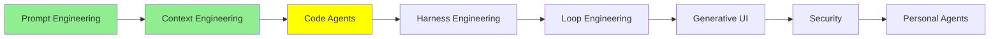

# Code Agent‌ها

درس [Context Engineering](context_engineering_fa.md) با این حرف تموم شد که coding agent‌هایی که همین الان باهاشون کار می‌کنی، deep agent‌ان: برنامه می‌ریزن، کار رو به subagent‌ها می‌سپرن و فایل می‌خونن و می‌نویسن. این درس درباره‌ی خود همین agent‌هاست. اول می‌بینیم چرا معلوم شد خیلی بیشتر از «یه ابزار کدنویسی» به درد می‌خورن، و بعد می‌ریم سراغ هشت راهی که می‌شه یکی‌شون رو گسترش داد.

## چرا coding agent فقط به درد کد نمی‌خوره

فرض کن یه فایل PNG داری و می‌خوای حجمش رو کم کنی یا تبدیلش کنی به JPEG. بدون agent، یکی باید برای همین کار یه tool بنویسه و بده دست مدل.

ولی coding agent اصلاً tool لازم نداره؛ یه کتابخونه‌ی پردازش تصویر Python نصب می‌کنه و همون چهار خط کدی رو که تبدیل رو انجام می‌ده، می‌نویسه. ازش یه پرزنتیشن (slide deck) بخوای هم همین کار رو می‌کنه: یه کتابخونه‌ی pptx پیدا می‌کنه و نصبش می‌کنه، کدش رو می‌نویسه و آخرش فایل رو تحویلت می‌ده. هیچ‌کدوم از این دو تا کار توی لیست tool‌هاش نبود.

روی این قسمت یه کم مکث کن. این agent‌ها فقط از چیزهایی که هست *استفاده* نمی‌کنن؛ چیزی رو هم که نیست، *می‌سازن*. یه داستانی دهن‌به‌دهن چرخید درباره‌ی کسی که پرینترش درایور لینوکس نداشت و از یه coding agent خواست براش درایور بنویسه. شاید جزئیاتش توی تعریف کردن‌ها عوض شده باشه، ولی اصل حرف درسته: مدلی که بتونه کد بنویسه و اجرا کنه، تقریباً به هر کاری که از یه کامپیوتر برمیاد دسترسی داره.

  
*ردیف بالا روش قدیمیه: برای هر حوزه یه agent، که هر کدوم tool‌های مخصوص خودش رو لازم داره. ردیف پایین نشون می‌ده چرا coding agent‌ها جای اون‌ها رو گرفتن. با کد می‌شه به وب، تقویم، بانک و سایت شرکت هواپیمایی رسید، پس یه agent که کد می‌نویسه هر چهار تا رو پوشش می‌ده و دیگه لازم نیست کسی چهار دسته tool جدا بنویسه.*

پس کدنویسی فقط یکی از مهارت‌ها نیست؛ مهارتیه که می‌تونه جای بقیه رو بگیره. برای همینه که coding agent توی کارهایی هم کمک می‌کنه که هیچ ربطی به نرم‌افزار ندارن. یه نگاه دیگه به مثال‌های بالا بنداز؛ هیچ‌کدومشون کار برنامه‌نویسی نبود.

بقیه‌ی این درس درباره‌ی امکاناتیه که تقریباً همه‌ی coding agent‌های امروزی دارن، مثل Claude Code، Codex، Antigravity، Copilot و OpenCode. اسم‌ها و مسیر فایل‌ها توی هر کدوم یه کم فرق می‌کنه. مثال‌های این‌جا از Claude Code هستن، و صفحه‌ی [Claude Code features](https://code.claude.com/docs/en/agent-sdk/claude-code-features) همه‌شون رو یه‌جا آورده.

## AGENTS.md

README برای آدم‌هاست و AGENTS.md برای agent‌ها.

AGENTS.md یه فایل markdown معمولیه توی repository‌ت. coding agent محتواش رو می‌چسبونه ته system prompt خودش، بعد از system prompt‌ای که شرکت سازنده‌ی agent نوشته، و کل ماجرا همینه. [agents.md](https://agents.md/) فرمت بازیه که پشت این فایله، و این فایل رو این‌طور معرفی می‌کنه: «یه جای مشخص و قابل پیش‌بینی برای اینکه context و دستورالعمل‌هایی رو بدی که به coding agent‌ها کمک می‌کنه روی پروژه‌ت کار کنن».

چیزی که جاش توی این فایله، اطلاعاتیه که توی کل repository درست می‌مونه و زیاد هم عوض نمی‌شه:

- دستورهای build و test
- چیدمان پوشه‌ها
- قراردادهایی که تیمت رعایت می‌کنه
- قانون‌هایی که اگه ننویسیشون، agent یه بار نه، دو بار اشتباهشون می‌کنه

ولی هر چیزی که یه هفته‌ی دیگه کهنه می‌شه، جاش این‌جا نیست. فایلی که پر از جزئیاتیه که دیگه با کد نمی‌خونه، از نبودنش بدتره، چون agent هر چی توی فایل نوشته رو باور می‌کنه.

لازم هم نیست دستی بنویسیش. `/init` رو بزن تا agent کد پروژه رو بخونه و یه پیش‌نویس اولیه بنویسه، بعد خودت درستش کن.

دو تا نکته‌ی عملی هم هست. اول اینکه Claude Code فایل `CLAUDE.md` رو می‌خونه، نه `AGENTS.md`. اگه repository‌ت از قبل برای ابزارهای دیگه یه AGENTS.md داره، راهی که توی مستنداتش اومده اینه که یه `CLAUDE.md` بنویسی که با `@AGENTS.md` اون فایل رو import کنه، و هر چیزی رو که فقط مخصوص Claude‌ه، زیر همون خط اضافه کنی.

دوم اینکه هر دو فرمت فایل‌های **تودرتو** (nested) رو پشتیبانی می‌کنن؛ یعنی می‌تونی یه فایل توی ریشه‌ی پروژه داشته باشی و یکی دیگه توی `frontend/` یا `backend/`. فایل تودرتو فقط وقتی لود می‌شه که agent داره توی همون پوشه کار می‌کنه. اینکه قانون‌های frontend وسط یه کار backend سبز نشن، همون context engineering‌ه، این بار روی دستورهای خودت.

## Slash Command‌ها

slash command یه prompt‌ه که یه بار می‌نویسیش و هر بار `/name` رو تایپ کنی، دوباره اجرا می‌شه. توی Claude Code، slash command‌ها توی `.claude/commands/` نگه داشته می‌شن.

این سه تا ارزش داشتن دارن:

- `/commit` پیام commit رو همون‌جوری می‌نویسه که تیمت می‌نویسه.
- `/review` چک‌لیست review تیمت رو روی diff فعلی اجرا می‌کنه.
- `/changelog` از pull request‌هایی که merge شدن، release notes درمیاره.

اگه این‌ها رو نداشته باشی، هر هفته باید هر سه تا prompt رو از نو تایپ کنی.

یه چیز رو هم باید بدونی، چون تصویری که پایین‌تر می‌بینی رو عوض می‌کنه: **custom command‌ها با skill‌ها یکی شدن.** فایل `.claude/commands/deploy.md` بهت `/deploy` می‌ده، یه skill توی `.claude/skills/deploy/SKILL.md` هم بهت `/deploy` می‌ده، و این دو تا عین هم رفتار می‌کنن. فایل‌های `commands/` که از قبل داری هم همچنان کار می‌کنن. فرق قدیمی‌شون حالا شده یه فیلد توی frontmatter، که توی بخش skill‌ها توضیحش می‌دیم.

## Model Context Protocol (MCP)

اول ببینیم MCP چه مشکلی رو حل می‌کنه.

فرض کن برای agent‌ای که با LangChain ساختی چند تا tool نوشتی که بتونه با Jira‌ت کار کنه. این tool‌ها API خود Jira رو صدا می‌زنن: یکی issue می‌سازه، یکی جست‌وجو می‌کنه، یکی هم comment می‌ذاره. حالا همین رو توی Claude Code هم می‌خوای، یا توی Codex، یا توی یه اسکریپت smolagents، و هر کدوم تعریف tool رو به شکل خودش می‌خواد. پس باید tool‌های Jira رو دوباره بنویسی، و باز دوباره.

**Model Context Protocol** کاری می‌کنه که این کار به‌جای چهار بار، یه بار انجام بشه. tool‌ها رو با یه روش استاندارد تعریف می‌کنی و هر agent‌ی که این پروتکل رو بلده، می‌تونه ازشون استفاده کنه.

  
*سمت چپ، هر سرویس یه integration جدا لازم داره که برای همون مدلی نوشته شده که باهاش حرف می‌زنه، پس کار به تعداد مدل‌ها چند برابر می‌شه. سمت راست، API هیچ سرویسی ذره‌ای عوض نشده؛ فقط راه رسیدن مدل بهشون عوض شده و حالا از یه رابط واحد می‌گذره که مدل از قبل بلده. پس هر سرویس رو یه بار integrate می‌کنی، نه یه بار برای هر agent.*

چیزهایی که از MCP گیرت میاد:

- **به هیچ vendor‌ی گیر نمی‌کنی.** اگه agent‌ت رو عوض کنی، لازم نیست tool‌هات رو از نو بنویسی.
- **tool‌ها رو می‌تونی همه‌جا ببری.** هر tool رو یه بار می‌نویسی و هر agent‌ی که MCP رو پشتیبانی کنه، می‌تونه ازش استفاده کنه.
- **اونی که لازم داری رو احتمالاً یکی دیگه قبلاً نوشته.** این همون قسمتیه که خیلی‌ها رو غافلگیر می‌کنه.

شهرت MCP هم بیشتر به خاطر همین آخریه. MCP کار رو بین یه client و یه server تقسیم می‌کنه: tool‌ها توی یه **MCP server** هستن و agent یه client‌ه که بهش وصل می‌شه. پس MCP server در واقع یه بسته tool‌ه، و برای اضافه کردنش فقط تنظیمات رو عوض می‌کنی، نه کد رو. agent‌ت رو به MCP server مربوط به Jira وصل کن، از همون لحظه می‌تونه با Jira‌ت کار کنه.

توی Claude Code این کار فقط یه دستوره و [Connect to MCP servers](https://code.claude.com/docs/en/mcp-quickstart) توضیحش داده:

```bash
# a hosted server, reached over HTTP
claude mcp add --transport http sentry https://mcp.sentry.dev/mcp

# a local one, run as a process on your machine
claude mcp add playwright -- npx -y @playwright/mcp@latest
```

بعد `claude mcp list` بهت می‌گه server واقعاً وصل شده یا نه. اگه `--scope project` رو هم اضافه کنی، Claude Code اون server رو توی یه فایل `.mcp.json` ثبت می‌کنه که هم‌تیمی‌هات موقع clone کردن repository، اون رو هم می‌گیرن.

برای اینکه ببینی چه server‌هایی از قبل ساخته شدن، یه سر به [awesome-mcp-servers](https://github.com/punkpeye/awesome-mcp-servers) بزن، که لیستیه که خود community نگهش می‌داره.

> **نکته:** هر server که وصل می‌کنی، یه تیکه از context window رو می‌گیره، چون اسم و توضیح tool‌هاش توی هر session لود می‌شه. ده تا server که هیچ‌وقت صداشون نمی‌زنی هم برات خرج دارن، پس اون‌هایی رو که استفاده نمی‌کنی بردار، به همون دلیل‌هایی که توی [Context Engineering](context_engineering_fa.md) گفتیم.

## Subagent‌ها

توی [Context Engineering](context_engineering_fa.md) دیدیم subagent‌ها برای چی هستن: کار سنگین رو می‌برن توی یه context window تازه، تا به window اصلی فقط نتیجه برسه، نه کل ماجرای گشتن و پیدا کردن.

چیزی که این‌جا دستت رو باز می‌ذاره اینه که می‌تونی subagent‌های خودت رو تعریف کنی. هر agent یه subagent همه‌کاره (general-purpose) همراهش داره، و کنارش می‌تونی مثلاً یه تحلیلگر امنیت، یه متخصص frontend و یه تست‌نویس اضافه کنی که هر کدوم system prompt و لیست tool‌های خودشون رو دارن. توی Claude Code این‌ها فایل‌های markdown‌ان توی `.claude/agents/`.

subagent سفارشی یه نقش ثابته: دستورهاش رو یه بار می‌نویسی، و هر بار که agent صداش می‌زنه، از همون دستورها و توی یه window تمیز شروع می‌کنه. اگه ترجیح می‌دی از subagent‌هایی که بقیه ساختن شروع کنی، [awesome-claude-code-subagents](https://github.com/VoltAgent/awesome-claude-code-subagents) بیشتر از صد تا رو یه‌جا جمع کرده.

## Skill‌ها

skill یه پوشه پر از دستورالعمله که agent هر وقت یه کار لازمش داشت، می‌تونه بخونه‌ش. Anthropic توی [Equipping agents for the real world with Agent Skills](https://www.anthropic.com/engineering/equipping-agents-for-the-real-world-with-agent-skills) skill رو این‌طور تعریف کرده: «پوشه‌هایی مرتب از دستورالعمل، اسکریپت و منابع که agent‌ها می‌تونن پیداشون کنن و هر وقت لازم شد لودشون کنن، تا توی کارهای مشخص بهتر عمل کنن». توی Claude Code، هر skill توی `.claude/skills/<name>/SKILL.md` می‌شینه.

اصل ماجرا مکانیزمشه، که اسمی داره که بهتره یادت بمونه: **progressive disclosure**، یعنی هر چیزی فقط وقتی رو می‌شه که لازمه.

موقع شروع، agent فقط `name` و `description` هر skill نصب‌شده رو لود می‌کنه، که برای هر skill یکی دو خطه، پس بیست تا skill تقریباً هیچ هزینه‌ای ندارن. دستورالعمل کامل رو agent فقط وقتی می‌خونه که به این نتیجه برسه یه skill به کاری که دستشه مربوطه.

  
*نوار خاکستری بالا کل هزینه‌ی بیست تا skill‌ه وقتی ازشون استفاده نمی‌شه، یعنی برای هر کدوم یه خط کوتاه. وقتی کار PDF از راه می‌رسه، agent با یه Bash call معمولی `SKILL.md` رو می‌خونه و بعد از روی یه ارجاع توی همون فایل، می‌ره سراغ یه فایل دوم. دقت کن که skill به شکل یه tool result وارد context می‌شه، پس مکانیزم تازه‌ای در کار نیست؛ همون tool loop درس Tool Calling‌ه که این بار به‌جای داده، دستورالعمل می‌خونه.*

حالا چرا اصلاً skill داریم و همه‌چیز رو توی یه system prompt خیلی بزرگ نمی‌ریزیم؟ به خاطر context engineering: هر چیزی که agent ممکنه لازم داشته باشه دم دستشه، ولی توی window فقط همونیه که واقعاً لازم داره.

**skill یا subagent سفارشی؟** subagent دستورهای ثابتی داره و توی یه window جدا اجرا می‌شه؛ می‌ره و با یه جواب برمی‌گرده. ولی skill خود agent اصلی رو عوض می‌کنه. وقتی *همین* agent skill امنیت رو می‌خونه، تا آخر کار می‌شه یه بازبین امنیتی، توی همون window می‌مونه و هر چی از قبل می‌دونست هم یادش هست. همون agent‌ه که یه نقاب دیگه زده، و یه دقیقه بعد می‌تونه دوباره نقابش رو عوض کنه.

**skill یا slash command؟** این همون فرقیه که بعد از یکی شدنشون باقی موند، و برمی‌گرده به اینکه کی اجازه داره skill رو صدا بزنه. به‌طور پیش‌فرض هم تو می‌تونی، هم agent، و دو تا فیلد frontmatter این رو محدود می‌کنن:

```yaml
---
name: deploy
description: Deploy the application to production
disable-model-invocation: true
---
```

`disable-model-invocation: true` یعنی فقط خودت می‌تونی اون skill رو اجرا کنی، و برای هر کاری که اثر جانبی داره همین رو می‌خوای؛ دلت نمی‌خواد agent فقط چون به نظرش کد آماده‌ست، خودسر تصمیم بگیره deploy کنه. فیلد برعکسش `user-invocable: false`‌ه، یعنی فقط agent می‌تونه سراغ skill بره. این یکی به درد دانش پس‌زمینه می‌خوره، یعنی چیزهایی که اگه یه آدم بخواد مثل یه command تایپشون کنه، اصلاً معنی نمی‌دن.

برای مجموعه‌های عمومی skill، [anthropics/skills](https://github.com/anthropics/skills) مجموعه‌ی رسمیه و [awesome-claude](https://github.com/webfuse-com/awesome-claude) هم یه لیست دست‌چین‌شده‌ی گسترده‌تره.

## Hook‌ها

هر چی تا این‌جا گفتیم، توصیه‌ست به یه مدل، یعنی مدل بیشتر وقت‌ها بهش عمل می‌کنه. ولی hook توصیه نیست؛ یه shell command‌ه که به یه نقطه‌ی مشخص از چرخه‌ی کار agent وصل شده و اجرا می‌شه، چه مدل بخواد چه نخواد.

توی [hooks reference](https://code.claude.com/docs/en/hooks) بیشتر از سی تا event فهرست شده، که از بینشون این چند تا بیشتر به کار میان:

- **`PreToolUse`**، قبل از اینکه یه tool call اجرا بشه. می‌تونی جلوی ویرایش فایلی رو بگیری که هیچ‌کس نباید بهش دست بزنه، یا دستوری رو که می‌خواد مستقیم روی main push کنه، رد کنی.
- **`PostToolUse`**، بعد از اینکه یه tool call با موفقیت تموم شد. می‌تونی formatter رو روی هر فایلی که agent همین الان ویرایش کرده اجرا کنی، تا استایل کد دیگه به این بستگی نداشته باشه که agent یادش می‌مونه یا نه.
- **`Stop`**، وقتی نوبت agent تموم می‌شه. می‌تونی test suite رو اجرا کنی و اگه تستی قرمز شد، به agent بگی کار رو ادامه بده.
- **`SessionStart`**، وقتی یه session شروع می‌شه. می‌تونی branch فعلی و ticket‌های باز رو بریزی توی context.

اولی رو یادت بمونه، چون حرف اصلی توشه. اگه توی AGENTS.md بنویسی agent هیچ‌وقت به یه فایل دست نزنه، این یه خواهشه؛ ولی یه hook از نوع `PreToolUse` که جلوی نوشتن رو می‌گیره، یه قانونه. درس بعدی از همین ایده شروع می‌شه، و اصلاً به خاطر همین ایده نوشته شده.

## Plugin‌ها

plugin یه بسته‌ست از همین چیزهایی که گفتیم، یعنی command‌ها، skill‌ها، subagent‌ها، hook‌ها و MCP server‌ها، که با هم میان و با یه قدم نصب می‌شن. هم‌تیمی تازه‌وارد لازم نیست شش تا فایل رو دونه‌دونه توی پوشه‌ی `.claude/` خودش کپی کنه؛ یه plugin بهش می‌دی و تمام.

ساختارش توی هر vendor فرق می‌کنه. توی Claude Code، plugin یه پوشه‌ست با یه manifest که مشخص می‌کنه plugin کدوم‌یکی از این قسمت‌ها رو داره. [Discover plugins](https://code.claude.com/docs/en/discover-plugins) توضیح می‌ده plugin رو چطور نصب کنی و [plugins reference](https://code.claude.com/docs/en/plugins-reference) توضیح می‌ده چطور یکی بسازی. [claude-plugins-official](https://github.com/anthropics/claude-plugins-official) هم فهرستیه که خود Anthropic مدیریتش می‌کنه.

## MEMORY.md

هر session با یه context window خالی شروع می‌شه. دو تا چیز دونسته‌ها رو از یه session به session بعدی می‌برن، و این دو تا با هم فرق دارن.

**AGENTS.md رو تو می‌نویسی.** **Auto memory رو agent می‌نویسه.** جدول زیر از [How Claude remembers your project](https://code.claude.com/docs/en/memory) اومده:

| | CLAUDE.md files | Auto memory |
| --- | --- | --- |
| کی می‌نویسه | تو | Claude |
| چی توش هست | دستورالعمل‌ها و قانون‌ها | چیزهایی که یاد گرفته و الگوها |
| دامنه | پروژه، کاربر یا سازمان | برای هر repository، مشترک بین worktree‌ها |
| کجا لود می‌شه | هر session | هر session (200 خط اول یا 25KB) |
| به درد چی می‌خوره | استانداردهای کدنویسی، workflow‌ها، معماری پروژه | سلیقه‌های خودت، اصلاح‌هایی که به Claude می‌گی، و context‌ی از پروژه که Claude از روی کد نمی‌تونه بفهمه |

agent این یادداشت‌ها رو از روی اصلاح‌هایی می‌نویسه که تو بهش می‌دی، پس چیزی که این هفته مجبور شدی دو بار توضیح بدی، هفته‌ی بعد هم سر جاشه. فایل‌ها توی `~/.claude/projects/<project>/memory/` نگه داشته می‌شن. agent توی هر session یه فهرست به اسم `MEMORY.md` لود می‌کنه و یادداشت‌های مفصل کنارش هستن، که فقط وقتی لازمشون داره می‌خونه‌شون. این هم باز همون progressive disclosure‌ه، این بار روی یادداشت‌های خود agent.

یه کار به‌دردبخور اینه که خودت عمداً به agent بگی یه چیزی رو یادش بمونه. مثلاً بگی «یادت باشه تست‌های API یه Redis محلی لازم دارن» تا agent یادداشتش کنه. `/memory` هم هر چی agent ذخیره کرده رو نشونت می‌ده، و همه‌ش markdown ساده‌ست که می‌تونی ویرایشش کنی یا پاکش کنی.

## Plan Mode

فرض کن یه refactor بزرگ داری، یا باید چند تا feature رو با هم تحویل بدی. این‌جا شروع کردن با کد نوشتن قدم اول اشتباهیه، و دلیلش رو توی [Context Engineering](context_engineering_fa.md) دیدیم: agent‌ای که برنامه‌ش رو ننوشته، رشته‌ی کار از دستش در می‌ره.

plan mode یه حالت فقط‌خوندنیه برای همین وضعیت. agent توی کد می‌گرده ولی نمی‌تونه حتی یه خطش رو عوض کنه، پس کل فاز اول صرف این می‌شه که بفهمه واقعاً چی اون‌جاست. بعد agent یه برنامه می‌نویسه، تو می‌خونیش، و فقط بعد از اینکه تأییدش کردی، agent دست به ویرایش می‌زنه.

نسخه‌ی Claude Code یه قدم جلوتر می‌ره: قبل از اینکه چیزی رو برنامه‌ریزی کنه، ازت سوال می‌پرسه تا ابهام‌ها روشن بشه، و می‌تونه چند تا راه پیشنهاد بده که یکی‌ش رو انتخاب کنی. این قسمت واقعاً به کار میاد، چون بهترین وقت برای گرفتن جلوی یه برنامه‌ی بد، قبل از اینه که حتی یه خط کد نوشته شده باشه.

این به کارهای long-horizon هم برمی‌گرده. agent‌ای که روی یه برنامه‌ی مکتوب و تأییدشده کار می‌کنه، ساعت‌ها سررشته‌ی کار رو گم نمی‌کنه، چون برنامه روی دیسکه و از همون‌جا مدام هدف رو دوباره به context یادآوری می‌کنه. اگه همون هدف فقط توی context window مونده بود، بی‌سروصدا می‌پوسید و از بین می‌رفت.

## Reasoning Effort

توی [Prompt Engineering](prompt_engineering_fa.md) دیدیم chain of thought یعنی مدل قبل از جواب دادن استدلال کنه. `/effort` همون پیچیه که میزان این استدلال رو تنظیم می‌کنه.

یه راهنمای سرانگشتی:

- **medium** برای جواب دادن به سوال، مستندات، اصلاح‌های کوچیک و ویرایش‌های ساده.
- **high** برای کارهای معمولی، که بیشتر کارهات رو شامل می‌شه.
- **xhigh** برای کدنویسی سنگین، مثل یه refactor واقعی، یه باگ ریز و موذی یا یه تصمیم طراحی.
- **max** برای وقتی که یه چیزی واقعاً سخته و تنظیم‌های پایین‌تر جواب ندادن.

تنظیم بالاتر مفت نیست و توی هر نوبت token و وقت می‌خوره، پس اگه برای درست کردن یه غلط تایپی تا ته بکشیش بالا، داری پولت رو دور می‌ریزی. اگه می‌خوای ببینی تنظیم بالاتر واقعاً چقدر فرق می‌کنه، یه سر به [Artificial Analysis](https://artificialanalysis.ai/) بزن که نتیجه‌ی benchmark هر مدل رو با تنظیم‌های مختلف reasoning منتشر می‌کنه، و از عددهاش معلومه فاصله‌ی هر تنظیم با تنظیم بعدی چقدره.

## همه‌ی این‌ها در اصل یه چیزن

یه نگاه دیگه به این هشت بخش بنداز: AGENTS.md، slash command‌ها، subagent‌ها، skill‌ها، hook‌ها، plugin‌ها، memory و plan‌ها.

تقریباً همه‌شون چیزی نیستن جز **markdown توی یه پوشه**. نه دیتابیسن، نه یه plugin API که باید کدت رو باهاش compile کنی، نه یه فرمت config که یکی از خودش درآورده باشه؛ یه مشت فایل روی دیسکن که می‌تونی:

- با هر ادیتوری بازشون کنی
- diff‌شون رو ببینی
- توی یه pull request بررسی‌شون کنی
- ببریشون روی یه سیستم دیگه

این از سر تنبلی نیست؛ این تنها فرمتیه که هم تو و هم مدل خوب از پسش برمیاین. تو بدون هیچ ابزار خاصی می‌خونیش و ویرایشش می‌کنی، و مدل‌ها هم توی markdown و گشتن توی filesystem به‌طرز عجیبی واردن، چون سهم خیلی بزرگی از داده‌های آموزشی‌شون دقیقاً همینه. پس آخرش راه گسترش دادن یه coding agent، همون کاریه که از اول از همه بهتر بلد بود.

  
*این‌ها سه تا مسئله‌ی جدان و بهتره بدونی کدوم به کدومه. skill‌های سمت چپ دستورالعمل‌هایی‌ان که agent می‌خونه تا رفتارش عوض بشه. MCP server‌های سمت راست tool‌هایی‌ان که بهش اجازه می‌دن به سیستم‌هایی برسه که وگرنه دستش بهشون نمی‌رسید. subagent‌های پایین هم context window‌های اضافه‌ان. پس هر کدوم از این راه‌ها یکی از این سه تا رو به agent می‌ده: چیزی که باید بدونه (skill)، کاری که می‌تونه بکنه (MCP server)، یا یه جای جدا برای فکر کردن (subagent).*

## کجای این مجموعه هستیم



## خلاصه

coding agent خیلی قوی‌تر از چیزیه که از اسمش برمیاد، چون نوشتن و اجرای کد راهیه برای رسیدن به تقریباً همه‌چیز. برای هر کاری tool لازم نداره، چون می‌تونه یه کتابخونه نصب کنه یا خودش یکی بنویسه، و برای همینه که توی کارهایی هم که اصلاً کدنویسی نیستن کمکت می‌کنه.

یه coding agent رو می‌شه به هشت روش استاندارد گسترش داد، و سه تاش مربوط به چیزیه که agent می‌دونه. AGENTS.md قانون‌های repository‌ت رو بهش می‌ده. auto memory چیزهایی رو که درباره‌ی تو یاد گرفته، به session بعدی می‌بره. skill‌ها هم باعث می‌شن دستورالعمل‌ها فقط وقتی لود بشن که کار واقعاً لازمشون داره. این آخری همون progressive disclosure‌ه، و به خاطر همینه که بیست تا skill داشتن برات گرون تموم نمی‌شه.

سه تای دیگه مربوط به کارهاییه که می‌تونه بکنه. slash command‌ها یه prompt رو نگه می‌دارن که وگرنه باید هر بار دوباره تایپش می‌کردی. MCP یه دسته tool رو قابل حمل می‌کنه، یعنی tool رو یه بار می‌نویسی، نه یه بار برای هر agent. subagent‌های سفارشی هم نقش‌های ثابتی بهش می‌دن که می‌تونه کار رو بسپره بهشون، و هر کدوم توی یه context window تمیز کار می‌کنن.

دو تای آخر مربوط به کنترلن. hook‌ها بخش خودکار و بی‌چون‌وچرای ماجران، یعنی کارهایی که انجام می‌شن، چه مدل انتخابشون کرده باشه چه نه. plan mode هم agent رو وادار می‌کنه اول کد رو خوب بفهمه، بعد اجازه‌ی دست زدن بهش رو داشته باشه. plugin‌ها هر کدوم از این‌ها رو توی یه نصب بسته‌بندی می‌کنن، و effort هم تعیین می‌کنه agent موقع همه‌ی این کارها چقدر فکر کنه.

تقریباً همه‌ش markdown توی یه پوشه‌ست، یعنی همون فرمتی که هم تو و هم مدل باهاش راحتید.

درس بعدی: hook‌ها اولین چیزی توی این درس بودن که نظر مدل توش اهمیتی نداشت. اسم این ایده harness engineering‌ه و درس بعدی کلاً درباره‌ی همینه.

**بررسی سریع**: skill و subagent سفارشی هر دو به agent یه تخصص می‌دن. فرق اصلی‌شون چیه و هر کدوم کجا به کار میاد؟

## منابع

- [Claude Code features](https://code.claude.com/docs/en/agent-sdk/claude-code-features): همه‌ی راه‌های گسترش روی یه صفحه، که می‌شه مثل یه چک‌لیست ازش استفاده کرد تا ببینی agent خودت کدوم‌ها رو پشتیبانی می‌کنه
- [agents.md](https://agents.md/): فرمت باز، از جمله اینکه فایل‌های تودرتو توی یه monorepo چطور کار می‌کنن
- [How Claude remembers your project](https://code.claude.com/docs/en/memory): فرق CLAUDE.md و auto memory، و اینکه فایل‌ها کجا نگه داشته می‌شن
- [Connect to MCP servers](https://code.claude.com/docs/en/mcp-quickstart): اضافه کردن یه server از اول تا آخر، و اینکه اگه وصل نشد چی رو چک کنی
- [awesome-mcp-servers](https://github.com/punkpeye/awesome-mcp-servers): لیست community، برای اینکه ببینی tool‌ی که می‌خوای از قبل ساخته شده یا نه
- [Equipping agents for the real world with Agent Skills](https://www.anthropic.com/engineering/equipping-agents-for-the-real-world-with-agent-skills): جایی که progressive disclosure درست و حسابی توضیح داده شده
- [Extend Claude with skills](https://code.claude.com/docs/en/skills): نسخه‌ی کاربردی، از جمله دو فیلدی که تعیین می‌کنن کی اجازه داره یه skill رو صدا بزنه
- [anthropics/skills](https://github.com/anthropics/skills): مجموعه‌ی رسمی skill‌ها
- [awesome-claude](https://github.com/webfuse-com/awesome-claude): یه لیست دست‌چین‌شده‌ی گسترده‌تر از ابزارهای Claude
- [awesome-claude-code-subagents](https://github.com/VoltAgent/awesome-claude-code-subagents): بیشتر از صد تعریف subagent که می‌تونی ازشون شروع کنی
- [Hooks reference](https://code.claude.com/docs/en/hooks): همه‌ی event‌های چرخه‌ی کار agent، و ورودی‌ای که هر کدوم می‌گیره
- [Discover plugins](https://code.claude.com/docs/en/discover-plugins) و [plugins reference](https://code.claude.com/docs/en/plugins-reference): اول اینکه plugin چطور نصب می‌شه، بعد اینکه چطور یکی بسازی
- [claude-plugins-official](https://github.com/anthropics/claude-plugins-official): فهرست plugin‌هایی که خود Anthropic مدیریتش می‌کنه
- [Artificial Analysis](https://artificialanalysis.ai/): عددهای benchmark هر مدل با هر تنظیم reasoning، اگه می‌خوای ببینی effort چی بهت می‌ده
