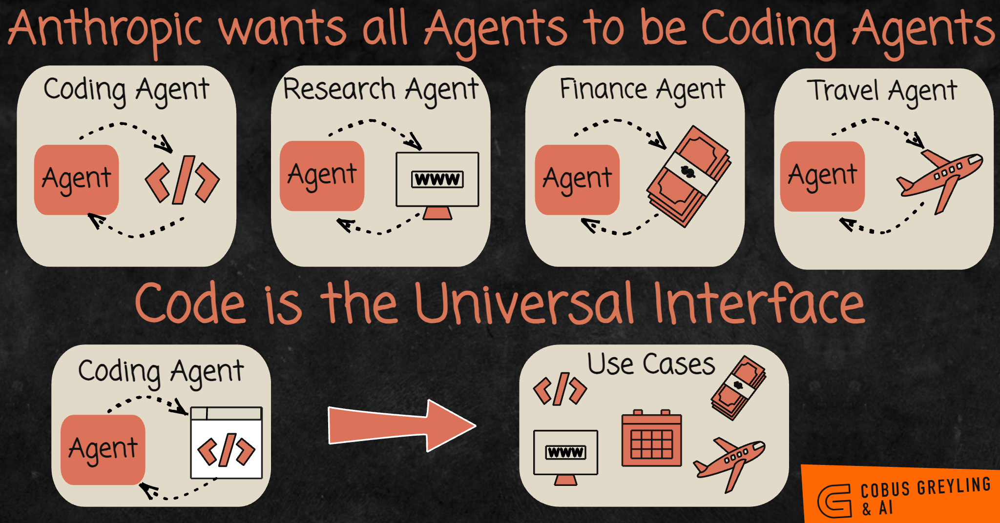
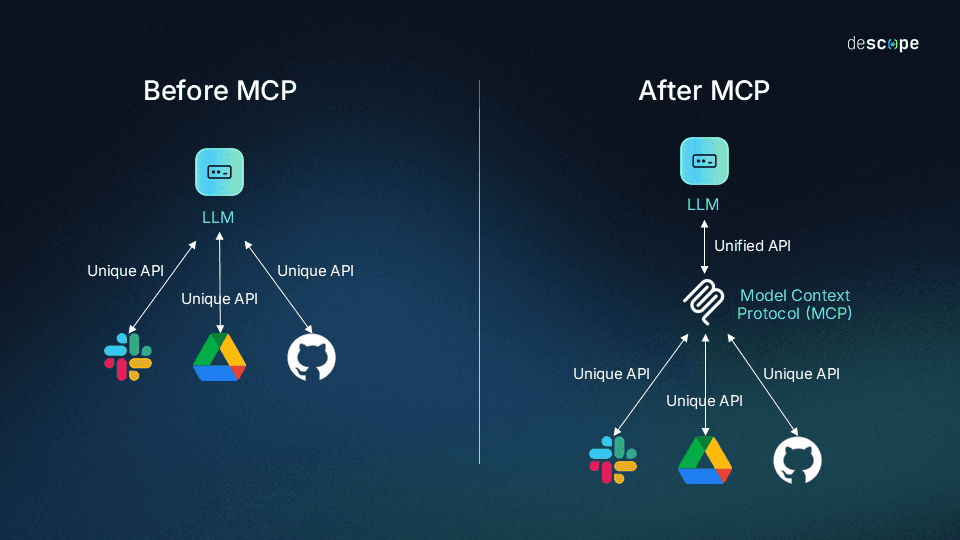
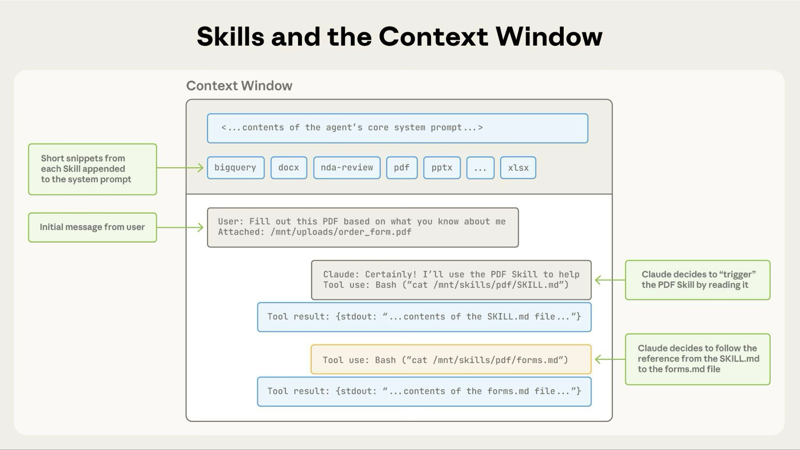
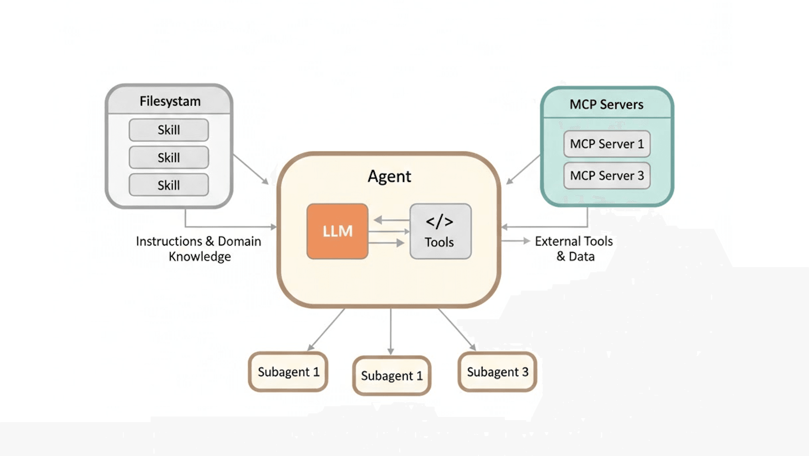
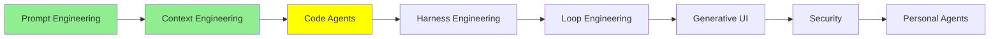

# Code Agent‌ها

[Context Engineering](context_engineering_fa.md) با یه نکته تموم شد: coding agent‌هایی که الان استفاده می‌کنی، deep agent هستن. یعنی برنامه‌ریزی می‌کنن، کار رو به subagent‌ها می‌سپارن و فایل‌ها رو می‌خونن و می‌نویسن، و این ماژول درباره‌ی خود همین agent‌هاست. اول بررسی می‌کنیم که چرا این‌ها این‌قدر از یه «ابزار نوشتن کد» مفیدتر شدن، و بعد هشت راهی رو می‌بینیم که با اون‌ها می‌شه یه coding agent رو گسترش داد.

## چرا coding agent فقط کد نمی‌نویسه

فرض کن یه فایل PNG داری و می‌خوای حجمش رو کم کنی، یا تبدیلش کنی به JPEG. اگه agent نداشته باشی، باید یکی برای این کار یه tool بنویسه و بده دست مدل.

یه coding agent به هیچ tool‌ای نیاز نداره. می‌تونه یه کتابخونه‌ی پردازش تصویر توی Python نصب کنه و چهار خط کدی رو بنویسه که تبدیل رو انجام بده. اگه ازش یه slide deck بخوای، همین کار رو می‌کنه: یه کتابخونه برای کار با pptx پیدا می‌کنه، نصبش می‌کنه، کد رو می‌نویسه و آخرش فایل رو تحویلت می‌ده. هیچ‌کدوم از این دو کار توی لیست tool‌هاش نبود.

این قسمت رو یه لحظه جدی بگیر. این agent‌ها فقط از چیزهایی که وجود دارن استفاده نمی‌کنن؛ چیزهایی رو هم که وجود ندارن می‌سازن. یه داستان بود که خیلی دست‌به‌دست شد: یکی پرینترش درایور لینوکس نداشت، پس از یه coding agent خواستن که یه درایور براش بنویسه. جزئیات داستان شاید موقع تعریف شدنش عوض شده باشه، ولی ایده‌ی اصلیش درسته. یه مدل که بتونه کد بنویسه و اجرا کنه، راهی داره که به تقریباً هر کاری که یه کامپیوتر می‌تونه انجام بده برسه.

  
*ردیف بالا روش قدیمیه: برای هر حوزه یه agent، و هر agent tool‌های مخصوص خودش رو لازم داره. ردیف پایین نشون می‌ده چرا coding agent‌ها جای اون‌ها رو گرفتن. کد به وب، تقویم، بانک و خطوط هوایی دسترسی داره. پس یه agent که کد می‌نویسه، هر چهار تا رو پوشش می‌ده و دیگه لازم نیست برای هر کدوم یه مجموعه tool جدا نوشته بشه.*

پس کدنویسی فقط یه مهارت بین خیلی مهارت‌های دیگه نیست، و می‌تونه جای بقیه‌شون رو بگیره. برای همین یه coding agent به کارهایی که ربطی به نرم‌افزار ندارن هم کمک می‌کنه. به مثال‌های بالا نگاه کن: همه‌شون کارهایی بودن که اصلاً کد نبودن.

بقیه‌ی این ماژول درباره‌ی امکاناتی هست که تقریباً همه‌ی coding agent‌های امروزی دارن: Claude Code، Codex، Antigravity، Copilot و OpenCode. اسم‌ها و مسیر فایل‌ها توی هر کدوم کمی فرق دارن. مثال‌های مشخص این ماژول از Claude Code میان، و صفحه‌ی [Claude Code features](https://code.claude.com/docs/en/agent-sdk/claude-code-features) همه‌شون رو کنار هم روی یه صفحه آورده.

## AGENTS.md

README برای آدم‌هاست، و AGENTS.md برای agent‌ها.

AGENTS.md یه فایل markdown ساده توی repository‌ت هست. coding agent اون رو بعد از system prompt‌ای که vendor نوشته، به system prompt خودش اضافه می‌کنه، و کل مکانیزم همین‌قدر ساده‌ست. [agents.md](https://agents.md/) فرمت باز پشت این فایله، و توی توصیفش گفته این فایل «یه جای اختصاصی و قابل پیش‌بینی برای دادن context و دستورالعمل‌هاست، تا coding agent‌ها بتونن روی پروژه‌ت کار کنن».

توی این فایل چیزی می‌ره که توی کل repository درست بمونه و زیاد عوض نشه:

- دستورهای build و test
- چیدمان directory‌ها
- قراردادهایی که تیمت رعایت می‌کنه
- قواعدی که اگه بهشون اشاره نکنی، agent دو بار اشتباه‌شون می‌کنه

چیزی که نباید توش باشه، هر چیزیه که یه هفته بعد کهنه بشه. فایلی که پر از جزئیاتی باشه که دیگه با کد جور نیست، از نداشتن فایل بدتره، چون agent حرف فایل رو باور می‌کنه.

لازم نیست دستی بنویسیش. کافیه دستور `/init` رو بزنی تا agent کد پروژه رو بخونه و یه پیش‌نویس اولیه بنویسه، و بعدش خودت درستش کنی.

دو تا نکته‌ی عملی هم هست. اول این‌که Claude Code فایل `CLAUDE.md` رو می‌خونه، نه `AGENTS.md` رو. ممکنه توی repository‌ت از قبل یه AGENTS.md برای ابزارهای دیگه داشته باشی. توی این حالت، راه‌حلی که مستنداتش پیشنهاد می‌کنه اینه که یه `CLAUDE.md` بنویسی که با `@AGENTS.md` اون فایل رو وارد کنه. بعدش هر چیزی رو که مخصوص Claude هست، زیر همون خط اضافه می‌کنی.

نکته‌ی دوم اینه که هر دو فرمت از فایل‌های **تودرتو** (nested) پشتیبانی می‌کنن. می‌تونی یه فایل توی ریشه داشته باشی و یه فایل دیگه توی `frontend/` یا `backend/`. فایل تودرتو فقط وقتی لود می‌شه که agent توی همون directory کار کنه. نگه داشتن قواعد frontend دور از یه کار backend، همون context engineering هست، فقط این بار روی دستورهای خودت.

## Slash Command‌ها

slash command یه prompt هست که یه بار می‌نویسیش، و هر وقت `/name` رو تایپ کنی دوباره اجرا می‌شه. توی Claude Code، slash command‌ها توی `.claude/commands/` قرار دارن.

این سه تا رو ارزش داره داشته باشی:

- `/commit` پیام commit رو همون‌طوری می‌نویسه که تیمت می‌نویسه.
- `/review` چک‌لیست review ت رو روی diff فعلی اجرا می‌کنه.
- `/changelog` pull request‌های merge شده رو تبدیل می‌کنه به release notes.

بدون این‌ها، هر هفته باید هر سه تا prompt رو دوباره از اول تایپ کنی.

یه نکته هست که باید بدونی، چون روی بقیه‌ی این ماژول اثر داره: **custom command‌ها با skill‌ها ادغام شدن.** فایلی توی `.claude/commands/deploy.md` بهت `/deploy` رو می‌ده. یه skill توی `.claude/skills/deploy/SKILL.md` هم بهت `/deploy` رو می‌ده، و هر دو دقیقاً یه جور رفتار می‌کنن. فایل‌های `commands/` که از قبل داشتی هم همچنان کار می‌کنن. تفاوت قدیمی‌شون حالا توی یه فیلد frontmatter خلاصه می‌شه، که توی بخش skill‌ها توضیحش می‌دیم.

## Model Context Protocol (MCP)

مشکلی که MCP حلش می‌کنه این‌جوریه.

فرض کن برای agent‌ای که با LangChain ساختی، tool نوشتی تا بتونه با Jira کار کنه. این tool‌ها دور API خود Jira رو می‌گیرن: یکی issue می‌سازه، یکی جستجو می‌کنه، و یکی کامنت می‌ذاره زیر یه issue. حالا همین‌ها رو می‌خوای توی Claude Code داشته باشی، یا توی Codex، یا توی یه اسکریپت smolagents. هر کدوم از این‌ها تعریف tool رو به شکل خودشون می‌خوان، پس tool‌های Jira رو دوباره می‌نویسی و باز هم همین کار رو تکرار می‌کنی.

**Model Context Protocol** کاری می‌کنه که این کار به‌جای چهار بار، فقط یه بار انجام بشه. tool رو به یه روش استاندارد توصیف می‌کنی و بعدش هر agent‌ای که این پروتکل رو بلد باشه می‌تونه ازش استفاده کنه.

  
*سمت چپ، هر سرویس integration مخصوص خودش رو لازم داره که برای مدلی که باهاش حرف می‌زنه نوشته شده، پس کار با تعداد مدل‌ها ضرب می‌شه. سمت راست، API هیچ سرویسی عوض نشده. چیزی که عوض شده، راه رسیدن مدل به اون‌هاست: از یه رابط واحد که مدل از قبل بلده. پس هر سرویس رو یه بار integrate می‌کنی، نه یه بار برای هر agent.*

این‌ها چیزهایی هستن که از MCP نصیبت می‌شه:

- **بدون وابستگی به vendor.** وقتی agent رو عوض می‌کنی، لازم نیست tool‌هات رو از نو بنویسی.
- **tool‌ها قابل حمل می‌شن.** یه بار بنویسش، هر جا خواستی ازش استفاده کن.
- **یکی دیگه قبلاً همون tool رو که لازمته نوشته.** این همون قسمتیه که خیلی‌ها رو غافلگیر می‌کنه.

MCP به خاطر همین آخری معروفه. کار رو بین یه client و یه server تقسیم می‌کنه. tool‌ها توی یه **MCP server** نگهداری می‌شن و agent یه client هست که بهش وصل می‌شه، یعنی MCP server در واقع یه بسته‌ی tool هست. برای اضافه کردنش کد عوض نمی‌کنی، فقط تنظیمات رو عوض می‌کنی. کافیه agent رو به MCP server مربوط به Jira وصل کنی، و از همون لحظه می‌تونه با Jira کار کنه.

توی Claude Code این کار با یه دستور انجام می‌شه. [Connect to MCP servers](https://code.claude.com/docs/en/mcp-quickstart) نحوه‌ش رو توضیح می‌ده:

```bash
# a hosted server, reached over HTTP
claude mcp add --transport http sentry https://mcp.sentry.dev/mcp

# a local one, run as a process on your machine
claude mcp add playwright -- npx -y @playwright/mcp@latest
```

بعدش `claude mcp list` بهت می‌گه آیا server واقعاً وصل شده یا نه. اگه `--scope project` رو اضافه کنی، Claude Code سرور رو توی فایل `.mcp.json` می‌نویسه. وقتی همکارهات repository رو clone کنن، این فایل هم بهشون می‌رسه.

اگه بخوای ببینی از قبل چه server‌هایی وجود داره، سری بزن به [awesome-mcp-servers](https://github.com/punkpeye/awesome-mcp-servers)، فهرستی که جامعه‌ی توسعه‌دهنده‌ها نگهش داشتن.

> **نکته:** هر server وصل‌شده بخشی از context window رو مصرف می‌کنه. اسم tool‌ها و توضیحاتشون توی هر session لود می‌شه. حتی اگه ده تا server داشته باشی که هیچ‌وقت صداشون نمی‌زنی، بازم هزینه‌ت رو بالا می‌برن. اون‌هایی رو که استفاده نمی‌کنی بردار، به دلایلی که توی [Context Engineering](context_engineering_fa.md) گفته شد.

## Subagent‌ها

[Context Engineering](context_engineering_fa.md) توضیح داد که subagent چرا وجود داره. یه subagent به کار سنگین یه context window تازه می‌ده. برای همین، پنجره‌ی اصلی فقط یه نتیجه می‌گیره، نه کل تحقیق رو.

نقطه‌ی گسترشش اینه که می‌تونی subagent‌های خودت رو تعریف کنی. هر coding agent یه subagent عمومی (general-purpose) همراهش داره. کنارش می‌تونی یه تحلیلگر امنیت، یه متخصص frontend و یه نویسنده‌ی تست اضافه کنی. هر کدوم system prompt و فهرست tool‌های مخصوص خودشون رو دارن. توی Claude Code، این‌ها فایل‌های markdown هستن که توی `.claude/agents/` قرار می‌گیرن.

subagent سفارشی یه نقش ثابته که دستورهاش رو یه بار می‌نویسی. هر بار که agent اون subagent رو صدا بزنه، subagent از همون دستورها شروع می‌کنه، توی یه context window تمیز. اگه ترجیح می‌دی از subagent‌های دیگران شروع کنی، [awesome-claude-code-subagents](https://github.com/VoltAgent/awesome-claude-code-subagents) مجموعه‌ایه با بیش از صد تا تعریف.

## Skill‌ها

skill یه پوشه‌ست پر از دستورالعمل. agent وقتی یه کار بهش نیاز داشته باشه، می‌تونه فایلش رو بخونه. مقاله‌ی Anthropic با عنوان [Equipping agents for the real world with Agent Skills](https://www.anthropic.com/engineering/equipping-agents-for-the-real-world-with-agent-skills) skill رو این‌طور تعریف می‌کنه: «پوشه‌های سازمان‌یافته‌ای از دستورالعمل، اسکریپت و منبع که agent‌ها می‌تونن پیداشون کنن و به‌صورت پویا لود کنن تا توی کارهای مشخص بهتر عمل کنن». توی Claude Code، هر skill توی `.claude/skills/<name>/SKILL.md` قرار داره.

مکانیزمش مهم‌تره. یه اسم داره که بهتره یادت بمونه: **progressive disclosure**.

موقع شروع کار، agent فقط `name` و `description` هر skill نصب‌شده رو لود می‌کنه. این برای هر skill یه یا دو خطه، پس بیست تا skill تقریباً هزینه‌ای ندارن. agent دستورالعمل کامل رو فقط وقتی می‌خونه که تشخیص بده اون skill به کاری که دست گرفته ربط داره.

  
*نوار خاکستری بالای تصویر، هزینه‌ی کل بیست skill رو نشون می‌ده وقتی استفاده نمی‌شن: هر کدوم فقط یه خط کوتاه. وقتی کار PDF پیش میاد، agent با یه فراخوانی معمولی Bash فایل `SKILL.md` رو می‌خونه. بعدش به یه ارجاع داخل اون فایل می‌ره و فایل دوم رو هم باز می‌کنه. به این نکته توجه کن که skill به‌عنوان نتیجه‌ی یه tool وارد context می‌شه، پس این مکانیزم جدیدی نیست: همون حلقه‌ی tool از Tool Calling هست، فقط این بار برای خوندن دستورالعمل به کار رفته، نه داده.*

پس چرا skill وجود داره، به‌جای این‌که یه system prompt خیلی بزرگ داشته باشیم؟ دلیلش context engineering هست: هر چیزی که agent ممکنه لازم داشته باشه در دسترسه، ولی توی window فقط همون چیزی هست که واقعاً لازمه.

**skill در برابر subagent سفارشی.** subagent دستورهای ثابت داره و توی یه window جدا اجرا می‌شه. می‌ره، کارش رو انجام می‌ده و با یه جواب برمی‌گرده. ولی skill خود agent اصلی رو عوض می‌کنه. وقتی *همین* agent skill امنیت رو بخونه، تا آخر کار یه بازبین امنیتی می‌شه. توی همون window می‌مونه و بقیه‌ی چیزهایی رو که از قبل بلد بوده، همچنان داره. مثل اینه که همون agent یه نقاب دیگه زده باشه، و یه دقیقه‌ی بعد هم می‌تونه نقابش رو عوض کنه.

**skill در برابر slash command.** این همون تفاوتیه که بعد از ادغام باقی موند. درباره‌ی این هست که چه کسی اجازه داره skill رو صدا بزنه. به‌طور پیش‌فرض، هم تو می‌تونی اجراش کنی، هم agent. دو فیلد frontmatter این رو محدود می‌کنن:

```yaml
---
name: deploy
description: Deploy the application to production
disable-model-invocation: true
---
```

`disable-model-invocation: true` یعنی فقط تو می‌تونی skill رو اجرا کنی. این رو برای هر چیزی می‌خوای که اثر جانبی داره. نمی‌خوای agent به خاطر این‌که کد آماده به نظرش اومده، خودش تصمیم بگیره deploy کنه. فیلد مقابلش `user-invocable: false` هست، یعنی فقط agent می‌تونه به skill دسترسی داشته باشه. این فیلد برای دانش پس‌زمینه مناسبه: چیزی که اگه یه آدم به‌عنوان یه command تایپش کنه، اصلاً معنی نمی‌ده.

اگه دنبال مجموعه‌های عمومی skill می‌گردی، [anthropics/skills](https://github.com/anthropics/skills) مجموعه‌ی رسمیه. [awesome-claude](https://github.com/webfuse-com/awesome-claude) هم فهرستی گسترده‌تر و انتخاب‌شده از ابزارهای Claude هست.

## Hook‌ها

همه‌ی چیزهایی که تا اینجا گفتیم، توصیه به یه مدل بودن، و مدل بیشتر وقت‌ها ازشون پیروی می‌کنه. ولی hook توصیه نیست. یه shell command هست که به یه نقطه‌ی ثابت توی چرخه‌ی عمر (lifecycle) agent وصل شده. اجرا می‌شه، چه مدل بخواد چه نخواد.

[hooks reference](https://code.claude.com/docs/en/hooks) بیشتر از سی تا رویداد رو فهرست کرده. این‌ها رویدادهایی هستن که توی عمل بیشتر استفاده می‌شن:

- **`PreToolUse`**: قبل از اجرای یه فراخوانی tool. می‌تونی جلوی ویرایش فایلی رو بگیری که نباید کسی بهش دست بزنه، یا دستوری رو که می‌خواد مستقیم به main push کنه رد کنی.
- **`PostToolUse`**: بعد از این‌که یه فراخوانی tool موفق شد. می‌تونی formatter رو روی هر فایلی اجرا کنی که agent تازه ویرایشش کرده. این‌جوری استایل کد دیگه بستگی نداره به این‌که agent یادش مونده یا نه.
- **`Stop`**: وقتی agent نوبتش رو تموم می‌کنه. می‌تونی test suite رو اجرا کنی، و اگه یه تست قرمز شد، به agent بگی ادامه بده.
- **`SessionStart`**: وقتی یه session شروع می‌شه. می‌تونی branch فعلی و ticket‌های بازت رو توی context قرار بدی.

اولی رو یادت باشه، چون نکته‌ی اصلی توش هست. یه دستور توی AGENTS.md که از agent می‌خواد هیچ‌وقت به یه فایل دست نزنه، یه درخواسته. یه hook از نوع `PreToolUse` که نوشتن رو مسدود می‌کنه، یه قانونه. ماژول بعدی از همین ایده شروع می‌شه و اصلاً به خاطر همین ایده نوشته شده.

## Plugin‌ها

plugin یه بسته‌ست از همه‌ی چیزهایی که گفتیم: command‌ها، skill‌ها، subagent‌ها، hook‌ها و MCP server‌ها. همه با هم تحویل داده می‌شن و با یه قدم نصب می‌شن. یه همکار تازه‌وارد لازم نیست شش تا فایل رو توی پوشه‌ی `.claude/` خودش کپی کنه، و به‌جاش یه plugin بهش می‌دی.

ساختار هر vendor فرق داره، و برای Claude Code، یه plugin یه directory هست که یه manifest داره. manifest مشخص می‌کنه plugin کدوم‌یک از اون بخش‌ها رو ارائه می‌ده. [Discover plugins](https://code.claude.com/docs/en/discover-plugins) توضیح می‌ده چطور plugin نصب کنی، و [plugins reference](https://code.claude.com/docs/en/plugins-reference) توضیح می‌ده چطور یکی بسازی. [claude-plugins-official](https://github.com/anthropics/claude-plugins-official) هم فهرستی هست که Anthropic نگهداریش می‌کنه.

## MEMORY.md

هر session با یه context window خالی شروع می‌شه. دو چیز هستن که دانش رو از یه session به session بعدی منتقل می‌کنن، و این دو تا یکی نیستن.

**AGENTS.md چیزیه که تو می‌نویسی.** **Auto memory چیزیه که agent می‌نویسه.** جدول زیر از [How Claude remembers your project](https://code.claude.com/docs/en/memory) گرفته شده:

| | CLAUDE.md files | Auto memory |
| --- | --- | --- |
| چه کسی می‌نویسه | تو | Claude |
| چه محتوایی داره | دستورالعمل‌ها و قواعد | یادگیری‌ها و الگوها |
| محدوده | پروژه، کاربر یا سازمان | برای هر repository، و بین worktree‌ها مشترک |
| لود می‌شه توی | هر session | هر session (200 خط اول یا 25KB) |
| کاربردش | استانداردهای کد، workflow‌ها، معماری پروژه | ترجیح‌های تو، اصلاح‌هایی که به Claude می‌دی، و context پروژه‌ای که Claude نمی‌تونه از روی کد دربیاره |

agent این یادداشت‌ها رو از اصلاح‌هایی می‌نویسه که تو بهش می‌دی. پس چیزی که این هفته مجبور شدی دوبار توضیحش بدی، هفته‌ی بعدم سر جاشه. فایل‌ها توی `~/.claude/projects/<project>/memory/` نگهداری می‌شن. agent توی هر session یه فهرست `MEMORY.md` لود می‌کنه. یادداشت‌های تفصیلی کنارش نشستن، و agent فقط وقتی بهشون نیاز داشته باشه می‌خونه. این همون progressive disclosure هست، این بار روی یادداشت‌های خود agent.

یه کار مفید اینه که عمداً به agent بگی چیزی رو یادش بمونه. مثلاً بگو «یادت باشه تست‌های API به یه Redis محلی نیاز دارن»، و agent اون رو یادداشت می‌کنه. دستور `/memory` همه‌ی چیزهایی رو نشونت می‌ده که agent ذخیره کرده. همه‌شون هم markdown ساده هستن، و می‌تونی ویرایششون کنی یا پاکشون کنی.

## Plan Mode

فرض کن یه refactor بزرگ داری، یا چند تا feature رو همزمان باید تحویل بدی. شروع کردن با نوشتن کد، قدم اول اشتباهه. [Context Engineering](context_engineering_fa.md) دلیلش رو گفت: agent‌ای که برنامه‌اش رو ثبت نکرده، نقشه‌ش رو گم می‌کنه.

Plan mode برای همین وضعیت یه حالت فقط خواندنیه. agent کد رو می‌گرده و نمی‌تونه حتی یه خط ازش رو عوض کنه. پس کل فاز اول درباره‌ی این هست که بفهمه واقعاً چی اونجاست. بعدش agent یه برنامه می‌نویسه و تو اون رو می‌خونی. agent فقط بعد از این‌که تو برنامه رو تأیید کنی، شروع به ویرایش می‌کنه.

نسخه‌ی Claude Code یه قدم جلوتر می‌ره و قبل از این‌که هیچ برنامه‌ای بریزه، ازت سؤال‌های روشن‌کننده می‌پرسه. می‌تونه چند تا روش پیشنهاد بده و بذاره یکی‌شون رو انتخاب کنی. این بخش واقعاً مفیده، چون بهترین زمان برای گرفتن یه برنامه‌ی بد، قبل از این‌که هیچ کدی وجود داشته باشه.

این به کارهای بلندمدت (long-horizon) هم ربط داره. agent‌ای که از یه برنامه‌ی نوشته‌شده و تأییدشده کار می‌کنه، ساعت‌ها منسجم می‌مونه. دلیلش اینه که برنامه روی دیسک نشسته، و از اونجا مدام هدف رو دوباره توی context برمی‌گردونه. اگه همون هدف فقط توی یه context window می‌موند، آروم‌آروم از بین می‌رفت.

## Reasoning Effort

توی [Prompt Engineering](prompt_engineering_fa.md) حرف از chain of thought بود، یعنی این‌که مدل قبل از جواب دادن استدلال کنه. `/effort` دکمه‌ایه که تعیین می‌کنه مدل چقدر استدلال کنه.

یه راهنمای تقریبی:

- **medium** برای جواب دادن به سؤال، مستندات، اصلاح‌های کوچیک و ویرایش‌های ساده.
- **high** برای کار معمولی. بیشتر کارهایی که انجام می‌دی زیر همین دسته‌ست.
- **xhigh** برای کدنویسی سنگین: یه refactor واقعی، یه باگ ظریف، یا یه تصمیم طراحی.
- **max** وقتی یه کار واقعاً سخته و تنظیم‌های پایین‌تر جواب نداده‌ن.

تنظیم بالاتر مجانی نیست. توی هر نوبت، هزینه‌ی token و زمان داره. پس اگه تا آخر ببریش بالا تا فقط یه غلط تایپی رو درست کنی، پولت رو هدر دادی. اگه بخوای ببینی تنظیم بالاتر واقعاً چقدر بهت می‌ده، سری بزن به [Artificial Analysis](https://artificialanalysis.ai/). اون‌جا نتیجه‌ی benchmark هر مدل رو توی تنظیم‌های مختلف استدلال منتشر می‌کنن. عددها نشون می‌ده فاصله‌ی هر تنظیم با تنظیم بعدی چقدره.

## یه نکته‌ی مشترک بین همه‌شون

به هشت بخش برگرد: AGENTS.md، slash command‌ها، subagent‌ها، skill‌ها، hook‌ها، plugin‌ها، memory و plan mode.

تقریباً همه‌ی این‌ها **markdown توی یه پوشه** هستن. دیتابیس نیستن و API یه plugin هم نیستن که بخوای باهاش compile کنی. فرمت تنظیماتی هم نیستن که یه نفر اختراعش کرده باشه. فایل‌هایی روی دیسک هستن، و می‌تونی:

- با هر ویرایشگری بازشون کنی
- ازشون diff بگیری
- توی یه pull request بررسیشون کنی
- روی یه ماشین دیگه کپیشون کنی

این تنبلی نیست. این همون فرمتیه که هر دو طرف خوب باهاش کار می‌کنن. برای خوندن و ویرایشش لازم نیست ابزار خاصی داشته باشی. مدل‌ها توی markdown و جابه‌جا شدن توی filesystem خیلی خوبن، چون بخش بزرگی از داده‌ی آموزشی‌شون دقیقاً همین‌جوری بوده. پس در نهایت، مکانیزم گسترش یه coding agent همون چیزیه که از قبل بهترین کار رو باهاش می‌کرد.

  
*این‌ها سه مسئله‌ی متفاوتن، پس کمک می‌کنه بدونی هر کدوم کدومه. skill‌های سمت چپ دستورالعمل‌هایی هستن که agent می‌خونه تا رفتارش عوض بشه. MCP server‌ها سمت راست tool‌هایی هستن که بهش اجازه می‌دن به سیستم‌هایی برسه که وگرنه بهشون دسترسی نداشت. subagent‌های پایین هم context window‌های اضافی هستن. همه‌ی این‌ها یا چیزی هستن که باید بدونی، یا کاری هستن که باید انجام بدی، یا جاهایی هستن که باید درباره‌شون فکر کنی.*

## کجای این مجموعه هستیم



## خلاصه

یه coding agent خیلی قوی‌تر از اسمشه، چون نوشتن و اجرای کد راهیه برای رسیدن به تقریباً هر چیزی. لازم نیست برای هر کار یه tool داشته باشه، چون می‌تونه یه library نصب کنه یا خودش یکی بنویسه. برای همین به کارهایی هم کمک می‌کنه که اصلاً کد نیستن.

یه coding agent رو می‌شه به هشت روش استاندارد گسترش داد، که سه تاشون درباره‌ی چیزیه که agent می‌دونه. AGENTS.md قاعده‌های repository رو بهش می‌ده. Auto memory چیزهایی رو که درباره‌ی تو یاد گرفته، می‌بره به session بعدی. و skill‌ها باعث می‌شن دستورالعمل‌ها فقط وقتی لود بشن که کار واقعاً بهشون نیاز داشته باشه. آخری همون progressive disclosure هست، و به خاطر همینه که می‌تونی بیست تا skill داشته باشی بدون این‌که context ت شلوغ بشه.

سه تای دیگه درباره‌ی کارهایی هستن که می‌تونه انجام بده. Slash command‌ها یه prompt رو ذخیره می‌کنن که وگرنه باید دوباره تایپش کنی. MCP کل یه مجموعه‌ی tool رو قابل حمل می‌کنه، پس tool رو یه بار می‌نویسی، نه یه بار برای هر agent. و subagent‌های سفارشی بهش نقش‌های ثابتی می‌دن که می‌تونه کار رو بهشون بسپاره، و هر کدوم توی یه context window تمیز کار می‌کنن.

دو تای آخر درباره‌ی کنترل هستن. hook‌ها بخش مکانیکی ماجرا هستن: چیزهایی که اتفاق می‌افتن، چه مدل انتخابشون کرده باشه چه نه. Plan mode باعث می‌شه agent قبل از این‌که اجازه‌ی دست بردن توی کد رو داشته باشه، کد رو خوب بفهمه. Plugin‌ها می‌تونن هر کدوم از موارد بالا رو توی یه نصب جمع کنن، و effort تعیین می‌کنه agent موقع انجام همه‌ی این‌ها چقدر سخت فکر کنه.

تقریباً همه‌ی این‌ها markdown توی یه پوشه‌ن. همون فرمتیه که هم برای تو و هم برای مدل راحته.

ماژول بعدی: hook‌ها اولین چیزی بودن در این ماژول که مدل توش حق رأی نداره. این ایده یه اسم داره، و یه ماژول هم درباره‌ش هست.

**بررسی سریع**: هم skill و هم subagent سفارشی، به agent یه تخصص می‌دن. تفاوت واقعی‌شون چیه، و هر کدوم کی مناسبه؟

## منابع

- [Claude Code features](https://code.claude.com/docs/en/agent-sdk/claude-code-features): همه‌ی امکانات گسترش روی یه صفحه، که به‌عنوان یه چک‌لیست از چیزهایی که agent خودت پشتیبانی می‌کنه به درد می‌خوره.
- [agents.md](https://agents.md/): فرمت باز، از جمله این‌که فایل‌های تودرتو توی یه monorepo چطور کار می‌کنن.
- [How Claude remembers your project](https://code.claude.com/docs/en/memory): تفاوت CLAUDE.md و auto memory، و این‌که فایل‌ها کجا نگهداری می‌شن.
- [Connect to MCP servers](https://code.claude.com/docs/en/mcp-quickstart): از اول تا آخر، چطور یه server اضافه کنی، و اگه وصل نشد چی رو بررسی کنی.
- [awesome-mcp-servers](https://github.com/punkpeye/awesome-mcp-servers): فهرست جامعه، برای این‌که ببینی tool مورد نظرت از قبل وجود داره یا نه.
- [Equipping agents for the real world with Agent Skills](https://www.anthropic.com/engineering/equipping-agents-for-the-real-world-with-agent-skills): جایی که progressive disclosure درست و حسابی توضیح داده شده.
- [Extend Claude with skills](https://code.claude.com/docs/en/skills): نسخه‌ی کاربردی، از جمله دو فیلدی که تعیین می‌کنن چه کسی اجازه‌ی صدا زدن skill رو داره.
- [anthropics/skills](https://github.com/anthropics/skills): مجموعه‌ی رسمی skill‌ها.
- [awesome-claude](https://github.com/webfuse-com/awesome-claude): فهرست گسترده‌تر و انتخاب‌شده‌ی ابزارهای Claude.
- [awesome-claude-code-subagents](https://github.com/VoltAgent/awesome-claude-code-subagents): بیش از صد تعریف subagent که می‌تونی ازشون شروع کنی.
- [Hooks reference](https://code.claude.com/docs/en/hooks): همه‌ی رویدادهای چرخه‌ی عمر، و ورودی‌ای که هر کدوم دریافت می‌کنه.
- [Discover plugins](https://code.claude.com/docs/en/discover-plugins) و [plugins reference](https://code.claude.com/docs/en/plugins-reference): اول این‌که plugin چطور نصب می‌شه، بعد این‌که چطور یکی ساخته می‌شه.
- [claude-plugins-official](https://github.com/anthropics/claude-plugins-official): فهرست plugin‌هایی که مدیریت‌شده‌ست.
- [Artificial Analysis](https://artificialanalysis.ai/): عدد benchmark هر مدل برای هر تنظیم استدلال، اگه بخوای ببینی effort چی بهت می‌ده.
