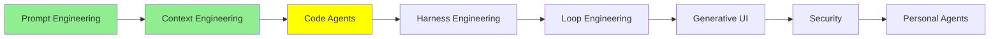

# Code Agent‌ها

[Context Engineering](context_engineering_fa.md) با یک نکته تمام شد: coding agent‌هایی که الان استفاده می‌کنید، deep agent هستند. آن‌ها برنامه‌ریزی می‌کنند، کار را به subagent‌ها واگذار می‌کنند، و فایل‌ها را می‌خوانند و می‌نویسند. این ماژول درباره‌ی خود همین agent‌ها است. ابتدا می‌بینیم چرا معلوم شد آن‌ها خیلی مفیدتر از «چیزی که کد می‌نویسد» هستند. بعد هشت روش استاندارد را مرور می‌کنیم که با آن‌ها می‌توانید یک agent را گسترش دهید.

## چرا یک Coding Agent می‌تواند بیشتر از کد کار کند

فرض کنید یک فایل PNG دارید و می‌خواهید آن را فشرده کنید یا به JPEG تبدیل کنید. بدون agent، باید کسی برای این کار یک tool بنویسد و آن را به مدل بدهد.

یک coding agent به tool نیاز ندارد. می‌تواند یک library پردازش تصویر در Python را نصب کند و چهار خط کدی را بنویسد که تبدیل را انجام می‌دهد. اگر از آن یک slide deck بخواهید، همین کار را می‌کند. یک library برای pptx پیدا می‌کند و آن را نصب می‌کند. کد را می‌نویسد. بعد فایل را به شما می‌دهد. هیچ‌کدام از این دو کار در فهرست tool‌های آن نبود.

لحظه‌ای روی این بخش فکر کنید. این agent‌ها فقط از چیزهایی که وجود دارد *استفاده* نمی‌کنند. آن‌ها چیزهایی را هم که وجود ندارد *می‌سازند*. یکی از داستان‌هایی که مردم تعریف کرده‌اند، درباره‌ی کسی بود که پرینترش driver مربوط به Linux نداشت. پس از یک coding agent خواستند که یکی بنویسد. جزئیات داستان ممکن است با بازگو شدن آن تغییر کرده باشد، اما ایده‌ی کلی درست است: مدلی که می‌تواند کد بنویسد و اجرا کند، راهی برای رسیدن به تقریباً هر کاری دارد که یک کامپیوتر می‌تواند انجام دهد.

  
*ردیف بالا روش قدیمی است: یک agent برای هر حوزه، و هر agent به tool‌هایی نیاز دارد که مخصوص خودش ساخته شده‌اند. ردیف پایین نشان می‌دهد چرا coding agent‌ها جای آن را گرفتند. کد می‌تواند به وب، تقویم، بانک و شرکت هواپیمایی برسد. پس یک agent که کد می‌نویسد، هر چهار مورد را پوشش می‌دهد و لازم نیست کسی چهار مجموعه tool بنویسد.*

پس coding فقط یکی از مهارت‌های زیاد نیست. این مهارتی است که می‌تواند جای بقیه را بگیرد. به همین دلیل یک coding agent به کارهایی کمک می‌کند که ربطی به نرم‌افزار ندارند. به مثال‌های بالا نگاه کنید: هر کدام از آن‌ها یک کار غیرکدنویسی بود.

بقیه‌ی این ماژول درباره‌ی امکانات استاندارد است. تقریباً هر coding agent امروزی این امکانات را دارد: Claude Code، Codex، Antigravity، Copilot و OpenCode. نام‌ها و مسیرهای فایل در هر کدام کمی فرق دارند. مثال‌های مشخص این بخش از Claude Code می‌آیند، و [Claude Code features](https://code.claude.com/docs/en/agent-sdk/claude-code-features) همه‌ی آن‌ها را کنار هم، در یک صفحه، فهرست می‌کند.

## AGENTS.md

README برای انسان‌ها است. AGENTS.md برای agent‌ها است.

AGENTS.md یک فایل markdown ساده در repository شما است. coding agent آن را به system prompt موجودش اضافه می‌کند، و این کار بعد از system prompt‌ای انجام می‌شود که vendor نوشته است. همین کل مکانیزم است. [agents.md](https://agents.md/) فرمت باز پشت این فایل است، و فایل را این‌طور توصیف می‌کند: «جایی اختصاصی و قابل پیش‌بینی برای ارائه‌ی زمینه و دستورالعمل، تا به AI coding agent‌ها در کار روی پروژه‌ی شما کمک کند».

آنچه باید در این فایل باشد، اطلاعاتی است که در کل repository درست می‌ماند و زیاد تغییر نمی‌کند:

- دستورهای build و test
- چیدمان directory‌ها
- قراردادهایی که تیم شما رعایت می‌کند
- قواعدی که اگر نباشند، agent دو بار اشتباه می‌کند

آنچه نباید در آن باشد، هر چیزی است که در یک هفته کهنه می‌شود. فایلی پر از جزئیاتی که دیگر با کد جور نیست، از نداشتن فایل بدتر است. agent به آنچه فایل می‌گوید باور می‌کند.

لازم نیست آن را با دست بنویسید. دستور `/init` را اجرا کنید. آن‌وقت agent کد شما را می‌خواند و یک پیش‌نویس اول می‌نویسد. بعد شما آن را اصلاح می‌کنید.

دو نکته‌ی عملی وجود دارد. اول، Claude Code فایل `CLAUDE.md` را می‌خواند، نه `AGENTS.md` را. ممکن است repository شما از قبل برای ابزارهای دیگر یک AGENTS.md داشته باشد. در این صورت، راه‌حلی که در مستندات آمده این است که یک `CLAUDE.md` بنویسید که آن را با `@AGENTS.md` import می‌کند. بعد هر چیزی را که مخصوص Claude است، زیر آن خط اضافه کنید.

دوم، هر دو فرمت از فایل‌های **nested** پشتیبانی می‌کنند. می‌توانید یک فایل در ریشه نگه دارید، و فایل دیگری داخل `frontend/` یا `backend/`. فایل nested فقط وقتی بارگذاری می‌شود که agent در آن directory کار کند. نگه داشتن قواعد frontend دور از یک کار backend، همان context engineering است که روی دستورهای خودتان اعمال شده است.

## Slash Command‌ها

slash command یک prompt است که شما یک بار می‌نویسید. هر وقت `/name` را تایپ کنید، می‌توانید دوباره آن را اجرا کنید. در Claude Code، slash command‌ها در `.claude/commands/` قرار دارند.

این سه مورد ارزش داشتن دارند:

- `/commit` پیام‌های commit را به شیوه‌ای می‌نویسد که تیم شما آن‌ها را می‌نویسد.
- `/review` چک‌لیست بازبینی شما را روی diff فعلی اجرا می‌کند.
- `/changelog` pull request‌های merge‌شده را به release notes تبدیل می‌کند.

بدون آن‌ها، هر هفته باید هر سه prompt را دوباره تایپ کنید.

یک نکته را اینجا باید بدانید، چون تصویری را که در ادامه می‌آید تغییر می‌دهد: **custom command‌ها با skill‌ها ادغام شده‌اند.** فایل `.claude/commands/deploy.md` به شما `/deploy` می‌دهد. یک skill در `.claude/skills/deploy/SKILL.md` هم `/deploy` می‌دهد، و این دو به یک شکل رفتار می‌کنند. فایل‌های `commands/` موجود شما همچنان کار می‌کنند. تفاوت قدیمی بین این دو، حالا یک فیلد frontmatter است، و آن را در بخش skill‌ها توضیح می‌دهیم.

## پروتکل Model Context Protocol (MCP)

این مشکلی است که MCP حل می‌کند.

فرض کنید برای LangChain agent خود tool می‌نویسید تا بتواند با Jira شما کار کند. این tool‌ها روی API مربوط به Jira یک wrapper می‌سازند: یکی یک issue می‌سازد، یکی جستجو می‌کند، و یکی یک comment اضافه می‌کند. حالا همین کار را می‌خواهید در Claude Code یا Codex یا یک اسکریپت smolagents انجام دهید. هر کدام از آن‌ها تعریف tool‌ها را در شکل مخصوص خودشان می‌خواهند. پس tool‌های Jira را دوباره می‌نویسید. و باز هم دوباره.

**Model Context Protocol** این کار را به یک کار تبدیل می‌کند، نه چهار کار. tool‌ها را با یک روش استاندارد توصیف می‌کنید. بعد هر agent که این پروتکل را پشتیبانی کند، می‌تواند از آن‌ها استفاده کند.

  
*سمت چپ، هر سرویس به integration مخصوص خودش نیاز دارد که برای مدلی نوشته شده که با آن کار می‌کند. پس حجم کار با تعداد مدل‌ها زیاد می‌شود. سمت راست، API هیچ سرویسی اصلاً تغییر نکرده است. آنچه عوض شده، راهی است که مدل با آن‌ها ارتباط می‌گیرد: از طریق یک interface واحد که مدل از قبل با آن کار می‌کند. پس هر سرویس را فقط یک بار integrate می‌کنید، نه یک بار برای هر agent.*

آنچه از آن به دست می‌آورید:

- **بدون vendor lock-in.** وقتی agent را عوض می‌کنید، لازم نیست tool‌های خود را دوباره بنویسید.
- **مجموعه‌ی tool‌ها قابل حمل می‌شود.** یک بار بنویسید، همه جا استفاده کنید.
- **کسی دیگر از قبل همان را که لازم دارید نوشته است.** این بخشی است که خیلی‌ها را شگفت‌زده می‌کند.

همین آخرین نکته است که MCP به خاطرش معروف است. MCP کار را بین یک client و یک server تقسیم می‌کند. tool‌ها در یک **MCP server** قرار دارند، و agent یک client است که به آن وصل می‌شود. پس یک MCP server بسته‌ای از tool‌ها است. برای اضافه کردن آن، configuration را تغییر می‌دهید، نه کد را. agent خود را به Jira MCP server وصل کنید، و حالا می‌تواند با Jira شما کار کند.

در Claude Code این کار با یک دستور انجام می‌شود. [Connect to MCP servers](https://code.claude.com/docs/en/mcp-quickstart) آن را مستند کرده است:

```bash
# a hosted server, reached over HTTP
claude mcp add --transport http sentry https://mcp.sentry.dev/mcp

# a local one, run as a process on your machine
claude mcp add playwright -- npx -y @playwright/mcp@latest
```

بعد، `claude mcp list` نشان می‌دهد که آیا server واقعاً وصل شده است یا نه. با افزودن `--scope project`، Claude Code server را در یک فایل `.mcp.json` می‌نویسد. وقتی هم‌تیمی‌های شما repository را clone می‌کنند، این فایل را هم دریافت می‌کنند.

برای دیدن server‌هایی که از قبل وجود دارند، به [awesome-mcp-servers](https://github.com/punkpeye/awesome-mcp-servers) نگاه کنید، که فهرست جامعه است.

> **نکته:** هر server وصل‌شده بخشی از context window را مصرف می‌کند. نام tool‌ها و توضیح‌هایشان در هر session بارگذاری می‌شود. ده server که هرگز از آن‌ها استفاده نمی‌کنید، باز هم برای شما هزینه دارند. آن‌هایی را که استفاده نمی‌کنید حذف کنید، به دلایلی که در [Context Engineering](context_engineering_fa.md) آمده است.

## Subagent‌ها

[Context Engineering](context_engineering_fa.md) توضیح داد که چرا subagent‌ها وجود دارند. یک subagent به کار سنگین یک context window تازه می‌دهد. پس context window اصلی به جای کل بررسی، فقط یک نتیجه می‌گیرد.

نقطه‌ی گسترش این است که می‌توانید subagent‌های خودتان را تعریف کنید. هر agent یک subagent عمومی (general-purpose) همراه خودش دارد. در کنار آن، می‌توانید یک تحلیلگر امنیت، یک متخصص frontend و یک نویسنده‌ی test اضافه کنید. هر کدام system prompt مخصوص خودشان و فهرست tool مخصوص خودشان را دارند. در Claude Code، این‌ها فایل‌های markdown داخل `.claude/agents/` هستند.

یک custom subagent یک نقش ثابت است. دستورهای آن را یک بار می‌نویسید. هر بار که agent آن subagent را فراخوانی می‌کند، subagent از همان دستورها و در یک context window تمیز شروع می‌کند. اگر ترجیح می‌دهید از subagent‌های دیگران شروع کنید، [awesome-claude-code-subagents](https://github.com/VoltAgent/awesome-claude-code-subagents) مجموعه‌ای از بیش از صد مورد است.

## Skill‌ها

skill یک پوشه از دستورالعمل‌ها است. agent هر وقت یک کار به آن نیاز داشته باشد، می‌تواند آن را بخواند. [Equipping agents for the real world with Agent Skills](https://www.anthropic.com/engineering/equipping-agents-for-the-real-world-with-agent-skills) از Anthropic، skill را این‌طور تعریف می‌کند: «پوشه‌های سازمان‌یافته‌ای از دستورالعمل‌ها، اسکریپت‌ها و منابع، که agent‌ها می‌توانند آن‌ها را پیدا کنند و به‌صورت پویا بارگذاری کنند تا در کارهای مشخص بهتر عمل کنند». در Claude Code، یک skill در `.claude/skills/<name>/SKILL.md` قرار دارد.

نکته‌ی مهم، مکانیزم آن است. این مکانیزم نامی دارد که باید به خاطر بسپارید: **progressive disclosure**.

در شروع کار، agent فقط `name` و `description` هر skill نصب‌شده را بارگذاری می‌کند. این یک یا دو خط برای هر skill است، پس بیست skill تقریباً هزینه‌ای ندارد. agent دستورالعمل‌های کامل را فقط وقتی می‌خواند که تصمیم بگیرد یک skill به کاری که در دست دارد مربوط است.

  
*نوار خاکستری بالای تصویر، هزینه‌ی کامل هر بیست skill است در زمانی که استفاده نمی‌شوند: برای هر کدام یک خط کوتاه. وقتی کار PDF می‌رسد، agent فایل `SKILL.md` را با یک فراخوانی معمولی Bash می‌خواند. بعد یک ارجاع داخل آن فایل را دنبال می‌کند تا به فایل دوم برسد. توجه کنید که skill به صورت یک tool result وارد context می‌شود. پس این مکانیزم جدیدی نیست. این همان tool loop از Tool Calling است که این بار برای خواندن دستورالعمل به جای داده به کار رفته است.*

پس چرا skill‌ها وجود دارند، به جای یک system prompt خیلی بزرگ؟ دلیلش context engineering است. هر چیزی که agent ممکن است به آن نیاز داشته باشد، در دسترس است. فقط آنچه واقعاً لازم دارد در window قرار می‌گیرد.

**Skill در برابر custom subagent.** یک subagent دستورهای ثابت دارد و در یک window جدا اجرا می‌شود. می‌رود، کار را انجام می‌دهد و با یک پاسخ برمی‌گردد. در مقابل، یک skill خود agent اصلی را تغییر می‌دهد. وقتی *همین* agent skill امنیتی را می‌خواند، تا آخر کار یک بازبین امنیتی می‌شود. در همان window می‌ماند و هر چیز دیگری را که از قبل می‌دانست نگه می‌دارد. این همان agent است با یک ماسک متفاوت، و یک دقیقه‌ی بعد می‌تواند دوباره ماسک را عوض کند.

**Skill در برابر slash command.** این تفاوتی است که بعد از ادغام باقی ماند. این تفاوت درباره‌ی این است که چه کسی اجازه دارد skill را فراخوانی کند. به طور پیش‌فرض، هم شما و هم agent می‌توانید آن را فراخوانی کنید. دو فیلد frontmatter این را محدود می‌کنند:

```yaml
---
name: deploy
description: Deploy the application to production
disable-model-invocation: true
---
```

`disable-model-invocation: true` یعنی فقط شما می‌توانید skill را اجرا کنید. این را برای هر چیزی می‌خواهید که side effect دارد. نمی‌خواهید agent، چون کد از نظرش آماده به نظر می‌رسید، تصمیم بگیرد deploy کند. فیلد مقابل آن `user-invocable: false` است. یعنی فقط agent می‌تواند به skill دسترسی داشته باشد. این فیلد برای دانش پس‌زمینه مناسب است: چیزی که به عنوان دستوری که آدم تایپ می‌کند معنایی ندارد.

برای مجموعه‌های عمومی skill، [anthropics/skills](https://github.com/anthropics/skills) مجموعه‌ی رسمی است. [awesome-claude](https://github.com/webfuse-com/awesome-claude) فهرست گسترده‌تری است که به دقت انتخاب شده است.

## Hook‌ها

همه‌ی آنچه بالاتر آمد، توصیه به یک مدل است. یعنی مدل بیشتر وقت‌ها از آن پیروی می‌کند. hook توصیه نیست. یک shell command است که به یک نقطه‌ی ثابت در چرخه‌ی عمر (lifecycle) agent وصل است. چه مدل بخواهد چه نخواهد، اجرا می‌شود.

[hooks reference](https://code.claude.com/docs/en/hooks) بیش از سی رویداد را فهرست می‌کند. این‌ها رویدادهایی هستند که مردم در عمل از آن‌ها استفاده می‌کنند:

- **`PreToolUse`**، پیش از اجرای یک tool call. می‌توانید ویرایش فایلی را که نباید کسی به آن دست بزند مسدود کنید، یا دستوری را که به main push می‌کند رد کنید.
- **`PostToolUse`**، بعد از موفقیت یک tool call. می‌توانید formatter را روی هر فایلی اجرا کنید که agent همین الان ویرایش کرده است. آن‌وقت سبک کد هرگز به این بستگی ندارد که agent یادش باشد یا نه.
- **`Stop`**، وقتی agent نوبتش را تمام می‌کند. می‌توانید test suite را اجرا کنید، و اگر یک test قرمز بود، به agent بگویید ادامه دهد.
- **`SessionStart`**، وقتی یک session شروع می‌شود. می‌توانید branch فعلی و ticket‌های باز را وارد context کنید.

اولی را به خاطر بسپارید، چون نکته‌ی اصلی در آن است. دستوری در AGENTS.md که از agent می‌خواهد هرگز به یک فایل دست نزند، یک درخواست است. یک `PreToolUse` hook که نوشتن را مسدود می‌کند، یک قانون است. این ایده جایی است که ماژول بعدی از آن شروع می‌شود، و دلیل وجود آن ماژول همین است.

## Plugin‌ها

یک plugin بسته‌ای از همان چیزهای بالا است: command‌ها، skill‌ها، subagent‌ها، hook‌ها و MCP server‌ها. این‌ها با هم منتشر می‌شوند و در یک مرحله نصب می‌شوند. یک هم‌تیمی جدید لازم نیست شش فایل را داخل directory‌ای به نام `.claude/` کپی کند. به جای آن، فقط یک plugin به او بدهید.

ساختار برای هر vendor فرق دارد. برای Claude Code، یک plugin یک directory است که یک manifest دارد. manifest مشخص می‌کند plugin کدام یک از آن بخش‌ها را ارائه می‌دهد. [Discover plugins](https://code.claude.com/docs/en/discover-plugins) توضیح می‌دهد که چطور plugin نصب کنید، و [plugins reference](https://code.claude.com/docs/en/plugins-reference) توضیح می‌دهد که چطور یکی بسازید. [claude-plugins-official](https://github.com/anthropics/claude-plugins-official) directory‌ای است که Anthropic آن را مدیریت می‌کند.

## MEMORY.md

هر session با یک context window خالی شروع می‌شود. دو چیز دانش را از یک session به session بعدی منتقل می‌کنند، و این دو یک چیز نیستند.

**AGENTS.md همان چیزی است که شما می‌نویسید.** **Auto memory همان چیزی است که agent می‌نویسد.** جدول زیر از [How Claude remembers your project](https://code.claude.com/docs/en/memory) آمده است:

| | CLAUDE.md files | Auto memory |
| --- | --- | --- |
| چه کسی می‌نویسد | شما | Claude |
| محتوا | دستورالعمل‌ها و قواعد | یادگیری‌ها و الگوها |
| دامنه | پروژه، کاربر یا سازمان | برای هر repository، بین worktree‌ها مشترک |
| بارگذاری می‌شود در | هر session | هر session (200 خط اول یا 25KB) |
| کاربرد | استانداردهای کدنویسی، workflow‌ها، معماری پروژه | ترجیح‌های شما، اصلاحاتی که به Claude می‌دهید، و زمینه‌ی پروژه‌ای که Claude نمی‌تواند از کد استنباط کند |

agent این یادداشت‌ها را از اصلاحاتی می‌نویسد که شما به آن می‌دهید. پس چیزی را که این هفته دو بار باید توضیح می‌دادید، دوشنبه‌ی هفته‌ی بعد هم آنجا است. فایل‌ها در `~/.claude/projects/<project>/memory/` قرار دارند. agent در هر session یک فهرست `MEMORY.md` را بارگذاری می‌کند. یادداشت‌های دقیق‌تر کنار آن قرار دارند، و agent فقط وقتی به آن‌ها نیاز دارد آن‌ها را می‌خواند. این باز هم progressive disclosure است، این بار روی یادداشت‌های خود agent.

یک کار مفید که عمداً می‌توانید انجام دهید این است که به agent بگویید چیزی را به یاد بسپارد. بگویید «remember that the API tests need a local Redis»، و agent آن را یادداشت می‌کند. `/memory` همه‌ی چیزهایی را که agent ذخیره کرده به شما نشان می‌دهد. همه‌ی آن‌ها markdown ساده هستند که می‌توانید ویرایش یا حذف کنید.

## Plan Mode

فرض کنید یک refactor بزرگ دارید، یا چند feature که باید همزمان تحویل دهید. شروع کردن به تایپ کد، اولین قدم اشتباه است. [Context Engineering](context_engineering_fa.md) دلیلش را داده است: agent‌ای که برنامه را یادداشت نکرده باشد، نقشه را گم می‌کند.

Plan mode یک حالت فقط خواندنی برای همین وضعیت است. agent کل codebase را بررسی می‌کند و نمی‌تواند حتی یک خط از آن را تغییر دهد. پس کل مرحله‌ی اول درباره‌ی فهمیدن این است که واقعاً چه چیزی آنجا هست. بعد agent یک plan می‌نویسد و شما آن را می‌خوانید. agent فقط بعد از تأیید شما در plan شروع به ویرایش می‌کند.

نسخه‌ی Claude Code یک قدم جلوتر می‌رود. پیش از اینکه چیزی را برنامه‌ریزی کند، از شما سؤال‌های روشن‌کننده می‌پرسد. همچنین می‌تواند چند روش را پیشنهاد دهد و به شما اجازه دهد یکی را انتخاب کنید. این بخش واقعاً مفید است، چون بهترین زمان برای پیدا کردن یک plan بد، پیش از آنکه اصلاً کدی نوشته شده باشد، همین جاست.

این به کار long-horizon هم مربوط می‌شود. agent‌ای که از یک plan نوشته‌شده و تأییدشده کار می‌کند، ساعت‌ها منسجم می‌ماند. دلیلش این است که plan روی دیسک قرار دارد، و از آنجا هدف را دوباره و دوباره به context برمی‌گرداند. اگر همان هدف در یک context window باقی می‌ماند، بی‌سروصدا فرسوده می‌شد.

## میزان Reasoning Effort

در [Prompt Engineering](prompt_engineering_fa.md)، chain of thought درباره‌ی این بود که مدل پیش از پاسخ دادن استدلال کند. `/effort` همان دکمه‌ای است که مشخص می‌کند مدل چقدر استدلال کند.

این یک راهنمای تقریبی است:

- **medium** برای پاسخ به سؤال، مستندات، اصلاحات کوچک و ویرایش‌های ساده.
- **high** برای کار معمولی. بیشتر کارهایی را که انجام می‌دهید پوشش می‌دهد.
- **xhigh** برای coding سنگین: یک refactor واقعی، یک bug ظریف، یک تصمیم طراحی.
- **max** وقتی کاری واقعاً سخت است و تنظیم‌های پایین‌تر جواب نداده‌اند.

تنظیم بالاتر رایگان نیست. در هر نوبت، token و زمان هزینه دارد. پس اگر آن را تا آخر بالا ببرید تا یک غلط تایپی را درست کنید، پول دور ریخته‌اید. اگر می‌خواهید ببینید یک تنظیم بالاتر واقعاً چقدر به شما می‌دهد، به [Artificial Analysis](https://artificialanalysis.ai/) نگاه کنید. این سایت نتایج benchmark هر مدل را در تنظیم‌های مختلف reasoning منتشر می‌کند. عددهای آن فاصله‌ی بین یک تنظیم و تنظیم بعدی را نشان می‌دهند.

## همه‌ی این‌ها در واقع چه هستند

به هشت بخش نگاه کنید: AGENTS.md، slash command‌ها، subagent‌ها، skill‌ها، hook‌ها، plugin‌ها، memory و plan‌ها.

تقریباً همه‌ی آن‌ها **markdown در یک پوشه** هستند. آن‌ها database نیستند. آن‌ها یک plugin API نیستند که باید با آن کامپایل کنید. آن‌ها یک فرمت config نیستند که کسی اختراع کرده باشد. آن‌ها فایل‌هایی روی دیسک هستند، و شما می‌توانید:

- آن‌ها را در هر editor‌ای باز کنید
- آن‌ها را diff کنید
- آن‌ها را در یک pull request بازبینی کنید
- آن‌ها را به ماشین دیگری کپی کنید

این تنبلی نیست. این تنها فرمتی است که هر دو طرف به خوبی از عهده‌ی آن برمی‌آیند. می‌توانید بدون ابزار خاص آن را بخوانید و ویرایش کنید. مدل‌ها در markdown و در حرکت دادن خود در یک filesystem به طور غیرعادی خوب هستند، چون بخش بسیار بزرگی از داده‌های آموزشی آن‌ها دقیقاً همین است. پس در نهایت، مکانیزم گسترش یک coding agent، همان چیزی است که از قبل بهترین کار را با آن می‌کرد.

  
*این سه مشکل متفاوت‌اند، پس کمک می‌کند نام هر کدام را بدانیم. skill‌های سمت چپ دستورالعمل‌هایی هستند که agent برای تغییر رفتارش می‌خواند. MCP server‌های سمت راست tool‌هایی هستند که به agent اجازه می‌دهند به سیستم‌هایی برسد که در غیر این صورت به آن‌ها دسترسی نداشت. subagent‌های پایین، context window‌های اضافی هستند. هر چیزی که این‌جا می‌بینید، یا چیزی است که باید بدانید، یا کاری است که باید انجام دهید، یا جایی است که باید در آن فکر کنید.*

## کجای این مجموعه هستیم



## خلاصه

یک coding agent خیلی قدرتمندتر از اسمش است، چون نوشتن و اجرای کد راهی برای رسیدن به تقریباً هر چیزی است. برای هر کار به tool نیاز ندارد، چون می‌تواند یک library را نصب کند یا خودش یکی بنویسد. به همین دلیل به کارهایی کمک می‌کند که اصلاً کدنویسی نیستند.

می‌توانید یک coding agent را به هشت روش استاندارد گسترش دهید. سه تا از آن‌ها درباره‌ی چیزی است که agent می‌داند. AGENTS.md قواعد repository شما را به آن می‌دهد. Auto memory چیزهایی را که درباره‌ی شما یاد گرفته به session بعدی می‌برد. و skill‌ها به آن اجازه می‌دهند دستورالعمل‌ها را فقط وقتی بارگذاری کند که یک کار واقعاً به آن‌ها نیاز دارد. آخری progressive disclosure است، و به همین دلیل می‌توانید بیست skill داشته باشید.

سه تای دیگر درباره‌ی کاری است که agent می‌تواند انجام دهد. Slash command‌ها یک prompt را ذخیره می‌کنند که در غیر این صورت باید دوباره تایپ کنید. MCP کل مجموعه‌ی tool را قابل حمل می‌کند، پس tool را یک بار می‌نویسید، نه یک بار برای هر agent. و custom subagent‌ها به آن نقش‌های ثابتی می‌دهند که می‌تواند کار را به آن‌ها واگذار کند، هر کدام در یک context window تمیز.

دو تای آخر درباره‌ی کنترل است. Hook‌ها بخش مکانیکی هستند: چیزهایی که اتفاق می‌افتند، چه مدل آن‌ها را انتخاب کرده باشد چه نه. Plan mode باعث می‌شود agent پیش از اینکه اجازه‌ی ویرایش هر بخشی از کد را داشته باشد، آن را بفهمد. Plugin‌ها هر کدام از موارد بالا را در یک نصب واحد بسته‌بندی می‌کنند، و effort تعیین می‌کند agent هنگام انجام همه‌ی این کارها چقدر سخت فکر کند.

تقریباً همه‌اش markdown در یک پوشه است. این فرمتی است که هم شما و هم مدل به خوبی با آن کار می‌کنید.

بعدی: hook‌ها اولین چیزی در این ماژول بودند که مدل در آن رأیی ندارد. این ایده نامی دارد، و خودش یک ماژول دارد.

**بررسی سریع**: یک skill و یک custom subagent، هر دو به یک agent تخصص می‌دهند. تفاوت واقعی بین آن‌ها چیست، و هر کدام کی مناسب است؟

## منابع

- [Claude Code features](https://code.claude.com/docs/en/agent-sdk/claude-code-features): کل امکانات گسترش در یک صفحه، مفید به عنوان چک‌لیستی از آنچه agent خودتان پشتیبانی می‌کند
- [agents.md](https://agents.md/): فرمت باز، از جمله اینکه فایل‌های nested در یک monorepo چطور کار می‌کنند
- [How Claude remembers your project](https://code.claude.com/docs/en/memory): تقسیم CLAUDE.md و auto memory، و محل نگهداری فایل‌ها
- [Connect to MCP servers](https://code.claude.com/docs/en/mcp-quickstart): چطور یک server را از ابتدا تا انتها اضافه کنید، و چه چیزهایی را بررسی کنید وقتی وصل نمی‌شود
- [awesome-mcp-servers](https://github.com/punkpeye/awesome-mcp-servers): فهرست جامعه، برای بررسی اینکه tool شما از قبل وجود دارد یا نه
- [Equipping agents for the real world with Agent Skills](https://www.anthropic.com/engineering/equipping-agents-for-the-real-world-with-agent-skills): جایی که progressive disclosure به طور کامل توضیح داده شده است
- [Extend Claude with skills](https://code.claude.com/docs/en/skills): نسخه‌ی عملی، از جمله دو فیلدی که تعیین می‌کنند چه کسی اجازه دارد skill را فراخوانی کند
- [anthropics/skills](https://github.com/anthropics/skills): مجموعه‌ی رسمی skill‌ها
- [awesome-claude](https://github.com/webfuse-com/awesome-claude): فهرست گسترده‌تر و انتخاب‌شده از ابزارهای Claude
- [awesome-claude-code-subagents](https://github.com/VoltAgent/awesome-claude-code-subagents): بیش از صد تعریف subagent برای شروع
- [Hooks reference](https://code.claude.com/docs/en/hooks): هر رویداد چرخه‌ی عمر، و ورودی‌ای که هر کدام دریافت می‌کند
- [Discover plugins](https://code.claude.com/docs/en/discover-plugins) و [plugins reference](https://code.claude.com/docs/en/plugins-reference): اول اینکه چطور یک plugin نصب کنید، و بعد اینکه چطور یکی بسازید
- [claude-plugins-official](https://github.com/anthropics/claude-plugins-official): فهرست مدیریت‌شده‌ی plugin‌ها
- [Artificial Analysis](https://artificialanalysis.ai/): عددهای benchmark برای هر مدل و هر تنظیم reasoning، اگر می‌خواهید ببینید effort چه چیزی به شما می‌دهد
