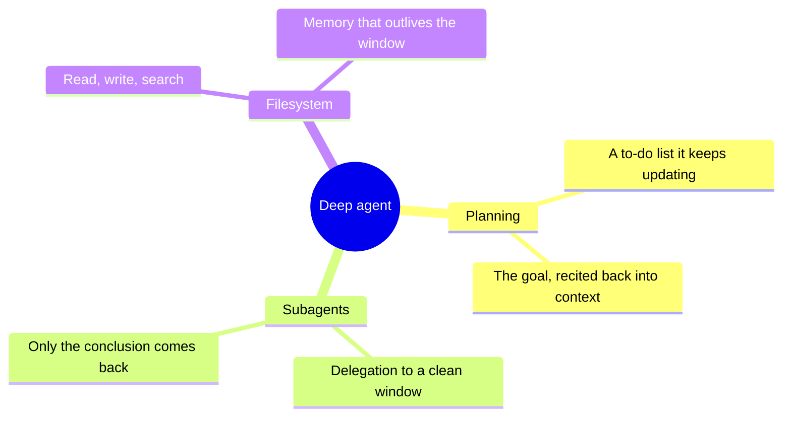
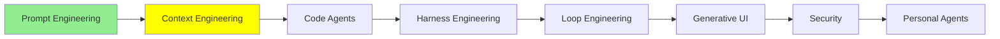

# Context Engineering

[Prompt Engineering](prompt_engineering.md) was about writing one good input. This module is about
everything else that goes in front of the model. It is also about one problem: there is not enough
room for all of it.

After prompt engineering came context engineering. It became the trend of late 2025. Here we cover
where it came from, how it developed, and the techniques that are worth knowing.

## Rise of Context Engineering

Back then, the whole discussion was about size. People wanted models with larger context windows.
They gave the model more and more, because more context really did give better results.

If you have ever worked through a long session with a coding agent, you know the feeling. You
brainstorm, you design, you go back and forth. Then, with no warning, you are at 95% of the window.
Because more context helped, people kept adding extra material to their prompts. That made the
window fill faster than ever.

So what did systems do when the stack grew bigger than the window? Mostly, they used a **sliding
window**. Say the model holds 1M tokens, and your history has reached 1.4M. The window slides
forward, and the model only sees the last 1M, from 0.4M to 1.4M. The first 0.4M is gone.

That is worse than it sounds. The moment you cross the limit, you have to drop the *oldest*
context. That is usually where you explained what you were trying to do. So the shared
understanding you built with the model is the first thing the system throws away. You are left
copying your own earlier prompts back in by hand, to remind the model what the job was.

## Context Rot (Pollution)

While everyone was looking for ways around a full window, the Chroma team published
[Context Rot: How Increasing Input Tokens Impacts LLM Performance](https://www.trychroma.com/research/context-rot).
Its finding was a big surprise: **as the context grows, the model gets worse at the task.**

They tested 18 models, including GPT-4.1, Claude 4 and Gemini 2.5, and the pattern was the same in
all of them. Give the same model the same job, and it does the job noticeably better with 25K
tokens in its context than with 800K. It is not because the window overflowed. It is because of
what was already in it.

  
*The three things the model needs are in both jars. On the right they are still there, still readable, and still lost. Everything else in the jar is competing for the same attention.*

People use two names for this effect: **context rot** and **context pollution**. Drew Breunig's [How Long Contexts Fail](https://www.dbreunig.com/2025/06/22/how-contexts-fail-and-how-to-fix-them.html) goes one step further. It names four specific ways that it happens: poisoning, distraction, confusion and clash.

The reason is **attention**. Attention is the mechanism a model uses to decide which parts of its
input matter for the token it is about to write. We are not going into the theory here. What you
need is the result: attention is a fixed budget, and the model divides it across everything in the
window. A person works the same way. You can hold a few things in your head at once, and no more.
The model that is your agent's brain is no different. Fill its context with a lot of loosely
related material, and it carries the same load a person would. It also makes the same kind of
mistakes.

Be careful about one point, because it is the part people get wrong: this is not the window
"filling up". Performance starts to drop long before you reach the limit. A window that is 40% full
can already give worse answers than the same window at 5%.

Here is what it feels like in practice. You start a long session to write a book. At the
beginning, you tell the model to write in a clear academic tone. For a while, it does. Somewhere
past 800K, it stops: the tone drifts to something vague and chatty, and the model starts to invent
things. Nothing was deleted, and the window never overflowed. The instruction is still there. But
its share of the attention had to compete with everything you added after it, and it lost. The
model has lost the map, which means it no longer keeps track of the goal you set at the start.

  
*The question asks for the classmate's advice. The needle answers it. The distractor is the same sentence, but about a professor. Chroma found that one distractor is enough to hurt. They also found that the less the needle looks like the question, the faster performance collapses as the haystack grows.*

You will hear the name of that test all the time: **needle in a haystack**. The version above is
the harder one. The easy version hides an exact phrase in the text and asks for it back. Models do
that almost perfectly. Chroma's contribution was to hide something you have to *reason* to find,
and to put wrong sentences that look almost right beside it.

Out of all of this came a set of practices, and a name for them.

## What is Context Engineering?

Context engineering answers one question: **what should go into the context, and what should be
kept out of it?**

The window is limited, so something has to decide. There is a constantly growing universe of things
that could go into the window. Context engineering is the art and science of choosing which of them
actually go in. The goal is to have as many tokens as possible that carry real signal, and as few as
possible that are noise, so that the context does not rot.

  
*On the left is one turn and one decision: that is [Prompt Engineering](prompt_engineering.md). On the right is a universe of things that could go in the window, and a decision about what actually goes in. That decision is made again on every single turn.*

The term became popular after a [post by Andrej Karpathy](https://x.com/karpathy/status/1937902205765607626)
in mid-2025. Anthropic's
[Effective context engineering for AI agents](https://www.anthropic.com/engineering/effective-context-engineering-for-ai-agents)
gave it the most complete treatment. It calls context engineering "the set of strategies for
curating and maintaining the optimal set of tokens during LLM inference". Philipp Schmid's
[The New Skill in AI is Not Prompting, It's Context Engineering](https://www.philschmid.de/context-engineering)
describes the same idea as a job description: give the model the right information and tools, in
the right format, at the right time. LangChain sorts the techniques into four verbs: write, select,
compress, isolate. You can find this sorting in
[Context Engineering](https://www.langchain.com/blog/context-engineering-for-agents) and in Lance
Martin's [Context Engineering for Agents](https://rlancemartin.github.io/2025/06/23/context_engineering/).

Here are the techniques that are worth knowing now.

## Context Summarization (Compaction)

This is the simplest one. When the context gets long, replace it with a summary of itself. This
way, 800K tokens of conversation become 20K tokens of "here is what we decided, here is what is
still broken, here is where we were".

Most agents now do this on their own when they get close to the limit. Some also let you start it
yourself. In Claude Code, you type `/compact` and it happens immediately.

  
*Notice what is kept and what is not. The tool results are most of the window, and they go. The summary keeps the decisions. The few recent files are kept, because the agent will read them again immediately. The reserved block at the bottom is space the agent holds for its own summarising. This way, it is never caught with a full window and no room to write.*

The cost is real, and it is worth saying plainly. A summary throws away the 40,000-token output of
a terminal command that nobody needs again. That is the point. But it can also throw away
something you did need. This can happen by accident. It can also happen because whatever wrote the
summary decided that the thing was unimportant, and was wrong. For exactly this reason,
Anthropic's own guidance on compaction says to keep architectural decisions, unresolved bugs and
implementation details.

## Context Offloading

Instead of keeping something in the context, the agent writes it down in a place where it can read
it later. Usually that place is a markdown file. The important facts leave the window and live on
disk. The agent fetches them back when it actually needs them.

The Manus team wrote about this in
[Context Engineering for AI Agents: Lessons from Building Manus](https://manus.im/blog/Context-Engineering-for-AI-Agents-Lessons-from-Building-Manus).
They describe it as using the file system as context. The file system is unlimited in size and
persistent by nature, and the agent can work with it directly.

Many agents build this into a feature called **long-term memory**. It is an index of the things
worth keeping. So even after the context is summarised, the facts survive, and the agent can still
search them.

The same warning applies here, and it has the same root cause. Deciding what is worth keeping is a
matter of judgement, and that judgement comes from either you or the model. Both get it wrong.
Losing something valuable this way is common, not rare.

[Memory](../1_fundamentals/memory.md) divided memory into parametric, working and long-term. This
is the long-term one. In practice, it is usually organised into three kinds:

  
*The split matters because the agent writes and reads the three at different times. Facts about you collect quietly over time. Past actions are what stop an agent from repeating a mistake. And the instructions layer is just the system prompt from [Tool Calling](../1_fundamentals/tools.md) under another name.*

## Using a Knowledge Base as Explorable Context

Some information is really valuable and does not change often, such as how your company's internal
API works. Do not paste it into every prompt. Put it in a place where the agent can go and look: a
folder of markdown files that it can read and search.

Then, when the agent decides it needs your documentation, it retrieves it. It reads the part that
matters, and learns that much in context. Retrieval can be full RAG from
[RAG & Embeddings](../1_fundamentals/rag.md), or just an agent opening files. Either way, the
alternative is to dump the entire API reference into the window and pay for it on every turn.

One tool is worth knowing here. [DeepWiki](https://deepwiki.org/) generates a wiki for a GitHub
repository. Say your agent has a question about a library's internals, its architecture or its
API. It can read DeepWiki's write-up, instead of crawling the repository itself and filling its
context with source files.

## Context Isolation

Here is the example that makes this clear.

Your coding agent needs to tell you what architecture a repository uses. The repository is a
million lines long. To answer, the agent has to open a lot of files. Say that costs 800K tokens of
context, and the answer is one sentence: the system orchestrates an event-driven microservices
fabric, blending distributed Kafka streams with real-time geospatial processing. You spent 800K
tokens of context to get one sentence. And now that 800K sits in the window, rotting everything
that comes next.

The fix is to not do the reading in that context at all. The main agent calls a second agent that
has an empty context of its own. This second agent is a **subagent**. The subagent does the
800K-token crawl. It throws away everything except the conclusion, and it hands back the sentence.
The main agent's context gains one sentence.

  
*Each box is a separate context. It starts empty, and it is thrown away when the work is done. The main agent never sees the intermediate steps, and that is the whole point: because those steps never reach its window, they cannot fill it and make its answers worse.*

**How it works.** A subagent is a new agent with a clean context. The main agent calls it in the
same way it calls any other tool, with something like
`Task("find out what architecture this repo uses")`. From the point of view of
[Tool Calling](../1_fundamentals/tools.md), nothing new is happening: a tool was called, and a tool
result came back. The subagent runs its own loop and hides every intermediate step. Then it returns
the final answer as that tool result. Anthropic reports that these summaries are usually around
1,000 to 2,000 tokens.

Modern agents call subagents one after another or in parallel. This leaves the main agent free to
do what it is actually good at: holding the plan and deciding what happens next.

## Explicit Planning (TODOs)

Say you ask an agent to build you a portfolio site. That means all of these steps:

- defining the scope
- choosing a stack
- building the layouts
- writing the content in
- wiring up a CMS
- configuring deployment

If the agent starts writing code straight away, it will lose the map. It forgets a step, or it
drifts somewhere else entirely. So instead, it writes the plan down first. The plan is a to-do
list, with a state on each item:

```text
[x] Define the scope: one page, three projects, a contact form
[x] Choose the stack: Next.js, static export, no database
[~] Build the layouts: header and hero done, project grid in progress
[ ] Write the content in
[ ] Wire up a CMS
[ ] Configure deployment
```

Then it works through the list. After each step, it goes back, marks what it finished, and takes
the next one. The big task became small tasks. There is now a written record of which ones are
done, so nothing depends on the agent remembering.

The second effect is less obvious, and it matters more. Each time the agent re-reads and rewrites
that list, it brings the goal back into recent context. This happens over and over. Manus calls
this **manipulating attention through recitation**. It is the most direct answer to the
academic-tone problem above. The instruction loses its share of attention because nothing repeats
it. A to-do list repeats it.

Remember the word recitation. It comes back at the end of this module, because the to-do list is
not the only thing that does it.

**How it works.** Modern agents offer this as a built-in tool. If your agent does not have one but
it can reach a filesystem, it can keep a markdown file and get the same result.

> **NOTE:** these are not all of the techniques. [Advanced Context Engineering](../3_expert/advanced_context_engineering.md) covers the harder ones,
> especially for software work.

## Deep Agents

**Deep agents** are an agent architecture that became popular while all of this was happening. You
do not have to build every technique above into your own agent by hand. A deep agent is the shape
that packages them together. There are several architectures worth knowing, and
[Advanced Agent Architectures](../3_expert/advanced_agent_architectures.md) covers them. This is the
one that belongs in this module, because it is context engineering turned into a design.

To count as deep, an agent needs at least these:



Philipp Schmid's [Agents 2.0: From Shallow Loops to Deep
Agents](https://www.philschmid.de/agents-2.0-deep-agents) adds a fourth: a very long and very
specific system prompt. It is sometimes thousands of tokens long. It tells the agent when to plan,
when to spawn a subagent and how to organise its files. NVIDIA's [What Is a Deep
Agent?](https://www.nvidia.com/en-us/glossary/deep-agents/) describes the same architecture in the
same terms. You will also hear the whole idea called **Agents 2.0**. It is the same thing under
another name. That name makes the break from the plain loop of
[AI Agents](../1_fundamentals/agents.md) sound as big as it really is. [The Agent 2.0 Era: Mastering
Long-Horizon Tasks with Deep
Agents](https://medium.com/@amirkiarafiei/the-agent-2-0-era-mastering-long-horizon-tasks-with-deep-agents-part-3-745705e13b16)
walks through it from start to finish.

To build one, the simplest place to start is [deepagents](https://github.com/langchain-ai/deepagents)
from LangChain. It calls itself a batteries-included agent harness. That means it comes with the main parts already
built in, so you do not have to add them yourself. The batteries are exactly this
list:

- planning
- a pluggable filesystem
- subagents with isolated windows
- summarisation of long threads

The [Deep Agents overview](https://docs.langchain.com/oss/python/deepagents/overview) is the
documentation.

Here is the real benefit: a deep agent does most of the context engineering for you. It summarises,
it offloads, it delegates, it plans. You do not have to wire up any of it. Some techniques still
need a human, and those are the problem of the advanced module.

And here is the thing to notice: most agents you already use are deep agents. Claude Code, Codex,
Copilot and OpenCode all have planning, subagents and a filesystem.

## Long-horizon Tasks

When you put all of this together, something new appears: agents that work for hours without anyone
watching them.

You have probably seen someone get a whole website, or a working game, out of a single prompt.
Those are **long-horizon tasks**. They became possible because of the techniques in this module.
Think of an agent that can do all of these things:

- break a huge job into steps
- plan those steps
- write its own notes
- offload what it does not need
- spawn subagents for the expensive parts
- summarise its own context

That agent can keep going long past the point where, before, it would have lost track of the task.

There is a real measurement of how far this has come, and it is more useful than the marketing.
METR's [Measuring AI Ability to Complete Long Software Tasks](https://arxiv.org/abs/2503.14499)
asks a simple question. Take the tasks that a model finishes about half the time. How long do those
tasks take a human? That number is the model's **time horizon**. When the paper came out, Claude
3.7 Sonnet was at roughly 50 minutes of human work. The trend line has doubled about every seven
months since 2019. If you extend that line, month-long tasks arrive within five years. METR keeps
the [current numbers](https://metr.org/time-horizons/) for each frontier model on one chart, at both
50% and 80% success. That chart is the honest way to read a claim that some agent "worked for six
hours".

Long-horizon is the keyword of 2026, and every company is chasing it. They chase it because it is
the difference between an agent that helps you work and an agent that does the work. If you want
the research landscape rather than the headline, look at
[Awesome-Long-Horizon-Agents](https://github.com/RUC-NLPIR/Awesome-Long-Horizon-Agents). It is a
reading list that is kept up to date. It sorts the whole field into two parts: what you build around
the model, and what you change inside it.

## Chain of Thought as a Context Engineering Tool

There is one last thing, and it sits exactly between this module and the previous one.

Chain of thought from [Prompt Engineering](prompt_engineering.md) does more than improve one answer.
It also keeps a long session on track. When the model writes out its reasoning, it repeats the goal
to itself. Take the book that drifted out of its academic tone. With reasoning turned on, the trace
at that same point in the session looks something like this:

```text
<thinking>
The user wants section 8, which is about slang in American society. Before I
start: their instruction from the beginning of this project was a clear academic
tone throughout, and that has not been withdrawn. The subject is informal, but
the treatment of it should not be. Academic register, slang only as quoted
examples.
</thinking>
```

Nothing was retrieved, and nothing was added to the window. The model wrote the instruction back
into its own recent context, where attention is cheapest.

That is the same move the to-do list makes, and it is why the word recitation was worth
remembering. Both techniques work by **saying the important thing again, close to where the model
is about to write**. A to-do list recites the plan. A chain of thought recites the constraint.
The model gives more attention to text that is close to where it is writing, and to text that
appears more than once. So if you want the model to still care about something
at 800K tokens, something has to repeat it. Left alone, it fades. That is chain of thought working
as a context engineering tool. It is also the cheapest tool in this module: you do not build it,
you turn it on.

## Where this fits in the series



## Summary

A context window is limited, and its quality drops before it is full. More context makes the answer
worse. That is the opposite of what everyone assumed in 2025. The reason is that attention is a
fixed budget, divided across whatever is in the window.

Context engineering is deciding what earns a place in there. All the techniques are versions of the
same move: get the tokens out of the window, and keep a way back to them.

- Summarise the history.
- Offload facts to files.
- Leave documentation where the agent can go and read it.
- Hand expensive work to a subagent with its own window.
- Keep a to-do list that recites the goal back into recent context.

A deep agent is an agent that does most of this for you. That is why the coding agents you use every
day are already deep agents.

Next: the coding agents themselves, and the six ways you extend one.

**Quick Check**: why does a model get worse before its window is full, and what does a subagent
actually save you?

## References

- [Context Rot: How Increasing Input Tokens Impacts LLM Performance](https://www.trychroma.com/research/context-rot): the Chroma study behind all of this, 18 models, and the needle-and-distractor experiments
- [How Long Contexts Fail](https://www.dbreunig.com/2025/06/22/how-contexts-fail-and-how-to-fix-them.html): Drew Breunig's four named failures, from an early hallucination that keeps getting cited to new information that contradicts the old
- [Effective context engineering for AI agents](https://www.anthropic.com/engineering/effective-context-engineering-for-ai-agents): the most complete treatment, and the source of the compaction and subagent guidance
- [The New Skill in AI is Not Prompting, It's Context Engineering](https://www.philschmid.de/context-engineering): the shortest good definition
- [Context Engineering](https://www.langchain.com/blog/context-engineering-for-agents): the four verbs (write, select, compress and isolate)
- [Context Engineering for Agents](https://rlancemartin.github.io/2025/06/23/context_engineering/): the same four, with diagrams that are worth reusing
- [Karpathy on context engineering](https://x.com/karpathy/status/1937902205765607626): the post that put the term in front of everyone
- [Context Engineering for AI Agents: Lessons from Building Manus](https://manus.im/blog/Context-Engineering-for-AI-Agents-Lessons-from-Building-Manus): specific lessons from real experience, especially the filesystem and recitation lessons
- [Stop stuffing your context window (here's why)](https://youtube.com/shorts/9P36wMntNSI): the short version, if you would rather watch
- [DeepWiki](https://deepwiki.org/): a wiki per repository, so your agent reads about the code instead of reading the code
- [Agents 2.0: From Shallow Loops to Deep Agents](https://www.philschmid.de/agents-2.0-deep-agents): what makes an agent deep, and why it is an architecture rather than a feature
- [What Is a Deep Agent?](https://www.nvidia.com/en-us/glossary/deep-agents/): the same definition, stated plainly
- [The Agent 2.0 Era: Mastering Long-Horizon Tasks with Deep Agents](https://medium.com/@amirkiarafiei/the-agent-2-0-era-mastering-long-horizon-tasks-with-deep-agents-part-3-745705e13b16): the same architecture, explained from start to finish
- [deepagents](https://github.com/langchain-ai/deepagents): the library, and the [Deep Agents overview](https://docs.langchain.com/oss/python/deepagents/overview) that documents it
- [Context Engineering: How Deep Agents Remember](https://www.langchain.com/blog/context-engineering-deep-agents-remember): how deepagents keeps the context of a long run small (offloading, summarization, skills, subagents and memory files), and why memory kept as plain files lets you change models
- [Measuring AI Ability to Complete Long Software Tasks](https://arxiv.org/abs/2503.14499): where the time-horizon number comes from, and the doubling trend
- [Task-completion time horizons](https://metr.org/time-horizons/): the current numbers per model, kept up to date
- [Awesome-Long-Horizon-Agents](https://github.com/RUC-NLPIR/Awesome-Long-Horizon-Agents): the research landscape, sorted, if you want to go deeper than this module
- [Advanced Context Engineering](../3_expert/advanced_context_engineering.md): the techniques this module left out
