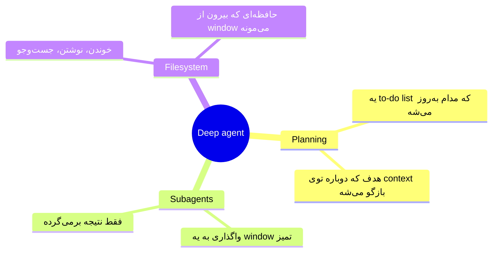
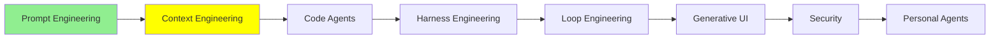

# Context Engineering

[Prompt Engineering](prompt_engineering_fa.md) درباره‌ی این بود که یه ورودی خوب بنویسی. این ماژول درباره‌ی همه‌ی چیزهای دیگه‌ای حرف می‌زنه که جلوی مدل قرار می‌گیرن. و یه مشکل اصلی هم داره: جا برای همه‌ی این‌ها کافی نیست.

بعد از prompt engineering، context engineering اومد. این اصطلاح اواخر 2025 ترند شد. توی این ماژول می‌بینیم که از کجا اومد، چطور رشد کرد، و کدوم تکنیک‌هاش ارزش یاد گرفتن دارن.

## ظهور Context Engineering

اون موقع، همه‌ی بحث سر اندازه بود. آدم‌ها دنبال مدل‌هایی با context window بزرگ‌تر بودن. برای همین مدام بیشتر و بیشتر بهش می‌دادن، چون context بیشتر واقعاً جواب بهتری می‌داد.

اگه تا حالا یه session طولانی با یه coding agent کار کرده باشی، این حس رو می‌شناسی. ایده می‌دی، طراحی می‌کنی، این‌ور و اون‌ور می‌ری. بعد یهو، بی‌هیچ هشداری، می‌بینی 95 درصد window پر شده. چون context بیشتر کمک کرده بود، آدم‌ها هم مدام مطلب اضافه رو به prompt‌هاشون می‌چسبوندن. همین باعث شد window سریع‌تر از همیشه پر بشه.

خب، وقتی تاریخچه از window بزرگ‌تر می‌شد، سیستم‌ها چی‌کار می‌کردن؟ بیشترشون از **sliding window** استفاده می‌کردن. فرض کن مدل جا برای 1M توکن داره، ولی تاریخچه‌ت به 1.4M رسیده. window می‌ره جلو و مدل فقط 1M آخر رو می‌بینه، یعنی از 0.4M تا 1.4M. اون 0.4M اول دیگه وجود نداره.

این از چیزی که به نظر می‌رسه بدتره. همین که از حد رد بشی، باید *قدیمی‌ترین* context رو دور بریزی. و معمولاً همون جاییه که توضیح داده بودی می‌خوای چی‌کار کنی. پس تفاهمی که با مدل ساخته بودی، اولین چیزیه که سیستم دور می‌ریزه. آخرش خودت می‌مونی و باید prompt‌های قبلی‌ت رو دستی دوباره توی چت کپی کنی، تا به مدل یادآوری کنی کار چی بوده.

## Context Rot (Pollution)

درحالی‌که همه دنبال راه فرار از window پر می‌گشتن، تیم Chroma این مقاله رو منتشر کرد: [Context Rot: How Increasing Input Tokens Impacts LLM Performance](https://www.trychroma.com/research/context-rot). یافته‌شون خیلی غافلگیرکننده بود: **هرچی context بزرگ‌تر بشه، کار مدل بدتر می‌شه.**

اون‌ها 18 مدل رو تست کردن، از جمله GPT-4.1، Claude 4 و Gemini 2.5، و الگو توی همه‌شون یکی بود. با همون مدل و همون کار، وقتی 25K توکن توی context داره، به‌طور محسوسی بهتر کار رو انجام می‌ده، نسبت به وقتی 800K توکن داره. دلیلش این نیست که window سرریز شده باشه. دلیلش چیزیه که قبلاً توش بوده.

  
*سه چیزی که مدل بهش نیاز داره، توی هر دو ظرف هست. سمت راست، این سه تا هنوز اون‌جان و هنوز قابل خوندن، ولی گم شدن. بقیه‌ی چیزهای داخل ظرف هم برای همون attention رقابت می‌کنن.*

آدم‌ها برای این اثر دو اسم به کار می‌برن: **context rot** و **context pollution**. نوشته‌ی Drew Breunig با عنوان [How Long Contexts Fail](https://www.dbreunig.com/2025/06/22/how-contexts-fail-and-how-to-fix-them.html) یه قدم جلوتر می‌ره. اون نوشته چهار حالت مشخص رو اسم می‌بره که این اتفاق به‌خاطرشون می‌افته: poisoning، distraction، confusion و clash.

دلیلش **attention** ه. attention مکانیزمیه که مدل باهاش تصمیم می‌گیره کدوم بخش‌های ورودی برای توکنی که می‌خواد بنویسه مهمه. تئوری‌ش رو این‌جا باز نمی‌کنیم، و فقط نتیجه‌ش رو لازم داری: attention یه بودجه‌ی ثابته، و مدل اون رو بین همه‌ی چیزهای داخل window تقسیم می‌کنه. آدم هم همین‌طوری کار می‌کنه، فقط می‌تونه چند تا چیز رو همزمان توی ذهنش نگه داره، نه بیشتر، و مغز agent‌ت هم فرقی نداره. اگه context رو با یه عالمه مطلب پر کنی که کم‌وبیش به هم ربط دارن، همون باری رو می‌کشه که یه آدم می‌کشه، و همون اشتباه‌ها رو هم می‌کنه.

یه نکته رو خوب دقت کن، چون همون چیزیه که آدم‌ها اشتباه می‌فهمنش: این ماجرا «پر شدن window» نیست. افت کارایی خیلی پیش از رسیدن به سقف شروع می‌شه. یه window که 40 درصدش پره، ممکنه همین الان جواب بدتری بده تا همون window وقتی فقط 5 درصد پره.

ببین توی عمل این حس چطوریه. یه session طولانی باز می‌کنی تا یه کتاب بنویسی. اول به مدل می‌گی با لحن علمی و روشن بنویسه. یه مدت هم همین کار رو می‌کنه. ولی یه جایی بعد از 800K، دیگه نمی‌کنه: لحن کم‌کم می‌ره سمت یه چیز مبهم و پرحرف، و مدل شروع می‌کنه به درآوردن مطلب. هیچی پاک نشده بود و window هم هیچ‌وقت سرریز نشده بود، و دستور هنوز اون بالاست. ولی سهمش از attention باید با هر چیزی که بعدش اضافه کردی رقابت می‌کرد، و باخت. مدل نقشه رو گم کرده.

  
*سؤال، توصیه‌ی یه همکلاسی رو می‌خواد، و سوزن همون جوابه. حواس‌پرت‌کن هم همون جمله‌ست، با این تفاوت که این بار درباره‌ی یه استاده. Chroma دید که یه حواس‌پرت‌کن هم برای خراب کردن جواب کافیه. همچنین دید که هرچی سوزن کمتر شبیه سؤال باشه، کارایی وقتی انبار کاه بزرگ‌تر می‌شه سریع‌تر فرو می‌ریزه.*

اسم اون تست رو زیاد می‌شنوی: **needle in a haystack**. نسخه‌ای که بالا دیدی، سخت‌تره. نسخه‌ی آسون یه عبارت دقیق رو توی متن قایم می‌کنه و ازت می‌خواد همون رو برگردونی. مدل‌ها تقریباً بی‌نقص این کار رو انجام می‌دن. سهم Chroma این بود که چیزی رو قایم کنن که برای پیداکردنش باید *استدلال* کنی، و کنارش جمله‌های غلطی بذارن که تقریباً درست به نظر می‌رسن.

از دل همه‌ی این ماجرا، یه سری روش بیرون اومد که یه اسم هم روشون گذاشتن.

## Context Engineering چیست؟

Context engineering به یه سؤال جواب می‌ده: **چی باید وارد context بشه، و چی باید بیرونش نگه داشته بشه؟**

window محدوده، پس یه چیزی باید تصمیم بگیره. یه دنیای همیشه در حال بزرگ‌شدن از چیزهایی هست که می‌تونن وارد window بشن. Context engineering یه ترکیبی از هنر و علمه برای انتخاب اینکه واقعاً کدومشون وارد بشن. هدف اینه که توکن‌های حامل سیگنال واقعی زیاد باشن، و توکن‌های نویز تا جایی که می‌شه کم باشن، تا context پوسیده نشه.

  
*سمت چپ یه نوبت و یه تصمیم داریم، یعنی همون [Prompt Engineering](prompt_engineering_fa.md). سمت راست یه دنیا از چیزهاییه که می‌تونن توی window بیان، و تصمیمی درباره‌ی اینکه واقعاً کدومشون بیان. این تصمیم توی هر نوبت دوباره گرفته می‌شه.*

اصطلاح بعد از یه [پست از Andrej Karpathy](https://x.com/karpathy/status/1937902205765607626) توی اواسط 2025 ترند شد. کامل‌ترین بررسی رو Anthropic توی [Effective context engineering for AI agents](https://www.anthropic.com/engineering/effective-context-engineering-for-ai-agents) ارائه داد. اون‌ها context engineering رو این‌طور تعریف می‌کنن: «the set of strategies for curating and maintaining the optimal set of tokens during LLM inference». Philipp Schmid توی [The New Skill in AI is Not Prompting, It's Context Engineering](https://www.philschmid.de/context-engineering) همین ایده رو مثل یه شرح شغلی توضیح داده: به مدل اطلاعات و ابزار درست رو، توی فرمت درست و توی زمان درست بده. LangChain تکنیک‌ها رو زیر چهار فعل دسته‌بندی می‌کنه: write، select، compress و isolate. این دسته‌بندی رو می‌تونی توی [Context Engineering](https://www.langchain.com/blog/context-engineering-for-agents) و همچنین توی [Context Engineering for Agents](https://rlancemartin.github.io/2025/06/23/context_engineering/) نوشته‌ی Lance Martin پیدا کنی.

حالا تکنیک‌هایی رو ببینیم که الان ارزش یاد گرفتن دارن.

## خلاصه‌کردن context (Compaction)

این ساده‌ترین تکنیکه. وقتی context بلند می‌شه، خودش رو با یه خلاصه از خودش عوض می‌کنی. این‌جوری 800K توکن از گفت‌وگو می‌شه 20K توکن که می‌گه: «این رو تصمیم گرفتیم، این هنوز خرابه، و الان دقیقاً به اینجا رسیدیم.»

الان بیشتر agent‌ها وقتی به سقف نزدیک می‌شن، خودشون این کار رو انجام می‌دن. بعضی‌هاشون هم بهت اجازه می‌دن خودت شروعش کنی. توی Claude Code کافیه `/compact` رو تایپ کنی، و همون لحظه انجام می‌شه.

  
*به چیزی که نگه داشته می‌شه و چیزی که نمی‌شه دقت کن. خروجی ابزارها بیشترین جای window رو گرفته و قراره دور ریخته بشه. خلاصه تصمیم‌ها رو نگه می‌داره. چند تا فایل اخیر هم می‌مونن، چون agent بلافاصله دوباره می‌خونه‌شون. بلوکی که رزرو شده و توی پایین تصویر می‌بینی، فضاییه که agent برای خلاصه‌سازی خودش نگه می‌داره. این‌جوری هیچ‌وقت با window پر و بدون جا برای نوشتن گیر نمی‌کنه.*

هزینه‌ش واقعیه و ارزش داره صاف و پوست‌کنده بگم. خلاصه خروجی 40,000 توکنی یه دستور ترمینال رو دور می‌ریزه که دیگه کسی بهش نیاز نداره، و همین هم هدفه. ولی ممکنه چیزی رو هم دور بریزه که لازمش داشتی، و این می‌تونه کاملاً تصادفی باشه. یا ممکنه این‌جوری بشه که کسی یا چیزی که خلاصه رو نوشته، تشخیص بده اون چیز مهم نیست، و اشتباه کنه. دقیقاً به همین دلیل، راهنمایی خود Anthropic درباره‌ی compaction می‌گه تصمیم‌های معماری، باگ‌های حل‌نشده و جزئیات پیاده‌سازی رو نگه دار.

## Context Offloading (ذخیره روی فایل)

به‌جای اینکه چیزی رو توی context نگه داره، agent اون رو جایی می‌نویسه که بعداً بتونه بخونه‌ش. معمولاً اون جا یه فایل markdown ه. اطلاعات مهم از window بیرون می‌رن و روی دیسک زندگی می‌کنن. وقتی واقعاً لازمشون داشته باشه، agent دوباره برشون می‌داره.

تیم Manus درباره‌ی این موضوع توی [Context Engineering for AI Agents: Lessons from Building Manus](https://manus.im/blog/Context-Engineering-for-AI-Agents-Lessons-from-Building-Manus) نوشته. اون‌ها این کار رو استفاده از file system به‌عنوان context توصیف می‌کنن. file system ذاتاً حجمش نامحدوده و ماندگاره، و agent می‌تونه مستقیم باهاش کار کنه.

خیلی از agent‌ها این کار رو توی یه قابلیت به اسم **long-term memory** می‌ذارن. این یه فهرست از چیزهاییه که ارزش نگه‌داشتن دارن. پس حتی بعد از خلاصه‌شدن context، اطلاعات از بین نمی‌رن و agent هنوز می‌تونه توشون جست‌وجو کنه.

همون هشداری که توی خلاصه‌سازی گفتیم اینجا هم صدق می‌کنه، و ریشه‌ش هم همونه. تصمیم اینکه چی ارزش نگه‌داشتن داره، یه جور قضاوته، و این قضاوت یا از خودت میاد یا از مدل، و هر دوشون ممکنه اشتباه کنن. از دست دادن یه چیز باارزش به این شکل خیلی رایجه، نه کمیاب.

[Memory](../1_fundamentals/memory_fa.md) حافظه رو به سه نوع تقسیم کرد: parametric، working و long-term. ما الان درباره‌ی همون نوع سوم حرف می‌زنیم، و توی عمل معمولاً این حافظه به سه دسته‌ی زیر تقسیم می‌شه:

  
*تقسیم‌بندی مهمه، چون agent این سه تا رو توی زمان‌های متفاوتی می‌نویسه و می‌خونه. اطلاعات درباره‌ی تو آروم‌آروم و توی طول زمان جمع می‌شن. کارهای گذشته هم کمک می‌کنن agent یه اشتباه رو دوباره تکرار نکنه. و لایه‌ی instructions، همون system prompt از [Tool Calling](../1_fundamentals/tools_fa.md) هست، فقط با یه اسم دیگه.*

## Knowledge Base، جایی که agent می‌تونه بگرده

بعضی اطلاعات واقعاً باارزشن و زیاد عوض نمی‌شن، مثل اینکه API داخلی شرکتت چطور کار می‌کنه. اون‌ها رو توی هر prompt کپی نکن. بذارشون جایی که agent بتونه بره و بگرده: یه پوشه پر از فایل markdown که بتونه بخونه و توشون جست‌وجو کنه.

بعد، وقتی agent تشخیص بده به مستنداتت نیاز داره، اون رو بازیابی می‌کنه. فقط بخشی رو که مهمه می‌خونه، و همون‌قدر رو توی context یاد می‌گیره. بازیابی می‌تونه RAG کامل از [RAG و Embedding‌ها](../1_fundamentals/rag_fa.md) باشه، یا فقط اینکه agent فایل‌ها رو باز کنه. هرجور که باشه، جایگزینش این بود که کل مرجع API رو توی window بریزی و هزینه‌ش رو توی هر نوبت بدی.

یه ابزار هم اینجا ارزش شناختن داره. [DeepWiki](https://deepwiki.org/) برای یه ریپازیتوری GitHub یه wiki می‌سازه. فرض کن agent‌ت یه سؤال درباره‌ی ساختار داخلی یه کتابخونه داره، یعنی معماریش یا API‌ش. به‌جای اینکه خود ریپازیتوری رو بگرده و context رو با فایل‌های سورس پر کنه، می‌تونه نوشته‌ی DeepWiki رو بخونه.

## جداسازی context

این مثال این موضوع رو خیلی روشن نشون می‌ده.

فرض کن coding agent‌ت باید بهت بگه یه ریپازیتوری از چه معماری‌ای استفاده می‌کنه. ریپازیتوری یه میلیون خط کد داره. برای جواب دادن، agent باید کلی فایل باز کنه. فرض کن این کار 800K توکن context خرج برداره، و جواب هم فقط یه جمله باشه: «the system orchestrates an event-driven microservices fabric, blending distributed Kafka streams with real-time geospatial processing». یعنی 800K توکن context خرج کردی تا یه جمله بگیری. و حالا اون 800K توی window نشسته و هر چیزی رو که بعدش میاد کم‌کم خراب می‌کنه.

راه‌حل اینه که اصلاً خوندن رو توی اون context انجام ندی. agent اصلی یه agent دوم رو صدا می‌زنه که context خالی خودش رو داره، و این یکی یه **subagent** ه که اون گشتن 800K توکنی رو انجام می‌ده. همه‌چیز رو دور می‌ریزه به‌جز نتیجه، و همون یه جمله رو برمی‌گردونه. context agent اصلی فقط یه جمله بیشتر پیدا می‌کنه.

  
*هر جعبه یه context جداست. خالی شروع می‌شه و وقتی کار تموم شد دور ریخته می‌شه. agent اصلی مراحل میانی رو هیچ‌وقت نمی‌بینه، و نکته‌ش همین‌جاست: چیزی که نمی‌بینه نمی‌تونه window رو خراب کنه.*

**طرز کارش.** subagent یه agent تازه با context تمیزه. agent اصلی اون رو درست مثل هر ابزار دیگه‌ای صدا می‌زنه، مثلاً با چیزی شبیه `Task("find out what architecture this repo uses")`. از نگاه [Tool Calling](../1_fundamentals/tools_fa.md) هیچ چیز جدیدی اتفاق نمی‌افته: یه ابزار صدا زده شده و یه نتیجه‌ی ابزار برگشته. subagent یه loop خودش رو اجرا می‌کنه و همه‌ی مراحل میانی رو پنهون می‌کنه. بعد جواب نهایی رو به‌عنوان همون نتیجه‌ی ابزار برمی‌گردونه. Anthropic گزارش می‌ده این خلاصه‌ها معمولاً حدود 1,000 تا 2,000 توکن می‌شن.

agent‌های امروزی subagent‌ها رو یکی‌یکی یا هم‌زمان صدا می‌زنن. این باعث می‌شه agent اصلی آزاد بمونه تا کاری رو بکنه که واقعاً توش خوبه: نگه داشتن برنامه و تصمیم گرفتن درباره‌ی مرحله‌ی بعد.

## برنامه‌ریزی صریح (TODO‌ها)

فرض کن از یه agent می‌خوای برات یه سایت پورتفولیو بسازه. یعنی همه‌ی این مرحله‌ها لازمه:

- تعریف محدوده‌ی کار
- انتخاب stack
- ساختن layout‌ها
- نوشتن محتوا توشون
- وصل کردن CMS
- تنظیم deployment

اگه agent همون اول شروع کنه به نوشتن کد، نقشه رو گم می‌کنه. یه مرحله رو یادش می‌ره، یا کلاً یه جای دیگه می‌ره. برای همین، اول برنامه رو می‌نویسه. برنامه یه to-do list ه، که هر آیتمش یه وضعیت داره:

```text
[x] Define the scope: one page, three projects, a contact form
[x] Choose the stack: Next.js, static export, no database
[~] Build the layouts: header and hero done, project grid in progress
[ ] Write the content in
[ ] Wire up a CMS
[ ] Configure deployment
```

بعد agent لیست رو یکی‌یکی جلو می‌بره. بعد از هر مرحله برمی‌گرده، کاری رو که تموم کرده علامت می‌زنه، و می‌ره سراغ بعدی. کار بزرگ حالا شده چندتا کار کوچیک، و یه سند نوشته‌شده هست که معلوم می‌کنه کدوم‌ها تمومن. پس هیچ‌چیز به حافظه‌ی agent بند نیست.

اثر دوم کمتر به چشم می‌آد، ولی مهم‌تره. هربار که agent اون لیست رو دوباره می‌خونه و بازنویسی می‌کنه، هدف رو دوباره وارد context تازه می‌کنه، و این کار مدام تکرار می‌شه. Manus اسمش رو گذاشته **manipulating attention through recitation**، یعنی دستکاری attention با بازگو کردن مدام. این مستقیم‌ترین جوابه به مشکل افت لحن علمی‌ای که بالاتر گفتیم. دستوری که هیچ‌کس تکرارش نمی‌کنه، سهمش از attention رو از دست می‌ده. ولی یه to-do list اون رو تکرار می‌کنه.

کلمه‌ی recitation رو یادت باشه. آخر همین ماژول دوباره برمی‌گرده، چون to-do list تنها چیزی نیست که این کار رو می‌کنه.

**طرز کارش.** agent‌های امروزی این رو به‌صورت یه ابزار داخلی ارائه می‌کنن. اگه agent‌ت چنین ابزاری نداشت ولی به یه filesystem دسترسی داشت، می‌تونست یه فایل markdown نگه داره و همون نتیجه رو بگیره.

> **نکته:** اینا همه‌ی تکنیک‌ها نیستن. [Advanced Context Engineering](../3_expert/advanced_context_engineering.md) اون‌هایی رو پوشش می‌ده که سخت‌ترن، به‌خصوص برای کارهای نرم‌افزاری.

## Deep Agent‌ها

**Deep agent‌ها** یه معماری برای agent‌ان که توی همین مدت خیلی محبوب شد. لازم نیست همه‌ی تکنیک‌های بالا رو خودت دستی توی agent‌ت پیاده کنی. deep agent شکلیه که همه‌شون رو کنار هم جمع می‌کنه. چند تا معماری هستن که ارزش شناختن دارن، و [Advanced Agent Architectures](../3_expert/advanced_agent_architectures.md) همه‌شون رو پوشش می‌ده. این یکی به این ماژول مربوطه، چون context engineering‌ه که تبدیل شده به یه طراحی.

برای اینکه یه agent deep حساب بشه، حداقل این‌ها رو لازم داره:



Philipp Schmid توی [Agents 2.0: From Shallow Loops to Deep Agents](https://www.philschmid.de/agents-2.0-deep-agents) یه چیز چهارم هم اضافه می‌کنه: یه system prompt خیلی بلند و خیلی مشخص. گاهی طولش به هزارها توکن می‌رسه. بهش می‌گه کی برنامه‌ریزی کنه، کی یه subagent راه بندازه، و فایل‌هاش رو چطور مرتب کنه. NVIDIA هم توی [What Is a Deep Agent?](https://www.nvidia.com/en-us/glossary/deep-agents/) همین معماری رو با همین اصطلاحات توضیح می‌ده. ممکنه کل این ایده رو با اسم **Agents 2.0** هم بشنوی. این فقط همون چیزه با اسم دیگه، و این اسم فاصله‌ی این ایده رو با loop ساده‌ی [AI Agents](../1_fundamentals/agents_fa.md) اون‌طور که واقعاً هست نشون می‌ده. و [The Agent 2.0 Era: Mastering Long-Horizon Tasks with Deep Agents](https://medium.com/@amirkiarafiei/the-agent-2-0-era-mastering-long-horizon-tasks-with-deep-agents-part-3-745705e13b16) کل ماجرا رو از اول تا آخر توضیح می‌ده.

اگه بخوای یکی بسازی، ساده‌ترین جا برای شروع [deepagents](https://github.com/langchain-ai/deepagents) از LangChain هست. خودش رو یه agent harness با همه‌ی لوازم آماده معرفی می‌کنه. اون «لوازم» دقیقاً همین لیسته:

- planning
- یه filesystem که می‌شه عوضش کرد
- subagent‌هایی با window جدا
- خلاصه‌سازی thread‌های طولانی

مستندات همه‌ش توی [Deep Agents overview](https://docs.langchain.com/oss/python/deepagents/overview) هست.

مزیت واقعیش اینه: یه deep agent بیشتر کار context engineering رو به‌جات انجام می‌ده. خلاصه‌سازی می‌کنه، به فایل منتقل می‌کنه، واگذار می‌کنه، برنامه‌ریزی می‌کنه. لازم نیست هیچ‌کدومش رو خودت راه‌اندازی کنی. بعضی تکنیک‌ها هنوز به آدم نیاز دارن، و اون‌ها مسئله‌ی ماژول پیشرفته‌ان.

و این نکته رو هم ببین: بیشتر agent‌هایی که الان استفاده می‌کنی، خودشون deep agent هستن. Claude Code، Codex، Copilot و OpenCode همه‌شون planning، subagent و filesystem دارن.

## کارهای Long-horizon

وقتی همه‌ی این‌ها رو کنار هم بذاری، یه چیز تازه پیدا می‌شه: agent‌هایی که ساعت‌ها کار می‌کنن، بی‌اینکه کسی بالای سرشون باشه.

احتمالاً دیدی یکی با یه prompt تنها، یه سایت کامل یا یه بازی که واقعاً کار می‌کنه گرفته، و به این کارها می‌گن **long-horizon tasks**. این کارها به‌خاطر تکنیک‌های همین ماژول ممکن شدن. یه agent رو تصور کن که همه‌ی این کارها رو بلده:

- یه کار بزرگ رو به مرحله‌های کوچیک بشکنه
- اون مرحله‌ها رو برنامه‌ریزی کنه
- یادداشت‌های خودش رو بنویسه
- چیزهایی رو که لازمش نیست از context بیرون بذاره
- برای بخش‌های پرهزینه یه subagent راه بندازه
- context خودش رو خلاصه کنه

این agent می‌تونه خیلی دیرتر از جایی که قبلاً گم می‌شد، هنوز سر کار باشه.

یه اندازه‌گیری واقعی هم هست که نشون می‌ده این‌ها تا کجا پیش رفتن، و از حرف‌های بازاریابی مفیدتره. مقاله‌ی METR با عنوان [Measuring AI Ability to Complete Long Software Tasks](https://arxiv.org/abs/2503.14499) یه سؤال ساده می‌پرسه. کارهایی رو در نظر بگیر که یه مدل تقریباً نصف مواقع تمومشون می‌کنه. اون کارها یه آدم چقدر طول می‌کشه؟ به این عدد می‌گن **time horizon** مدل. وقتی مقاله منتشر شد، Claude 3.7 Sonnet حدود 50 دقیقه کار آدمی رو انجام می‌داد. از 2019 به این‌طرف، تقریباً هر هفت ماه، خط روند دو برابر شده. اگه این خط رو ادامه بدی، کارهایی که یه ماه طول می‌کشن تا پنج سال دیگه می‌رسن. METR [آخرین عددها](https://metr.org/time-horizons/) رو برای هر مدل پیشرفته، با موفقیت 50 و 80 درصد، روی یه نمودار نگه می‌داره. اون نمودار راه درست خوندن ادعاییه که می‌گه یه agent «شش ساعت کار کرده».

Long-horizon کلیدواژه‌ی سال 2026 شده، و همه‌ی شرکت‌ها دنبالش هستن. دنبالش هستن چون فرق بین یه agent که بهت کمک می‌کنه کار کنی، و یه agent که خودش کار رو انجام می‌ده، همین‌جاست. اگه نقشه‌ی کل تحقیقات رو می‌خوای، نه فقط تیتر خبرها، یه سر برو به [Awesome-Long-Horizon-Agents](https://github.com/RUC-NLPIR/Awesome-Long-Horizon-Agents). این یه لیست مطالعه‌ست که به‌روز نگه داشته می‌شه. کل این حوزه رو به دو بخش تقسیم می‌کنه: چیزهایی که دور مدل می‌سازی، و چیزهایی که توی خود مدل عوض می‌کنی.

## Chain of Thought به‌عنوان ابزار Context Engineering

یه چیز آخر مونده، و درست بین همین ماژول و ماژول قبلی قرار می‌گیره.

Chain of thought از [Prompt Engineering](prompt_engineering_fa.md) فقط یه جواب رو بهتر نمی‌کنه. یه session طولانی رو هم روی مسیر نگه می‌داره. وقتی مدل استدلالش رو می‌نویسه، هدف رو برای خودش تکرار می‌کنه. کتابی رو در نظر بگیر که از لحن علمی‌ش فاصله گرفته بود. وقتی reasoning روشن باشه، ردپای استدلال توی همون نقطه از session تقریباً این شکلیه:

```text
<thinking>
The user wants section 8, which is about slang in American society. Before I
start: their instruction from the beginning of this project was a clear academic
tone throughout, and that has not been withdrawn. The subject is informal, but
the treatment of it should not be. Academic register, slang only as quoted
examples.
</thinking>
```

هیچی بازیابی نشد، و چیزی هم به window اضافه نشد. مدل دستور رو دوباره توی context اخیر خودش نوشت، یعنی جایی که attention کمترین هزینه رو داره.

همین کاریه که to-do list هم می‌کنه، و به همین خاطر یادآوری کلمه‌ی recitation ارزش داشت. هر دو تکنیک با **گفتن دوباره‌ی چیز مهم، نزدیک جایی که مدل می‌خواد بنویسه** کار می‌کنن. to-do list برنامه رو بازگو می‌کنه، و chain of thought محدودیت رو بازگو می‌کنه. attention می‌ره سراغ چیزی که نزدیک و تکرارشده باشه. پس اگه می‌خوای مدل حتی توی 800K توکن هنوز به یه چیزی اهمیت بده، یه جایی باید اون چیز تکرار بشه. اگه ولش کنی، کم‌کم محو می‌شه. این همون کاریه که chain of thought به‌عنوان یه ابزار context engineering انجام می‌ده. ضمناً ارزون‌ترین ابزار این ماژوله: لازم نیست خودت بسازیش، فقط روشنش می‌کنی.

## کجای این مجموعه هستیم



## خلاصه

context window محدوده، و کیفیتش پیش از پر شدن افت می‌کنه. context بیشتر جواب رو بدتر می‌کنه، و این درست برعکس چیزیه که همه توی 2025 فکر می‌کردن. دلیلش اینه که attention یه بودجه‌ی ثابته که بین هرچی توی window هست تقسیم می‌شه.

Context engineering یعنی تصمیم بگیری چی حق داره توی اون جای محدود بمونه. همه‌ی تکنیک‌ها نسخه‌های یه حرکت‌ان: توکن‌ها رو از window بیرون ببر، و یه راه برگشت به‌شون نگه دار.

- تاریخچه رو خلاصه کن.
- اطلاعات رو به فایل منتقل کن.
- مستندات رو جایی بذار که agent بتونه بره و بخونه‌شون.
- کارهای پرهزینه رو به یه subagent با window جدا بسپار.
- یه to-do list نگه دار که هدف رو دوباره وارد context اخیر کنه.

یه deep agent یه agent‌ه که بیشتر این کارها رو به‌جات انجام می‌ده. برای همین، coding agent‌هایی که هر روز ازشون استفاده می‌کنی، از الان deep agent هستن.

قدم بعد: خود coding agent‌ها، و شش راهی که می‌تونی یکی‌شون رو گسترش بدی.

**بررسی سریع**: چرا یه مدل پیش از پر شدن window بدتر می‌شه؟ و subagent در عمل چه دردسری رو از سرت باز می‌کنه؟

## منابع

- [Context Rot: How Increasing Input Tokens Impacts LLM Performance](https://www.trychroma.com/research/context-rot): مطالعه‌ی Chroma که همه‌ی این ماجرا ازش شروع شد، با 18 مدل و آزمایش‌های needle و distractor
- [How Long Contexts Fail](https://www.dbreunig.com/2025/06/22/how-contexts-fail-and-how-to-fix-them.html): چهار شکست نام‌گذاری‌شده‌ی Drew Breunig، از یه hallucination قدیمی که مدام نقل می‌شه تا اطلاعات تازه‌ای که با قدیمی تناقض داره
- [Effective context engineering for AI agents](https://www.anthropic.com/engineering/effective-context-engineering-for-ai-agents): کامل‌ترین بررسی، و منبع راهنمایی‌های compaction و subagent
- [The New Skill in AI is Not Prompting, It's Context Engineering](https://www.philschmid.de/context-engineering): کوتاه‌ترین تعریف خوب
- [Context Engineering](https://www.langchain.com/blog/context-engineering-for-agents): چهار فعل (write، select، compress و isolate)
- [Context Engineering for Agents](https://rlancemartin.github.io/2025/06/23/context_engineering/): همون چهار تا، با نمودارهایی که ارزش استفاده‌ی دوباره دارن
- [Karpathy on context engineering](https://x.com/karpathy/status/1937902205765607626): پستی که این اصطلاح رو جلوی چشم همه گذاشت
- [Context Engineering for AI Agents: Lessons from Building Manus](https://manus.im/blog/Context-Engineering-for-AI-Agents-Lessons-from-Building-Manus): درس‌های عملی از تجربه‌ی واقعی، به‌خصوص درس‌های مربوط به filesystem و recitation
- [Stop stuffing your context window (here's why)](https://youtube.com/shorts/9P36wMntNSI): نسخه‌ی کوتاه، اگه ترجیح می‌دی ویدیو ببینی
- [DeepWiki](https://deepwiki.org/): یه wiki برای هر ریپازیتوری، تا agent‌ت به‌جای خوندن کد، درباره‌ش بخونه
- [Agents 2.0: From Shallow Loops to Deep Agents](https://www.philschmid.de/agents-2.0-deep-agents): اینکه چی یه agent رو deep می‌کنه، و چرا این یه معماریه نه یه ویژگی
- [What Is a Deep Agent?](https://www.nvidia.com/en-us/glossary/deep-agents/): همون تعریف، ساده گفته شده
- [The Agent 2.0 Era: Mastering Long-Horizon Tasks with Deep Agents](https://medium.com/@amirkiarafiei/the-agent-2-0-era-mastering-long-horizon-tasks-with-deep-agents-part-3-745705e13b16): همون معماری، از اول تا آخر توضیح داده شده
- [deepagents](https://github.com/langchain-ai/deepagents): کتابخونه، و [Deep Agents overview](https://docs.langchain.com/oss/python/deepagents/overview) که مستندش هست
- [Measuring AI Ability to Complete Long Software Tasks](https://arxiv.org/abs/2503.14499): منبع عدد time horizon و روند دو برابر شدن
- [Task-completion time horizons](https://metr.org/time-horizons/): عدد فعلی هر مدل، به‌روز نگه داشته می‌شه
- [Awesome-Long-Horizon-Agents](https://github.com/RUC-NLPIR/Awesome-Long-Horizon-Agents): نقشه‌ی تحقیقات، مرتب‌شده، اگه بخوای عمیق‌تر از این ماژول بری
- [Advanced Context Engineering](../3_expert/advanced_context_engineering.md): تکنیک‌هایی که این ماژول کنار گذاشت
