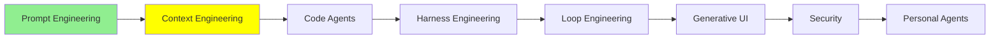

# Context Engineering

درس [Prompt Engineering](prompt_engineering_fa.md) درباره‌ی نوشتن یه ورودی خوب بود. این درس درباره‌ی بقیه‌ی چیزهاییه که جلوی مدل گذاشته می‌شه، و مشکل اصلی‌ش هم اینه که برای همه‌ی این‌ها جا کم میاد.

بعد از prompt engineering نوبت context engineering رسید که اواخر 2025 حسابی سر زبون‌ها افتاد. این‌جا می‌بینیم از کجا شروع شد، چطور جا افتاد و کدوم تکنیک‌هاش ارزش یاد گرفتن دارن.

## Context Engineering از کجا اومد

اون موقع همه‌ی بحث‌ها سر اندازه بود. همه دنبال مدل‌هایی بودن که context window بزرگ‌تری داشته باشن، و هی بیشتر و بیشتر به مدل خوراک می‌دادن، چون context بیشتر واقعاً نتیجه‌ی بهتری می‌داد.

اگه تا حالا یه session طولانی با یه coding agent کار کرده باشی، این حس رو خوب می‌شناسی: ایده می‌دی، طراحی می‌کنی، با مدل کلی بحث و رفت‌وبرگشت داری، و یهو بی‌خبر می‌بینی 95 درصد window پر شده. چون context بیشتر کمک می‌کرد، آدم‌ها هم مدام چیزهای اضافه‌تری توی prompt‌هاشون می‌ریختن، و همین باعث می‌شد window از همیشه زودتر پر بشه.

حالا وقتی پیام‌ها روی هم انباشته می‌شد و از window بیشتر می‌شد، سیستم‌ها چیکار می‌کردن؟ بیشترشون از **sliding window** استفاده می‌کردن. فرض کن مدل جا برای 1M token داره و history‌ت به 1.4M رسیده. window سُر می‌خوره جلو و مدل فقط 1M آخر رو می‌بینه، یعنی از 0.4M تا 1.4M، و اون 0.4M اول کلاً از دست می‌ره.

این بدتر از اونیه که فکر می‌کنی. همین که از سقف رد بشی، باید *قدیمی‌ترین* context رو بیرون بریزی، که معمولاً همون‌جاییه که توضیح داده بودی دنبال چی هستی. یعنی اون درک مشترکی که با مدل ساخته بودی، اولین چیزیه که سیستم دور می‌ریزه، و آخرش خودت می‌مونی که باید prompt‌های قبلی‌ت رو دستی دوباره کپی کنی تا یادش بیاد اصلاً کار چی بود.

## Context Rot (Pollution)

وقتی همه دنبال راهی بودن که از دست window پر خلاص بشن، تیم Chroma مقاله‌ی [Context Rot: How Increasing Input Tokens Impacts LLM Performance](https://www.trychroma.com/research/context-rot) رو منتشر کرد، با نتیجه‌ای که همه رو غافلگیر کرد: **هر چی context بزرگ‌تر بشه، مدل توی انجام کار ضعیف‌تر می‌شه.**

18 تا مدل رو تست کردن، از جمله GPT-4.1، Claude 4 و Gemini 2.5، و الگو توی همه‌شون یکی بود. یه کار مشخص رو به یه مدل بدی، با 25K token توی context به‌وضوح بهتر انجامش می‌ده تا با 800K. مشکل هم این نیست که window سرریز شده؛ مشکل چیزهاییه که از قبل توش بوده.

  
*اون سه چیزی که مدل لازم داره، توی هر دو ظرف هست. سمت راست هم هنوز سر جاشونن و هنوز هم می‌شه خوندشون، ولی با این حال گم شدن، چون هر چیز دیگه‌ای که توی ظرفه، سر همون attention باهاشون رقابت می‌کنه.*

به این پدیده دو تا اسم می‌گن: **context rot** و **context pollution**. نوشته‌ی [How Long Contexts Fail](https://www.dbreunig.com/2025/06/22/how-contexts-fail-and-how-to-fix-them.html) از Drew Breunig یه قدم جلوتر می‌ره و چهار شکل مشخص ازش رو اسم می‌بره: poisoning، distraction، confusion و clash.

ریشه‌ی ماجرا چیزیه به اسم **attention**، یعنی مکانیزمی که مدل باهاش تصمیم می‌گیره برای token‌ی که الان می‌خواد بنویسه، کدوم قسمت‌های ورودی مهم‌ترن. وارد تئوری‌ش نمی‌شیم، چون فقط نتیجه‌ش به کارت میاد: attention یه بودجه‌ی ثابته که مدل بین همه‌ی چیزهای توی window پخشش می‌کنه. آدم هم همین‌طوره؛ هم‌زمان فقط چند تا چیز رو می‌تونی توی ذهنت نگه داری، نه بیشتر. مدلی که مغز agent‌ته هم فرقی نداره. اگه context‌ش رو با یه عالمه مطلب پر کنی که فقط یه کم به هم ربط دارن، همون فشاری رو تحمل می‌کنه که یه آدم می‌کنه، و همون جور اشتباه‌ها رو هم می‌کنه.

یه نکته رو دقت کن، چون همون‌جاییه که خیلی‌ها اشتباه می‌کنن: این قضیه با «پر شدن» window فرق داره. کیفیت خیلی قبل از اینکه به سقف برسی، شروع می‌کنه به افت کردن، و یه window که 40 درصدش پره، ممکنه همین حالا جواب‌های بدتری بده تا همون window وقتی 5 درصدش پر بود.

توی عمل این‌جوری حسش می‌کنی: یه session طولانی باز می‌کنی که یه کتاب بنویسی و همون اول به مدل می‌گی با لحن علمی و روشن بنویسه. یه مدت هم همین کار رو می‌کنه، ولی یه جایی بعد از 800K دیگه نمی‌کنه؛ لحن کم‌کم مبهم و خودمونی و پرحرف می‌شه و مدل شروع می‌کنه از خودش چیز درآوردن. هیچی پاک نشده، window هم هیچ‌وقت سرریز نشده و اون دستور هنوز همون‌جاست، ولی سهمش از attention مجبور بوده با هر چیزی که بعدش اضافه کردی رقابت کنه، و کم آورده. رشته‌ی کار از دست مدل در رفته، یعنی دیگه دنبال هدفی که اول کار بهش داده بودی نیست.

  
*سوال دنبال توصیه‌ی هم‌کلاسیه و سوزن همون جوابه. جمله‌ی گمراه‌کننده (distractor) همون جمله‌ست، فقط درباره‌ی یه استاد. Chroma دید که حتی یه دونه distractor هم کافیه که نتیجه رو خراب کنه، و اینکه هر چی سوزن کمتر شبیه سوال باشه، با بزرگ‌تر شدن انبار کاه کیفیت تندتر سقوط می‌کنه.*

اسم این تست رو زیاد می‌شنوی: **needle in a haystack**، همون سوزن توی انبار کاه خودمون. نسخه‌ای که بالا دیدی، نسخه‌ی سختشه. نسخه‌ی آسونش یه عبارت رو عیناً یه جای متن قایم می‌کنه و ازت می‌خواد همون رو پیدا کنی و برگردونی، و مدل‌ها این کار رو تقریباً بی‌نقص انجام می‌دن. کاری که Chroma کرد این بود که چیزی رو قایم کنه که برای پیدا کردنش باید *استدلال* کنی، و کنارش جمله‌های غلطی بذاره که تقریباً عین جواب درستن.

از دل همه‌ی این‌ها یه سری روش بیرون اومد، و یه اسم هم روشون گذاشتن.

## Context Engineering چیه؟

کل context engineering جواب به یه سواله: **چی باید بره توی context و چی باید بیرون بمونه؟**

window محدوده، پس یکی باید تصمیم بگیره. یه دنیای بی‌انتها از چیزهایی که می‌تونن برن توی window وجود داره که هر لحظه هم بزرگ‌تر می‌شه، و context engineering هنر و علمِ انتخاب اینه که کدومشون واقعاً برن تو. هدف اینه که تا جای ممکن token‌هایی داشته باشی که سیگنال واقعی دارن و تا جای ممکن کمتر نویز، تا context نپوسه.

  
*سمت چپ یه نوبت و یه تصمیمه، یعنی همون [Prompt Engineering](prompt_engineering_fa.md). سمت راست یه دنیا چیز هست که می‌تونن برن توی window، و یه تصمیم که کدومشون واقعاً برن، و این تصمیم توی تک‌تک نوبت‌ها از نو گرفته می‌شه.*

این اصطلاح اواسط 2025 بعد از یه [پست Andrej Karpathy](https://x.com/karpathy/status/1937902205765607626) معروف شد. کامل‌ترین توضیحش رو Anthropic توی [Effective context engineering for AI agents](https://www.anthropic.com/engineering/effective-context-engineering-for-ai-agents) داده و context engineering رو این‌طور تعریف کرده: «the set of strategies for curating and maintaining the optimal set of tokens during LLM inference»، یعنی مجموعه‌ی راهکارهایی برای اینکه موقع inference بهترین مجموعه‌ی token‌ها رو دست‌چین کنی و نگهش داری. Philipp Schmid توی [The New Skill in AI is Not Prompting, It's Context Engineering](https://www.philschmid.de/context-engineering) همین ایده رو مثل شرح وظایف یه شغل گفته: اطلاعات و tool درست رو، با فرمت درست و سر وقتش به مدل بده. LangChain هم تکنیک‌ها رو زیر چهار تا فعل دسته‌بندی می‌کنه، یعنی write، select، compress و isolate، که می‌تونی توی [Context Engineering](https://www.langchain.com/blog/context-engineering-for-agents) و توی [Context Engineering for Agents](https://rlancemartin.github.io/2025/06/23/context_engineering/) از Lance Martin ببینیشون.

حالا بریم سراغ تکنیک‌هایی که الان ارزش دونستن دارن.

## خلاصه کردن context (Compaction)

ساده‌ترینشون همینه: وقتی context طولانی شد، جاش یه خلاصه از خودش بذار. این‌جوری 800K token گفت‌وگو می‌شه 20K token از این جنس که «این‌ها رو تصمیم گرفتیم، این‌ها هنوز خرابه، این‌جا بودیم».

الان بیشتر agent‌ها وقتی به سقف نزدیک می‌شن، خودشون این کار رو می‌کنن و بعضی‌هاشون هم می‌ذارن خودت دستی شروعش کنی. توی Claude Code کافیه `/compact` رو بزنی تا همون لحظه انجام بشه.

  
*ببین چی می‌مونه و چی نمی‌مونه. نتیجه‌ی tool‌ها بیشتر window رو گرفتن و همین‌ها هم حذف می‌شن. تصمیم‌ها توی خلاصه می‌مونن. چند تا فایلی هم که تازه باز شده بودن نگه داشته می‌شن، چون agent الان دوباره سراغشون می‌ره. اون تیکه‌ی رزروشده‌ی پایین هم جاییه که agent برای خلاصه‌نویسی خودش کنار گذاشته، تا هیچ‌وقت با یه window پر و بی‌جا برای نوشتن گیر نیفته.*

ولی بی‌هزینه هم نیست و بهتره رک بگیم. خلاصه، خروجی 40,000 token‌ی یه دستور ترمینال رو که دیگه به کار هیچ‌کس نمیاد دور می‌ریزه، و هدف هم همینه. ولی ممکنه چیزی رو هم دور بریزه که لازمش داشتی؛ یا اتفاقی، یا چون هر کی یا هر چی خلاصه رو نوشته، فکر کرده اون چیز مهم نیست و اشتباه کرده. دقیقاً به همین خاطر، خود Anthropic توی راهنمایی‌ش درباره‌ی compaction می‌گه تصمیم‌های معماری، باگ‌هایی که هنوز حل نشدن و جزئیات پیاده‌سازی رو نگه دار.

## Context Offloading

به‌جای اینکه agent یه چیزی رو توی context نگه داره، یه جا یادداشتش می‌کنه که بعداً بتونه بخونه‌ش، و این جا معمولاً یه فایل markdown‌ه. این‌جوری اطلاعات مهم از window بیرون می‌رن و روی دیسک می‌مونن، و agent هر وقت واقعاً لازمشون داشت، دوباره میاره‌شون.

تیم Manus توی [Context Engineering for AI Agents: Lessons from Building Manus](https://manus.im/blog/Context-Engineering-for-AI-Agents-Lessons-from-Building-Manus) درباره‌ی همین نوشته و اسمش رو گذاشته استفاده از file system به‌عنوان context. file system جاش تموم نمی‌شه، ذاتاً ماندگاره و agent هم می‌تونه مستقیم باهاش کار کنه.

خیلی از agent‌ها این رو توی قابلیتی به اسم **long-term memory** گذاشتن که در واقع فهرستیه از چیزهایی که ارزش نگه داشتن دارن. برای همین حتی بعد از اینکه context خلاصه شد، اون اطلاعات سر جاشون می‌مونن و agent هنوز می‌تونه توشون بگرده.

همون هشدار این‌جا هم صدق می‌کنه، با همون ریشه. اینکه چی ارزش نگه داشتن داره یه تشخیصه، و این تشخیص یا با توئه یا با مدل، و هر دوتون هم اشتباه می‌کنید. اینکه یه چیز باارزش این‌جوری از دست بره، اتفاق نادری نیست و زیاد پیش میاد.

توی درس [Memory](../1_fundamentals/memory_fa.md) حافظه رو به سه نوع parametric، working و long-term تقسیم کردیم، و این همون long-term‌ه. توی عمل معمولاً خودش سه دسته‌ست:

  
*این تقسیم‌بندی مهمه، چون agent هر کدوم از این سه تا رو یه وقت دیگه می‌نویسه و می‌خونه. اطلاعات مربوط به تو بی‌سروصدا و کم‌کم جمع می‌شن، کارهایی که agent قبلاً کرده جلوی تکرار یه اشتباه رو می‌گیرن، و لایه‌ی instructions هم چیزی نیست جز همون system prompt که توی [Tool Calling](../1_fundamentals/tools_fa.md) دیدیم، با یه اسم دیگه.*

## یه Knowledge Base که agent بتونه توش بگرده

بعضی اطلاعات واقعاً باارزشن و زیاد هم عوض نمی‌شن، مثلاً اینکه API داخلی شرکتت چطور کار می‌کنه. این‌ها رو توی هر prompt کپی نکن؛ بذارشون یه جا که agent خودش بره و ببینه، مثلاً یه پوشه پر از فایل markdown که بتونه بخونه و توش بگرده.

بعد هر وقت agent به این نتیجه رسید که مستنداتت رو لازم داره، می‌ره سراغشون، فقط همون تیکه‌ای رو که به کارش میاد می‌خونه و همون‌قدر رو توی context یاد می‌گیره. این بازیابی می‌تونه یه RAG کامل مثل چیزی که توی [RAG و Embedding‌ها](../1_fundamentals/rag_fa.md) دیدیم باشه، یا فقط agent‌ای که فایل‌ها رو باز می‌کنه. در هر حال، راه دیگه‌ش این بود که کل مستندات API رو بریزی توی window و توی هر نوبت پولش رو بدی.

این‌جا یه ابزار هم هست که خوبه بشناسیش: [DeepWiki](https://deepwiki.org/) برای هر repository توی GitHub یه wiki می‌سازه. فرض کن agent‌ت درباره‌ی ساختار داخلی یه کتابخونه، معماری‌ش یا API‌ش سوال داره. به‌جای اینکه خودش کل repository رو زیر و رو کنه و context‌ش رو با فایل‌های سورس پر کنه، می‌تونه توضیح DeepWiki رو بخونه.

## ایزوله کردن context

با یه مثال قضیه روشن می‌شه.

coding agent‌ت باید بهت بگه یه repository چه معماری‌ای داره. این repository یه میلیون خط کده و agent برای جواب دادن باید کلی فایل باز کنه. فرض کن این کار 800K token از context رو بخوره و آخرش جواب یه جمله باشه، مثلاً اینکه «سیستم یه شبکه از microservice‌های event-driven رو هماهنگ می‌کنه و stream‌های توزیع‌شده‌ی Kafka رو با پردازش لحظه‌ای داده‌های جغرافیایی ترکیب می‌کنه». یعنی 800K token از context رو خرج کردی که یه جمله گیرت بیاد، و حالا اون 800K توی window نشسته و هر چی بعدش میاد رو هم می‌پوسونه.

راه‌حلش اینه که این خوندن اصلاً توی اون context انجام نشه. agent اصلی یه agent دوم رو صدا می‌زنه که context خالی خودش رو داره، و به این agent دوم می‌گن **subagent**. subagent اون گشت‌وگذار 800K token‌ی رو انجام می‌ده، همه‌چیز رو جز نتیجه دور می‌ریزه و فقط همون یه جمله رو تحویل می‌ده، و به context agent اصلی فقط یه جمله اضافه می‌شه.

  
*هر جعبه یه context جداست که خالی شروع می‌شه و وقتی کار تموم شد دور ریخته می‌شه. agent اصلی هیچ‌وقت قدم‌های وسط کار رو نمی‌بینه، و کل فایده‌ش هم همینه، چون وقتی این قدم‌ها اصلاً وارد window‌ش نمی‌شن، نمی‌تونن پرش کنن و جواب‌هاش رو خراب کنن.*

**چطور کار می‌کنه.** subagent یه agent تازه‌ست با یه context تمیز. agent اصلی درست مثل هر tool دیگه‌ای صداش می‌زنه، با چیزی شبیه `Task("find out what architecture this repo uses")`. از دید [Tool Calling](../1_fundamentals/tools_fa.md) هیچ چیز تازه‌ای در کار نیست: یه tool صدا زده شده و یه tool result برگشته. subagent یه loop جدا برای خودش اجرا می‌کنه، همه‌ی قدم‌های وسط رو پیش خودش نگه می‌داره و آخر سر جواب نهایی رو به‌عنوان همون tool result پس می‌ده. به گزارش Anthropic، این خلاصه‌ها معمولاً حدود 1,000 تا 2,000 token می‌شن.

agent‌های امروزی subagent‌ها رو یکی‌یکی یا هم‌زمان صدا می‌زنن، و این‌جوری دست agent اصلی باز می‌مونه برای کاری که واقعاً توش خوبه، یعنی نگه داشتن نقشه‌ی کار و تصمیم گرفتن درباره‌ی قدم بعدی.

## برنامه‌ریزی مکتوب (TODO‌ها)

فرض کن از یه agent می‌خوای برات یه سایت portfolio بسازه، که یعنی همه‌ی این مرحله‌ها:

- مشخص کردن محدوده‌ی کار
- انتخاب stack
- ساختن layout‌ها
- گذاشتن محتوا توشون
- وصل کردن یه CMS
- تنظیم deployment

اگه agent یه‌راست بره سراغ کد نوشتن، رشته‌ی کار از دستش در می‌ره؛ یا یه مرحله رو یادش می‌ره، یا کلاً سر از یه جای دیگه درمیاره. برای همین اول برنامه رو می‌نویسه، به شکل یه to-do list که هر آیتمش یه وضعیت داره:

```text
[x] Define the scope: one page, three projects, a contact form
[x] Choose the stack: Next.js, static export, no database
[~] Build the layouts: header and hero done, project grid in progress
[ ] Write the content in
[ ] Wire up a CMS
[ ] Configure deployment
```

بعد لیست رو قدم به قدم جلو می‌بره؛ بعد از هر مرحله برمی‌گرده، جلوی کاری که تموم کرده تیک می‌زنه و می‌ره سراغ بعدی. این‌جوری کار بزرگ شکسته شده به چند تا کار کوچیک، و یه جا نوشته شده کدوم‌ها تموم شدن، پس هیچی به حافظه‌ی agent بند نیست.

یه اثر دیگه هم داره که کمتر به چشم میاد ولی مهم‌تره. هر بار که agent اون لیست رو دوباره می‌خونه و بازنویسی می‌کنه، هدف دوباره میاد ته context، یعنی جایی که از همه تازه‌تره، و این بارها و بارها تکرار می‌شه. Manus اسم این کار رو گذاشته **manipulating attention through recitation**، یعنی جهت دادن به attention با تکرار کردن. این مستقیم‌ترین جواب به همون مشکل لحن علمی بالاست: اون دستور سهمش از attention رو از دست می‌ده چون هیچی تکرارش نمی‌کنه، و to-do list دقیقاً تکرارش می‌کنه.

کلمه‌ی recitation رو یادت بمونه، چون آخر همین درس دوباره سر و کله‌ش پیدا می‌شه؛ to-do list تنها چیزی نیست که این کار رو می‌کنه.

**چطور کار می‌کنه.** agent‌های امروزی این رو به شکل یه tool آماده دارن. اگه agent‌ت چنین tool‌ی نداره ولی به filesystem دسترسی داره، می‌تونه یه فایل markdown نگه داره و به همون نتیجه برسه.

> **نکته:** این‌ها همه‌ی تکنیک‌ها نیستن. [Advanced Context Engineering](../3_expert/advanced_context_engineering.md) سراغ تکنیک‌های سخت‌تر می‌ره، مخصوصاً برای کارهای نرم‌افزاری.

## Deep Agent‌ها

**Deep agent‌ها** یه معماری agent‌ان که هم‌زمان با همه‌ی این ماجراها محبوب شدن. لازم نیست تک‌تک تکنیک‌های بالا رو خودت دستی توی agent‌ت پیاده کنی، چون deep agent قالبیه که همه‌شون رو یه‌جا بسته‌بندی می‌کنه. معماری‌های دیگه‌ای هم هست که ارزش شناختن دارن و [Advanced Agent Architectures](../3_expert/advanced_agent_architectures.md) سراغشون می‌ره، ولی جای این یکی توی همین درسه، چون در واقع همون context engineering‌ه که شکل یه طراحی به خودش گرفته.

یه agent برای اینکه deep حساب بشه، دست‌کم این‌ها رو لازم داره:


Philipp Schmid توی [Agents 2.0: From Shallow Loops to Deep Agents](https://www.philschmid.de/agents-2.0-deep-agents) یه چهارمی هم اضافه می‌کنه: یه system prompt خیلی بلند و خیلی دقیق، که گاهی به هزاران token می‌رسه و به agent می‌گه کی برنامه بریزه، کی یه subagent راه بندازه و فایل‌هاش رو چطور مرتب کنه. NVIDIA هم توی [What Is a Deep Agent?](https://www.nvidia.com/en-us/glossary/deep-agents/) همین معماری رو با همین اصطلاح‌ها توضیح می‌ده. ممکنه کل این ایده رو با اسم **Agents 2.0** هم بشنوی که همون چیزه با یه اسم دیگه، و این اسم خوب نشون می‌ده فاصله‌ی این معماری با loop ساده‌ی درس [AI Agents](../1_fundamentals/agents_fa.md) واقعاً چقدر زیاده. [The Agent 2.0 Era: Mastering Long-Horizon Tasks with Deep Agents](https://medium.com/@amirkiarafiei/the-agent-2-0-era-mastering-long-horizon-tasks-with-deep-agents-part-3-745705e13b16) هم کل ماجرا رو از سیر تا پیاز توضیح داده.

اگه بخوای یکی بسازی، ساده‌ترین نقطه‌ی شروع [deepagents](https://github.com/langchain-ai/deepagents) از LangChain‌ه که خودش رو یه agent harness «batteries-included» معرفی می‌کنه، یعنی همه‌ی لوازمش همراهشه. اون لوازم دقیقاً همین لیسته:

- planning
- یه filesystem که می‌شه برش داشت و یکی دیگه جاش گذاشت
- subagent‌هایی که هر کدوم window جدای خودشون رو دارن
- خلاصه کردن thread‌های طولانی

مستنداتش رو هم توی [Deep Agents overview](https://docs.langchain.com/oss/python/deepagents/overview) پیدا می‌کنی.

فایده‌ی اصلی‌ش اینه که بیشتر کار context engineering رو خودش جای تو انجام می‌ده: خلاصه می‌کنه، چیزها رو می‌ریزه توی فایل، کار رو به بقیه می‌سپره و برنامه می‌ریزه، بی‌اینکه لازم باشه تو هیچ‌کدومش رو سرهم کنی. بعضی تکنیک‌ها هنوز آدم لازم دارن که اون‌ها رو گذاشتیم برای درس پیشرفته.

جالبش اینه که بیشتر agent‌هایی که همین الان باهاشون کار می‌کنی، deep agent هستن؛ Claude Code، Codex، Copilot و OpenCode همه‌شون planning و subagent و filesystem دارن.

## کارهای Long-horizon

همه‌ی این‌ها رو که کنار هم بذاری، یه چیز تازه درمیاد: agent‌هایی که ساعت‌ها کار می‌کنن بی‌اینکه کسی بالای سرشون باشه.

احتمالاً دیدی یکی با یه دونه prompt یه سایت کامل یا یه بازی که واقعاً اجرا می‌شه تحویل گرفته. به این‌ها می‌گن **long-horizon tasks** و به لطف همین تکنیک‌های این درس ممکن شدن. agent‌ای رو در نظر بگیر که همه‌ی این کارها رو بلده:

- یه کار خیلی بزرگ رو به چند مرحله بشکنه
- برای اون مرحله‌ها برنامه بریزه
- برای خودش یادداشت بنویسه
- چیزهایی رو که فعلاً لازم نداره از context بیرون بذاره و توی فایل نگه داره
- برای قسمت‌های پرهزینه subagent راه بندازه
- context خودش رو خلاصه کنه

چنین agent‌ی خیلی بیشتر از قبل دووم میاره و تا مدت‌ها بعد از جایی که قبلاً سررشته‌ی کار رو گم می‌کرد، هنوز داره درست کار می‌کنه.

برای اینکه بدونی کار تا کجا پیش رفته، یه اندازه‌گیری واقعی هم هست که از حرف‌های تبلیغاتی خیلی به‌دردبخورتره. مقاله‌ی [Measuring AI Ability to Complete Long Software Tasks](https://arxiv.org/abs/2503.14499) از METR یه سوال ساده می‌پرسه: کارهایی رو در نظر بگیر که یه مدل تقریباً نصف دفعه‌ها از پسشون برمیاد؛ همین کارها برای یه آدم چقدر وقت می‌برن؟ این عدد می‌شه **time horizon** اون مدل. وقتی مقاله منتشر شد، Claude 3.7 Sonnet حدوداً روی 50 دقیقه کار آدمی بود. این خط روند از 2019 تا حالا تقریباً هر هفت ماه دو برابر شده، و اگه همین‌طور ادامه‌ش بدی، تا پنج سال دیگه به کارهای یه‌ماهه می‌رسیم. METR [عددهای فعلی](https://metr.org/time-horizons/) هر مدل frontier رو، هم برای 50% موفقیت و هم برای 80%، روی یه نمودار نگه می‌داره، و درست‌ترین راه برای سنجیدن ادعایی مثل اینکه فلان agent «شش ساعت کار کرد»، نگاه کردن به همین نموداره.

کلیدواژه‌ی 2026 همین long-horizon‌ه و همه‌ی شرکت‌ها دنبالشن، چون فرق agent‌ی که توی کار کمکت می‌کنه با agent‌ی که خودش کار رو انجام می‌ده، همین‌جاست. اگه به‌جای تیتر خبرها می‌خوای تصویر کلی پژوهش‌ها رو ببینی، یه سر به [Awesome-Long-Horizon-Agents](https://github.com/RUC-NLPIR/Awesome-Long-Horizon-Agents) بزن. یه لیست مطالعه‌ست که مرتب به‌روز می‌شه و کل این حوزه رو دو بخش کرده: چیزهایی که دور مدل می‌سازی و چیزهایی که توی خود مدل عوض می‌کنی.

## Chain of Thought به‌عنوان ابزار Context Engineering

یه نکته‌ی آخر هم مونده که درست وسط این درس و درس قبلی قرار می‌گیره.

chain of thought که توی [Prompt Engineering](prompt_engineering_fa.md) دیدیم، فقط یه جواب رو بهتر نمی‌کنه؛ نمی‌ذاره یه session طولانی هم از مسیرش منحرف بشه. وقتی مدل استدلالش رو می‌نویسه، هدف رو برای خودش تکرار می‌کنه. همون کتابی رو یادت بیار که لحن علمی‌ش از دست رفته بود. اگه reasoning روشن باشه، trace توی همون نقطه از session یه چیزی شبیه اینه:

```text
<thinking>
The user wants section 8, which is about slang in American society. Before I
start: their instruction from the beginning of this project was a clear academic
tone throughout, and that has not been withdrawn. The subject is informal, but
the treatment of it should not be. Academic register, slang only as quoted
examples.
</thinking>
```

نه چیزی retrieve شد، نه چیزی به window اضافه شد. مدل فقط دستور رو دوباره ته context خودش نوشت، همون‌جایی که attention از همه ارزون‌تر به دست میاد.

to-do list هم دقیقاً همین کار رو می‌کنه، و برای همین گفتیم کلمه‌ی recitation رو یادت بمونه. هر دو تکنیک با یه ترفند جواب می‌دن: **چیز مهم رو دوباره می‌گن، نزدیک همون جایی که مدل الان می‌خواد بنویسه**. to-do list نقشه‌ی کار رو تکرار می‌کنه و chain of thought محدودیت رو. attention مدل بیشتر می‌ره سمت متنی که نزدیک همون جاییه که داره می‌نویسه، یا متنی که بیشتر از یه بار تکرار شده. پس اگه می‌خوای مدل توی 800K token هنوز به یه چیزی اهمیت بده، باید یه چیزی مدام تکرارش کنه، وگرنه کم‌کم کم‌رنگ می‌شه. chain of thought این‌جوری به یه ابزار context engineering تبدیل می‌شه، و ارزون‌ترین ابزار این درس هم هست، چون لازم نیست بسازیش؛ فقط روشنش می‌کنی.

## کجای این مجموعه هستیم



## خلاصه

context window محدوده و کیفیتش قبل از اینکه پر بشه افت می‌کنه. context بیشتر جواب رو بدتر می‌کنه، یعنی درست برعکس چیزی که توی 2025 همه فکر می‌کردن، و دلیلش اینه که attention یه بودجه‌ی ثابته که بین هر چی توی window هست تقسیم می‌شه.

context engineering یعنی تصمیم بگیری چی لیاقت داره اون تو جا داشته باشه. همه‌ی تکنیک‌ها هم شکل‌های مختلف یه ترفندن: token‌ها رو از window بیرون ببر، ولی راه برگشت بهشون رو نگه دار.

- history رو خلاصه کن.
- اطلاعات رو بریز توی فایل.
- مستندات رو یه جا بذار که agent خودش بره و بخونه.
- کارهای پرهزینه رو بسپار به یه subagent که window خودش رو داره.
- یه to-do list نگه دار که هدف رو مدام برگردونه ته context.

deep agent یعنی agent‌ی که بیشتر این کارها رو خودش برات انجام می‌ده، و برای همینه که coding agent‌هایی که هر روز باهاشون کار می‌کنی، همین حالا هم deep agent‌ان.

درس بعدی درباره‌ی خود coding agent‌هاست، و شش راهی که می‌شه یکی‌شون رو گسترش داد.

**بررسی سریع**: چرا مدل قبل از اینکه window‌ش پر بشه بدتر می‌شه، و یه subagent در عمل چی رو برات صرفه‌جویی می‌کنه؟

## منابع

- [Context Rot: How Increasing Input Tokens Impacts LLM Performance](https://www.trychroma.com/research/context-rot): پژوهش Chroma که همه‌ی این بحث از اون شروع شد، با 18 مدل و آزمایش‌های سوزن و distractor
- [How Long Contexts Fail](https://www.dbreunig.com/2025/06/22/how-contexts-fail-and-how-to-fix-them.html): چهار شکست اسم‌دار Drew Breunig، از یه hallucination اولیه که مدام بهش ارجاع داده می‌شه تا اطلاعات تازه‌ای که با قبلی‌ها تناقض داره
- [Effective context engineering for AI agents](https://www.anthropic.com/engineering/effective-context-engineering-for-ai-agents): کامل‌ترین توضیح، و منبع راهنمایی‌های compaction و subagent
- [The New Skill in AI is Not Prompting, It's Context Engineering](https://www.philschmid.de/context-engineering): کوتاه‌ترین تعریف خوب
- [Context Engineering](https://www.langchain.com/blog/context-engineering-for-agents): چهار فعل write، select، compress و isolate
- [Context Engineering for Agents](https://rlancemartin.github.io/2025/06/23/context_engineering/): همون چهار تا، با نمودارهایی که می‌ارزه دوباره ازشون استفاده کنی
- [Karpathy on context engineering](https://x.com/karpathy/status/1937902205765607626): پستی که این اصطلاح رو سر زبون همه انداخت
- [Context Engineering for AI Agents: Lessons from Building Manus](https://manus.im/blog/Context-Engineering-for-AI-Agents-Lessons-from-Building-Manus): درس‌های مشخص از تجربه‌ی واقعی، مخصوصاً درباره‌ی filesystem و recitation
- [Stop stuffing your context window (here's why)](https://youtube.com/shorts/9P36wMntNSI): نسخه‌ی کوتاهش، اگه دیدن ویدیو رو ترجیح می‌دی
- [DeepWiki](https://deepwiki.org/): یه wiki برای هر repository، تا agent‌ت به‌جای خوندن خود کد، درباره‌ی کد بخونه
- [Agents 2.0: From Shallow Loops to Deep Agents](https://www.philschmid.de/agents-2.0-deep-agents): اینکه چی یه agent رو deep می‌کنه، و چرا این یه معماریه نه یه feature
- [What Is a Deep Agent?](https://www.nvidia.com/en-us/glossary/deep-agents/): همون تعریف، ساده و سرراست
- [The Agent 2.0 Era: Mastering Long-Horizon Tasks with Deep Agents](https://medium.com/@amirkiarafiei/the-agent-2-0-era-mastering-long-horizon-tasks-with-deep-agents-part-3-745705e13b16): همون معماری، از اول تا آخر
- [deepagents](https://github.com/langchain-ai/deepagents): خود کتابخونه، و [Deep Agents overview](https://docs.langchain.com/oss/python/deepagents/overview) که مستنداتشه
- [Measuring AI Ability to Complete Long Software Tasks](https://arxiv.org/abs/2503.14499): عدد time horizon از کجا میاد، و روند دو برابر شدنش
- [Task-completion time horizons](https://metr.org/time-horizons/): عددهای فعلی هر مدل، همیشه به‌روز
- [Awesome-Long-Horizon-Agents](https://github.com/RUC-NLPIR/Awesome-Long-Horizon-Agents): تصویر کلی پژوهش‌ها، دسته‌بندی‌شده، اگه بخوای از این درس عمیق‌تر بری
- [Advanced Context Engineering](../3_expert/advanced_context_engineering.md): تکنیک‌هایی که این درس کنار گذاشت
