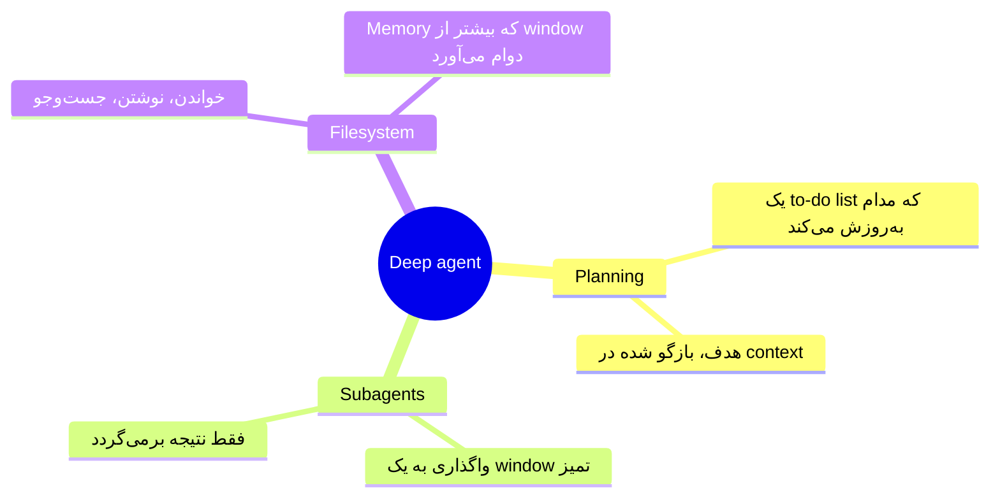
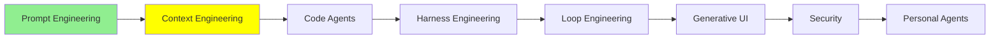

# Context Engineering

[Prompt Engineering](prompt_engineering_fa.md) درباره‌ی نوشتن یک ورودی خوب بود. این ماژول درباره‌ی همه‌ی چیزهای دیگری است که جلوی مدل قرار می‌گیرند. این ماژول درباره‌ی یک مشکل هم هست: جا برای همه‌ی آن‌ها کافی نیست.

بعد از prompt engineering، context engineering آمد. در اواخر سال 2025 این موضوع به یک ترند تبدیل شد. اینجا می‌بینیم که این ایده از کجا آمد، چطور رشد کرد، و کدام تکنیک‌ها ارزش دانستن دارند.

## ظهور Context Engineering

در آن زمان، کل بحث درباره‌ی اندازه بود. مردم مدل‌هایی با context window بزرگ‌تر می‌خواستند. به مدل بیشتر و بیشتر می‌دادند، چون context بیشتر واقعاً نتیجه‌ی بهتری می‌داد.

اگر تا حالا یک session طولانی با یک coding agent کار کرده باشید، این حس را می‌شناسید. ایده‌پردازی می‌کنید، طراحی می‌کنید، و بین این دو جلو و عقب می‌روید. بعد، بدون هیچ هشداری، به 95% از window رسیده‌اید. چون context بیشتر کمک کرده بود، مردم مطالب اضافی بیشتری به prompt‌هایشان اضافه می‌کردند. این باعث شد window سریع‌تر از همیشه پر شود.

پس سیستم‌ها چه کار می‌کردند وقتی حجم مطالب جمع‌شده از window بزرگ‌تر می‌شد؟ بیشتر وقت‌ها از یک **sliding window** استفاده می‌کردند. فرض کنید مدل 1M token را در خود نگه می‌دارد، اما تاریخچه‌ی شما به 1.4M رسیده است. window به جلو می‌لغزد و مدل فقط 1M آخر را می‌بیند، یعنی از 0.4M تا 1.4M. آن 0.4M اول از بین رفته است.

این از چیزی که به نظر می‌رسد بدتر است. لحظه‌ای که از حد مجاز رد می‌شوید، باید *قدیمی‌ترین* context را کنار بگذارید. معمولاً همان جایی است که توضیح داده‌اید می‌خواهید چه کاری انجام دهید. پس درک مشترکی که با مدل ساخته‌اید، اولین چیزی است که سیستم دور می‌ریزد. در نهایت باید prompt‌های قبلی‌تان را دستی دوباره وارد کنید، تا به مدل یادآوری شود کار چه بود.

## Context Rot (Pollution)

در حالی که همه دنبال راهی برای کار با یک window پر بودند، تیم Chroma این پژوهش را منتشر کرد: [Context Rot: How Increasing Input Tokens Impacts LLM Performance](https://www.trychroma.com/research/context-rot). یافته‌ی آن‌ها خیلی غافلگیرکننده بود: **هرچه context بزرگ‌تر شود، مدل در انجام کار ضعیف‌تر می‌شود.**

آن‌ها 18 مدل را آزمودند، از جمله GPT-4.1، Claude 4 و Gemini 2.5، و الگو در همه‌ی آن‌ها یکسان بود. همان مدل را با همان کار در نظر بگیرید. با 25K token در context، کار را به‌طور محسوسی بهتر از 800K token انجام می‌دهد. دلیلش این نیست که window سرریز شده باشد. دلیلش چیزی است که از قبل در آن بود.

  
*سه چیزی که مدل به آن نیاز دارد در هر دو ظرف است. در سمت راست، این سه چیز هنوز آنجا هستند، هنوز خواندنی هستند، و با این حال گم شده‌اند. بقیه‌ی چیزهای داخل ظرف برای همان attention با آن‌ها رقابت می‌کنند.*

مردم برای این اثر دو اسم به کار می‌برند: **context rot** و **context pollution**. مقاله‌ی Drew Breunig با عنوان [How Long Contexts Fail](https://www.dbreunig.com/2025/06/22/how-contexts-fail-and-how-to-fix-them.html) یک قدم جلوتر می‌رود. این مقاله چهار شیوه‌ی مشخص برای وقوع این مشکل نام می‌برد: poisoning، distraction، confusion و clash.

دلیل این موضوع **attention** است. attention مکانیزمی است که مدل با آن تشخیص می‌دهد کدام بخش‌های ورودی‌اش برای token‌ای که قرار است بنویسد، مهم هستند. ما وارد نظریه‌اش نمی‌شویم. آنچه لازم دارید نتیجه است: attention یک بودجه‌ی ثابت است و مدل آن را بین همه‌ی چیزهای داخل window تقسیم می‌کند. انسان هم همین‌طور کار می‌کند. شما فقط می‌توانید چند چیز را هم‌زمان در ذهن نگه دارید، نه بیشتر. مدلی که مغز agent شماست فرقی ندارد. اگر context آن را با مقدار زیادی مطلب کم‌ربط پر کنید، همان باری را حمل می‌کند که یک انسان حمل می‌کند. و همان نوع اشتباه‌ها را هم مرتکب می‌شود.

به یک نکته دقت کنید، چون همین بخشی است که مردم اشتباه می‌فهمند: این موضوع «پر شدن window» نیست. کارایی خیلی پیش از رسیدن به حد مجاز افت می‌کند. یک window که 40% پر است، ممکن است از همان window در 5%، پاسخ‌های بدتری بدهد.

حالا ببینیم در عمل این موضوع چه حسی دارد. یک session طولانی را برای نوشتن یک کتاب شروع می‌کنید. در ابتدا به مدل می‌گویید با لحن علمی و روشن بنویسد. مدتی همین کار را می‌کند. یک جایی بعد از 800K token، دیگر این کار را نمی‌کند: لحن به چیزی مبهم و پرحرف تبدیل می‌شود، و مدل شروع می‌کند چیزهایی را سر هم کند. هیچ چیزی حذف نشده بود و window هم هرگز سرریز نشده بود. دستور هنوز آنجاست. اما سهمش از attention باید با همه‌ی چیزهایی که بعد از آن اضافه کردید رقابت می‌کرد، و باخت. مدل نقشه را گم کرده است.

  
*سؤال، توصیه‌ی هم‌کلاسی را می‌خواهد. needle همان جواب را دارد. distractor همان جمله است، اما درباره‌ی یک استاد. Chroma دید که یک distractor هم برای آسیب زدن کافی است. آن‌ها همچنین دیدند هرچه needle کمتر شبیه سؤال باشد، با بزرگ‌تر شدن haystack، کارایی سریع‌تر فرو می‌ریزد.*

نام این آزمون را همیشه می‌شنوید: **needle in a haystack**. نسخه‌ی بالا، سخت‌تر است. نسخه‌ی آسان، یک عبارت دقیق را در متن پنهان می‌کند و از مدل می‌خواهد آن را دوباره پس بدهد. مدل‌ها این کار را تقریباً بی‌نقص انجام می‌دهند. سهم Chroma این بود که چیزی را پنهان کند که برای پیدا کردنش باید *استدلال* کنید، و جمله‌های غلطی را کنارش بگذارد که تقریباً درست به نظر می‌رسند.

از همه‌ی این‌ها، مجموعه‌ای از روش‌ها و یک اسم برای آن‌ها بیرون آمد.

## Context Engineering چیست؟

Context engineering به یک سؤال جواب می‌دهد: **چه چیزی باید وارد context شود، و چه چیزی باید بیرون نگه داشته شود؟**

window محدود است، پس باید چیزی تصمیم بگیرد. دنیایی از چیزها وجود دارد که می‌توانند وارد window شوند، و این دنیا دائماً بزرگ‌تر می‌شود. Context engineering هنر و علم انتخاب این است که از میان آن‌ها، کدام‌ها واقعاً وارد شوند. هدف این است که token‌های حامل signal واقعی زیاد باشند و token‌های noise کم، تا context پوسیده نشود.

  
*سمت چپ یک نوبت و یک تصمیم است: همان [Prompt Engineering](prompt_engineering_fa.md). سمت راست دنیایی از چیزهایی است که می‌توانند وارد window شوند، و تصمیمی درباره‌ی اینکه واقعاً کدام‌ها وارد می‌شوند. آن تصمیم در هر نوبت، دوباره گرفته می‌شود.*

این اصطلاح در اواسط سال 2025 و بعد از [پستی از Andrej Karpathy](https://x.com/karpathy/status/1937902205765607626) پرطرفدار شد. مطلب [Effective context engineering for AI agents](https://www.anthropic.com/engineering/effective-context-engineering-for-ai-agents) از Anthropic کامل‌ترین بررسی را از آن ارائه کرد. این مطلب context engineering را «مجموعه‌ی راهبردها برای انتخاب و نگه‌داشتن مجموعه‌ی بهینه‌ی token‌ها در طول inference در LLM» می‌نامد. [The New Skill in AI is Not Prompting, It's Context Engineering](https://www.philschmid.de/context-engineering) نوشته‌ی Philipp Schmid، همین ایده را مثل یک شرح شغل توصیف می‌کند: به مدل اطلاعات و ابزارهای درست را بدهید، با قالب درست، در زمان درست. LangChain این تکنیک‌ها را در چهار فعل دسته‌بندی می‌کند: write، select، compress و isolate. این دسته‌بندی را در [Context Engineering](https://www.langchain.com/blog/context-engineering-for-agents) و در [Context Engineering for Agents](https://rlancemartin.github.io/2025/06/23/context_engineering/) نوشته‌ی Lance Martin می‌توانید ببینید.

این‌ها تکنیک‌هایی هستند که الان دانستن‌شان ارزش دارد.

## Context Summarization (Compaction)

این ساده‌ترین تکنیک است. وقتی context بلند می‌شود، آن را با خلاصه‌ی خودش جایگزین کنید. به این ترتیب، 800K token گفتگو می‌شود 20K token از این نوع: «این چیزی است که تصمیم گرفتیم، این چیزهایی است که هنوز خراب است، و این جایی است که بودیم».

امروزه بیشتر agent‌ها وقتی به حد مجاز نزدیک می‌شوند، خودشان این کار را انجام می‌دهند. بعضی هم به شما اجازه می‌دهند خودتان آن را شروع کنید. در Claude Code، `/compact` را تایپ می‌کنید و همان لحظه انجام می‌شود.

  
*به آنچه نگه داشته می‌شود و آنچه نه توجه کنید. نتیجه‌ی tool‌ها بیشتر window را پر می‌کنند و کنار گذاشته می‌شوند. خلاصه، تصمیم‌ها را نگه می‌دارد. چند فایل اخیر نگه داشته می‌شوند، چون agent بلافاصله دوباره آن‌ها را می‌خواند. بلوک رزروشده‌ی پایین، فضایی است که agent برای خلاصه‌سازی خودش نگه داشته است. به این ترتیب، agent هیچ‌وقت با window پر و بدون جایی برای نوشتن گیر نمی‌افتد.*

هزینه‌ی این کار واقعی است و باید صریح گفته شود. خلاصه، خروجی 40,000-token یک دستور terminal را دور می‌ریزد که دیگر کسی به آن نیاز ندارد. همین هدف است. اما ممکن است چیزی را هم دور بریزد که لازم داشتید. این می‌تواند تصادفی اتفاق بیفتد. همچنین ممکن است به این خاطر اتفاق بیفتد که چیزی که خلاصه را نوشته، تشخیص داده که آن چیز مهم نیست، و اشتباه کرده است. دقیقاً به همین دلیل، راهنمای خود Anthropic درباره‌ی compaction می‌گوید تصمیم‌های architecture، باگ‌های حل‌نشده و جزئیات implementation را نگه دارید.

## Context Offloading

به‌جای اینکه چیزی را در context نگه دارد، agent آن را جایی یادداشت می‌کند که بعداً بتواند بخواندش. معمولاً آن جا یک فایل markdown است. حقایق مهم از window بیرون می‌روند و روی disk نگهداری می‌شوند. agent وقتی واقعاً به آن‌ها نیاز داشته باشد، دوباره آن‌ها را برمی‌گرداند.

تیم Manus درباره‌ی این موضوع در [Context Engineering for AI Agents: Lessons from Building Manus](https://manus.im/blog/Context-Engineering-for-AI-Agents-Lessons-from-Building-Manus) نوشته است. آن‌ها این کار را استفاده از file system به‌عنوان context توصیف می‌کنند. file system از نظر اندازه نامحدود است و ذاتاً پایدار (persistent) است، و agent می‌تواند مستقیم با آن کار کند.

خیلی از agent‌ها این کار را در یک قابلیت به نام **long-term memory** پیاده کرده‌اند. این یک index از چیزهایی است که ارزش نگه داشتن دارند. پس حتی بعد از خلاصه شدن context، حقایق باقی می‌مانند و agent هنوز می‌تواند در آن‌ها جست‌وجو کند.

همان هشدار اینجا هم صدق می‌کند و ریشه‌اش هم همان است. تصمیم درباره‌ی اینکه چه چیزی ارزش نگه داشتن دارد، یک موضوع قضاوت است، و این قضاوت یا از شما می‌آید یا از مدل. هر دو ممکن است اشتباه کنند. از دست دادن چیزی باارزش به این شکل، رایج است، نه نادر.

[Memory](../1_fundamentals/memory_fa.md) حافظه را به سه نوع parametric، working و long-term تقسیم کرد. این همان نوع long-term است. در عمل، معمولاً آن را در سه نوع سازمان‌دهی می‌کنند:

  
*این تقسیم‌بندی مهم است، چون agent این سه نوع را در زمان‌های متفاوت می‌نویسد و می‌خواند. حقایق مربوط به شما، آرام‌آرام و با گذر زمان جمع می‌شوند. کارهای گذشته همان چیزی است که جلوی تکرار اشتباه توسط agent را می‌گیرد. و لایه‌ی دستورالعمل‌ها، فقط همان system prompt از [Tool Calling](../1_fundamentals/tools_fa.md) است با اسم دیگر.*

## استفاده از Knowledge Base به‌عنوان Context قابل کاوش

بعضی اطلاعات واقعاً ارزشمندند و زیاد تغییر نمی‌کنند، مثل اینکه API داخلی شرکت شما چطور کار می‌کند. آن‌ها را در هر prompt کپی نکنید. آن‌ها را جایی بگذارید که agent بتواند برود و نگاه کند: یک پوشه از فایل‌های markdown که agent بتواند بخواند و در آن جست‌وجو کند.

وقتی agent تشخیص دهد که به مستندات شما نیاز دارد، آن را بازیابی (retrieval) می‌کند. فقط بخشی را می‌خواند که مهم است، و همان اندازه در context یاد می‌گیرد. بازیابی می‌تواند RAG کامل از [RAG و Embedding‌ها](../1_fundamentals/rag_fa.md) باشد، یا فقط agentی که فایل‌ها را باز می‌کند. در هر صورت، جایگزین این است که کل مرجع API را در window بریزیم و هزینه‌اش را در هر نوبت بپردازیم.

یک ابزار اینجا ارزش دانستن دارد. [DeepWiki](https://deepwiki.org/) برای یک repository در GitHub یک wiki می‌سازد. فرض کنید agent شما درباره‌ی جزئیات داخلی یک کتابخانه، معماری یا API آن سؤال دارد. به جای اینکه خود repository را بگردد و context را با فایل‌های source پر کند، می‌تواند گزارش DeepWiki را بخواند.

## Context Isolation

این مثالی است که این موضوع را روشن می‌کند.

coding agent شما باید بگوید یک repository از چه architecture‌ای استفاده می‌کند. repository یک میلیون خط است. برای جواب دادن، agent باید تعداد زیادی فایل را باز کند. فرض کنید این کار 800K token از context را مصرف می‌کند، و جواب یک جمله است: سیستم یک event-driven microservices fabric را orchestrate می‌کند، و جریان‌های توزیع‌شده‌ی Kafka را با پردازش geospatial در زمان واقعی ترکیب می‌کند. شما 800K token از context را برای گرفتن یک جمله مصرف کردید. و حالا آن 800K در window نشسته است و همه‌ی چیزهایی را که بعد از آن می‌آیند می‌پوساند.

راه حل این است که اصلاً آن خواندن را در آن context انجام ندهیم. agent اصلی یک agent دیگر را صدا می‌زند که context خالی خودش را دارد. این agent دوم یک **subagent** است. subagent آن مرور 800K token را انجام می‌دهد. همه چیز را جز نتیجه دور می‌ریزد، و همان یک جمله را برمی‌گرداند. context agent اصلی فقط یک جمله‌ی تازه می‌گیرد.

  
*هر جعبه یک context جداست. با خالی شروع می‌شود و وقتی کار تمام شد، دور ریخته می‌شود. agent اصلی هیچ‌وقت مراحل میانی را نمی‌بیند، و نکته‌ی اصلی همین است: چیزی که دیده نمی‌شود، نمی‌تواند window آن را بپوساند.*

**چطور کار می‌کند.** یک subagent یک agent تازه با context تمیز است. agent اصلی آن را همان‌طور صدا می‌زند که هر tool دیگری را صدا می‌زند، با چیزی مثل `Task("find out what architecture this repo uses")`. از دید [Tool Calling](../1_fundamentals/tools_fa.md)، چیز تازه‌ای اتفاق نمی‌افتد: یک tool صدا زده شده و یک نتیجه‌ی tool برگشته است. subagent یک loop خودش را اجرا می‌کند و هر مرحله‌ی میانی را پنهان می‌کند. بعد پاسخ نهایی را به‌عنوان همان نتیجه‌ی tool برمی‌گرداند. Anthropic گزارش می‌دهد که این خلاصه‌ها معمولاً حدود 1,000 تا 2,000 token هستند.

agent‌های امروزی subagent‌ها را یکی پس از دیگری یا به‌صورت موازی صدا می‌زنند. این به agent اصلی اجازه می‌دهد کاری را انجام دهد که واقعاً در آن خوب است: نگه داشتن برنامه و تصمیم‌گیری درباره‌ی اینکه بعد چه اتفاقی بیفتد.

## Explicit Planning (TODOs)

فرض کنید از یک agent می‌خواهید برایتان یک portfolio site بسازد. این یعنی همه‌ی این مراحل:

- تعریف scope
- انتخاب stack
- ساختن layout‌ها
- نوشتن محتوا در آن‌ها
- وصل کردن یک CMS
- تنظیم deployment

اگر agent فوراً شروع به نوشتن کد کند، نقشه را گم می‌کند. یک مرحله را فراموش می‌کند، یا کاملاً به جای دیگری منحرف می‌شود. پس به‌جایش اول برنامه را یادداشت می‌کند. این برنامه یک to-do list است که هر آیتمش یک وضعیت دارد:

```text
[x] Define the scope: one page, three projects, a contact form
[x] Choose the stack: Next.js, static export, no database
[~] Build the layouts: header and hero done, project grid in progress
[ ] Write the content in
[ ] Wire up a CMS
[ ] Configure deployment
```

بعد، فهرست را یکی‌یکی جلو می‌برد. بعد از هر مرحله، به فهرست برمی‌گردد، آنچه را تمام کرده علامت می‌زند و مرحله‌ی بعد را برمی‌دارد. کار بزرگ تبدیل شد به کارهای کوچک. حالا یک یادداشت نوشته‌شده وجود دارد که نشان می‌دهد کدام‌ها تمام شده‌اند، پس هیچ چیزی به حافظه‌ی agent وابسته نیست.

اثر دوم کمتر آشکار است و مهم‌تر است. هر بار که agent آن فهرست را دوباره می‌خواند و بازنویسی می‌کند، هدف را به context اخیر برمی‌گرداند. این کار بارها و بارها تکرار می‌شود. Manus به این کار می‌گوید **manipulating attention through recitation**، یعنی کنترل attention از راه بازگویی مداوم هدف. این مستقیم‌ترین پاسخ به مشکل لحن علمی در بالاست. دستور سهمش را از attention از دست می‌دهد، چون چیزی آن را تکرار نمی‌کند. یک to-do list آن را تکرار می‌کند.

کلمه‌ی recitation را به یاد بسپارید. در پایان این ماژول دوباره ظاهر می‌شود، چون to-do list تنها چیزی نیست که این کار را انجام می‌دهد.

**چطور کار می‌کند.** agent‌های امروزی این را به‌صورت یک tool داخلی ارائه می‌دهند. اگر agent شما چنین toolی ندارد، اما به یک filesystem دسترسی دارد، می‌تواند یک فایل markdown نگه دارد و همان نتیجه را بگیرد.

> **نکته:** این‌ها همه‌ی تکنیک‌ها نیستند. [Advanced Context Engineering](../3_expert/advanced_context_engineering.md) تکنیک‌های سخت‌تر را پوشش می‌دهد،
> به‌ویژه برای کار نرم‌افزاری.

## Deep Agent‌ها

**Deep agent‌ها** معماری agent‌هایی هستند که همزمان با همه‌ی این تحولات محبوب شدند. لازم نیست همه‌ی تکنیک‌های بالا را دستی در agent خودتان پیاده کنید. یک deep agent شکلی است که آن‌ها را کنار هم بسته‌بندی می‌کند. چند معماری ارزش دانستن دارند و [Advanced Agent Architectures](../3_expert/advanced_agent_architectures.md) آن‌ها را پوشش می‌دهد. این همان معماری است که به این ماژول تعلق دارد، چون context engineering است که به یک طراحی تبدیل شده است.

برای اینکه یک agent deep حساب شود، حداقل به این موارد نیاز دارد:



Philipp Schmid در [Agents 2.0: From Shallow Loops to Deep Agents](https://www.philschmid.de/agents-2.0-deep-agents) یک مورد چهارم اضافه می‌کند: یک system prompt بسیار طولانی و خیلی مشخص. گاهی این prompt هزاران token طول دارد. به agent می‌گوید کی برنامه‌ریزی کند، کی یک subagent راه بیندازد، و فایل‌هایش را چطور سازمان‌دهی کند. NVIDIA در [What Is a Deep Agent?](https://www.nvidia.com/en-us/glossary/deep-agents/) همان معماری را با همان اصطلاحات توصیف می‌کند. همچنین ممکن است کل این ایده را **Agents 2.0** بشنوید. این همان چیز است با اسم دیگر. این اسم، شکاف آن با حلقه‌ی ساده‌ی [AI Agents](../1_fundamentals/agents_fa.md) را به اندازه‌ی واقعی‌اش نشان می‌دهد. [The Agent 2.0 Era: Mastering Long-Horizon Tasks with Deep Agents](https://medium.com/@amirkiarafiei/the-agent-2-0-era-mastering-long-horizon-tasks-with-deep-agents-part-3-745705e13b16) آن را از ابتدا تا انتها توضیح می‌دهد.

برای ساختن یکی، ساده‌ترین جا برای شروع [deepagents](https://github.com/langchain-ai/deepagents) از LangChain است. این کتابخانه خودش را یک agent harness با همه‌ی امکانات آماده (batteries-included) می‌نامد. این امکانات دقیقاً همین فهرست است:

- planning
- یک filesystem قابل جایگزینی
- subagent‌ها با window‌های جداگانه
- summarisation برای thread‌های طولانی

مستندات این کتابخانه، [Deep Agents overview](https://docs.langchain.com/oss/python/deepagents/overview) است.

این مزیت واقعی است: یک deep agent بیشتر کارهای context engineering را برای شما انجام می‌دهد. خلاصه می‌کند، offload می‌کند، کار را به subagent می‌سپارد و برنامه‌ریزی می‌کند. لازم نیست هیچ‌کدام را خودتان وصل کنید. بعضی تکنیک‌ها هنوز به انسان نیاز دارند، و آن‌ها موضوع ماژول پیشرفته هستند.

و این نکته‌ای است که باید به آن توجه کنید: بیشتر agent‌هایی که الان استفاده می‌کنید، deep agent هستند. Claude Code، Codex، Copilot و OpenCode همه planning، subagent‌ها و یک filesystem دارند.

## وظایف Long-horizon

وقتی همه‌ی این‌ها را کنار هم بگذارید، چیز تازه‌ای پدیدار می‌شود: agent‌هایی که ساعت‌ها کار می‌کنند، بدون اینکه کسی مراقب‌شان باشد.

احتمالاً دیده‌اید کسی یک وب‌سایت کامل یا یک بازی قابل اجرا را فقط با یک prompt ساخته است. این‌ها **long-horizon tasks** هستند. این کارها به‌خاطر تکنیک‌های این ماژول ممکن شدند. agentی را در نظر بگیرید که می‌تواند همه‌ی این کارها را انجام دهد:

- یک کار بزرگ را به مرحله‌ها تقسیم کند
- آن مرحله‌ها را برنامه‌ریزی کند
- یادداشت‌های خودش را بنویسد
- چیزهایی را که لازم ندارد offload کند
- برای بخش‌های پرهزینه، subagent راه بیندازد
- context خودش را خلاصه کند

چنین agentی می‌تواند خیلی دیرتر از جایی که قبلاً رشته‌ی کار را گم می‌کرد، ادامه دهد.

یک اندازه‌گیری واقعی از اینکه تا کجا پیش رفته‌ایم وجود دارد، و این از تبلیغات مفیدتر است. مقاله‌ی METR با عنوان [Measuring AI Ability to Complete Long Software Tasks](https://arxiv.org/abs/2503.14499) یک سؤال ساده می‌پرسد. کارهایی را در نظر بگیرید که یک مدل تقریباً در نیمی از موارد آن‌ها را تمام می‌کند. این کارها برای یک انسان چقدر طول می‌کشند؟ آن عدد، **time horizon** مدل است. وقتی مقاله منتشر شد، Claude 3.7 Sonnet حدود 50 دقیقه کار انسانی را انجام می‌داد. خط روند از سال 2019 به این طرف، تقریباً هر هفت ماه دو برابر شده است. اگر این خط را ادامه دهید، کارهای یک‌ماهه ظرف پنج سال می‌رسند. METR [عددهای فعلی](https://metr.org/time-horizons/) را برای هر مدل پیشرفته، روی یک نمودار و در هر دو سطح موفقیت 50% و 80%، نگه می‌دارد. آن نمودار راه صادقانه‌ای برای خواندن ادعایی است که می‌گوید یک agent «شش ساعت کار کرده است».

Long-horizon کلیدواژه‌ی سال 2026 است، و هر شرکتی دنبال آن است. آن‌ها دنبالش می‌روند، چون تفاوت بین agentی که به شما در کار کمک می‌کند و agentی که خودش کار را انجام می‌دهد، در همین است. اگر به جای تیتر، نقشه‌ی پژوهش را می‌خواهید، به [Awesome-Long-Horizon-Agents](https://github.com/RUC-NLPIR/Awesome-Long-Horizon-Agents) نگاه کنید. این یک فهرست مطالعه است که به‌روز نگه داشته می‌شود. این فهرست کل این حوزه را به دو بخش تقسیم می‌کند: آنچه دور مدل می‌سازید، و آنچه داخل مدل تغییر می‌دهید.

## Chain of Thought به‌عنوان ابزار Context Engineering

یک نکته‌ی آخر مانده است، و دقیقاً بین این ماژول و ماژول قبلی قرار دارد.

Chain of thought از [Prompt Engineering](prompt_engineering_fa.md) فقط یک جواب را بهتر نمی‌کند. یک session طولانی را هم در مسیر درست نگه می‌دارد. وقتی مدل استدلالش را می‌نویسد، هدف را برای خودش تکرار می‌کند. کتابی را در نظر بگیرید که از لحن علمی‌اش منحرف شده بود. با reasoning روشن، trace آن نقطه‌ی session شبیه این است:

```text
<thinking>
The user wants section 8, which is about slang in American society. Before I
start: their instruction from the beginning of this project was a clear academic
tone throughout, and that has not been withdrawn. The subject is informal, but
the treatment of it should not be. Academic register, slang only as quoted
examples.
</thinking>
```

هیچ چیزی بازیابی نشد و هیچ چیزی هم به window اضافه نشد. مدل دستور را دوباره در context اخیر خودش نوشت، جایی که attention کم‌هزینه‌ترین است.

این همان حرکتی است که to-do list انجام می‌دهد، و به همین دلیل کلمه‌ی recitation ارزش به یاد سپردن داشت. هر دو تکنیک با **گفتن دوباره‌ی چیز مهم، نزدیک به جایی که مدل می‌خواهد بنویسد** کار می‌کنند. یک to-do list برنامه را بازگو می‌کند. یک chain of thought محدودیت را بازگو می‌کند. attention به چیزی می‌رود که نزدیک و تکرارشده است. پس اگر می‌خواهید مدل در 800K token هنوز به چیزی اهمیت بدهد، باید چیزی آن را تکرار کند. اگر به حال خود رها شود، کم‌رنگ می‌شود. این همان کار chain of thought است به‌عنوان یک ابزار context engineering. همچنین این ارزان‌ترین ابزار این ماژول است: شما آن را نمی‌سازید، فقط روشنش می‌کنید.

## کجای این مجموعه هستیم



## خلاصه

یک context window محدود است، و کیفیتش پیش از پر شدن افت می‌کند. context بیشتر، جواب را بدتر می‌کند. این دقیقاً برعکس چیزی است که همه در سال 2025 فرض می‌کردند. دلیلش این است که attention یک بودجه‌ی ثابت است که بین هر چیزی که در window هست تقسیم می‌شود.

Context engineering یعنی تصمیم گرفتن درباره‌ی اینکه چه چیزی باید جایی در آن داشته باشد. همه‌ی تکنیک‌ها نسخه‌هایی از یک حرکت‌اند: token‌ها را از window بیرون ببرید، و راهی برای برگشتن به آن‌ها نگه دارید.

- تاریخچه را خلاصه کنید.
- حقایق را به فایل‌ها offload کنید.
- مستندات را جایی بگذارید که agent بتواند برود و بخواند.
- کار پرهزینه را به یک subagent با window خودش بسپارید.
- یک to-do list داشته باشید که هدف را دوباره به context اخیر بازگو کند.

یک deep agent، agentی است که بیشتر این کارها را برای شما انجام می‌دهد. به همین دلیل، coding agent‌هایی که هر روز استفاده می‌کنید، همین حالا deep agent هستند.

بعدی: خود coding agent‌ها، و شش راهی که می‌توانید یکی از آن‌ها را گسترش دهید.

**بررسی سریع**: چرا یک مدل پیش از پر شدن window بدتر می‌شود، و یک subagent در واقع چه چیزی را برای شما صرفه‌جویی می‌کند؟

## منابع

- [Context Rot: How Increasing Input Tokens Impacts LLM Performance](https://www.trychroma.com/research/context-rot): مطالعه‌ی Chroma که پشت همه‌ی این مباحث است، 18 مدل، و آزمایش‌های needle و distractor
- [How Long Contexts Fail](https://www.dbreunig.com/2025/06/22/how-contexts-fail-and-how-to-fix-them.html): Drew Breunig درباره‌ی چهار شکست نام‌گذاری‌شده، از یک hallucination اولیه که همچنان نقل می‌شود تا اطلاعات تازه‌ای که با اطلاعات قدیمی در تضاد است
- [Effective context engineering for AI agents](https://www.anthropic.com/engineering/effective-context-engineering-for-ai-agents): کامل‌ترین بررسی، و منبع راهنمایی‌های مربوط به compaction و subagent
- [The New Skill in AI is Not Prompting, It's Context Engineering](https://www.philschmid.de/context-engineering): کوتاه‌ترین تعریف خوب
- [Context Engineering](https://www.langchain.com/blog/context-engineering-for-agents): چهار فعل (write، select، compress و isolate)
- [Context Engineering for Agents](https://rlancemartin.github.io/2025/06/23/context_engineering/): همان چهار مورد، با نمودارهایی که ارزش استفاده‌ی دوباره دارند
- [Karpathy درباره‌ی context engineering](https://x.com/karpathy/status/1937902205765607626): پستی که این اصطلاح را پیش چشم همه گذاشت
- [Context Engineering for AI Agents: Lessons from Building Manus](https://manus.im/blog/Context-Engineering-for-AI-Agents-Lessons-from-Building-Manus): درس‌های مشخص از تجربه‌ی واقعی، به‌ویژه درس‌های مربوط به filesystem و recitation
- [Stop stuffing your context window (here's why)](https://youtube.com/shorts/9P36wMntNSI): نسخه‌ی کوتاه، اگر ترجیح می‌دهید تماشا کنید
- [DeepWiki](https://deepwiki.org/): یک wiki برای هر repository، تا agent شما درباره‌ی کد بخواند، به‌جای اینکه خود کد را بخواند
- [Agents 2.0: From Shallow Loops to Deep Agents](https://www.philschmid.de/agents-2.0-deep-agents): اینکه چه چیزی یک agent را deep می‌کند، و چرا این یک معماری است، نه یک قابلیت
- [What Is a Deep Agent?](https://www.nvidia.com/en-us/glossary/deep-agents/): همان تعریف، به زبان ساده
- [The Agent 2.0 Era: Mastering Long-Horizon Tasks with Deep Agents](https://medium.com/@amirkiarafiei/the-agent-2-0-era-mastering-long-horizon-tasks-with-deep-agents-part-3-745705e13b16): همان معماری، از ابتدا تا انتها توضیح داده شده
- [deepagents](https://github.com/langchain-ai/deepagents): کتابخانه، و [Deep Agents overview](https://docs.langchain.com/oss/python/deepagents/overview) که آن را مستند می‌کند
- [Measuring AI Ability to Complete Long Software Tasks](https://arxiv.org/abs/2503.14499): منبع عدد time horizon و روند دو برابر شدن
- [Task-completion time horizons](https://metr.org/time-horizons/): عددهای فعلی برای هر مدل، به‌روز نگه داشته‌شده
- [Awesome-Long-Horizon-Agents](https://github.com/RUC-NLPIR/Awesome-Long-Horizon-Agents): نقشه‌ی پژوهش، دسته‌بندی‌شده، اگر می‌خواهید فراتر از این ماژول بروید
- [Advanced Context Engineering](../3_expert/advanced_context_engineering.md): تکنیک‌هایی که این ماژول کنار گذاشته است
