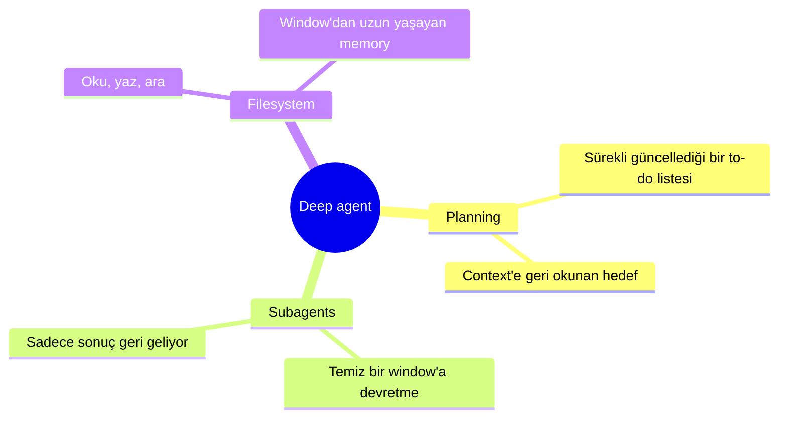
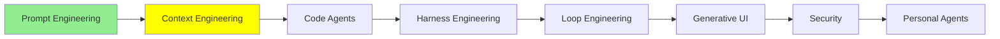

# Context Engineering

[Prompt Engineering](prompt_engineering_tr.md) tek bir iyi input yazmakla ilgiliydi. Bu modül, modelin önüne giden geri kalan her şeyle ilgili. Bir de şu sorunla: hepsi için yeterli yer yok.

Prompt engineering'den sonra context engineering geldi ve 2025'in sonlarının trendi oldu. Burada nereden çıktığını, nasıl geliştiğini ve bilinmeye değer teknikleri işliyoruz.

## Context Engineering'in Yükselişi

O zamanlar herkes boyuttan konuşuyordu. İnsanlar daha büyük context window'u olan modeller istiyordu. Modele durmadan daha fazlasını veriyorlardı, çünkü daha fazla context gerçekten daha iyi sonuç demekti.

Bir coding agent'la uzun bir session'da çalıştıysan bu hissi biliyorsun. Beyin fırtınası yapıyorsun, tasarlıyorsun, ileri geri gidiyorsun. Sonra hiçbir uyarı olmadan window'un %95'indesin. Daha fazla context işe yaradığı için insanlar prompt'larına durmadan ek malzeme koydu. Bu yüzden window her zamankinden hızlı doldu.

Peki stack window'dan büyüdüğünde sistemler ne yapıyordu? Çoğunlukla bir **sliding window** kullanıyorlardı. Diyelim model 1M token tutuyor ve geçmişin 1.4M'ye ulaştı. Window ileri kayıyor ve model sadece son 1M'i görüyor, yani 0.4M'den 1.4M'ye kadarını. İlk 0.4M gitmiş oluyor.

Bu, kulağa geldiğinden daha kötü. Sınırı geçtiğin anda *en eski* context'i bırakmak zorunda kalıyorsun. Orası da genelde ne yapmaya çalıştığını anlattığın yer. Yani modelle kurduğun ortak anlayış, sistemin attığı ilk şey oluyor. Sonunda işin ne olduğunu modele hatırlatmak için kendi eski prompt'larını elle geri kopyalıyorsun.

## Context Rot (Pollution)

Herkes dolu bir window'a çözüm ararken, Chroma ekibi [Context Rot: How Increasing Input Tokens Impacts LLM Performance](https://www.trychroma.com/research/context-rot) çalışmasını yayınladı. Bulgu büyük bir sürpriz oldu: **context büyüdükçe model işi yapmakta kötüleşiyor.**

GPT-4.1, Claude 4 ve Gemini 2.5 dahil 18 modeli test ettiler. Sonuç hepsinde aynıydı. Aynı iş verilen aynı model, context'inde 25K token varken bu işi, 800K token varken olduğundan belirgin biçimde daha iyi yapıyor. Bunun sebebi window'un taşması değil. Sebebi, içinde zaten olan şey.

  
*Modelin ihtiyaç duyduğu üç şey iki kavanozun da içinde. Sağdakinde hâlâ oradalar, hâlâ okunabiliyorlar ve yine de kayboluyorlar. Kavanozdaki geri kalan her şey aynı attention için yarışıyor.*

Bu etkinin iki adı var: **context rot** ve **context pollution**. Drew Breunig'in [How Long Contexts Fail](https://www.dbreunig.com/2025/06/22/how-contexts-fail-and-how-to-fix-them.html) yazısı bir adım daha ileri gidiyor. Bunun nasıl olduğunu dört ayrı adla tanımlıyor: poisoning, distraction, confusion ve clash.

Sebebi **attention**. Attention, modelin yazmak üzere olduğu token için input'un hangi kısımlarının önemli olduğuna karar verdiği mekanizma. Teorisine girmiyoruz. Sana gereken, sonucu: attention sabit bir bütçe ve model onu window'daki her şeye bölüyor. İnsan da aynı şekilde çalışıyor. Kafanda aynı anda birkaç şey tutabiliyorsun, fazlasını değil. Agent'ının beyni olan model de farklı değil. Context'ini birbiriyle az ilgili bir sürü malzemeyle doldurursan, bir insanın taşıyacağı yükü taşıyor. Aynı tür hataları da yapıyor.

Bir noktaya dikkat et, çünkü insanların yanlış anladığı kısım bu: bu, window'un "dolması" değil. Performans limite gelmeden çok önce düşmeye başlıyor. %40 dolu bir window, aynı window %5 doluyken verdiğinden daha kötü cevaplar veriyor olabilir.

Pratikte şöyle hissediliyor. Bir kitap yazmak için uzun bir session başlatıyorsun. En başta modele net bir akademik tonda yazmasını söylüyorsun. Bir süre öyle yapıyor. 800K'yı geçtikten sonra bir yerde bırakıyor: ton belirsiz ve sohbet havasına kayıyor, model de bir şeyler uydurmaya başlıyor. Hiçbir şey silinmedi ve window hiç taşmadı. Talimat hâlâ orada duruyor. Ama attention'daki payı, ondan sonra eklediğin her şeyle yarışmak zorunda kaldı ve kaybetti. Model haritayı kaybetti.

  
*Soru sınıf arkadaşının tavsiyesini istiyor. Needle onu cevaplıyor. Distractor ise aynı cümle, ama bir profesör hakkında. Chroma, tek bir distractor'ın zarar vermeye yettiğini buldu. Ayrıca needle soruya ne kadar az benzerse, haystack büyüdükçe performansın o kadar hızlı çöktüğünü buldu.*

Bu testin adını sürekli duyacaksın: **needle in a haystack**. Yukarıdaki, testin zor versiyonu. Kolay versiyon metne tam bir ifade gizliyor ve onu geri istiyor. Modeller bunu neredeyse kusursuz yapıyor. Chroma'nın katkısı, bulmak için *akıl yürütmen* gereken bir şeyi gizlemek ve yanına neredeyse doğru görünen yanlış cümleler koymak oldu.

Bütün bunlardan bir pratikler kümesi ve onlara bir isim çıktı.

## Context Engineering Nedir?

Context engineering tek bir soruyu cevaplıyor: **context'e ne girmeli, ve ne dışarıda tutulmalı?**

Window sınırlı, yani bir şeyin karar vermesi gerekiyor. Window'a girebilecek şeylerin sürekli büyüyen bir evreni var. Context engineering, bunlardan hangilerinin gerçekten gireceğini seçme sanatı ve bilimi. Amaç, gerçek sinyal taşıyan token'ları olabildiğince çoğaltmak ve gürültü olanları olabildiğince azaltmak. Böylece context çürümüyor.

  
*Solda tek bir tur ve tek bir karar var: bu, [Prompt Engineering](prompt_engineering_tr.md). Sağda window'a girebilecek şeylerin bir evreni ve gerçekte neyin girdiğine dair bir karar var. Bu karar her turda yeniden alınıyor.*

Terim, 2025 ortalarında [Andrej Karpathy'nin bir post'undan](https://x.com/karpathy/status/1937902205765607626) sonra yayıldı. En kapsamlı işlenişini Anthropic'in [Effective context engineering for AI agents](https://www.anthropic.com/engineering/effective-context-engineering-for-ai-agents) yazısında buldu. Orada "LLM inference sırasında en uygun token kümesini seçme ve koruma stratejileri kümesi" diye tanımlanıyor. Philipp Schmid'in [The New Skill in AI is Not Prompting, It's Context Engineering](https://www.philschmid.de/context-engineering) yazısı aynı fikri bir iş tanımı gibi anlatıyor: modele doğru bilgiyi ve tool'ları, doğru biçimde, doğru zamanda ver. LangChain teknikleri dört fiile ayırıyor: write, select, compress, isolate. Bu ayrımı [Context Engineering](https://www.langchain.com/blog/context-engineering-for-agents) yazısında ve Lance Martin'in [Context Engineering for Agents](https://rlancemartin.github.io/2025/06/23/context_engineering/) yazısında bulabilirsin.

Şimdi bilinmeye değer teknikler.

## Context Summarization (Compaction)

Bu, en basit olanı. Context uzayınca onu kendi özetiyle değiştir. Böylece 800K token'lık konuşma, 20K token'lık "şuna karar verdik, şu hâlâ bozuk, şurada kalmıştık"a dönüşüyor.

Çoğu agent artık limite yaklaşınca bunu kendi başına yapıyor. Bazıları bunu senin başlatmana da izin veriyor. Claude Code'da `/compact` yazıyorsun ve anında oluyor.

  
*Neyin tutulduğuna ve neyin tutulmadığına dikkat et. Tool sonuçları window'un büyük kısmı ve onlar gidiyor. Özet kararları tutuyor. Son kullanılan birkaç dosya tutuluyor, çünkü agent onları hemen tekrar okuyacak. Alttaki ayrılmış blok, agent'ın kendi özetlemesi için ayırdığı yer. Böylece hiçbir zaman dolu bir window'la ve yazacak yeri olmadan kalmıyor.*

Maliyeti gerçek ve bunu açıkça söylemek gerek. Bir özet, kimsenin bir daha ihtiyaç duymadığı bir terminal komutunun 40.000 token'lık çıktısını atıyor. Amaç da zaten bu. Ama ihtiyacın olan bir şeyi de atabiliyor. Bu kazara olabilir. Ya da özeti yazan şey onu önemsiz sayıp yanılmış olabilir. Anthropic'in compaction hakkındaki kendi rehberi de tam bu yüzden mimari kararların, çözülmemiş bug'ların ve implementasyon detaylarının korunmasını söylüyor.

## Context Offloading

Bir şeyi context'te tutmak yerine agent onu sonradan okuyabileceği bir yere yazıyor. Bu yer genelde bir markdown dosyası. Önemli bilgiler window'dan çıkıp diskte yaşıyor. Agent gerçekten ihtiyaç duyduğunda onları geri getiriyor.

Manus ekibi bunu [Context Engineering for AI Agents: Lessons from Building Manus](https://manus.im/blog/Context-Engineering-for-AI-Agents-Lessons-from-Building-Manus) yazısında anlatıyor. Onlara göre bu, filesystem'i context olarak kullanmak. Filesystem'in boyutu sınırsız, doğası gereği kalıcı ve agent onunla doğrudan çalışabiliyor.

Birçok agent bunu **long-term memory** adlı bir feature olarak içine kuruyor. Bu, tutulmaya değer şeylerin bir index'i. Böylece context özetlendikten sonra bile bilgiler kalıyor ve agent onları hâlâ arayabiliyor.

Aynı uyarı burada da geçerli, kök sebep de aynı. Neyin tutulmaya değer olduğuna karar vermek bir yargı meselesi ve bu yargı ya senden ya modelden geliyor. İkisi de yanılıyor. Değerli bir şeyi böyle kaybetmek nadir değil, yaygın.

[Memory](../1_fundamentals/memory_tr.md) memory'yi parametrik, working ve long-term diye ayırmıştı. Bu, long-term olanı. Pratikte genelde üç türe ayrılıyor:

  
*Ayrım önemli, çünkü agent bu üçünü farklı zamanlarda yazıp okuyor. Senin hakkındaki bilgiler zamanla sessizce birikiyor. Geçmiş eylemler, bir agent'ın aynı hatayı tekrarlamasını engelleyen şey. Talimatlar katmanı da [LLM Tool Calling](../1_fundamentals/tools_tr.md)'deki system prompt'un başka bir isim altındaki hâli.*

## Knowledge Base'i Keşfedilebilir Context Olarak Kullanmak

Bazı bilgiler gerçekten değerli ve pek değişmiyor, mesela şirketinin iç API'sinin nasıl çalıştığı. Bunları her prompt'a yapıştırma. Agent'ın gidip bakabileceği bir yere koy: okuyup arayabileceği markdown dosyalarından oluşan bir klasöre.

Sonra agent dokümantasyonuna ihtiyacı olduğuna karar verdiğinde onu getiriyor. Önemli olan kısmı okuyor ve o kadarını context'te öğreniyor. Getirme (retrieval) işi [RAG & Embeddings](../1_fundamentals/rag_tr.md)'deki tam RAG olabilir ya da sadece dosya açan bir agent. Her iki durumda da alternatifi, bütün API referansını window'a boşaltmak ve her turda bunun bedelini ödemek.

Burada bilinmeye değer bir tool var. [DeepWiki](https://deepwiki.org/) bir GitHub repo'su için wiki üretiyor. Diyelim agent'ının bir library'nin iç yapısı, mimarisi ya da API'si hakkında bir sorusu var. Repo'yu kendisi tarayıp context'ini kaynak dosyalarla doldurmak yerine, DeepWiki'nin yazdığını okuyabiliyor.

## Context Isolation

Konuyu netleştiren örnek şu.

Coding agent'ının sana bir repo'nun hangi mimariyi kullandığını söylemesi gerekiyor. Repo bir milyon satır. Cevaplamak için agent'ın bir sürü dosya açması lazım. Diyelim bu 800K token'lık context'e mal oluyor ve cevap tek bir cümle: sistem, dağıtık Kafka stream'lerini gerçek zamanlı geospatial işlemeyle harmanlayan event-driven bir microservices dokusunu orkestre ediyor. Tek bir cümle almak için 800K token'lık context harcadın. Şimdi o 800K window'da duruyor ve sonra gelen her şeyi çürütüyor.

Çözüm, okumayı o context'te hiç yapmamak. Ana agent, kendi boş context'i olan ikinci bir agent'ı çağırıyor. Bu ikinci agent bir **subagent**. Subagent 800K token'lık taramayı yapıyor. Sonuç dışındaki her şeyi atıyor ve cümleyi geri veriyor. Ana agent'ın context'i bir cümle kazanıyor.

  
*Her kutu ayrı bir context. Boş başlıyor ve iş bitince atılıyor. Ana agent ara adımları hiç görmüyor ve bütün amaç da bu: göremediği şey window'unu çürütemiyor.*

**Nasıl çalışıyor.** Subagent, temiz context'i olan yeni bir agent. Ana agent onu başka herhangi bir tool'u çağırdığı gibi çağırıyor, `Task("bu repo'nun hangi mimariyi kullandığını bul")` gibi bir şeyle. [Tool Calling](../1_fundamentals/tools_tr.md)'in bakış açısından yeni bir şey olmuyor: bir tool çağrıldı ve bir tool sonucu geldi. Subagent kendi loop'unu çalıştırıyor ve her ara adımı saklıyor. Sonra son cevabı o tool sonucu olarak döndürüyor. Anthropic bu özetlerin genelde 1.000 ile 2.000 token civarında olduğunu bildiriyor.

Modern agent'lar subagent'ları sırayla ya da paralel çağırıyor. Böylece ana agent, gerçekten iyi olduğu şeyi yapmakta serbest kalıyor: planı tutmak ve sırada ne olacağına karar vermek.

## Explicit Planning (TODO'lar)

Diyelim bir agent'tan sana bir portfolyo sitesi yapmasını istiyorsun. Bu, şu adımların hepsi demek:

- kapsamı tanımlamak
- bir stack seçmek
- layout'ları kurmak
- içeriği yazmak
- bir CMS bağlamak
- deployment'ı yapılandırmak

Agent hemen kod yazmaya başlarsa haritayı kaybediyor. Bir adımı unutuyor ya da tamamen başka bir yere kayıyor. Bu yüzden önce planı yazıyor. Plan, her maddesinde bir durum olan bir to-do listesi:

```text
[x] Kapsamı tanımla: tek sayfa, üç proje, bir iletişim formu
[x] Stack'i seç: Next.js, static export, veritabanı yok
[~] Layout'ları kur: header ve hero bitti, proje grid'i devam ediyor
[ ] İçeriği yaz
[ ] Bir CMS bağla
[ ] Deployment'ı yapılandır
```

Sonra listede ilerliyor. Her adımdan sonra geri dönüp bitirdiğini işaretliyor ve sıradakini alıyor. Büyük iş küçük işlere dönüştü. Artık hangilerinin bittiğine dair yazılı bir kayıt var, yani hiçbir şey agent'ın hatırlamasına bağlı değil.

İkinci etki daha az belli, ama daha önemli. Agent o listeyi her okuyup yeniden yazdığında, hedefi yakın context'e geri getiriyor. Bu tekrar tekrar oluyor. Manus buna **recitation ile attention'ı yönlendirmek** diyor. Bu, yukarıdaki akademik ton probleminin en doğrudan cevabı. Talimat attention payını kaybediyor, çünkü hiçbir şey onu tekrarlamıyor. Bir to-do listesi onu tekrarlıyor.

Recitation kelimesini akılda tut. Bu modülün sonunda geri geliyor, çünkü to-do listesi bunu yapan tek şey değil.

**Nasıl çalışıyor.** Modern agent'lar bunu yerleşik bir tool olarak sunuyor. Senin agent'ında böyle bir tool yoksa ama agent bir filesystem'e ulaşabiliyorsa, bir markdown dosyası tutup aynı sonucu alabilir.

> **NOT:** bunlar tekniklerin hepsi değil. [Advanced Context Engineering](../3_expert/advanced_context_engineering_tr.md) daha zor olanları, özellikle yazılım işi için olanları ele alıyor.

## Deep Agent'lar

**Deep agent'lar**, bütün bunlar olurken popüler olan bir agent mimarisi. Yukarıdaki her tekniği kendi agent'ına elle kurmak zorunda değilsin. Deep agent, onları bir arada paketleyen yapı. Bilinmeye değer birkaç mimari var ve [Advanced Agent Architectures](../3_expert/advanced_agent_architectures_tr.md) modülü bunları işliyor. Bu modüle ait olan ise bu, çünkü bu, tasarıma dönüşmüş context engineering.

Deep sayılmak için bir agent'ın en azından bunlara ihtiyacı var:



Philipp Schmid'in [Agents 2.0: From Shallow Loops to Deep Agents](https://www.philschmid.de/agents-2.0-deep-agents) yazısı bir dördüncüsünü ekliyor: çok uzun ve çok ayrıntılı bir system prompt. Bu prompt bazen binlerce token uzunluğunda. Agent'a ne zaman plan yapacağını, ne zaman subagent açacağını ve dosyalarını nasıl düzenleyeceğini söylüyor. NVIDIA'nın [What Is a Deep Agent?](https://www.nvidia.com/en-us/glossary/deep-agents/) sayfası aynı mimariyi aynı terimlerle anlatıyor. Bütün fikri **Agents 2.0** diye de duyacaksın. Bu, aynı şeyin başka bir adı. Bu ad, [AI Agent'lar](../1_fundamentals/agents_tr.md)'daki düz loop'tan kopuşu gerçekte olduğu kadar büyük gösteriyor. [The Agent 2.0 Era: Mastering Long-Horizon Tasks with Deep Agents](https://medium.com/@amirkiarafiei/the-agent-2-0-era-mastering-long-horizon-tasks-with-deep-agents-part-3-745705e13b16) onu baştan sona anlatıyor.

Bir tane kurmak için başlanacak en kolay yer, LangChain'in [deepagents](https://github.com/langchain-ai/deepagents) kütüphanesi. Kendisine batteries-included bir agent harness diyor. Bataryalar tam olarak bu liste:

- planlama
- takılabilir bir filesystem
- izole window'ları olan subagent'lar
- uzun thread'lerin özetlenmesi

[Deep Agents overview](https://docs.langchain.com/oss/python/deepagents/overview) de dokümantasyonu.

Asıl fayda şu: bir deep agent context engineering'in çoğunu senin için yapıyor. Özetliyor, offload ediyor, devrediyor, plan yapıyor. Bunların hiçbirini senin bağlaman gerekmiyor. Bazı teknikler hâlâ bir insan gerektiriyor. Onlar da advanced modülün konusu.

Ve dikkat edilecek nokta şu: zaten kullandığın agent'ların çoğu deep agent. Claude Code, Codex, Copilot ve OpenCode'un hepsinde planlama, subagent'lar ve bir filesystem var.

## Long-horizon İşler

Bütün bunları bir araya koyduğunda yeni bir şey ortaya çıkıyor: kimse izlemeden saatlerce çalışan agent'lar.

Birinin tek bir prompt'tan koca bir web sitesi ya da çalışan bir oyun çıkardığını muhtemelen gördün. Bunlar **long-horizon** işler. Bu modüldeki teknikler sayesinde mümkün oldular. Şunların hepsini yapabilen bir agent düşün:

- kocaman bir işi adımlara bölmek
- bu adımları planlamak
- kendi notlarını yazmak
- ihtiyaç duymadığını offload etmek
- pahalı kısımlar için subagent açmak
- kendi context'ini özetlemek

Böyle bir agent, eskiden işin takibini kaybedeceği noktanın çok ötesine kadar devam edebiliyor.

Bunun ne kadar ilerlediğinin gerçek bir ölçümü var ve bu ölçüm pazarlamadan daha faydalı. METR'in [Measuring AI Ability to Complete Long Software Tasks](https://arxiv.org/abs/2503.14499) çalışması basit bir soru soruyor. Bir modelin denemelerin yaklaşık yarısında bitirebildiği işleri al. O işler bir insanın ne kadar zamanını alıyor? O sayı modelin **time horizon**'u. Makale çıktığında Claude 3.7 Sonnet kabaca 50 dakikalık insan işindeydi. Trend çizgisi de 2019'dan beri yaklaşık yedi ayda bir ikiye katlanıyor. Bu çizgiyi uzatırsan, bir ay süren işler beş yıl içinde geliyor. METR her frontier model için [güncel sayıları](https://metr.org/time-horizons/) tek bir grafikte, hem %50 hem %80 başarıda tutuyor. Bir agent'ın "altı saat çalıştığı" iddiasını okumanın dürüst yolu da bu grafik.

Long-horizon 2026'nın anahtar kelimesi ve her şirket onun peşinde. Çünkü sana işinde yardım eden bir agent ile işi kendisi yapan bir agent arasındaki fark bu. Manşet yerine araştırma manzarasını istersen [Awesome-Long-Horizon-Agents](https://github.com/RUC-NLPIR/Awesome-Long-Horizon-Agents) listesine bak. Bu, güncel tutulan bir okuma listesi. Bütün alanı iki kısma ayırıyor: modelin etrafında ne kurduğun ve modelin içinde ne değiştirdiğin.

## Bir Context Engineering Tool'u Olarak Chain of Thought

Son bir şey daha var ve tam olarak bu modülle bir öncekinin arasında duruyor.

[Prompt Engineering](prompt_engineering_tr.md)'deki chain of thought tek bir cevabı iyileştirmekten fazlasını yapıyor. Uzun bir session'ı da yolunda tutuyor. Model akıl yürütmesini yazarken hedefi kendine tekrarlıyor. Akademik tonundan kayan kitabı düşün. Reasoning açıkken, session'ın aynı noktasındaki trace şuna benzer bir şey oluyor:

```text
<thinking>
Kullanıcı 8. bölümü istiyor, konusu Amerikan toplumunda argo. Başlamadan
önce: bu projenin başındaki talimatı baştan sona net bir akademik tondu,
ve o geri alınmadı. Konu resmî değil, ama işlenişi öyle olmamalı.
Akademik register, argo sadece alıntılanan örnekler olarak.
</thinking>
```

Hiçbir şey getirilmedi ve window'a hiçbir şey eklenmedi. Model talimatı kendi yakın context'ine geri yazdı. Attention'ın en ucuz olduğu yer de orası.

Bu, to-do listesinin yaptığı hamlenin aynısı. Recitation kelimesini akılda tutmaya değmesinin sebebi de bu. İki teknik de **önemli olan şeyi, modelin yazmak üzere olduğu yerin yakınında tekrar söyleyerek** çalışıyor. To-do listesi planı tekrarlıyor. Chain of thought kısıtı tekrarlıyor. Attention yakın ve tekrarlanan şeye gidiyor. Yani modelin 800K token'da hâlâ önemsemesini istediğin bir şey varsa, onu bir şeyin tekrarlaması gerekiyor. Kendi hâline bırakılırsa soluyor. Bu, chain of thought'un bir context engineering tool'u olarak çalışması. Modüldeki en ucuz tool da bu: onu kurmuyorsun, açıyorsun.

## Bu serinin neresindeyiz



## Özet

Bir context window sınırlı ve dolmadan önce kalitesi düşmeye başlıyor. Daha fazla context cevabı kötüleştiriyor. Bu, 2025'te herkesin varsaydığının tersi. Sebebi, attention'ın window'da ne varsa ona bölünen sabit bir bütçe olması.

Context engineering, oraya neyin girmeyi hak ettiğine karar vermek. Tekniklerin hepsi aynı hamlenin versiyonları: token'ları window'dan çıkar ve onlara geri dönen bir yol bırak.

- Geçmişi özetle.
- Bilgileri dosyalara offload et.
- Dokümantasyonu agent'ın gidip okuyabileceği bir yerde bırak.
- Pahalı işi kendi window'u olan bir subagent'a devret.
- Hedefi yakın context'e geri okuyan bir to-do listesi tut.

Deep agent, bunun çoğunu senin için yapan agent. Her gün kullandığın coding agent'ların zaten birer deep agent olmasının sebebi de bu.

Sırada: coding agent'ların kendisi ve birini genişletmenin altı yolu.

**Hızlı Kontrol**: bir model neden window'u dolmadan önce kötüleşiyor, ve bir subagent gerçekte sana neyi kazandırıyor?

## Kaynaklar

- [Context Rot: How Increasing Input Tokens Impacts LLM Performance](https://www.trychroma.com/research/context-rot): bütün bunların arkasındaki Chroma çalışması, 18 model, ve needle ile distractor deneyleri
- [How Long Contexts Fail](https://www.dbreunig.com/2025/06/22/how-contexts-fail-and-how-to-fix-them.html): Drew Breunig'in adlandırdığı dört hata, sürekli alıntılanan erken bir hallucination'dan eski bilgiyle çelişen yeni bilgiye kadar
- [Effective context engineering for AI agents](https://www.anthropic.com/engineering/effective-context-engineering-for-ai-agents): en kapsamlı işlenişi, ve compaction ile subagent rehberliğinin kaynağı
- [The New Skill in AI is Not Prompting, It's Context Engineering](https://www.philschmid.de/context-engineering): en kısa iyi tanım
- [Context Engineering](https://www.langchain.com/blog/context-engineering-for-agents): dört fiil (write, select, compress ve isolate)
- [Context Engineering for Agents](https://rlancemartin.github.io/2025/06/23/context_engineering/): aynı dördü, yeniden kullanmaya değer diyagramlarla
- [Karpathy on context engineering](https://x.com/karpathy/status/1937902205765607626): terimi herkesin önüne koyan post
- [Context Engineering for AI Agents: Lessons from Building Manus](https://manus.im/blog/Context-Engineering-for-AI-Agents-Lessons-from-Building-Manus): gerçek deneyimden gelen somut dersler, özellikle filesystem ile recitation dersleri
- [Stop stuffing your context window (here's why)](https://youtube.com/shorts/9P36wMntNSI): izlemeyi tercih edersen kısa versiyon
- [DeepWiki](https://deepwiki.org/): repo başına bir wiki, böylece agent'ın kodu okumak yerine kod hakkında okuyor
- [Agents 2.0: From Shallow Loops to Deep Agents](https://www.philschmid.de/agents-2.0-deep-agents): bir agent'ı deep yapan şey, ve neden bir feature değil mimari olduğu
- [What Is a Deep Agent?](https://www.nvidia.com/en-us/glossary/deep-agents/): aynı tanım, sade bir dille
- [The Agent 2.0 Era: Mastering Long-Horizon Tasks with Deep Agents](https://medium.com/@amirkiarafiei/the-agent-2-0-era-mastering-long-horizon-tasks-with-deep-agents-part-3-745705e13b16): aynı mimari, baştan sona anlatılmış
- [deepagents](https://github.com/langchain-ai/deepagents): kütüphane, ve onu dokümante eden [Deep Agents overview](https://docs.langchain.com/oss/python/deepagents/overview)
- [Measuring AI Ability to Complete Long Software Tasks](https://arxiv.org/abs/2503.14499): time-horizon sayısının çıktığı yer, ve ikiye katlanma trendi
- [Task-completion time horizons](https://metr.org/time-horizons/): model başına güncel sayılar, güncel tutuluyor
- [Awesome-Long-Horizon-Agents](https://github.com/RUC-NLPIR/Awesome-Long-Horizon-Agents): araştırma manzarası, sıralanmış, bu modülden daha derine gitmek istersen
- [Advanced Context Engineering](../3_expert/advanced_context_engineering_tr.md): bu modülün dışarıda bıraktığı teknikler
