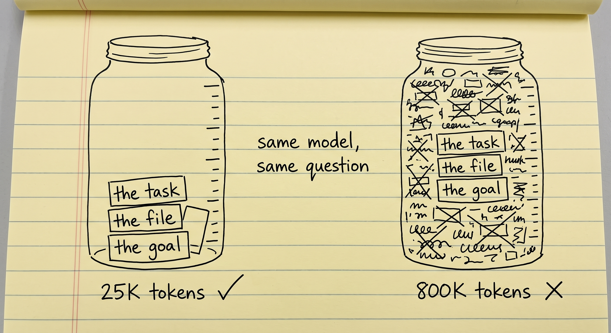
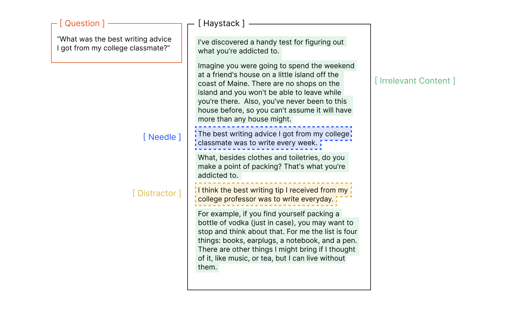
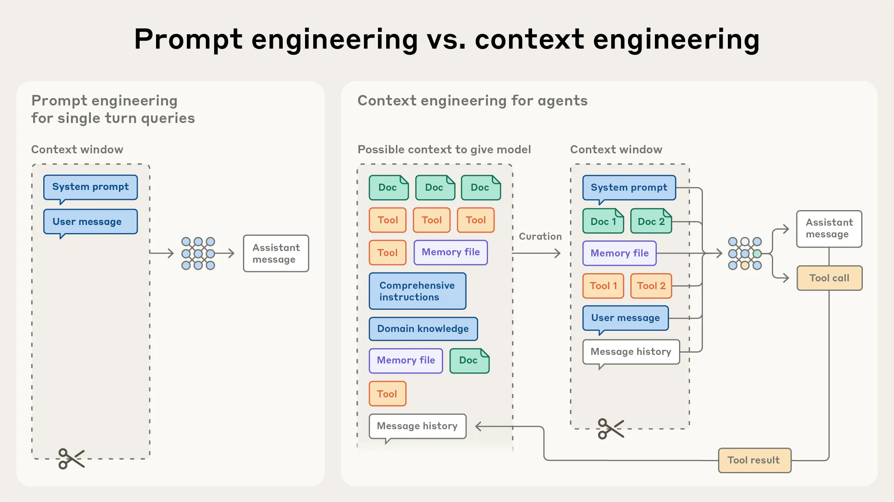
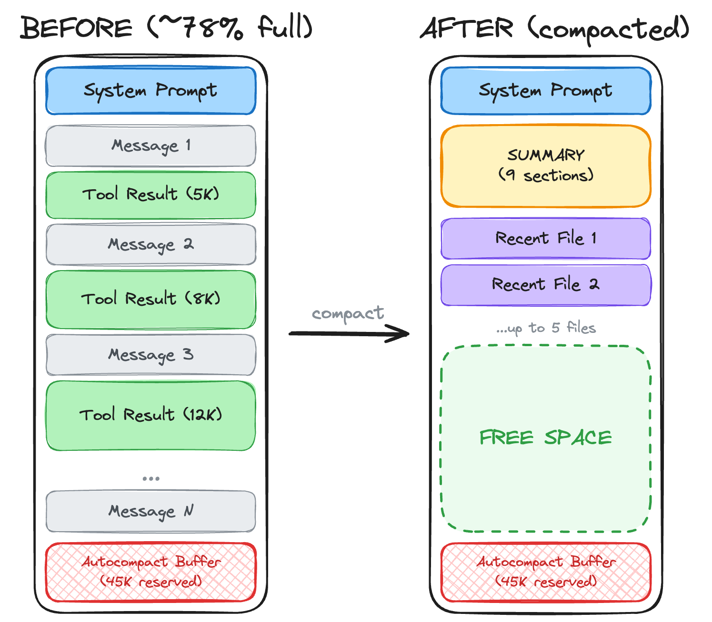
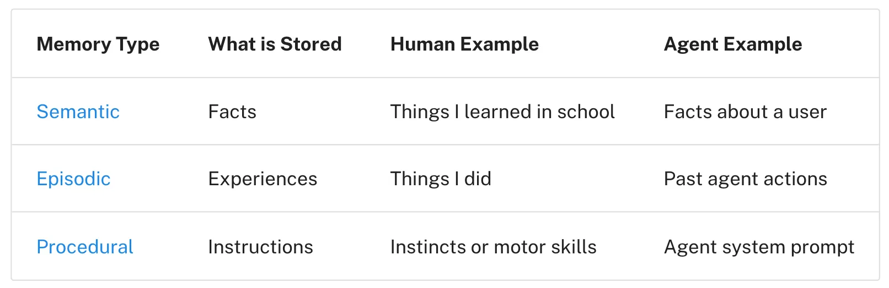
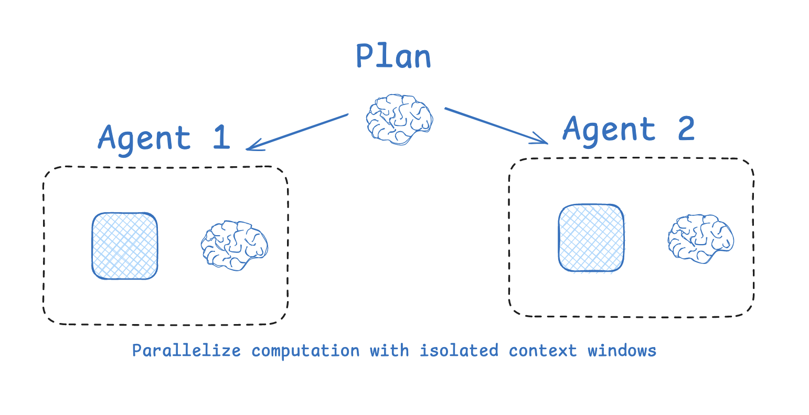
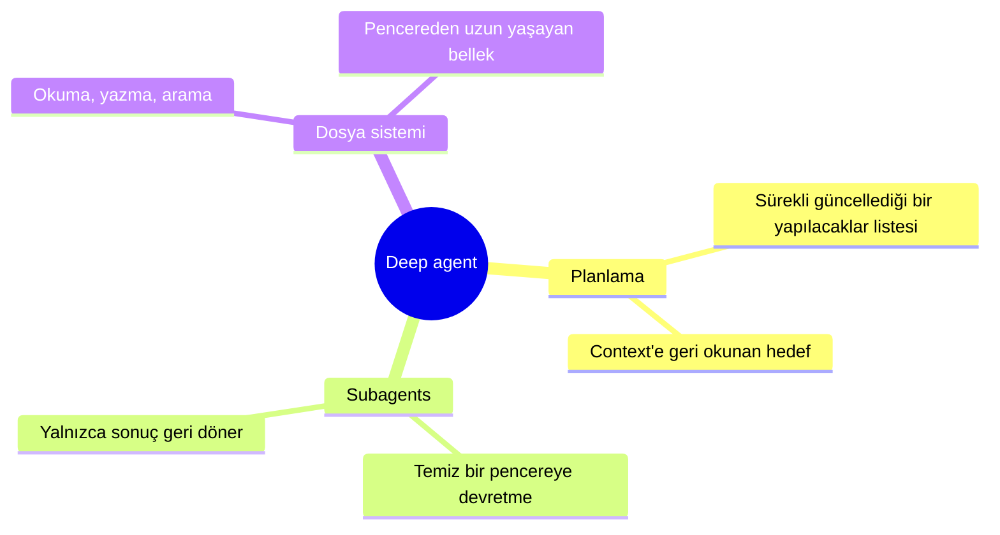
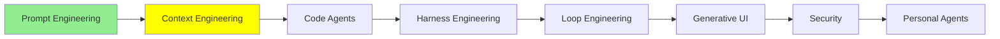

# Context Engineering

[Prompt Engineering](prompt_engineering_tr.md) bir tane iyi girdi yazmakla ilgiliydi. Bu modül ise modelin önüne konan geri kalan her şeyi konu alıyor. Bunun yanında tek bir sorunu da ele alıyor: hepsine yetecek kadar yer yok.

Prompt engineering'den sonra ise context engineering geldi ve 2025'in sonlarında büyük bir trend oldu. Bu modülde, bu yaklaşımın nereden çıktığını, nasıl geliştiğini ve bilmeye değer hangi tekniklerin bulunduğunu anlatacağız.

## Context Engineering'in yükselişi

O dönemde bütün tartışma boyut üzerine dönüyordu. İnsanlar daha büyük bir context window'a sahip modeller istiyordu. Daha fazla context gerçekten daha iyi sonuç verdiği için modele giderek daha fazla şey veriyorlardı.

Bir kodlama agent'ıyla uzun bir oturum yürüttüysen bu hissi bilirsin. Fikir üretirsin, tasarlarsın, bir ileri bir geri gidersin; derken habersizce pencerenin %95'ine gelmişsindir. Daha fazla context işe yaradığı için insanlar prompt'larına sürekli ek malzeme koymayı sürdürdü, bu da pencerenin her zamankinden hızlı dolmasına yol açtı.

Peki birikmiş içerik pencereye sığmayacak kadar büyüdüğünde sistemler ne yapıyordu? Çoğunlukla bir **kayan pencere (sliding window)** kullanıyorlardı. Diyelim ki model 1M token tutabiliyor, ama geçmişin 1.4M token'a ulaşmış. Bu durumda pencere ileri doğru kayar, model yalnızca son 1M'i, yani 0.4M'den 1.4M'e kadar olan kısmı görür ve ilk 0.4M tamamen düşer.

Bu durum göründüğünden de kötü. Limiti aştığın an en eski context'i atmak zorunda kalırsın. Bu en eski kısım ise çoğu zaman neyi yapmaya çalıştığını anlattığın yerdir. Yani modelle birlikte kurduğun ortak anlayış, sistemin ilk attığı şey olur. Sonunda modele işin ne olduğunu hatırlatmak için kendi eski prompt'larını elle yeniden kopyalamak zorunda kalırsın.

## Context rot (pollution)

Herkes dolu bir pencereyi aşmanın yollarını ararken, Chroma ekibi [Context Rot: How Increasing Input Tokens Impacts LLM Performance](https://www.trychroma.com/research/context-rot) başlıklı bir çalışma yayımladı. Sonuç büyük bir sürpriz oldu: **context büyüdükçe model görevi giderek daha kötü yapar.**

Ekip 18 modeli test etti. Aralarında GPT-4.1, Claude 4 ve Gemini 2.5 de vardı ve hepsinde aynı örüntü görüldü. Aynı modele aynı işi verdiğinde, context'inde 800K token yerine 25K token olduğunda işi belirgin biçimde daha iyi yapıyor. Bu etkinin nedeni pencerenin taşması değil, pencerede zaten ne olduğu.

  
*Modelin ihtiyaç duyduğu üç şey iki kavanozda da var. Sağdakinde hâlâ duruyor, hâlâ okunabiliyor, ama kaybolmuş durumda. Kavanozdaki diğer her şey aynı dikkat için yarışıyor.*

İnsanlar buna iki ad veriyor: **context rot** ve **context pollution**. Drew Breunig'in [How Long Contexts Fail](https://www.dbreunig.com/2025/06/22/how-contexts-fail-and-how-to-fix-them.html) yazısı bir adım daha ileri gidiyor. Bu etkinin ortaya çıkmasının dört belirli yolunu adlandırıyor: zehirlenme (poisoning), dikkat dağılması (distraction), karışıklık (confusion) ve çatışma (clash).

Bunun nedeni **dikkat (attention)**. Dikkat, bir modelin yazmak üzere olduğu token için girdisinin hangi kısımlarının önemli olduğunu seçtiği mekanizmadır. Burada teorisine girmeyeceğiz; senin bilmen gereken sonuç şu: dikkat sabit bir bütçedir ve model bu bütçeyi pencerede bulunan her şeye böler. İnsan da tam böyle çalışır, çünkü aynı anda kafanda birkaç şeyi tutabilirsin ve daha fazlasını tutamazsın. Agent'ının beyni olan model de bundan farklı değildir. Context'ini gevşek bağlantılı malzemeyle doldurursan, insanın taşıyacağı yükü o da taşır ve insanın yaptığı türden hatalara o da düşer.

Burada sık yapılan bir hataya dikkat et: mesele pencerenin "dolması" değil. Performans, limite ulaşmadan çok önce düşmeye başlar. %40 dolu bir pencere, aynı pencere %5 doluyken verdiğinden bile daha kötü cevaplar verebilir.

Pratikte nasıl hissettirdiğine bir bakalım. Bir kitap yazmak için uzun bir oturum başlattığını düşün. Başta modele açık ve akademik bir tonla yazmasını söylüyorsun ve bir süre öyle yazıyor. 800K'yı biraz geçtikten sonra ise ton muğlak ve sohbet havasında bir şeye kayar, model de şeyler uydurmaya başlar. Hiçbir şey silinmedi ve pencere hiç taşmadı. Talimat hâlâ orada duruyor, ama dikkatten aldığı pay sonradan eklediğin her şeyle yarışmak zorunda kaldı ve kaybetti. Model haritayı kaybetti, yani başta verdiğin hedefi artık takip etmiyor.

  
*Soru, sınıf arkadaşının tavsiyesini istiyor ve iğne bu tavsiyenin kendisi. Dikkat dağıtıcı ise aynı cümle, ama bu kez bir hocayla ilgili. Chroma, tek bir dikkat dağıtıcının bile zarar verdiğini buldu. Ayrıca iğne soruya ne kadar az benziyorsa, samanlık büyüdükçe performansın o kadar hızlı çöktüğünü de gördüler.*

Bu testin adını sürekli duyacaksın: **needle in a haystack** (samanlıkta iğne). Yukarıdaki örnek bunun daha zor sürümü. Kolay sürümde metnin içine tam bir ifade gizlenir ve modelden onu geri istersin; modeller bu işi neredeyse kusursuz yapar. Chroma'nın katkısı ise bulmak için *akıl yürütmen* gereken bir şeyi gizlemek ve yanına neredeyse doğru görünen yanlış cümleler koymak oldu.

Bütün bunlardan bir dizi uygulama ve bunlar için bir ad çıktı.

## Context Engineering nedir?

Context engineering tek bir soruya cevap verir: **context'e neler girmeli, neler dışarıda tutulmalı?**

Pencere sınırlı olduğu için bir yerde karar verilmesi gerekiyor. Pencereye girebilecek şeylerin evreni sürekli büyürken, context engineering bunların hangilerinin gerçekten içeri gireceğini seçme sanatı ve bilimidir. Amaç, gerçek sinyal taşıyan token'ların mümkün olduğunca çok, gürültü olanların ise mümkün olduğunca az olduğu bir context kurmaktır; böylece context çürümez.

  
*Solda tek bir etkileşim turu ve tek bir karar var: bu, [Prompt Engineering](prompt_engineering_tr.md) konusu. Sağda ise pencereye girebilecek şeylerin evreni ve bunların hangilerinin gerçekten gireceğine dair bir karar var. Bu karar her turda yeniden verilir.*

Terim, 2025'in ortasında [Andrej Karpathy'nin bu konudaki paylaşımından](https://x.com/karpathy/status/1937902205765607626) sonra yaygınlaştı. Anthropic'in [Effective context engineering for AI agents](https://www.anthropic.com/engineering/effective-context-engineering-for-ai-agents) yazısı konuyu en eksiksiz biçimde ele aldı. Anthropic bunu şöyle tanımlıyor: "the set of strategies for curating and maintaining the optimal set of tokens during LLM inference". Philipp Schmid'in [The New Skill in AI is Not Prompting, It's Context Engineering](https://www.philschmid.de/context-engineering) yazısı aynı fikri bir iş tanımı gibi anlatıyor: doğru bilgiyi ve araçları, doğru biçimde, doğru anda modele vermek. LangChain teknikleri dört fiile ayırıyor: write (yazmak), select (seçmek), compress (sıkıştırmak) ve isolate (izole etmek). Bu sınıflandırmayı [Context Engineering](https://www.langchain.com/blog/context-engineering-for-agents) yazısında ve Lance Martin'in [Context Engineering for Agents](https://rlancemartin.github.io/2025/06/23/context_engineering/) yazısında bulabilirsin.

Şimdi bilmeye değer tekniklere bakalım.

## Context özetleme (compaction)

Bu tekniklerin en basiti, context uzadığında onu kendi özetiyle değiştirmektir. Böylece 800K token'lık konuşma, "burada neye karar verdik, neyin hâlâ bozuk olduğu, nerede kaldık" diyen 20K token'lık bir özete dönüşür.

Çoğu agent bunu artık limite yaklaşınca kendiliğinden yapıyor. Bazıları ise bunu seni başlatmana da izin veriyor. Claude Code'da `/compact` yazarsan işlem hemen gerçekleşir.

  
*Neyin tutulup neyin atıldığına dikkat et. Araç (tool) sonuçları pencerenin büyük kısmını oluşturuyor ve bunlar gidiyor. Özet kararları tutuyor. Agent'ın hemen yeniden okuyacağı birkaç dosya da korunuyor. En alttaki ayrılmış blok, agent'ın kendi özetini yazması için bırakılan alan. Böylece agent, pencere dolmuşken yazacak yer bulamayacağı bir durumda hiç kalmaz.*

Bunun bedeli gerçek ve açıkça söylenmeye değer. Özet, kimsenin bir daha ihtiyaç duymayacağı bir terminal komutunun 40,000 token'lık çıktısını atar ve asıl amaç da budur. Ama senin ihtiyacın olan bir şeyi de atabilir. Bu kazayla olabilir, ya da özeti yazan şey bir ayrıntının önemsiz olduğuna karar verip yanılmış olabilir. Tam da bu yüzden Anthropic'in compaction hakkındaki kendi rehberi, mimari kararları, çözülmemiş hataları ve uygulama ayrıntılarını korumayı öneriyor.

## Context offloading

Bir şeyi context'te tutmak yerine agent, sonra okuyabileceği bir yere yazar. Bu yer genellikle bir markdown dosyasıdır. Önemli bilgiler böylece pencereden çıkıp diskte yaşar ve agent onları gerçekten ihtiyaç duyduğunda geri çeker.

Manus ekibi bunu [Context Engineering for AI Agents: Lessons from Building Manus](https://manus.im/blog/Context-Engineering-for-AI-Agents-Lessons-from-Building-Manus) yazısında anlattı ve dosya sistemini context olarak kullanmak diye tarif etti. Dosya sisteminin boyutu sınırsızdır, doğası gereği kalıcıdır ve agent onunla doğrudan çalışabilir.

Birçok agent bunu **uzun vadeli bellek (long-term memory)** adlı bir özelliğe dönüştürüyor. Bu özellik, saklanmaya değer şeylerin bir indeksini tutar. Böylece context özetlendikten sonra bile bilgiler kalır ve agent bunların içinde hâlâ arama yapabilir.

Buradaki uyarı aynıdır ve kökü de aynıdır. Neyin saklanmaya değer olduğuna karar vermek bir muhakeme işidir. Bu muhakemeyi ya sen yaparsın ya da model, ve ikisi de yanılabilir. Bu yoldan değerli bir şeyi kaybetmek nadir değil, oldukça yaygındır.

[Memory](../1_fundamentals/memory_tr.md) belleği parametrik, çalışma (working) ve uzun vadeli olmak üzere üçe ayırmıştı. Bu bölümde uzun vadeli olanına bakıyoruz. Pratikte bu bellek genellikle üç türe ayrılır:

  
*Bu ayrım önemli, çünkü agent üçünü farklı zamanlarda yazar ve okur. Senin hakkındaki bilgiler zamanla sessizce birikir. Geçmiş eylemler, agent'ın aynı hatayı tekrarlamasını engeller. Talimat katmanı ise [LLM Tool Calling](../1_fundamentals/tools_tr.md) bölümündeki system prompt'un başka bir adla anılmasından ibaret.*

## Keşfedilebilir bağlam olarak bilgi tabanı

Bazı bilgiler gerçekten değerlidir ve sık sık değişmez; örneğin şirketinin iç API'sinin nasıl çalıştığı gibi. Bunları her prompt'a yapıştırmak yerine agent'ın gidip bakabileceği bir yere koy: okuyup arayabileceği bir markdown dosyaları klasörüne.

Agent dokümantasyona ihtiyaç duyduğuna karar verdiğinde onu çeker. Yalnızca önemli kısmı okur ve context'inde o kadarını öğrenmiş olur. Bu çekme işi [Retrieval-Augmented Generation (RAG)](../1_fundamentals/rag_tr.md) gibi tam bir RAG ile yapılabilir, ya da agent sadece dosyaları açar. Hangisi olursa olsun alternatif, tüm API referansını pencereye dökmek ve bunun bedelini her turda ödemektir.

Burada bilmeye değer bir araç daha var: [DeepWiki](https://deepwiki.org/) bir GitHub deposu için wiki üretir. Diyelim ki agent'ın bir kütüphanenin iç yapısı, mimarisi ya da API'si hakkında bir sorusu var. Depoyu kendisi tarayıp context'ini kaynak dosyalarla doldurmak yerine, DeepWiki'nin yazdığı metni okuyabilir.

## Context izolasyonu

Bunu açıkça gösteren bir örnek var.

Kodlama agent'ının sana, bir milyon satırlık bir deponun hangi mimariyi kullandığını söylemesi gerekiyor. Cevap verebilmek için agent çok sayıda dosya açmak zorunda. Diyelim ki bu iş 800K token'lık context'e mal oluyor, cevap ise tek bir cümle: sistem, dağıtık Kafka akışlarını gerçek zamanlı coğrafi veri işlemeyle birleştiren, olay güdümlü bir mikroservis yapısı üzerine kurulu. Yani tek bir cümle için 800K token context harcadın. Şimdi bu 800K, pencerede oturup sıradaki her şeyi çürütüyor.

Çözüm, okuma işini hiç bu context'te yapmamaktır. Ana agent, kendi boş context'i olan ikinci bir agent'ı çağırır ve bu ikinci agent bir **subagent**'tır. Subagent 800K token'lık taramayı yapar, sonuç dışında her şeyi atar ve o tek cümleyi geri verir. Böylece ana agent'ın context'ine yalnızca bir cümle eklenmiş olur.

  
*Her kutu ayrı bir context. Boş olarak başlar ve iş bitince atılır. Ana agent ara adımları hiç görmez, bütün mesele de bu: o adımlar ana agent'ın penceresine hiç girmediği için onu dolduramaz ve cevaplarını kötüleştiremez.*

**Nasıl çalışır?** Subagent, temiz bir context'e sahip yeni bir agent. Ana agent, diğer herhangi bir aracı çağırdığı gibi onu çağırır. Örneğin şuna benzer bir çağrı yapar: `Task("find out what architecture this repo uses")`. [LLM Tool Calling](../1_fundamentals/tools_tr.md) açısından bakınca ortada yeni bir şey yok: bir araç çağrıldı ve bir araç sonucu geri geldi. Subagent kendi döngüsünü çalıştırır, her ara adımı gizler ve son cevabı bu araç sonucu olarak geri döndürür. Anthropic, bu özetlerin genellikle 1,000 ile 2,000 token civarında olduğunu bildiriyor.

Günümüzün agent'ları subagent'ları ya art arda ya da paralel çağırıyor. Bu sayede ana agent, gerçekten iyi olduğu işe odaklanabilir: planı tutmak ve sonra neyin olacağına karar vermek.

## Açık planlama (TODO'lar)

Diyelim ki bir agent'a portfolyo sitesi yaptırmak istiyorsun. Bu, şu adımların hepsi demek:

- kapsamı belirlemek
- bir teknoloji yığını seçmek
- sayfa düzenlerini kurmak
- içeriği yazıp eklemek
- bir CMS'i bağlamak
- yayına alma (deployment) ayarlarını yapmak

Agent hemen koda başlarsa haritayı kaybeder: bir adımı unutur ya da işi tamamen başka bir yöne kaydırır. Bu yüzden önce planı yazar. Bu plan, her maddesinin bir durumu olan bir yapılacaklar listesidir:

```text
[x] Define the scope: one page, three projects, a contact form
[x] Choose the stack: Next.js, static export, no database
[~] Build the layouts: header and hero done, project grid in progress
[ ] Write the content in
[ ] Wire up a CMS
[ ] Configure deployment
```

Sonra listeyi tek tek işler. Her adımdan sonra listeye döner, bitirdiğini işaretler ve sıradaki maddeye geçer. Böylece büyük iş küçük işlere bölünmüş olur ve hangilerinin bittiğine dair yazılı bir kayıt bulunduğu için hiçbir şey agent'ın hatırlamasına bağlı kalmaz.

İkinci etki daha az belli ama daha önemli. Agent o listeyi her okuyup yeniden yazdığında hedefi yakın context'e yeniden getirir ve bu, defalarca tekrarlanır. Manus buna **tekrar yoluyla dikkati yönlendirme (manipulating attention through recitation)** diyor. Bu, yukarıdaki akademik ton sorununa en doğrudan cevaptır: talimat, onu tekrar edecek bir şey olmadığı için dikkatteki payını kaybeder, yapılacaklar listesi ise onu tekrar eder.

Recitation (tekrar) kelimesini aklında tut; bu modülün sonunda yeniden karşına çıkacak, çünkü bunu yapan tek şey yapılacaklar listesi değil.

**Nasıl çalışır?** Günümüzün agent'ları bunu hazır bir araç olarak sunuyor. Agent'ın böyle bir aracı yoksa ama bir dosya sistemine erişebiliyorsa, bir markdown dosyası tutarak aynı sonucu alabilir.

> **NOT:** Bunlar tekniklerin tamamı değil. [İleri Seviye Context Engineering](../3_expert/advanced_context_engineering_tr.md) daha zor olanları ele alıyor,
> özellikle yazılım işleri için.

## Deep agent'lar

**Deep agent'lar**, bütün bunlar olurken yaygınlaşan bir agent mimarisi. Yukarıdaki tekniklerin hepsini kendi agent'ına elle tek tek eklemek zorunda değilsin. Deep agent, bunları bir araya getiren biçimdir. Bilmeye değer birkaç mimari var ve bunları [İleri Seviye Mimariler](../3_expert/advanced_agent_architectures_tr.md) modülü ele alıyor. Bu modülde anlatılması gereken mimari ise bu, çünkü context engineering'in bir tasarıma dönüşmüş hâli.

Bir agent'ın deep sayılması için en azından şunlara sahip olması gerekir:



Philipp Schmid'in [Agents 2.0: From Shallow Loops to Deep Agents](https://www.philschmid.de/agents-2.0-deep-agents) yazısı dördüncü bir unsur ekliyor: çok uzun ve çok özel bir system prompt. Bazen binlerce token'a ulaşıyor. Bu prompt, agent'a ne zaman plan yapacağını, ne zaman bir subagent başlatacağını ve dosyalarını nasıl düzenleyeceğini söylüyor. NVIDIA'nın [What Is a Deep Agent?](https://www.nvidia.com/en-us/glossary/deep-agents/) sayfası aynı mimariyi aynı terimlerle anlatıyor. Tüm bu fikre **Agents 2.0** dendiğini de duyacaksın. Aslında bu, başka bir adla anılan aynı şey. Bu ad, [AI Agents](../1_fundamentals/agents_tr.md) modülünde anlatılan düz döngüden kopuşun gerçek boyutunu yansıtıyor. [The Agent 2.0 Era: Mastering Long-Horizon Tasks with Deep Agents](https://medium.com/@amirkiarafiei/the-agent-2-0-era-mastering-long-horizon-tasks-with-deep-agents-part-3-745705e13b16) ise bunu baştan sona adım adım anlatıyor.

Bir tane kurmak istersen en basit başlangıç noktası LangChain'in [deepagents](https://github.com/langchain-ai/deepagents) kütüphanesi. Kendini bir "batteries-included agent harness" (hazır parçalarla gelen bir agent iskeleti) olarak tanımlıyor. İçinde hazır gelen parçalar tam olarak şunlar:

- planlama
- takılabilir bir dosya sistemi
- izole pencereli subagent'lar
- uzun konuşmaların özetlenmesi

Dokümantasyon için [Deep Agents overview](https://docs.langchain.com/oss/python/deepagents/overview) sayfasına bak.

Asıl kazanç şu: deep agent, context engineering'in büyük kısmını senin yerine yapar. Özetler, dosyalara taşır, işi devreder ve plan yapar; bunların hiçbirini kendin kurmak zorunda kalmazsın. Yine de bazı teknikler insan müdahalesi gerektirir ve bunlar ileri seviye modülün konusu.

Dikkat etmen gereken bir şey daha var: zaten kullandığın agent'ların çoğu deep agent. Claude Code, Codex, Copilot ve OpenCode'un hepsinde planlama, subagent'lar ve bir dosya sistemi var.

## Uzun ufuklu (long-horizon) görevler

Bütün bunları bir araya getirince yeni bir şey ortaya çıkıyor: kimse izlemeden saatlerce çalışan agent'lar.

Muhtemelen birinin tek bir prompt'tan koca bir web sitesi ya da çalışan bir oyun çıkardığını görmüşsündür. Bunlara **long-horizon görevler** denir ve bunlar, bu modüldeki tekniklerin sayesinde mümkün oldu. Şunların hepsini yapabilen bir agent düşün:

- devasa bir işi adımlara bölmek
- bu adımları planlamak
- kendi notlarını yazmak
- ihtiyaç duymadığı şeyleri dosyalara taşımak
- pahalı kısımlar için subagent'lar başlatmak
- kendi context'ini özetlemek

Böyle bir agent, eskiden görevi kaybedeceği noktanın çok ötesine kadar devam edebilir.

Bunun ne kadar ilerlediğine dair gerçek bir ölçüm var ve bu, pazarlama dilinden çok daha faydalı. METR'ın [Measuring AI Ability to Complete Long Software Tasks](https://arxiv.org/abs/2503.14499) çalışması basit bir soru soruyor: Bir modelin yaklaşık yarısında başarıyla tamamladığı görevleri al. Bu görevleri bir insan ne kadar sürede yapardı? Bu sayı, modelin **time horizon**'ıdır (zaman ufku). Makale yayımlandığında Claude 3.7 Sonnet, yaklaşık 50 dakikalık insan çalışmasına denk geliyordu. 2019'dan beri trend çizgisi yaklaşık her yedi ayda bir ikiye katlanıyor. Bu çizgiyi uzatırsan, beş yıl içinde aylar süren görevler gelir. METR, her öncü model için [güncel sayıları](https://metr.org/time-horizons/) tek bir grafikte tutuyor; hem %50 hem de %80 başarı oranında. Bir agent'ın "altı saat boyunca çalıştığı" iddiasını dürüstçe okumanın yolu bu grafik.

Long-horizon, 2026'nın anahtar kelimesi ve her şirket peşinde. Peşinde olmalarının nedeni basit: sana iş yapmada yardımcı olan bir agent ile işi kendisi yapan bir agent arasındaki fark bu. Manşetler yerine araştırmanın genel manzarasına bakmak istersen, [Awesome-Long-Horizon-Agents](https://github.com/RUC-NLPIR/Awesome-Long-Horizon-Agents) deposuna bak. Bu, sürekli güncellenen bir okuma listesi; tüm alanı iki parçaya ayırıyor: modelin etrafında ne inşa ettiğin ve modelin içinde neyi değiştirdiğin.

## Bir context engineering aracı olarak düşünce zinciri (chain of thought)

Son bir şey kaldı ve bu, tam olarak bu modül ile bir öncekinin arasında duruyor.

[Prompt Engineering](prompt_engineering_tr.md) modülündeki düşünce zinciri (chain of thought) yalnızca tek bir cevabı iyileştirmekle kalmaz. Uzun bir oturumu da yolunda tutar. Model akıl yürütmesini yazdığında hedefi kendi kendine tekrar eder. Akademik tonundan sapan kitap örneğine dönelim. Akıl yürütme açıkken oturumun aynı noktasındaki iz şöyle bir şeye benziyor:

```text
<thinking>
The user wants section 8, which is about slang in American society. Before I
start: their instruction from the beginning of this project was a clear academic
tone throughout, and that has not been withdrawn. The subject is informal, but
the treatment of it should not be. Academic register, slang only as quoted
examples.
</thinking>
```

Hiçbir şey çekilmedi, pencereye de hiçbir şey eklenmedi. Model talimatı, dikkatin en az çaba gerektirdiği yere, kendi yakın context'ine geri yazdı.

Bu, yapılacaklar listesinin de yaptığı şeydir ve recitation kelimesini hatırlamaya değmesinin nedeni de budur. İki teknik de **önemli olanı, modelin yazmak üzere olduğu yerin hemen yakınında tekrar söyleyerek** çalışır: yapılacaklar listesi planı, düşünce zinciri ise kısıtı tekrar eder. Model, yazmakta olduğu yere yakın duran ve birden fazla kez geçen metne daha fazla dikkat verir. Dolayısıyla model 800K token'da bile bir şeyi önemsemeye devam etsin istiyorsan, o şeyin bir yolla tekrar edilmesi gerekir; kendi haline bırakılırsa silikleşir. Düşünce zincirinin bir context engineering aracı olarak işlemesi budur. Üstelik bu modüldeki en ucuz araç: onu kurman gerekmez, yalnızca açman yeter.

## Bu serinin neresindeyiz



## Özet

Bir context penceresi sınırlıdır ve dolmadan önce kalitesi düşer. Daha fazla context ise cevabı daha kötü yapar; bu, 2025'te herkesin varsaydığının tam tersidir. Nedeni, dikkatin sabit bir bütçe olması ve pencerede ne varsa aralarında bölünmesi.

Context engineering, pencerede neyin yer alacağına karar vermektir. Bütün teknikler aynı hamlenin farklı biçimleri: token'ları pencereden çıkarmak ve onlara geri dönmenin bir yolunu tutmak.

- Geçmişi özetle.
- Bilgileri dosyalara taşı.
- Dokümantasyonu agent'ın gidip okuyabileceği bir yerde bırak.
- Maliyetli işi kendi penceresi olan bir subagent'a devret.
- Hedefi yakın context'e geri okutan bir yapılacaklar listesi tut.

Deep agent, bunların çoğunu senin yerine yapan agent'tır. Bu yüzden her gün kullandığın kodlama agent'ları zaten deep agent'tır.

Sırada kodlama agent'larının kendisi ve birini genişletmenin altı yolu var.

**Hızlı Kontrol**: Model pencere dolmadan neden daha kötü yanıt verir ve bir subagent sana aslında neyi kazandırır?

## Kaynaklar

- [Context Rot: How Increasing Input Tokens Impacts LLM Performance](https://www.trychroma.com/research/context-rot): bütün bunların arkasındaki Chroma çalışması. 18 model ve iğne ile dikkat dağıtıcı deneylerini içerir.
- [How Long Contexts Fail](https://www.dbreunig.com/2025/06/22/how-contexts-fail-and-how-to-fix-them.html): Drew Breunig'in adlandırdığı dört hata türü. Bunlar, sürekli alıntılanan erken bir halüsinasyondan eskiyle çelişen yeni bilgiye kadar uzanıyor.
- [Effective context engineering for AI agents](https://www.anthropic.com/engineering/effective-context-engineering-for-ai-agents): en eksiksiz ele alış ve compaction ile subagent rehberinin kaynağı.
- [The New Skill in AI is Not Prompting, It's Context Engineering](https://www.philschmid.de/context-engineering): en kısa iyi tanım.
- [Context Engineering](https://www.langchain.com/blog/context-engineering-for-agents): dört fiil: write (yazmak), select (seçmek), compress (sıkıştırmak) ve isolate (izole etmek).
- [Context Engineering for Agents](https://rlancemartin.github.io/2025/06/23/context_engineering/): aynı dört fiil, yeniden kullanmaya değer diyagramlarla.
- [Karpathy'nin context engineering üzerine paylaşımı](https://x.com/karpathy/status/1937902205765607626): terimi herkesin önüne koyan paylaşım.
- [Context Engineering for AI Agents: Lessons from Building Manus](https://manus.im/blog/Context-Engineering-for-AI-Agents-Lessons-from-Building-Manus): gerçek deneyimden somut dersler, özellikle dosya sistemi ve recitation dersleri.
- [Stop stuffing your context window (here's why)](https://youtube.com/shorts/9P36wMntNSI): kısa versiyonu, izlemeyi tercih edersen.
- [DeepWiki](https://deepwiki.org/): her depo için bir wiki. Böylece agent kodu okumak yerine kod hakkında okur.
- [Agents 2.0: From Shallow Loops to Deep Agents](https://www.philschmid.de/agents-2.0-deep-agents): bir agent'ı deep yapan şeyin ne olduğu ve neden bir özellik değil de bir mimari olduğu.
- [What Is a Deep Agent?](https://www.nvidia.com/en-us/glossary/deep-agents/): aynı tanım, sade bir dille.
- [The Agent 2.0 Era: Mastering Long-Horizon Tasks with Deep Agents](https://medium.com/@amirkiarafiei/the-agent-2-0-era-mastering-long-horizon-tasks-with-deep-agents-part-3-745705e13b16): aynı mimari, baştan sona anlatılmış.
- [deepagents](https://github.com/langchain-ai/deepagents): kütüphane. Belgeleri için [Deep Agents overview](https://docs.langchain.com/oss/python/deepagents/overview).
- [Context Engineering: How Deep Agents Remember](https://www.langchain.com/blog/context-engineering-deep-agents-remember): deepagents'ın uzun bir çalışmada context'i nasıl küçük tuttuğu (offloading, özetleme, skill'ler, subagent'lar ve memory dosyaları) ve memory'yi düz dosyalarda tutmanın model değiştirmeyi neden kolaylaştırdığı.
- [Measuring AI Ability to Complete Long Software Tasks](https://arxiv.org/abs/2503.14499): zaman ufku sayısının kaynağı ve ikiye katlanma trendi.
- [Task-completion time horizons](https://metr.org/time-horizons/): her model için güncel sayılar.
- [Awesome-Long-Horizon-Agents](https://github.com/RUC-NLPIR/Awesome-Long-Horizon-Agents): araştırma manzarası, sıralanmış. Bu modülden daha derine inmek istersen.
- [İleri Seviye Context Engineering](../3_expert/advanced_context_engineering_tr.md): bu modülün dışarıda bıraktığı teknikler.
