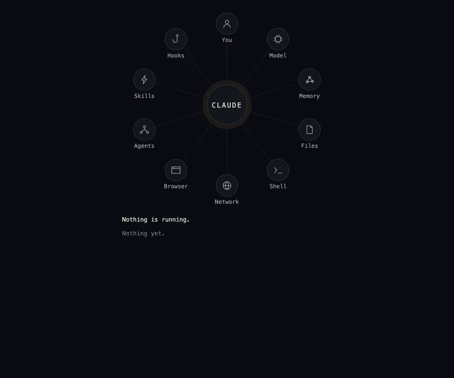

---
objectives:
  - "Bir agent'la çalışmayı neden onu kullanarak öğrendiğini söyle"
  - "Önce hangi kursu alacağını ve hangisinin isteğe bağlı olduğunu bil"
  - "Claude Cowork'ü Claude Duet'ten ayırt et"
---

# Agent'lar Pratikte

Bir yapay zekâ agent'ı, sana yalnızca cevap veren bir yapay zekâ değildir; senin için iş de yapar. Dosyaları açar, doküman yazar, internette arama yapar ve uygulamalarını kullanır; bir işi bitirene kadar bunları adım adım yapar. Agent'lar hakkında uzun süre okuyabilirsin, ama onları anlamanın en hızlı yolu birine gerçek bir iş verip ne yaptığını izlemektir.

> [!WARNING]
> **🛑 DUR. Önce kursları al, sonra buraya dön.**
>
> Asıl ders bu sayfada değil. Bu sayfa seni üç ücretsiz kursa yönlendiriyor; öğrenme o kursları yaparken oluyor. İkisi zorunlu ve toplam yaklaşık beş saat sürüyor: Claude 101 ve Introduction to Claude Cowork, ikisi de yaklaşık iki buçuk saat. Üçüncüsü olan Claude Code 101 isteğe bağlı ve yaklaşık bir buçuk saat ekliyor.
>
> ⏱️ Zorunlu olanlar yaklaşık beş saat · ➕ İsteğe bağlı olan yaklaşık bir buçuk saat
>
> Zamanını ayır, kursları aşağıdaki sırayla al ve bitirince bu sayfaya dön.

## Bu Kursları Neden Almalısın

Bir agent hakkında okurken her şey yolunda gider. Onunla çalışırken ise bazen seni yanlış anlar ya da yanlış bir yola sapar; o zaman bunu fark edip onu yeniden doğru yola sokman gerekir. Asıl beceri budur ve onu ancak pratik öğretir.

Aşağıdaki üç kurs ücretsiz ve kısa; yaparak öğreniyorsun. Hepsini araçları geliştiren şirket yazdı ve her biri kısa bir quiz ve bir rozetle bitiyor.

Üçü de Anthropic'in geliştirdiği yapay zekâ asistanı **Claude**'u kullanıyor. Bu yazıyı yazdığımız sırada bu tür işler için en yetenekli, en güvenilir ve en çok özelliğe sahip asistanın Claude olduğunu düşünüyoruz. Onunla öğrendiklerin başka yapay zekâ asistanlarında da işine yarar.

Aşağıdaki resim, çalışan bir yapay zekâ agent'ını gösteriyor. Resim, Claude Code için ücretsiz bir
eklenti olan lot-map'ten geliyor. Agent bir dosya okuduğunda, bir komut çalıştırdığında ya da modele bir
şey sorduğunda, haritada o yere bir ışık gidiyor.

  
*Yeniden oynatılan örnek bir oturum. Her ışık, agent'ın işindeki bir adımı gösteriyor. Kaynak: alexeyw'in [lot-map](https://github.com/alexeyw/lot-map) projesi (MIT lisansı).*

## Claude 101

> [!IMPORTANT]
> **🛑 Kurs 1 / 3: burada dur ve şimdi al**
>
> **Claude 101**: günlük işlerde Claude: ilk sohbetin, daha iyi cevaplar ve bir işi bir arada tutan project'ler.
>
> ⏱️ Yaklaşık iki buçuk saat · ✅ Zorunlu · 🏅 Ücretsiz kurs, quiz ve rozetle bitiyor
>
> Kursu aç, bitir, sonra bu sayfaya dönüp devam et.
>
> **[Kursu aç: Claude 101](https://academy.claude.com/courses/claude-101)**

[Claude 101](https://academy.claude.com/courses/claude-101), herkesin başlaması gereken yer. Claude'u günlük işlerinde nasıl kullanacağını gösteriyor: ilk sohbetin, daha iyi cevaplar almak için nasıl soracağın ve bir işe ait doküman ve talimatları bir project içinde nasıl bir arada tutacağın. Claude'un zaten kullandığın araçlara nasıl bağlandığını da gösteriyor.

Bir Claude hesabına ihtiyacın var; ücretsiz plan yeterli ve yapay zekâ deneyimi gerekmiyor. Yalnızca Cowork ve Research bölümlerini kendin denemek istersen ücretli bir plan gerekiyor. Yaklaşık iki buçuk saat sürüyor.

## Claude Code 101 (İsteğe Bağlı)

> [!NOTE]
> **💡 Kurs 2 / 3: isteğe bağlı, merak ediyorsan al**
>
> **Claude Code 101**: geliştiriciler için yazılmış coding agent kursu; kod bilmeyen insanlar da onunla küçük araçlar yapıyor.
>
> ⏱️ Yaklaşık bir buçuk saat · ➕ İsteğe bağlı · 🏅 Ücretsiz kurs, quiz ve rozetle bitiyor
>
> Alırsan bitir, sonra bu sayfaya dönüp devam et. Almayacaksan bir sonraki kursa geç.
>
> **[Kursu aç: Claude Code 101](https://academy.claude.com/courses/claude-code-101)**

[Claude Code 101](https://academy.claude.com/courses/claude-code-101), Claude Code'u öğretiyor. Claude Code, terminal denen bir metin penceresinde konuştuğun bir agent. Yazılım geliştirmek için yapıldı ve bu kurs da geliştiriciler için yazıldı.

Bu yüzden mühendis değilsen bu kurs isteğe bağlı. Yine de bir göz atmaya değer olduğunu düşünüyoruz: ne istediğini sade kelimelerle anlatıyorsun, Claude Code da kodu yazıp senin için çalıştırıyor. Kodlamadan hiç anlamayan insanlar bile onu küçük araçlar yapmak, tabloları düzenlemek ve sıkıcı işleri otomatikleştirmek için kullanıyor. Kursun kendisi, bir kod editörünü ve komut satırını biraz bildiğini varsayıyor. Ücretli bir Claude planı ya da bir API key gerekiyor.

## Introduction to Claude Cowork

> [!IMPORTANT]
> **🛑 Kurs 3 / 3: burada dur ve şimdi al**
>
> **Introduction to Claude Cowork**: Claude'un bilgisayarındaki dosyalar, klasörler ve uygulamalarla çalışması.
>
> ⏱️ Yaklaşık iki buçuk saat · ✅ Zorunlu · 🏅 Ücretsiz kurs, quiz ve rozetle bitiyor
>
> Kursu aç, bitir, sonra özet için bu sayfaya dön.
>
> **[Kursu aç: Introduction to Claude Cowork](https://academy.claude.com/courses/introduction-to-claude-cowork)**

Kod yazmıyorsan, Claude 101'den sonra bu kursu al. **Claude Cowork**, Claude'un doğrudan bilgisayarındaki dosyalar, klasörler ve uygulamalarla çalışmasıdır ve normal Claude uygulamasının bir parçasıdır. İşi sen başlatırsın: ona "bu faturaları klasörlere ayır ve bana bir özet çıkar" gibi bir hedef verirsin. Claude bir plan yapar, adımları uygular ve sen de yol boyunca onu yönlendirebilirsin. Sonunda bir rapor, bir tablo ya da düzenli bir klasör gibi gerçek bir sonuç elde edersin.

[Introduction to Claude Cowork](https://academy.claude.com/courses/introduction-to-claude-cowork), ona bu tür işleri devretmeyi öğretiyor. Ayrıca Chrome, Word, Excel, PowerPoint ve Outlook içindeki Claude'u ve yaptığı işe güvenmeden önce onu nasıl kontrol edeceğini gösteriyor. Kod yazmayı bilmen gerekmiyor; ücretli bir Claude planına, bilgisayarındaki klasörlerle çalışılan dersler için de Claude masaüstü uygulamasına ihtiyacın var. Yaklaşık iki buçuk saat sürüyor.

(Cowork'ü **Claude Duet** ile karıştırma. Cowork'te işi sen başlatırsın. Duet'te ise işi Claude başlatır: bağladığın uygulamaları takip eder, arka planda iş yapar ve her sabah sana kısa bir özetle gelir.)

## Özet

Bir yapay zekâ agent'ıyla çalışmayı, onunla çalışarak öğrenirsin. Claude 101 ile başla. Sonra dosyaların ve uygulamalarınla çalışan bir agent'ı öğreten Introduction to Claude Cowork kursunu al. Claude Code 101 senin için isteğe bağlı. Kurs geliştiriciler için yazılmış, ama anlattığı araç olan Claude Code, kod bilmeyen insanların da küçük şeyler yapmasına yardım ediyor.

## Kaynaklar

### 📄 Makaleler

- [Claude 101](https://academy.claude.com/courses/claude-101): günlük işlerde Claude
- [Claude Code 101](https://academy.claude.com/courses/claude-code-101): coding agent; geliştiriciler ve meraklılar için
- [Introduction to Claude Cowork](https://academy.claude.com/courses/introduction-to-claude-cowork): dosyalar ve uygulamalar üzerindeki işleri Claude'a devretmek
