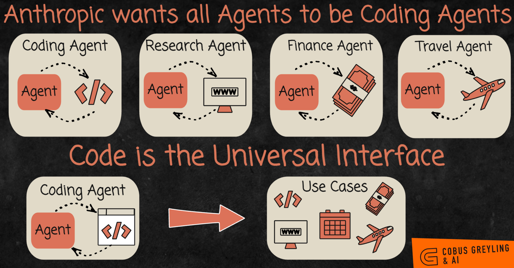
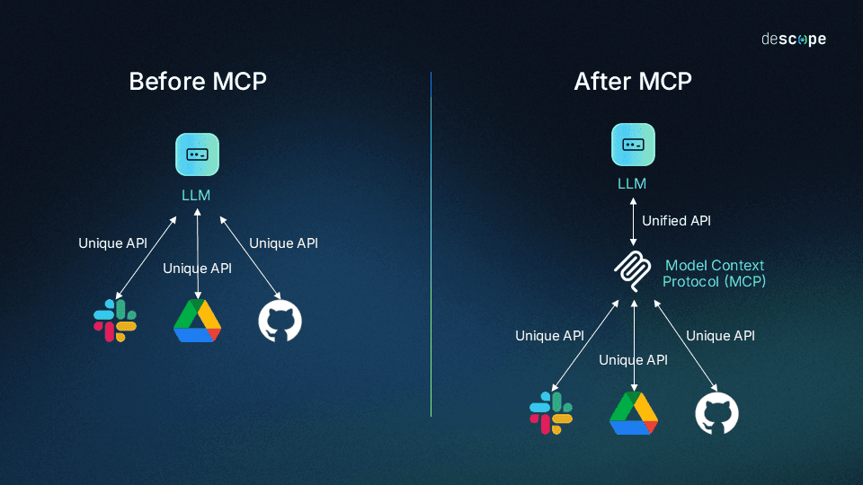
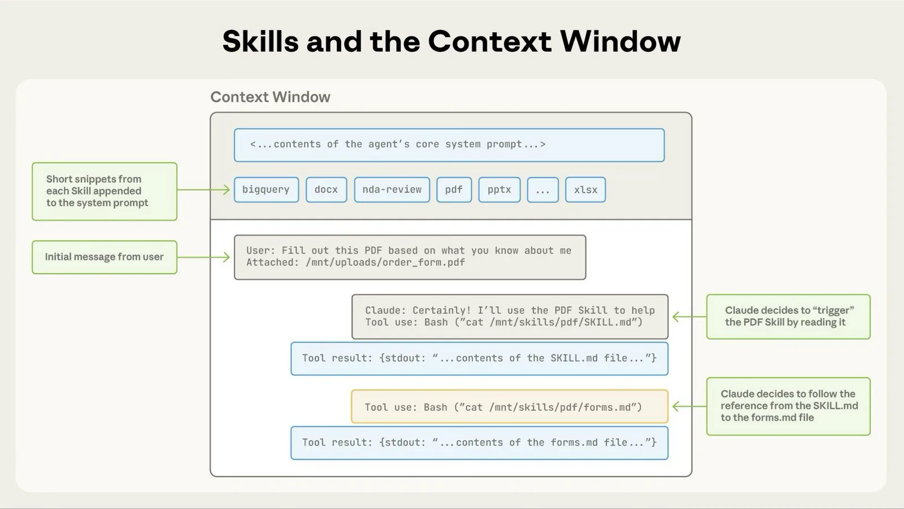
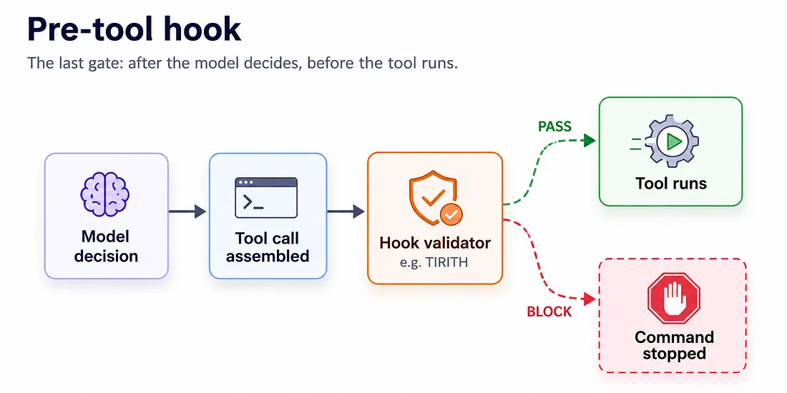
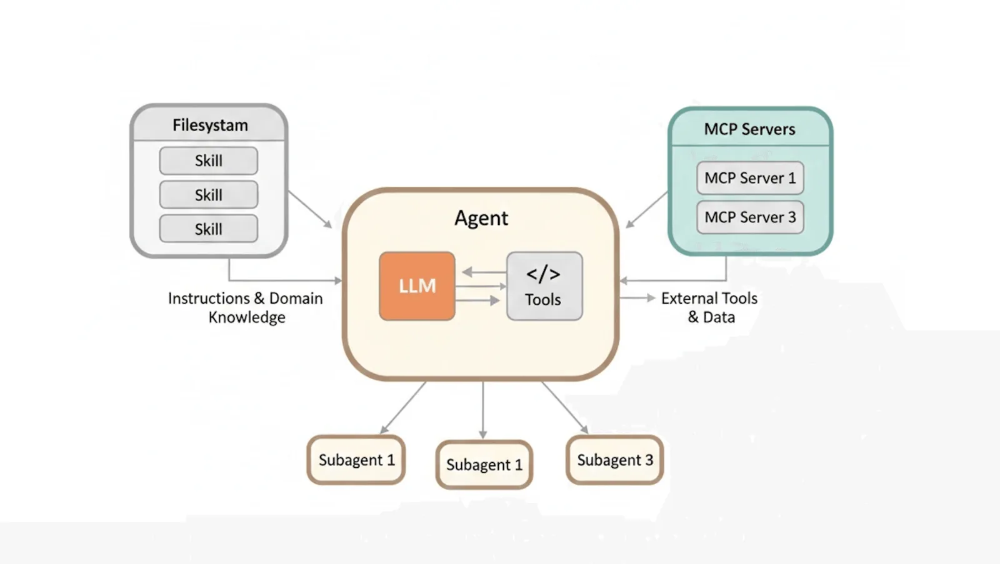

# Code Agents

[Context Engineering](context_engineering.md) ended with one point: the coding agents you may
already use are deep agents. They plan, they send helpers, and they read and write files. This
module is about those agents and their standard parts.

## Why This Matters to You

This module shows how you can build things by describing them. You describe what you want in plain words,
and a coding agent builds it: a small website, a tool that cleans up a spreadsheet, a script that
renames a thousand files. You do not need to know how to code. You need to know how to describe the
job clearly and how the agent works, which is what this course teaches. The
[Agents in Practice](agents_in_practice.md) module gives you courses to try it yourself.

## Why a Coding Agent Can Do More Than Code

Say you have an image and want to make it smaller, or turn it into another format. Without a coding
agent, someone has to build a tool for that job and give it to the AI.

A coding agent needs no ready-made tool. It writes the few lines of code that do the conversion,
and runs them. Ask it for a slide deck, and it does the same: it finds a piece of free software that
makes slides, installs it, and uses it.

Stop and think about this for a moment. These agents do not only *use* what exists. They *build*
what does not exist. One story people shared was about someone whose printer had no driver for their
computer. They asked a coding agent, and it wrote a working driver.

  
*The top row is the old way: one agent for each kind of work, and each needs its own tools built for it. The bottom row shows why coding agents took their place. Code can reach the web, the calendar, the bank and almost anything else.*

So code is not one skill among many. **It is the skill that can replace the others.** That is why a
coding agent helps with work that has nothing to do with software.

Almost every modern coding agent has the same standard parts: Claude Code, Codex, Copilot,
OpenCode and others. Here they are.

## AGENTS.md

When a new employee joins, you give them an onboarding note: how the team works, where things are,
which rules to follow. **AGENTS.md** is that note, written for the agent. It is a plain text file in
the project folder, and the agent reads it at the start of every session.

What belongs in it is what stays true for a long time: how to build and test the project, how the
folders are organised, and the rules the agent would otherwise get wrong. What does not belong is
anything that is out of date in a week, because the agent believes what the file says.

You do not have to write it from scratch. Type `/init`, and the agent reads the project and writes a
first draft for you to correct. (Claude Code reads a file called `CLAUDE.md` instead; it is the same
idea.)

## Slash Commands

A **slash command** is a prompt you write once and run again by typing `/name`, like an email
template. For example, `/review` could run your team's checklist against a piece of work, so you do
not type the same long prompt every week.

## Model Context Protocol (MCP)

Say you build a tool that connects an AI to your company's Jira. Then you want the same thing in
another AI product, and another. Without a standard, you build it again for each one.

The **Model Context Protocol** (MCP) solves this. Think of a universal charger plug that fits every
phone. A tool built once in the MCP standard works in every AI agent that supports MCP.

  
*On the left, every service needs its own connection, built separately for each AI. On the right, each service is connected once, in the MCP standard, and every AI can use it.*

What you get from it:

- **No lock-in.** When you change AI products, your tools still work.
- **Someone has usually built the one you need already.** Packages of MCP tools, called MCP
  servers, exist for most popular services. Adding one to your agent is often one command.

One cost to know: every connected MCP server takes a little room in the chat, even when it is not
used. So connect only the ones you need.

## Subagents

[Context Engineering](context_engineering.md) explained why helpers with a clean chat are useful.
In a coding agent you can also define your own: a security reviewer, a test writer, a translator.
Each one has its own fixed instructions and starts with a clean desk every time.

## Skills

A **skill** is a folder of instructions for one kind of task, such as "how to make a PDF report in
our company style". Think of recipe binders on a kitchen shelf.

At the start, the agent reads only the title on each binder, one short line each. So twenty skills
cost almost nothing. Only when a task needs one does the agent open that binder and read the full
instructions. This idea has a name you should remember: **progressive disclosure**.

  
*The thin band at the top is all twenty skills while they are not in use: one short line each. When a PDF task arrives, the agent opens the PDF skill and follows its instructions. The other nineteen never fill the chat.*

Why skills, instead of one huge set of instructions? Because of context engineering: everything the
agent might need is available, but only what it needs right now is in the chat.

## Hooks

Everything above is advice. The AI follows it most of the time. A **hook** is different: it is a
small program that runs at a fixed moment, for example just before the agent changes a file,
whether the AI wants it or not.

Think of the difference between a sign that says "please do not enter" and a locked door. An
instruction in AGENTS.md that says "never touch this file" is the sign. A hook that blocks any
change to that file is the locked door.

  
*The hook runs after the AI has decided and before the action happens, so it is the last gate. It checks the action and either lets it run or stops it, whatever the AI intended.*

This difference, a request against a rule, is where the next module,
[Harness Engineering](harness_engineering.md), begins.

## Plugins

A **plugin** is a package of all the above: commands, skills, helpers, hooks and MCP servers,
installed in one step. A new teammate gets the whole team setup at once.

## MEMORY.md

Every session starts with an empty chat. Two things carry knowledge from one session to the next:

| | AGENTS.md / CLAUDE.md | The agent's own memory |
| --- | --- | --- |
| Who writes it | You | The agent |
| What it holds | Instructions and rules | Lessons, your preferences, your corrections |
| When it is read | Every session | Every session |

The agent writes its memory from the corrections you give it. So the thing you had to explain twice
this week is still there next Monday. You can also say "remember that..." and it writes a note.

## Plan Mode

For a big job, starting to build at once is the wrong first step. In **plan mode**, the agent can
look at everything but change nothing. It studies the project, asks you questions, and writes a
plan. You approve or correct the plan, and only then does it start. It is like an architect who
draws the plans and asks questions before anyone builds.

## Reasoning Effort

`/effort` sets how much the agent thinks, the same dial as in
[Prompt Engineering](prompt_engineering.md). Medium suits small edits and questions. High suits
normal work. The highest settings suit truly hard problems. More thinking costs more time and money,
so match it to the task.

## Notice What All of These are

Look back: AGENTS.md, slash commands, subagents, skills, hooks, plugins, memory and plans. Almost all
of them are **plain text files in folders**. You can open them in any editor, read them, and share
them. That is not laziness. It is the one format that both people and AI handle well.

  
*Three different problems, three answers. Skills (left) change how the agent behaves. MCP servers (right) let it reach other systems. Subagents (bottom) do expensive work in a separate chat.*

You do not have to write code to use these ideas. Claude Cowork, for people who do not code, uses
the same skills and plugins.

## Words You Now Know

- **Coding agent**: an agent that writes and runs code to do a job.
- **AGENTS.md**: the onboarding note for the agent.
- **Slash command**: a saved prompt you run by name.
- **MCP**: one standard plug that lets a tool work in every AI agent.
- **Subagent**: a specialist helper with its own clean chat.
- **Skill**: a folder of instructions, opened only when a task needs it.
- **Progressive disclosure**: read only the titles until a task needs the full instructions.
- **Hook**: a small program that always runs at a fixed moment, a rule rather than a request.
- **Plugin**: a bundle of all of the above.
- **Plan mode**: the agent studies and plans before changing anything.

## Summary

A coding agent can build the tool it is missing, so code is the skill that replaces the others, and
you can use it by describing the job in plain words. Every coding agent has the same parts: an
onboarding note, saved prompts, a standard plug for tools, specialist helpers, recipe-like skills,
hooks that act as locked doors, plugins, memory and a plan mode. Almost all of them are plain text
files.

**Quick check**: Why can a coding agent help with work that has nothing to do with software? And
what is the difference between an instruction in AGENTS.md and a hook?

## References

### 📄 Articles

- [Equipping agents for the real world with Agent Skills](https://www.anthropic.com/engineering/equipping-agents-for-the-real-world-with-agent-skills): where progressive disclosure is explained properly
- [How Claude remembers your project](https://code.claude.com/docs/en/memory): the two kinds of memory, and where the files live
- [Connect to MCP servers](https://code.claude.com/docs/en/mcp-quickstart): how to add an MCP server

### 🛠️ Tools

- [agents.md](https://agents.md/): the open format for the onboarding note

### 🗃️ Repositories

- [awesome-mcp-servers](https://github.com/punkpeye/awesome-mcp-servers): the community list, to check whether the tool you need already exists
- [anthropics/skills](https://github.com/anthropics/skills): the official skill collection
