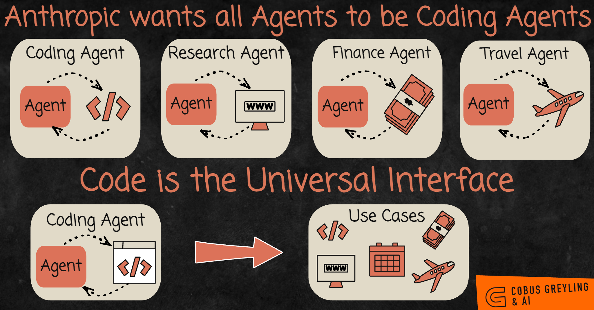
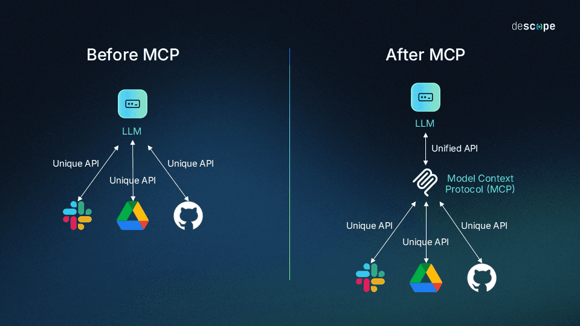
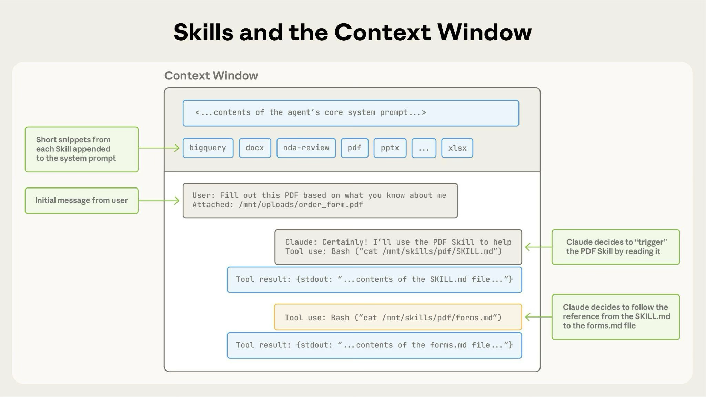
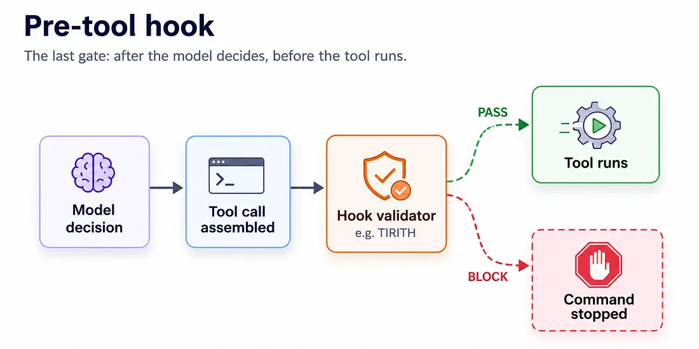
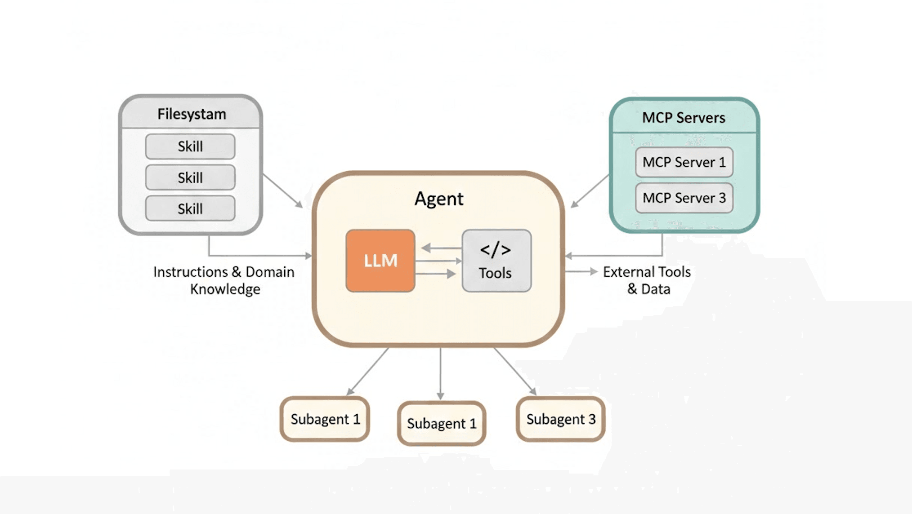

# Code Agent‌ها

[Context Engineering](context_engineering_fa.md) با یه نکته تموم شد: coding agent‌هایی که شاید همین الان استفاده می‌کنی، deep agent‌ان. برنامه می‌ریزن، کمک‌کار می‌فرستن و فایل می‌خونن و می‌نویسن. این درس درباره‌ی همین agent‌ها و بخش‌های استانداردشونه.

## چرا این برای تو مهمه

این درس نشون می‌ده چطور می‌تونی چیزی رو با توضیح دادنش بسازی. با کلمه‌های ساده می‌گی چی می‌خوای و یه coding agent می‌سازدش: یه سایت کوچیک، یه ابزار که یه spreadsheet رو مرتب می‌کنه، یه script که اسم هزار تا فایل رو عوض می‌کنه. لازم نیست کدنویسی بلد باشی. لازمه بدونی چطور کار رو روشن توضیح بدی و agent چطور کار می‌کنه، که همین رو این دوره یادت می‌ده. درس [Agent‌ها در عمل](agents_in_practice_fa.md) هم چند تا دوره بهت می‌ده که خودت امتحانش کنی.

## چرا coding agent فقط به درد کد نمی‌خوره

فرض کن یه عکس داری و می‌خوای کوچیکترش کنی یا به یه فرمت دیگه تبدیلش کنی. بدون coding agent یکی باید برای این کار یه ابزار بسازه و بده دست AI.

یه coding agent به ابزار آماده احتیاج نداره. خودش چند خط کدی رو که تبدیل رو انجام می‌ده می‌نویسه و اجراش می‌کنه. یه اسلاید ازش بخوای، همین کار رو می‌کنه: یه نرم‌افزار رایگان پیدا می‌کنه که اسلاید می‌سازه، نصبش می‌کنه و ازش استفاده می‌کنه.

یه لحظه به این فکر کن. این agent‌ها فقط از چیزهایی که هست *استفاده* نمی‌کنن. چیزهایی رو که نیست *می‌سازن*. یه داستان که دست‌به‌دست شد درباره‌ی کسی بود که پرینترش برای کامپیوترش درایور نداشت. از یه coding agent خواست و اون یه درایور ساخت که کار می‌کرد.

  
*ردیف بالا راه قدیمیه: برای هر جور کار یه agent، و هر کدوم ابزارهای مخصوص خودش رو لازم داره. ردیف پایین نشون می‌ده چرا coding agent‌ها جاشون رو گرفتن. کد می‌تونه به وب، تقویم، بانک و تقریباً هر چیز دیگه‌ای برسه.*

پس کد یه مهارت از بین مهارت‌های دیگه نیست. **مهارتیه که می‌تونه جای بقیه رو بگیره.** برای همینه که یه coding agent توی کارهایی که ربطی به نرم‌افزار ندارن هم کمک می‌کنه.

تقریباً هر coding agent مدرن همین بخش‌های استاندارد رو داره: Claude Code، Codex، Copilot،
OpenCode و بقیه. بخش‌ها اینان.

## AGENTS.md

وقتی یه کارمند جدید میاد، بهش یه یادداشت معرفی می‌دی: تیم چطور کار می‌کنه، چیزها کجان، کدوم قانون‌ها رو باید رعایت کنه. **AGENTS.md** همون یادداشته، که برای agent نوشته شده. یه فایل متنی ساده‌ست توی پوشه‌ی پروژه، و agent اول هر session می‌خونتش.

چیزی که توش جا داره، چیزهاییه که برای مدت طولانی درست می‌مونن: پروژه چطور ساخته و تست می‌شه، پوشه‌ها چطور سازمان‌دهی شدن، و قانون‌هایی که agent وگرنه اشتباه می‌کنه. چیزی که توش جا نداره هر چیزیه که تا یه هفته دیگه قدیمی می‌شه، چون agent هر چی توی فایل باشه رو باور می‌کنه.

لازم نیست از صفر بنویسیش. `/init` رو تایپ کن، تا agent پروژه رو بخونه و یه پیش‌نویس اول بنویسه که تو اصلاحش کنی. (Claude Code به جاش یه فایل به اسم `CLAUDE.md` رو می‌خونه؛ همون ایده‌ست.)

## Slash Command‌ها

**slash command** یه prompt‌ه که یه بار می‌نویسیش و بعد با تایپ `/name` دوباره اجراش می‌کنی، مثل یه قالب ایمیل. مثلاً `/review` می‌تونه چک‌لیست تیمت رو روی یه کار اجرا کنه، که هر هفته مجبور نباشی همون prompt بلند رو تایپ کنی.

## Model Context Protocol (MCP)

فرض کن یه ابزار می‌سازی که یه AI رو به Jira شرکتت وصل می‌کنه. بعد همین رو توی یه محصول AI دیگه می‌خوای، و بعد یکی دیگه. بدون یه استاندارد، برای هر کدوم از نو می‌سازیش.

این مشکل رو **Model Context Protocol** (MCP) حل می‌کنه. یه شارژر همه‌کاره رو تصور کن که به همه‌ی گوشی‌ها می‌خوره. ابزاری که یه بار با استاندارد MCP ساخته بشه، توی هر agent‌ای که MCP رو پشتیبانی کنه کار می‌کنه.

  
*سمت چپ، هر سرویس یه اتصال مخصوص خودش می‌خواد که برای هر AI جدا ساخته می‌شه. سمت راست، هر سرویس یه بار با استاندارد MCP وصل می‌شه و هر AI می‌تونه ازش استفاده کنه.*

چیزی که از این گیرت میاد:

- **گیر نمی‌افتی.** وقتی محصول AI رو عوض کنی، ابزارهات هنوز کار می‌کنن.
- **معمولاً یکی اونی که لازم داری رو از قبل ساخته.** برای بیشتر سرویس‌های محبوب بسته‌هایی از ابزارهای MCP هست، به اسم MCP server. اضافه کردن یکیشون به agent اغلب فقط یه دستوره.

یه هزینه که باید بدونی: هر MCP server وصل‌شده یه کم از جای چت رو می‌گیره، حتی وقتی استفاده نشه. پس فقط اونایی رو وصل کن که لازم داری.

## Subagent‌ها

[Context Engineering](context_engineering_fa.md) توضیح داد چرا کمک‌کارهایی با چت تمیز به درد می‌خورن. توی یه coding agent می‌تونی مال خودت رو هم تعریف کنی: یه بازبین امنیت، یه نویسنده‌ی تست، یه مترجم. هر کدوم دستورهای ثابت مخصوص خودش رو داره و هر بار با یه میز تمیز شروع می‌کنه.

## Skill‌ها

یه **skill** یه پوشه از دستورهاست برای یه جور کار، مثلاً «چطور با سبک شرکتمون یه گزارش PDF بسازیم». کلاسورهای دستور پخت روی قفسه‌ی آشپزخونه رو تصور کن.

اول کار agent فقط عنوان روی هر کلاسور رو می‌خونه، یه خط کوتاه برای هر کدوم. پس بیست تا skill تقریباً هیچی خرج نداره. فقط وقتی یه کار به یکی‌شون نیاز داشته باشه، agent اون کلاسور رو باز می‌کنه و دستورهای کامل رو می‌خونه. این ایده یه اسم داره که باید یادت بمونه: **progressive disclosure** (آشکار شدن مرحله‌به‌مرحله).

  
*نوار باریک بالا همه‌ی بیست تا skill رو نشون می‌ده وقتی استفاده نمی‌شن: یه خط کوتاه برای هر کدوم. وقتی یه کار PDF میاد، agent skill مربوط به PDF رو باز می‌کنه و دستورهاش رو دنبال می‌کنه. نوزده‌تای دیگه هیچ‌وقت چت رو پر نمی‌کنن.*

چرا skill، به جای یه مجموعه‌ی غول‌پیکر از دستورها؟ به خاطر context engineering: هر چیزی که agent ممکنه لازم داشته باشه در دسترسه، ولی فقط چیزی که همین الان لازمشه توی چته.

## Hook‌ها

هر چی تا حالا گفتیم توصیه بود. AI بیشتر وقت‌ها رعایتش می‌کنه. **hook** فرق داره: یه برنامه‌ی کوچیکه که توی یه لحظه‌ی مشخص اجرا می‌شه، مثلاً درست قبل از این‌که agent یه فایل رو عوض کنه، چه AI بخواد چه نخواد.

فرق بین تابلوی «لطفاً وارد نشید» و یه در قفل‌شده رو تصور کن. یه دستور توی AGENTS.md که می‌گه «هیچ‌وقت به این فایل دست نزن» همون تابلوئه. یه hook که هر تغییری روی اون فایل رو مسدود می‌کنه، همون در قفل‌شده‌ست.

  
*hook بعد از این‌که AI تصمیمش رو گرفته و قبل از این‌که کار انجام بشه اجرا می‌شه، پس آخرین دروازه‌ست. کار رو بررسی می‌کنه و یا می‌ذاره اجرا بشه یا متوقفش می‌کنه، هر چی که AI قصد کرده باشه.*

این فرق، یعنی درخواست در برابر قانون، همون‌جاییه که درس بعدی، [Harness Engineering](harness_engineering_fa.md)، از اون شروع می‌شه.

## Plugin‌ها

یه **plugin** یه بسته از همه‌ی چیزهای بالاست: command‌ها، skill‌ها، کمک‌کارها، hook‌ها و MCP server‌ها، که با یه قدم نصب می‌شه. هم‌تیمی جدید کل تنظیمات تیم رو یک‌جا می‌گیره.

## MEMORY.md

هر session با یه چت خالی شروع می‌شه. دو چیز هست که دانش رو از یه session به بعدی می‌رسونن:

| | AGENTS.md / CLAUDE.md | حافظه‌ی خود agent |
| --- | --- | --- |
| کی می‌نویسه | تو | agent |
| چی توشه | دستورها و قانون‌ها | درس‌ها، ترجیح‌های تو، اصلاح‌هایی که کردی |
| کی خونده می‌شه | هر session | هر session |

agent حافظه‌ش رو از اصلاح‌هایی که بهش می‌دی می‌نویسه. پس چیزی که این هفته دو بار مجبور شدی توضیح بدی، دوشنبه‌ی بعد هم هست. می‌تونی بگی «یادت باشه که...» هم بگی و یه یادداشت می‌نویسه.

## Plan Mode

برای یه کار بزرگ، یه‌راست شروع کردن به ساختن قدم اول اشتباهیه. توی **plan mode** agent می‌تونه همه‌چی رو ببینه ولی هیچی رو عوض نکنه. پروژه رو بررسی می‌کنه، ازت سوال می‌پرسه و یه برنامه می‌نویسه. تو برنامه رو تأیید یا اصلاح می‌کنی، و فقط بعدش شروع می‌کنه. مثل یه معماره که قبل از این‌که کسی بسازه، نقشه می‌کشه و سوال می‌پرسه.

## Reasoning Effort

`/effort` تنظیم می‌کنه agent چقدر فکر کنه، همون پیچی که توی [Prompt Engineering](prompt_engineering_fa.md) بود. medium برای ویرایش‌های کوچیک و سوال‌ها خوبه. high برای کار معمولیه. بالاترین تنظیم‌ها برای مسئله‌های واقعاً سخته. فکر کردن بیشتر وقت و پول بیشتری می‌گیره، پس با کار جورش کن.

## همه‌ی این‌ها در اصل یه چیزن

یه نگاه به عقب بنداز: AGENTS.md، slash command‌ها، subagent‌ها، skill‌ها، hook‌ها، plugin‌ها، memory و plan‌ها. تقریباً همه‌شون **فایل‌های متنی ساده توی پوشه‌ها**ن. می‌تونی توی هر editor بازشون کنی، بخونیشون و به اشتراک بذاریشون. این تنبلی نیست. این تنها فرمتیه که هم آدم‌ها خوب باهاش کار می‌کنن هم AI.

  
*سه مشکل مختلف، سه جواب. Skill‌ها (چپ) رفتار agent رو عوض می‌کنن. MCP server‌ها (راست) بهش اجازه می‌دن به سیستم‌های دیگه برسه. Subagent‌ها (پایین) کار پرهزینه رو توی یه چت جدا انجام می‌دن.*

لازم نیست برای استفاده از این ایده‌ها کد بنویسی. Claude Cowork، که برای آدم‌هایی که کد نمی‌نویسن ساخته شده، از همین skill‌ها و plugin‌ها استفاده می‌کنه.

## کلمه‌هایی که الان بلدی

- **Coding agent**: agent‌ای که برای انجام یه کار کد می‌نویسه و اجرا می‌کنه.
- **AGENTS.md**: یادداشت معرفی برای agent.
- **Slash command**: یه prompt ذخیره‌شده که با اسم اجراش می‌کنی.
- **MCP**: یه دوشاخه‌ی استاندارد که باعث می‌شه یه ابزار توی هر AI agent کار کنه.
- **Subagent**: یه کمک‌کار متخصص با چت تمیز مال خودش.
- **Skill**: یه پوشه از دستورها، که فقط وقتی کار لازمش داشته باشه باز می‌شه.
- **Progressive disclosure**: تا وقتی کار دستورهای کامل رو لازم نداره، فقط عنوان‌ها رو بخون.
- **Hook**: یه برنامه‌ی کوچیک که همیشه توی یه لحظه‌ی مشخص اجرا می‌شه، یه قانون نه یه درخواست.
- **Plugin**: یه بسته از همه‌ی چیزهای بالا.
- **Plan mode**: agent قبل از عوض کردن هر چیزی بررسی می‌کنه و برنامه می‌ریزه.

## خلاصه

یه coding agent می‌تونه ابزاری رو که نداره خودش بسازه، پس کد مهارتیه که جای بقیه رو می‌گیره، و تو می‌تونی با توضیح دادن کار به زبون ساده ازش استفاده کنی. هر coding agent همین بخش‌ها رو داره: یه یادداشت معرفی، prompt‌های ذخیره‌شده، یه دوشاخه‌ی استاندارد برای ابزارها، کمک‌کارهای متخصص، skill‌هایی شبیه دستور پخت، hook‌هایی که مثل در قفل‌شده عمل می‌کنن، plugin‌ها، memory و plan mode. تقریباً همه‌شون فایل‌های متنی ساده‌ان.

**بررسی سریع**: چرا یه coding agent توی کارهایی که ربطی به نرم‌افزار ندارن هم می‌تونه کمک کنه؟ و فرق یه دستور توی AGENTS.md با یه hook چیه؟

## منابع

### 📄 مقاله‌ها

- [Equipping agents for the real world with Agent Skills](https://www.anthropic.com/engineering/equipping-agents-for-the-real-world-with-agent-skills): جایی که progressive disclosure درست توضیح داده شده
- [How Claude remembers your project](https://code.claude.com/docs/en/memory): دو جور حافظه، و این‌که فایل‌ها کجان
- [Connect to MCP servers](https://code.claude.com/docs/en/mcp-quickstart): چطور یه MCP server اضافه کنی

### 🛠️ ابزارها

- [agents.md](https://agents.md/): فرمت باز برای یادداشت معرفی

### 🗃️ Repository‌ها

- [awesome-mcp-servers](https://github.com/punkpeye/awesome-mcp-servers): فهرست جامعه، که ببینی ابزاری که لازم داری از قبل هست یا نه
- [anthropics/skills](https://github.com/anthropics/skills): مجموعه‌ی رسمی skill‌ها
