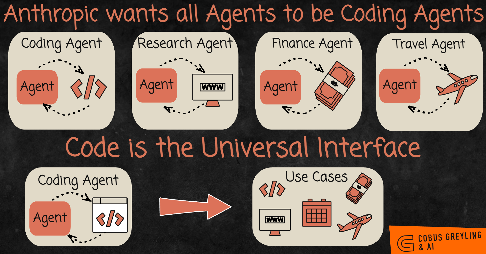
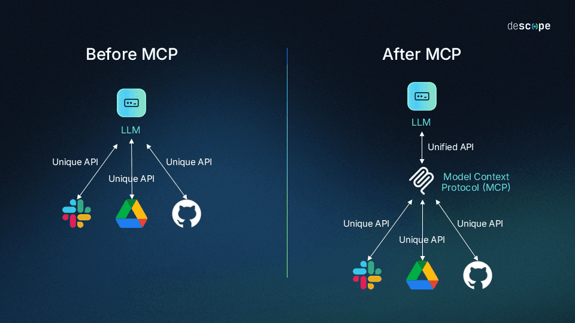
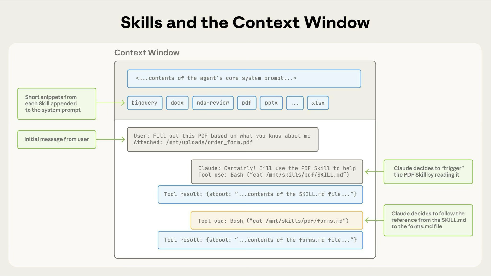
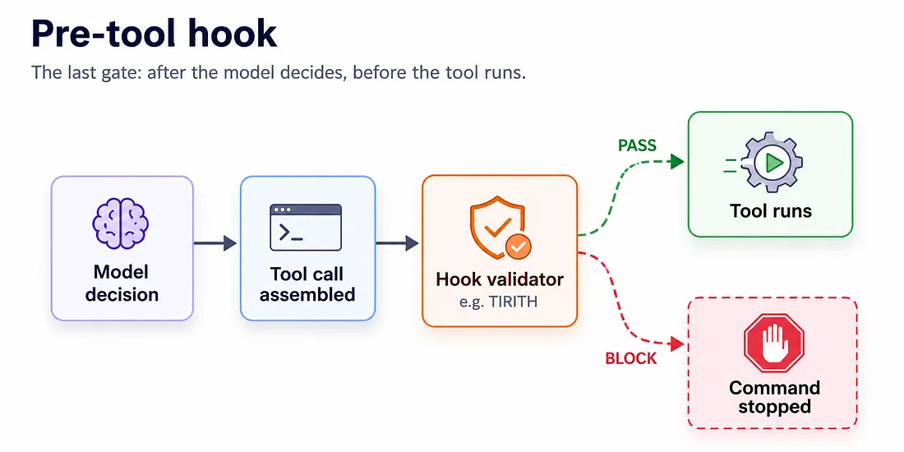
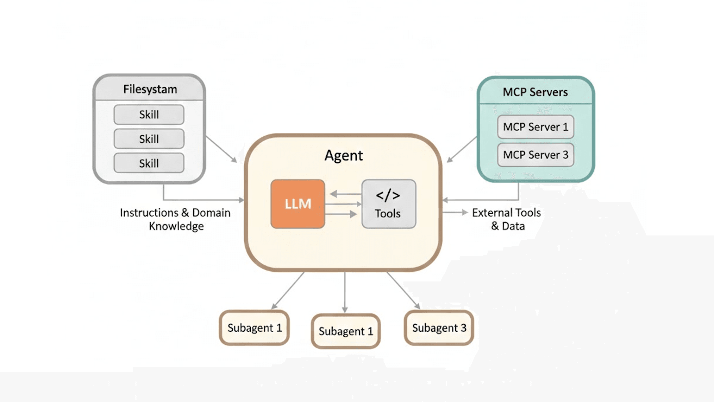

# Code Agent'lar

[Context Engineering](context_engineering_tr.md) modülü bir noktayla bitmişti: belki de zaten kullandığın code agent'lar, deep agent'lardır. Plan yapıyorlar, yardımcı gönderiyorlar, dosyaları okuyup yazıyorlar. Bu modül o agent'ları ve onların standart parçalarını anlatıyor.

## Bu Senin İçin Neden Önemli

Bu kursun vaadinin gerçeğe dönüştüğü yer burası. Ne istediğini sade kelimelerle anlatıyorsun ve bir code agent onu inşa ediyor: küçük bir web sitesi, bir tabloyu temizleyen bir araç, bin dosyanın adını değiştiren bir script. Kod yazmayı bilmen gerekmiyor. İşi net anlatmayı ve agent'ın nasıl çalıştığını bilmen gerekiyor; bu kurs tam olarak bunu öğretiyor. [Agent'lar Pratikte](agents_in_practice_tr.md) modülü de bunu kendin denemen için sana kurslar veriyor.

## Bir Code Agent Neden Koddan Fazlasını Yapabilir

Elinde bir görsel olduğunu ve onu küçültmek ya da başka bir formata çevirmek istediğini düşün. Code agent olmadan, birinin bu iş için bir araç yapıp onu yapay zekâya vermesi gerekir.

Bir code agent'ın hazır araca ihtiyacı yok. Dönüştürmeyi yapan birkaç satır kodu yazıyor ve çalıştırıyor. Ondan bir slayt sunumu istediğinde de aynısını yapıyor: slayt hazırlayan ücretsiz bir yazılım buluyor, kuruyor ve kullanıyor.

Bir an durup bunu düşün. Bu agent'lar yalnızca var olanı *kullanmıyor*. Var olmayanı *inşa ediyor*. İnsanların paylaştığı bir hikâye, yazıcısının bilgisayarı için sürücüsü olmayan birinin anlatısıydı. Bir code agent'a sormuş ve agent çalışan bir sürücü yazmıştı.

  
*Üst satır eski yöntem: her iş türü için ayrı bir agent var ve her birinin kendi araçlarının ayrıca yapılması gerekiyor. Alt satır, code agent'ların neden onların yerini aldığını gösteriyor. Kod web'e, takvime, bankaya ve neredeyse her şeye ulaşabilir.*

Yani kod, birçok beceriden biri değil. **Diğerlerinin yerini alabilen beceri o.** Bir code agent'ın yazılımla ilgisi olmayan işlerde de yardım edebilmesinin sebebi bu.

Neredeyse her modern code agent'ın aynı standart parçaları var: Claude Code, Codex, Copilot, OpenCode ve diğerleri. İşte o parçalar.

## AGENTS.md: İşe Başlama Notu

Yeni bir çalışan işe başladığında ona bir işe başlama notu verirsin: ekip nasıl çalışıyor, şeyler nerede, hangi kurallara uyulacak. **AGENTS.md** o notun agent için yazılmış hâli. Proje klasöründeki sade bir metin dosyası ve agent onu her oturumun başında okuyor.

İçine konacak şey, uzun süre doğru kalacak olanlar: projenin nasıl derlenip test edileceği, klasörlerin nasıl düzenlendiği ve agent'ın aksi halde yanlış yapacağı kurallar. Bir hafta içinde eskiyecek şeyler ise oraya ait değil, çünkü agent dosyanın söylediğine inanıyor.

Onu sıfırdan yazman gerekmiyor. `/init` yazarsan agent projeyi okuyor ve senin düzeltmen için bir ilk taslak yazıyor. (Claude Code bunun yerine `CLAUDE.md` adlı bir dosyayı okuyor; fikir aynı.)

## Slash Command'lar: Kayıtlı Prompt'lar

**Slash command**, bir kez yazıp `/isim` yazarak tekrar çalıştırdığın bir prompt; bir e-posta şablonu gibi. Örneğin `/review`, ekibinin kontrol listesini bir işe karşı çalıştırabilir; böylece aynı uzun prompt'u her hafta yeniden yazmazsın.

## MCP: Her Araç İçin Tek Bir Fiş

Yapay zekâyı şirketinin Jira'sına bağlayan bir araç yaptığını düşün. Sonra aynısını başka bir yapay zekâ ürününde, sonra bir başkasında istiyorsun. Bir standart yoksa her biri için yeniden yapman gerekir.

**Model Context Protocol** (MCP) bunu çözüyor. Her telefona uyan evrensel bir şarj fişini düşün. MCP standardında bir kez yapılan bir araç, MCP'yi destekleyen her yapay zekâ agent'ında çalışıyor.

  
*Solda her servisin, her yapay zekâ için ayrı ayrı yapılmış kendi bağlantısı var. Sağda her servis MCP standardında bir kez bağlanıyor ve her yapay zekâ onu kullanabiliyor.*

Bundan elde ettiklerin:

- **Bağımlılık yok.** Yapay zekâ ürününü değiştirdiğinde araçların yine çalışır.
- **İhtiyacın olanı genellikle biri zaten yapmıştır.** MCP server denen MCP araç paketleri, çoğu popüler servis için var. Bir tanesini agent'ına eklemek çoğu zaman tek komut.

Bilmen gereken bir bedel: bağlı her MCP server, kullanılmasa bile sohbette biraz yer kaplıyor. Bu yüzden yalnızca ihtiyacın olanları bağla.

## Subagent'lar: Kendi Uzmanların

[Context Engineering](context_engineering_tr.md) modülü, temiz sohbetli yardımcıların neden işe yaradığını anlatmıştı. Bir code agent'ta kendi yardımcılarını da tanımlayabilirsin: bir güvenlik gözden geçiricisi, bir test yazarı, bir çevirmen. Her birinin kendi sabit talimatları var ve her seferinde temiz bir masayla başlıyor.

## Skill'ler: Rafta Duran Tarif Dosyaları

**Skill**, tek bir iş türü için talimatlardan oluşan bir klasör; örneğin "şirketimizin stilinde PDF raporu nasıl hazırlanır". Mutfaktaki rafta duran tarif dosyalarını düşün.

Başlangıçta agent her dosyanın yalnızca üzerindeki başlığı, yani birer kısa satırı okuyor. Yani yirmi skill neredeyse hiçbir şeye mal olmuyor. Agent, bir iş birine ihtiyaç duyduğunda o dosyayı açıyor ve talimatların tamamını okuyor. Bu fikrin hatırlaman gereken bir adı var: **progressive disclosure** (kademeli açılım).

  
*En üstteki ince şerit, kullanılmadıkları sürece yirmi skill'in hepsi: her biri bir kısa satır. Bir PDF işi geldiğinde agent PDF skill'ini açıyor ve talimatlarını izliyor. Diğer ondokuz tanesi sohbeti hiç doldurmuyor.*

Neden tek bir kocaman talimat seti yerine skill'ler? Çünkü context engineering: agent'ın ihtiyaç duyabileceği her şey elinin altında, ama sohbette yalnızca şu an ihtiyaç duyduğu şey var.

## Hook'lar: Tabela Değil, Kilitli Kapı

Yukarıdaki her şey bir tavsiye. Yapay zekâ çoğu zaman onlara uyuyor. **Hook** farklı: sabit bir anda çalışan küçük bir program; örneğin agent bir dosyayı değiştirmeden hemen önce, yapay zekâ istesin istemesin.

"Lütfen girmeyin" yazan bir tabela ile kilitli bir kapı arasındaki farkı düşün. AGENTS.md'deki "bu dosyaya asla dokunma" talimatı tabela. O dosyada yapılacak her değişikliği engelleyen bir hook ise kilitli kapı.

  
*Hook, yapay zekâ kararını verdikten sonra ve eylem gerçekleşmeden önce çalışıyor; yani son kapı o. Eylemi kontrol ediyor ve yapay zekânın niyeti ne olursa olsun ya çalışmasına izin veriyor ya da durduruyor.*

Bir istek ile bir kural arasındaki bu fark, bir sonraki modül olan [Harness Engineering](harness_engineering_tr.md)'in başladığı yer.

## Plugin'ler: Paket

**Plugin**, yukarıdakilerin hepsinden oluşan bir paket: command'lar, skill'ler, yardımcılar, hook'lar ve MCP server'lar; tek adımda kuruluyor. Yeni bir ekip arkadaşı bütün ekip düzenini bir anda alıyor.

## Memory: Senin Yazdığın ve Agent'ın Yazdığı

Her oturum boş bir sohbetle başlıyor. Bilgiyi bir oturumdan diğerine taşıyan iki şey var:

| | AGENTS.md / CLAUDE.md | Agent'ın kendi memory'si |
| --- | --- | --- |
| Kim yazıyor | Sen | Agent |
| İçinde ne var | Talimatlar ve kurallar | Dersler, tercihlerin, düzeltmelerin |
| Ne zaman okunuyor | Her oturum | Her oturum |

Agent, memory'sini senin verdiğin düzeltmelerden yazıyor. Yani bu hafta iki kez anlatmak zorunda kaldığın şey, gelecek pazartesi de orada duruyor. "Şunu hatırla..." da diyebilirsin ve bir not yazıyor.

## Plan Mode: Önce Planı Çiz

Büyük bir işte hemen inşa etmeye başlamak yanlış ilk adım. **Plan mode**'da agent her şeye bakabiliyor ama hiçbir şeyi değiştiremiyor. Projeyi inceliyor, sana sorular soruyor ve bir plan yazıyor. Planı sen onaylıyorsun ya da düzeltiyorsun ve ancak ondan sonra başlıyor. Bu, kimse inşa etmeye başlamadan önce planları çizen ve soru soran bir mimara benziyor.

## Reasoning Effort: Yine Düşünme Kadranı

`/effort`, agent'ın ne kadar düşüneceğini ayarlıyor; [Prompt Engineering](prompt_engineering_tr.md) modülündeki kadranın aynısı. Orta seviye küçük düzenlemelere ve sorulara uygun. Yüksek seviye normal işlere uygun. En yüksek ayarlar gerçekten zor problemlere uygun. Daha fazla düşünmek daha çok zamana ve paraya mal oluyor, bu yüzden ayarı göreve göre seç.

## Bunların Hepsinin Ne Olduğuna Dikkat Et

Geriye bak: AGENTS.md, slash command'lar, subagent'lar, skill'ler, hook'lar, plugin'ler, memory ve planlar. Neredeyse hepsi **klasörlerdeki sade metin dosyaları**. Hepsini herhangi bir editörde açıp okuyabilir ve paylaşabilirsin. Bu tembellik değil. Hem insanların hem yapay zekânın iyi işlediği tek format bu.

  
*Üç farklı problem, üç cevap. Skill'ler (solda) agent'ın nasıl davrandığını değiştiriyor. MCP server'lar (sağda) onun başka sistemlere ulaşmasını sağlıyor. Subagent'lar (altta) pahalı işi ayrı bir sohbette yapıyor.*

Bu fikirleri kullanmak için kod yazman gerekmiyor. Kod yazmayan insanlar için hazırlanan Claude Cowork da aynı skill'leri ve plugin'leri kullanıyor.

## Artık Bildiğin Terimler

- **Coding agent**: bir işi yapmak için kod yazan ve çalıştıran agent.
- **AGENTS.md**: agent için işe başlama notu.
- **Slash command**: adıyla çalıştırdığın kayıtlı bir prompt.
- **MCP**: bir aracın her yapay zekâ agent'ında çalışmasını sağlayan tek standart fiş.
- **Subagent**: kendi temiz sohbeti olan uzman bir yardımcı.
- **Skill**: yalnızca bir iş ihtiyaç duyduğunda açılan talimat klasörü.
- **Progressive disclosure**: bir iş talimatların tamamına ihtiyaç duyana kadar yalnızca başlıkları okumak.
- **Hook**: sabit bir anda her zaman çalışan küçük bir program; bir istek değil, bir kural.
- **Plugin**: yukarıdakilerin hepsinden oluşan paket.
- **Plan mode**: agent'ın bir şeyi değiştirmeden önce inceleyip plan yapması.

## Özet

Bir code agent eksik olan aracı kendisi yapabilir; bu yüzden kod, diğer becerilerin yerini alan beceridir ve onu işi sade kelimelerle anlatarak kullanabilirsin. Her code agent'ın aynı parçaları var: bir işe başlama notu, kayıtlı prompt'lar, araçlar için standart bir fiş, uzman yardımcılar, tarif gibi skill'ler, kilitli kapı işi gören hook'lar, plugin'ler, memory ve bir plan mode. Neredeyse hepsi sade metin dosyası.

**Hızlı Kontrol**: Bir code agent yazılımla ilgisi olmayan işlerde neden yardım edebilir? AGENTS.md'deki bir talimat ile bir hook arasındaki fark nedir?

## Kaynaklar

### 📄 Makaleler

- [Equipping agents for the real world with Agent Skills](https://www.anthropic.com/engineering/equipping-agents-for-the-real-world-with-agent-skills): progressive disclosure'ın düzgünce anlatıldığı yer
- [How Claude remembers your project](https://code.claude.com/docs/en/memory): iki tür memory ve dosyaların nerede durduğu
- [Connect to MCP servers](https://code.claude.com/docs/en/mcp-quickstart): bir MCP server'ı nasıl eklersin

### 🛠️ Araçlar

- [agents.md](https://agents.md/): işe başlama notu için açık format

### 🗃️ Repolar

- [awesome-mcp-servers](https://github.com/punkpeye/awesome-mcp-servers): ihtiyacın olan aracın zaten var olup olmadığını kontrol etmek için topluluk listesi
- [anthropics/skills](https://github.com/anthropics/skills): resmi skill koleksiyonu
