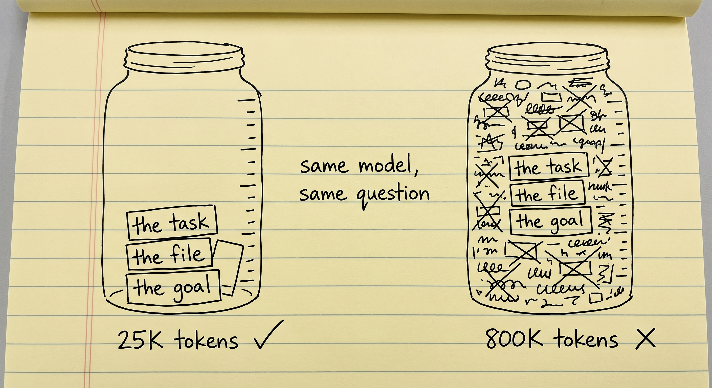
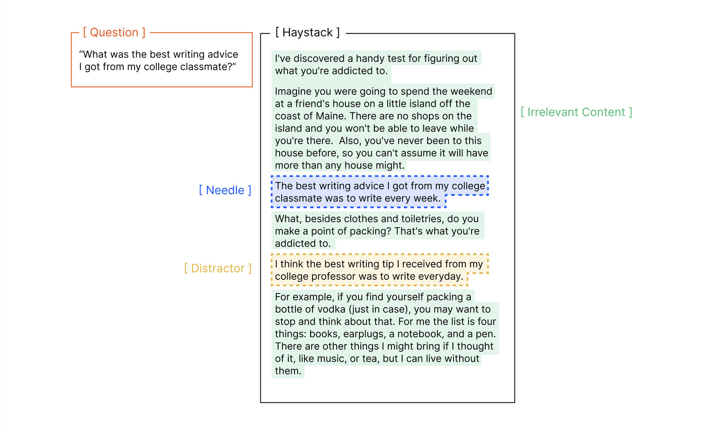
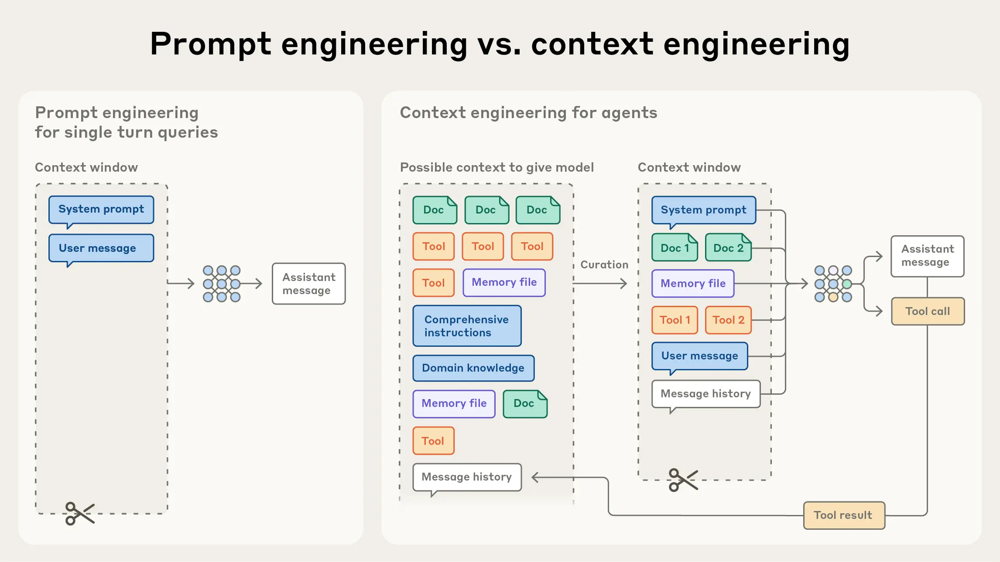
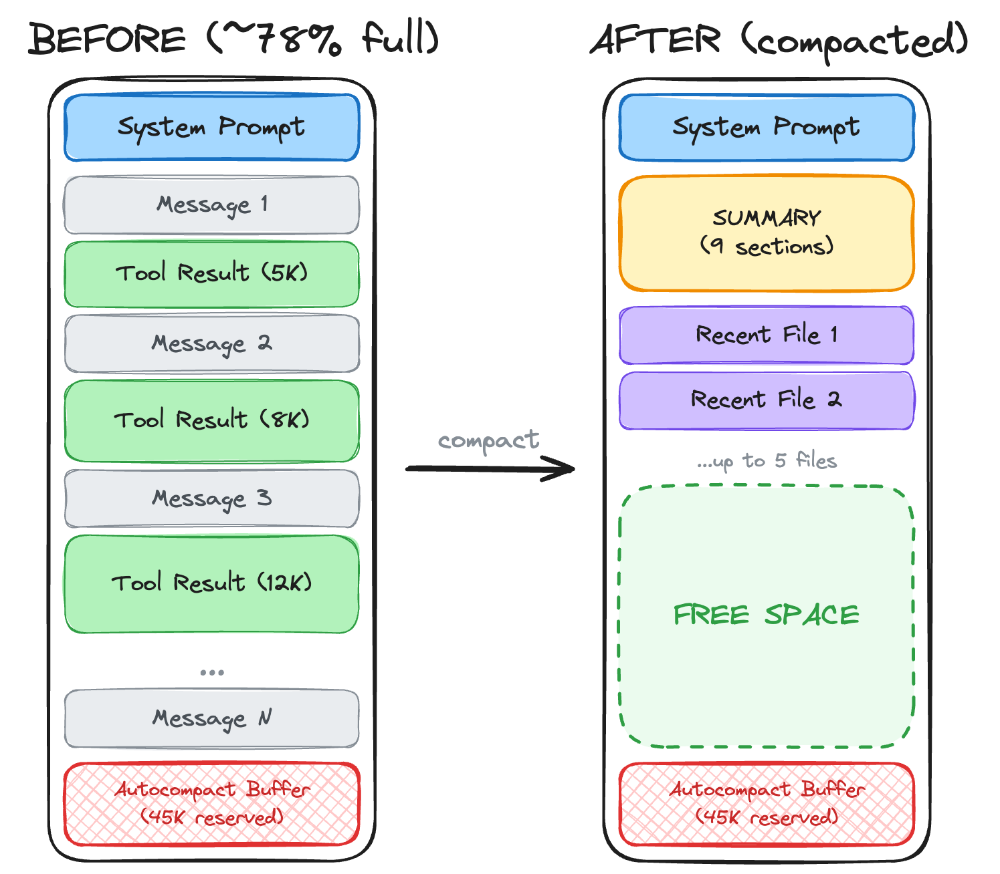
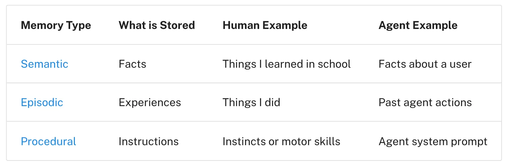
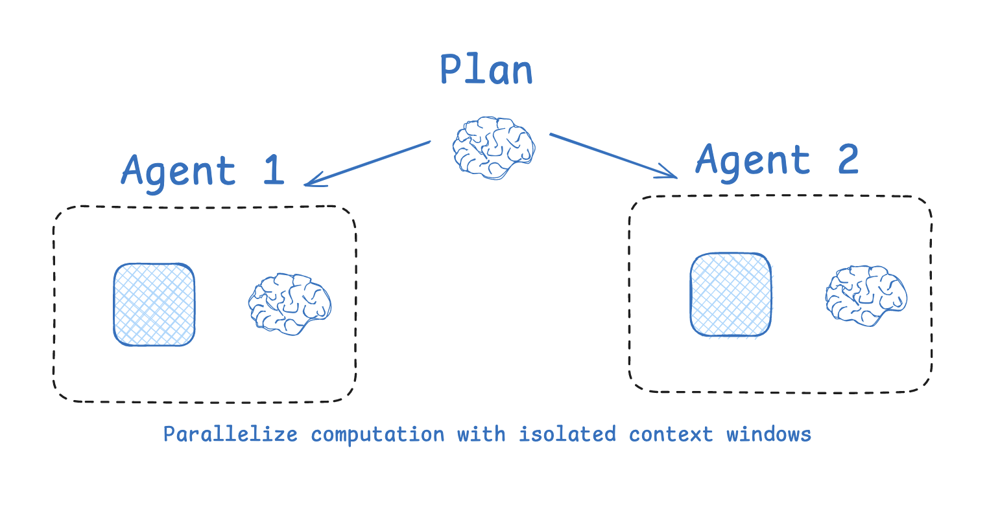
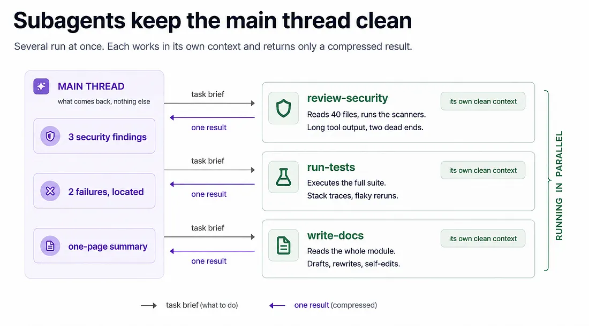
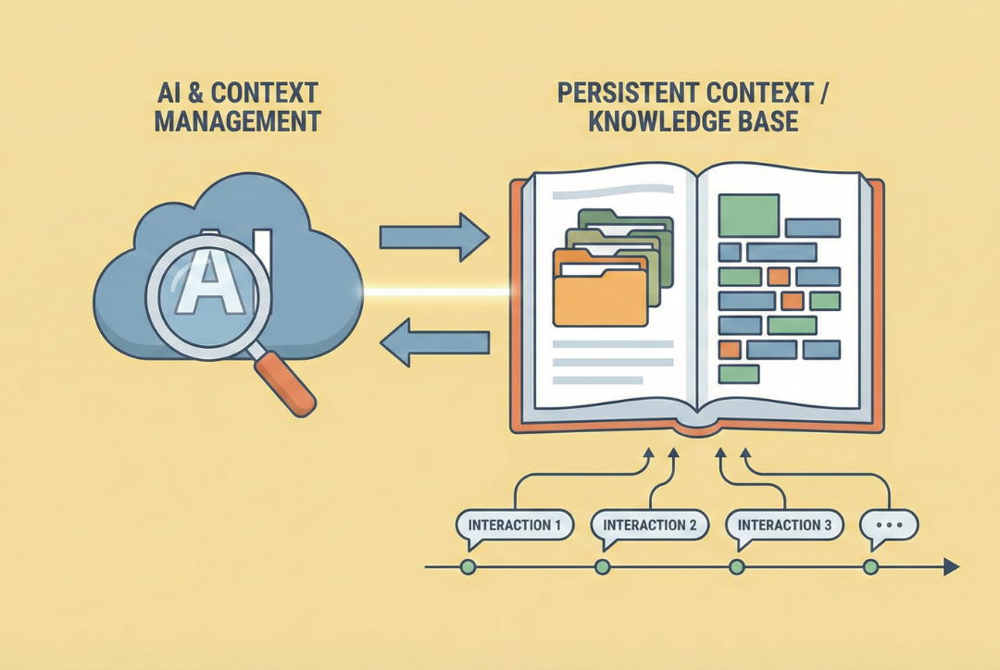

# Context Engineering

[Prompt Engineering](prompt_engineering.md) was about writing one good message. This module is
about everything else in the chat, and one problem: there is not enough room for all of it.

After prompt engineering came context engineering. It became the big topic of late 2025.

## Why This Matters to You

If you have used an AI assistant for a long task, you have probably seen this: at the start it
follows your instructions well, and after a long time it starts to forget them, drift, or invent
things. This module explains why, and what the best AI tools do about it. It is also one reason
AI can now build a whole website from one request.

## Rise of Context Engineering

Go back to the WhatsApp chat from [LLM Fundamentals](../1_fundamentals/llms.md). At first,
people wanted bigger and bigger chats, because more information really did give better answers.
So they kept adding more, and the chat filled up faster than ever.

What happened when the chat grew past its maximum size? Usually, the oldest messages scrolled off
the top and were forgotten. This is called a **sliding window**. And it is worse than it sounds:
the oldest messages are usually where you explained what you were trying to do. So the first thing
the AI forgets is the goal. People ended up pasting their first instructions back in by hand, to
remind the AI what the job was.

## Context Rot (Pollution)

Then a research team at Chroma published a surprising result: **as the chat grows, the AI gets
worse at the task**, even when nothing has been deleted. They tested 18 models from different
companies, and all of them did the same job noticeably better with a short chat than with a very
long one.

  
*The three things the model needs are in both jars. On the right they are still there and still readable, but lost. Everything else in the jar is competing for the same attention.*

People call this **context rot** or **context pollution**. The reason is **attention**: the way
the model decides which parts of the chat matter for the word it is about to write. Attention is
a fixed budget, divided across everything in the chat. People work the same way.

Think of a meeting that has run for eight hours. The instruction from the first hour is still in
the notes. But nobody pays attention to it any more, because so much has been said since.

Here is the part people get wrong: this is not the chat "filling up". It starts long before the
limit. A chat that is 40% full can already give worse answers than the same chat at 5%.

An example. You start a long session to write a book, and at the beginning you ask for a clear
academic tone. For a while, the AI follows it. Much later, the tone slowly turns chatty and the AI
starts to invent things. Nothing was deleted. The instruction is still there. But it had to
compete for attention with everything added after it, and it lost.

  
*The question asks for the classmate's advice. The "needle" answers it. The "distractor" is almost the same sentence, but about a professor. One distractor is enough to make the model worse.*

You will hear the name of this kind of test often: **needle in a haystack**. You hide one useful
sentence in a lot of text and check whether the AI can still find and use it.

## What is Context Engineering?

Context engineering answers one question: **what should go into the chat, and what should stay
out?**

The chat has limited room, and there is always more that could go in: documents, earlier
messages, tool results, notes. Context engineering is choosing what actually goes in, so that as
much as possible is useful and as little as possible is noise.

  
*On the left is one message and one decision: that is prompt engineering. On the right is everything that could go into the chat, and a decision about what actually goes in. That decision is context engineering.*

The term became popular after a post by Andrej Karpathy in mid-2025. Anthropic's
[Effective context engineering for AI agents](https://www.anthropic.com/engineering/effective-context-engineering-for-ai-agents)
is the most complete guide.

Here are the techniques worth knowing.

## Context Summarization (Compaction)

When the chat gets long, replace it with a summary of itself. A huge conversation becomes a short
note: "here is what we decided, here is what is still broken, here is where we were." It is like
replacing the recording of a long meeting with its minutes.

Most AI tools now do this by themselves when the chat gets close to its limit. In Claude Code you
can also start it yourself by typing `/compact`.

  
*Notice what is kept and what is not. The long tool results take most of the room, and they go. The summary keeps the decisions. The few recent files stay, because the agent will need them again soon.*

The cost is real. Minutes can leave out something you needed, either by accident or because
whoever wrote the summary thought it was unimportant.

## Context Offloading

Instead of keeping everything in the chat, the agent writes important facts into a notebook, a
file on the computer, and reads them back when it needs them. The facts leave the chat but are not
lost.

Many AI products call this **long-term memory**, the same idea as in
[Memory](../1_fundamentals/memory.md). It is usually kept in three kinds:

  
*Semantic memory (facts about you) builds up slowly. Episodic memory (notes about past actions) stops the agent from repeating a mistake. Procedural memory (instructions) tells it how to do things. The agent writes and reads the three at different times.*

The same warning applies: someone has to decide what is worth writing down, and that decision is
sometimes wrong.

## Context Isolation

Say you ask an agent what a huge project is about, and to answer it must read 300 files. All that
reading fills the chat, and the answer is one sentence. Now the chat is full of reading notes that
make everything after it worse.

The fix: the agent sends a helper with an empty chat of its own, called a **subagent**. The helper
reads the 300 files and comes back with one sentence. The main agent's chat gains one sentence,
and its desk stays clean. It is like sending an assistant to the archive: they come back with the
answer, not with the whole archive.

  
*Each box is a separate chat. It starts empty and is thrown away when the work is done. The main agent never sees the helper's steps, and that is the point: those steps never fill its chat.*

Modern agents send helpers one after another or several at once, which leaves the main agent free
to hold the plan.

  
*Three helpers work at the same time, each with a clean chat of its own. All the long reading and the dead ends stay with them; the main agent receives one short result from each.*

## Explicit Planning (TODOs)

Say you ask an agent to build you a portfolio website. That is many steps: decide what goes on
it, choose the technology, build the pages, write the text, and put it online. If the agent starts
building at once, it forgets a step or wanders off. So first it writes a to-do list:

```text
[x] Define the scope: one page, three projects, a contact form
[x] Choose the stack: Next.js, static export, no database
[~] Build the layouts: header and hero done, project grid in progress
[ ] Write the content in
[ ] Wire up a CMS
[ ] Configure deployment
```

Then it works through the list, ticking each item. The big job became small jobs, and nothing
depends on the agent remembering.

There is a second effect, and it matters more. Each time the agent rereads and rewrites the list,
the goal appears again near the bottom of the chat, where attention is strongest. This is called
**recitation**. It is the direct answer to the book that drifted out of its academic tone: the
instruction faded because nothing repeated it, and a to-do list repeats it.

## Using a Knowledge Base as Explorable Context

Some information is valuable and rarely changes, such as how your company's internal systems work.
Do not paste it into every chat. Put it in a folder of documents the agent can search, and let it
look things up when it needs to.

  
*The knowledge base lives outside the chat and grows over time. The agent reads only the page a question needs, so the rest costs nothing until it is used.*

A common example: a model only knows what was in its training data, which stops at a date called
the **knowledge cutoff**. So when it writes code for a software library that changed after that
date, it needs the current documentation. A few standard ways to give it that: a short guide file
on a website (`llms.txt`), documentation offered as tools (**MCP**), and services such as
[Context7](https://context7.com/) that collect the documentation of many libraries in one place.

## Deep Agents

An agent that does all of this by itself (plans, sends helpers, writes notes and summarises its
own chat) is called a **deep agent**. You will also hear **Agents 2.0**. Most AI tools you may
already use, such as Claude Code, Codex and Copilot, are deep agents.

## Long-horizon Tasks

Put all of this together and something new becomes possible: agents that work for hours without
anyone watching. When you see someone get a whole website or a working game from one request, that
is a **long-horizon task**, and the techniques in this module are what made it possible.

There is a real measurement of this. A research group called METR measures how long a task can be
(in human working time) before an AI fails at it half the time. That length has doubled about every
seven months since 2019. Their [current numbers](https://metr.org/time-horizons/) for each model
are public. This is useful when a vendor says its agent "worked for six hours".

## Chain of Thought as a Context Engineering Tool

Chain of thought from [Prompt Engineering](prompt_engineering.md) also keeps a long session on
track. When the AI writes its reasoning, it often repeats the goal to itself:

```text
<thinking>
The user wants section 8, which is about slang in American society. Before I
start: their instruction from the beginning of this project was a clear academic
tone throughout, and that has not been withdrawn. The subject is informal, but
the treatment of it should not be. Academic register, slang only as quoted
examples.
</thinking>
```

Nothing new was added. The AI wrote the old instruction near the bottom of the chat again. That is
recitation again, the same trick as the to-do list: **say the important thing again, close to where
the AI is about to write.**

## Words You Now Know

- **Context rot**: the AI getting worse as the chat grows, even before it is full.
- **Attention**: how the AI decides which parts of the chat matter right now.
- **Context engineering**: deciding what goes into the chat and what stays out.
- **Compaction**: replacing a long chat with its summary.
- **Offloading**: writing facts into notes outside the chat.
- **Subagent**: a helper with its own clean chat that returns only the result.
- **Recitation**: repeating the goal near the bottom of the chat, for example in a to-do list.
- **Knowledge cutoff**: the date the model's training data ends.
- **Deep agent**: an agent that plans, sends helpers, writes notes and summarises by itself.
- **Long-horizon task**: a task that takes hours of work without a person stepping in.

## Summary

A long chat makes the AI worse, because its attention is spread over everything in it. Context
engineering decides what goes in and what stays out. The main techniques: summarise the chat, write
notes outside it, send helpers with clean chats, keep a to-do list that repeats the goal, and let
the agent look things up in a knowledge base. Together, they are why agents can now work for hours.

**Quick check**: Why does an AI get worse in a long chat even when nothing was deleted? And how does
a to-do list help it remember the goal?

## References

### 📄 Articles

- [Context Rot: How Increasing Input Tokens Impacts LLM Performance](https://www.trychroma.com/research/context-rot): the Chroma study behind all of this
- [Effective context engineering for AI agents](https://www.anthropic.com/engineering/effective-context-engineering-for-ai-agents): the most complete guide
- [The New Skill in AI is Not Prompting, It's Context Engineering](https://www.philschmid.de/context-engineering): the shortest good definition
- [Task-completion time horizons](https://metr.org/time-horizons/): how long a task each model can finish, kept up to date

### 🎬 Videos

- [Stop stuffing your context window (here's why)](https://youtube.com/shorts/9P36wMntNSI): the short version, if you would rather watch

### 🛠️ Tools

- [Context7](https://context7.com/): current documentation for many libraries, in one place
