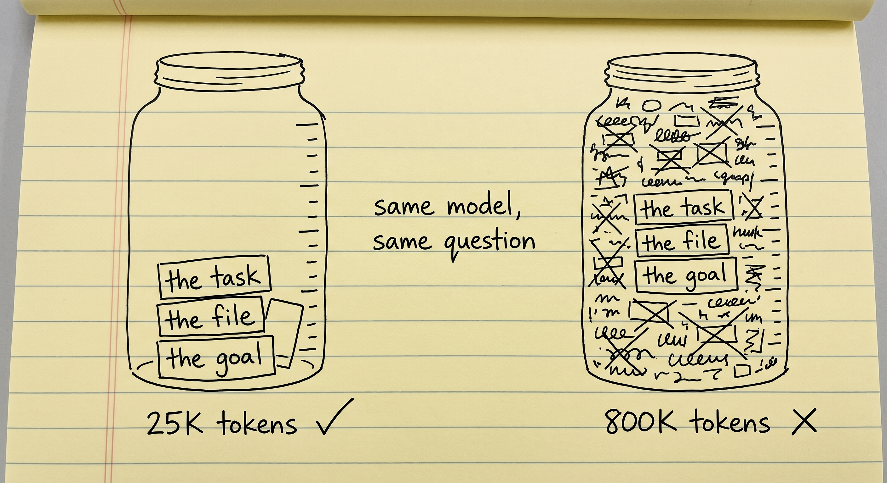
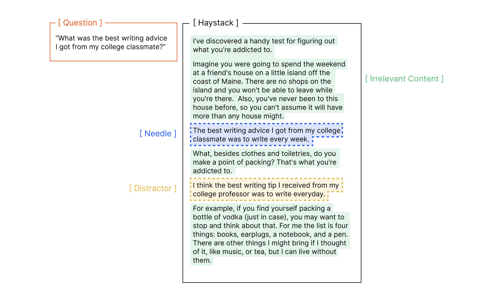
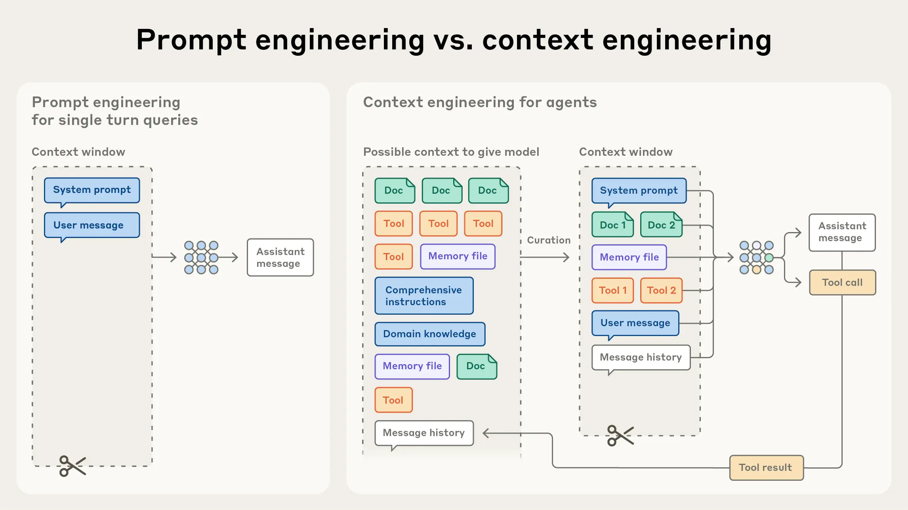
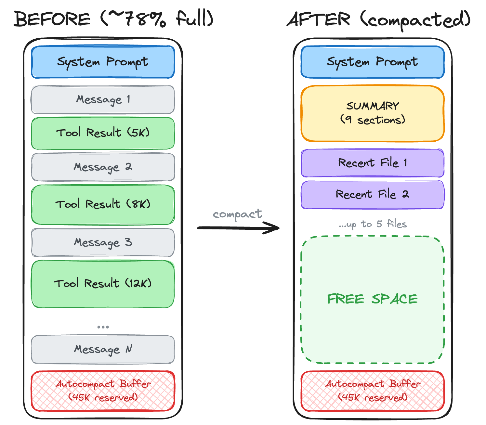
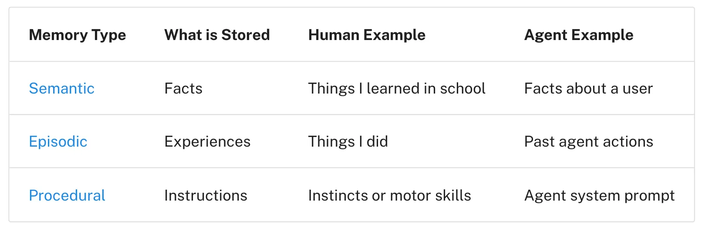
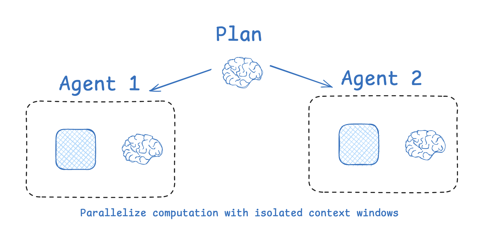
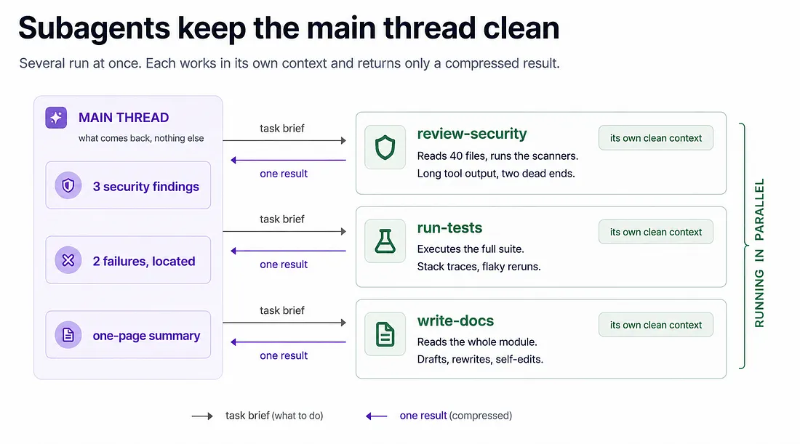
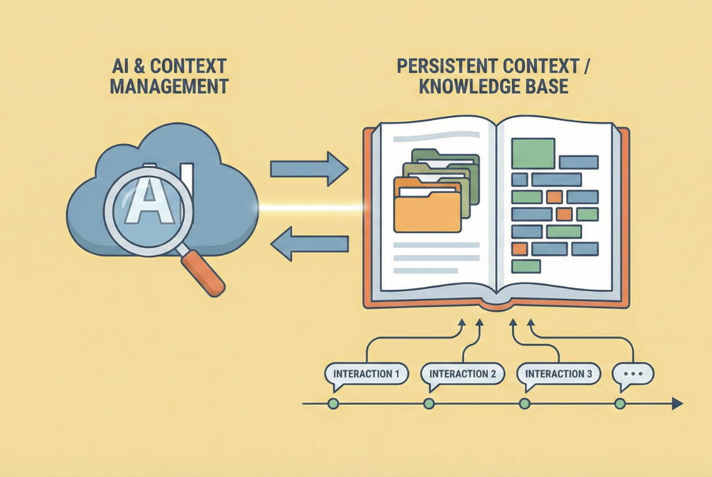

# Context Engineering

درس [Prompt Engineering](prompt_engineering_fa.md) درباره‌ی نوشتن یه پیام خوب بود. این درس درباره‌ی همه‌ی چیزهای دیگه‌ی توی چته، و یه مشکل: برای همه‌شون جا نیست.

بعد از prompt engineering نوبت context engineering رسید. اواخر 2025 این موضوع حسابی سر زبون‌ها افتاد.

## چرا این برای تو مهمه

اگه تا حالا برای یه کار طولانی از یه دستیار AI استفاده کرده باشی، احتمالاً این رو دیدی: اول کار دستورهات رو خوب انجام می‌ده، و بعد از یه مدت شروع می‌کنه به فراموش کردنشون، منحرف شدن یا از خودش چیز درآوردن. این درس می‌گه چرا این اتفاق می‌افته و بهترین ابزارهای AI چی کار می‌کنن که نیفته. دلیل این‌که الان یه AI می‌تونه با یه درخواست یه سایت کامل بسازه هم همینه.

## وقتی چت زیادی بلند می‌شه

برگرد سر چت واتس‌اپی که توی [مبانی LLM](../1_fundamentals/llms_fa.md) دیدی. اولش آدم‌ها چت‌های بزرگ‌تر و بزرگ‌تر می‌خواستن، چون اطلاعات بیشتر واقعاً جواب بهتری می‌داد. برای همین هی بیشتر توش می‌ریختن و چت از همیشه زودتر پر می‌شد.

وقتی چت از اندازه‌ی حداکثرش بیشتر می‌شد چی می‌شد؟ معمولاً قدیمی‌ترین پیام‌ها از بالا می‌افتادن بیرون و فراموش می‌شدن. بهش می‌گن **sliding window** (پنجره‌ی لغزان). و از اون چیزی که به نظر میاد بدتره: قدیمی‌ترین پیام‌ها معمولاً همون جاییه که توضیح داده بودی دنبال چی هستی. پس اولین چیزی که AI فراموش می‌کنه هدفه. آدم‌ها آخرش مجبور می‌شدن دستورهای اول رو دستی دوباره بچسبونن که AI یادش بیاد کار چی بود.

## Context Rot

بعد یه تیم پژوهشی به اسم Chroma یه نتیجه‌ی غافلگیرکننده منتشر کرد: **هر چی چت بلندتر بشه، AI توی انجام کار ضعیف‌تر می‌شه**، حتی اگه هیچی پاک نشده باشه. 18 تا مدل از شرکت‌های مختلف رو تست کردن و همه‌شون یه کار رو با چت کوتاه به‌وضوح بهتر از چت خیلی بلند انجام می‌دادن.

  
*اون سه چیزی که مدل لازم داره توی هر دو ظرف هست. سمت راست هم هنوز سر جاشونن و هنوز می‌شه خوندشون، ولی گم شدن. هر چیز دیگه‌ای که توی ظرفه، سر همون توجه با اون‌ها رقابت می‌کنه.*

به این می‌گن **context rot** یا **context pollution** (پوسیدن یا آلوده شدن context). دلیلش **attention** (توجه)‌ه: همون مکانیزمی که مدل باهاش تصمیم می‌گیره برای کلمه‌ای که می‌خواد بنویسه کدوم قسمت‌های چت مهمن. attention یه بودجه‌ی ثابته که بین همه‌ی چیزهای توی چت تقسیم می‌شه. آدم‌ها هم همین‌طورن.

یه جلسه رو در نظر بگیر که هشت ساعت طول کشیده. دستور ساعت اول هنوز توی صورت‌جلسه‌ست، ولی دیگه هیچ‌کس حواسش بهش نیست، چون از اون موقع کلی حرف زده شده.

اینجا یه نکته هست که آدم‌ها اشتباه می‌کنن: این «پر شدن» چت نیست. خیلی قبل از رسیدن به سقف شروع می‌شه. چتی که 40 درصدش پره می‌تونه همین حالا جواب‌های بدتری بده تا همون چت وقتی 5 درصدش پر بود.

یه مثال. یه session طولانی باز می‌کنی که یه کتاب بنویسی و اول کار لحن علمی و روشن می‌خوای. یه مدت AI رعایتش می‌کنه. خیلی بعدتر لحن کم‌کم خودمونی می‌شه و AI شروع می‌کنه از خودش چیز درآوردن. هیچی پاک نشده. دستور هنوز همون‌جاست. ولی مجبور بوده برای توجه با هر چیزی که بعدش اضافه شده رقابت کنه، و باخته.

  
*سوال دنبال توصیه‌ی هم‌کلاسیه. «سوزن» جواب همین سواله. «جمله‌ی گمراه‌کننده» (distractor) تقریباً همون جمله‌ست، فقط درباره‌ی یه استاد. یه distractor کافیه که مدل بدتر بشه.*

اسم این جور تست رو زیاد می‌شنوی: **needle in a haystack** (سوزن توی انبار کاه). یه جمله‌ی به‌دردبخور رو لابه‌لای کلی متن قایم می‌کنی و می‌بینی AI هنوز می‌تونه پیداش کنه و ازش استفاده کنه یا نه.

## Context Engineering چیه؟

context engineering جواب یه سواله: **چی باید بره توی چت و چی باید بیرون بمونه؟**

چت جای محدودی داره و همیشه چیز بیشتری هست که می‌تونه بره توش: سندها، پیام‌های قبلی، نتیجه‌ی ابزارها، یادداشت‌ها. context engineering یعنی انتخاب این‌که واقعاً چی بره تو، که تا جای ممکن بیشترش به دردبخور باشه و تا جای ممکن کمترش نویز.

  
*سمت چپ یه پیام و یه تصمیمه: این prompt engineering‌ه. سمت راست هر چیزیه که می‌تونه بره توی چت، و یه تصمیم درباره‌ی این‌که واقعاً چی بره تو. اون تصمیم context engineering‌ه.*

این اصطلاح اواسط 2025 بعد از یه پست از Andrej Karpathy معروف شد. مقاله‌ی Anthropic با اسم [Effective context engineering for AI agents](https://www.anthropic.com/engineering/effective-context-engineering-for-ai-agents) کامل‌ترین راهنمای این موضوعه.

بریم سراغ تکنیک‌هایی که ارزش دونستن دارن.

## خلاصه کردن چت (Compaction)

وقتی چت بلند شد، جاش یه خلاصه از خودش بذار. یه گفت‌وگوی غول‌پیکر می‌شه یه یادداشت کوتاه: «این‌ها رو تصمیم گرفتیم، این‌ها هنوز خرابه، این‌جا بودیم.» مثل اینه که به جای ضبط یه جلسه‌ی طولانی، صورت‌جلسه‌ش رو نگه داری.

الان بیشتر ابزارهای AI وقتی چت به سقفش نزدیک می‌شه، این کار رو خودشون می‌کنن. توی Claude Code می‌تونی خودت هم با تایپ `/compact` شروعش کنی.

  
*ببین چی می‌مونه و چی نه. نتیجه‌ی بلند ابزارها بیشترین جا رو می‌گیره و می‌ره. خلاصه تصمیم‌ها رو نگه می‌داره. چند تا فایل اخیر می‌مونن، چون agent به‌زودی دوباره بهشون احتیاج پیدا می‌کنه.*

هزینه‌ش واقعیه. ممکنه صورت‌جلسه یه چیزی رو جا بندازه که لازمش داشتی، یا اشتباهی، یا چون کسی که نوشتش فکر کرده مهم نیست.

## یادداشت برداشتن (Offloading)

به جای این‌که همه‌چی توی چت بمونه، agent چیزهای مهم رو توی یه دفترچه می‌نویسه، یعنی یه فایل روی کامپیوتر، و هر وقت لازم شد دوباره می‌خونه‌شون. این اطلاعات از چت می‌رن بیرون ولی گم نمی‌شن.

خیلی از محصول‌های AI به این می‌گن **long-term memory** (حافظه‌ی بلندمدت)، همون ایده‌ی [حافظه](../1_fundamentals/memory_fa.md). معمولاً سه جور نگهش می‌دارن:

  
*واقعیت‌هایی درباره‌ی تو کم‌کم و به‌مرور جمع می‌شن. یادداشت کارهای گذشته نمی‌ذاره agent یه اشتباه رو تکرار کنه. دستورها بهش می‌گن کارها رو چطور انجام بده. agent این سه تا رو توی زمان‌های مختلف می‌نویسه و می‌خونه.*

همون هشدار این‌جا هم هست: یکی باید تصمیم بگیره چی ارزش نوشتن داره، و این تصمیم گاهی غلطه.

## فرستادن یه کمک‌کار (Subagent)

فرض کن از یه agent می‌پرسی یه پروژه‌ی بزرگ درباره‌ی چیه، و برای جواب دادن باید 300 تا فایل بخونه. این همه خوندن چت رو پر می‌کنه، و جواب یه جمله‌ست. حالا چت پر شده از یادداشت‌های خوندن که هر چی بعدشه رو بدتر می‌کنه.

راه‌حل: agent یه کمک‌کار می‌فرسته که یه چت خالی مال خودش رو داره، به اسم **subagent**. کمک‌کار 300 تا فایل رو می‌خونه و با یه جمله برمی‌گرده. چت agent اصلی فقط یه جمله بیشتر می‌شه و میزش تمیز می‌مونه. مثل اینه که یه دستیار رو بفرستی بایگانی: جواب رو برات میاره، نه کل بایگانی رو.

  
*هر کادر یه چت جداست. خالی شروع می‌شه و وقتی کار تموم شد دور ریخته می‌شه. agent اصلی هیچ‌وقت قدم‌های کمک‌کار رو نمی‌بینه، و همین نکته‌ی کاره: اون قدم‌ها هیچ‌وقت چتش رو پر نمی‌کنن.*

agent‌های امروزی کمک‌کارها رو یکی‌یکی یا چند تا هم‌زمان می‌فرستن، و agent اصلی آزاد می‌مونه که برنامه رو توی ذهنش نگه داره.

  
*سه تا کمک‌کار هم‌زمان کار می‌کنن و هر کدوم یه چت تمیز مال خودش رو داره. تمام اون خوندن‌های طولانی و بن‌بست‌ها پیش خودشون می‌مونه. agent اصلی از هر کدوم یه نتیجه‌ی کوتاه می‌گیره.*

## نگه داشتن یه فهرست کار (Planning)

فرض کن از یه agent می‌خوای برات یه سایت نمونه‌کار بسازه. این کلی قدمه: تصمیم بگیره چی توش باشه، تکنولوژی رو انتخاب کنه، صفحه‌ها رو بسازه، متن‌ها رو بنویسه و بذارتش روی اینترنت. اگه agent یه‌راست شروع کنه به ساختن، یه قدم رو یادش می‌ره یا از مسیر منحرف می‌شه. برای همین اول یه فهرست کار می‌نویسه:

```text
[x] Define the scope: one page, three projects, a contact form
[x] Choose the stack: Next.js, static export, no database
[~] Build the layouts: header and hero done, project grid in progress
[ ] Write the content in
[ ] Wire up a CMS
[ ] Configure deployment
```

بعد فهرست رو یکی‌یکی جلو می‌ره و هر مورد رو تیک می‌زنه. یه کار بزرگ شد چند تا کار کوچیک، و هیچ‌چیز به یادآوری agent بستگی نداره.

یه اثر دوم هم هست، و مهم‌تره. هر بار که agent فهرست رو دوباره می‌خونه و بازنویسی می‌کنه، هدف دوباره نزدیک ته چت ظاهر می‌شه، همون‌جا که attention از همه‌جا قوی‌تره. بهش می‌گن **recitation** (دوباره گفتن). این جواب مستقیم همون کتابیه که از لحن علمیش منحرف شد: دستور کم‌رنگ شد چون هیچ‌چیز تکرارش نمی‌کرد، و فهرست کار تکرارش می‌کنه.

## یه پایگاه دانش برای پیدا کردن چیزها

بعضی اطلاعات ارزشمندن و به‌ندرت عوض می‌شن، مثل این‌که سیستم‌های داخلی شرکتت چطور کار می‌کنن. این‌ها رو توی هر چت نچسبون. بذارشون توی یه پوشه از سندها که agent بتونه توش بگرده، و بذار هر وقت لازم شد خودش پیداشون کنه.

  
*پایگاه دانش بیرون از چت زندگی می‌کنه و با زمان بزرگ‌تر می‌شه. agent فقط صفحه‌ای رو می‌خونه که یه سوال لازم داره، پس بقیه تا وقتی استفاده نشن هیچ هزینه‌ای ندارن.*

یه مثال رایج: یه مدل فقط چیزی رو می‌دونه که توی داده‌های آموزشیش بوده، و اون داده‌ها تا یه تاریخ می‌رسن که بهش می‌گن **knowledge cutoff** (مرز دانش). پس وقتی کدی برای یه کتابخونه‌ی نرم‌افزاری می‌نویسه که بعد از اون تاریخ عوض شده، به مستندات فعلی نیاز داره. چند تا راه معمول برای رسوندن مستندات بهش هست: یه فایل راهنمای کوتاه روی یه وب‌سایت (`llms.txt`)، مستندات به شکل ابزار (**MCP**)، و سرویس‌هایی مثل
[Context7](https://context7.com/) که مستندات کلی کتابخونه رو یک‌جا جمع می‌کنن.

## Deep Agent‌ها

agent‌ای که همه‌ی این کارها رو خودش انجام بده (برنامه می‌ریزه، کمک‌کار می‌فرسته، یادداشت می‌نویسه و چت خودش رو خلاصه می‌کنه) اسمش **deep agent**‌ه. اسم **Agents 2.0** رو هم می‌شنوی. بیشتر ابزارهای AI‌ای که شاید همین الان استفاده می‌کنی، مثل Claude Code، Codex و Copilot، deep agent‌ان.

## کارهای بلندمدت

همه‌ی این‌ها رو کنار هم بذاری یه چیز تازه ممکن می‌شه: agent‌هایی که ساعت‌ها کار می‌کنن بدون این‌که کسی تماشا کنه. وقتی می‌بینی یکی با یه درخواست یه سایت کامل یا یه بازی که کار می‌کنه گرفته، اسمش **long-horizon task** (کار بلندمدت)‌ه، و تکنیک‌های این درس همون چیزن که ممکنش کردن.

برای این یه اندازه‌گیری واقعی هم هست. یه گروه پژوهشی به اسم METR اندازه می‌گیره یه کار چقدر می‌تونه طولانی باشه (بر حسب زمان کار یه آدم) تا AI نصف دفعه‌ها توش شکست بخوره. این طول از 2019 تا حالا تقریباً هر هفت ماه دو برابر شده. [عددهای فعلی](https://metr.org/time-horizons/) برای هر مدل عمومیه. وقتی یه شرکت می‌گه agent‌ش «شش ساعت کار کرده»، این به دردت می‌خوره.

## بلند فکر کردن اینجا هم کمک می‌کنه

chain of thought که توی [Prompt Engineering](prompt_engineering_fa.md) دیدی، یه session طولانی رو هم سر مسیر نگه می‌داره. وقتی AI استدلالش رو می‌نویسه، اغلب هدف رو برای خودش تکرار می‌کنه:

```text
<thinking>
The user wants section 8, which is about slang in American society. Before I
start: their instruction from the beginning of this project was a clear academic
tone throughout, and that has not been withdrawn. The subject is informal, but
the treatment of it should not be. Academic register, slang only as quoted
examples.
</thinking>
```

چیز تازه‌ای اضافه نشد. AI دستور قدیمی رو دوباره نزدیک ته چت نوشت. این هم همون recitation‌ه، همون ترفند فهرست کار: **چیز مهم رو دوباره بگو، نزدیک جایی که AI می‌خواد بنویسه.**

## کلمه‌هایی که الان بلدی

- **Context rot**: AI با بلند شدن چت بدتر بشه، حتی قبل از این‌که چت پر بشه.
- **Attention**: AI چطور تصمیم می‌گیره کدوم قسمت‌های چت همین الان مهمن.
- **Context engineering**: تصمیم گرفتن این‌که چی بره توی چت و چی بیرون بمونه.
- **Compaction**: جایگزین کردن یه چت بلند با خلاصه‌ش.
- **Offloading**: نوشتن اطلاعات توی یادداشت‌های بیرون از چت.
- **Subagent**: یه کمک‌کار با چت تمیز مال خودش، که فقط نتیجه رو برمی‌گردونه.
- **Recitation**: تکرار هدف نزدیک ته چت، مثلاً توی یه فهرست کار.
- **Knowledge cutoff**: تاریخی که داده‌های آموزشی مدل تموم می‌شه.
- **Deep agent**: agent‌ای که خودش برنامه می‌ریزه، کمک‌کار می‌فرسته، یادداشت می‌نویسه و خلاصه می‌کنه.
- **Long-horizon task**: کاری که ساعت‌ها طول می‌کشه بدون این‌که آدمی وسطش دخالت کنه.

## خلاصه

چت بلند AI رو بدتر می‌کنه، چون توجهش بین همه‌ی چیزهای توش پخش می‌شه. context engineering تصمیم می‌گیره چی بره تو و چی بیرون بمونه. تکنیک‌های اصلی: چت رو خلاصه کن، بیرون از چت یادداشت بنویس، کمک‌کارهایی با چت تمیز بفرست، یه فهرست کار نگه دار که هدف رو تکرار کنه، و بذار agent توی یه پایگاه دانش دنبال چیزها بگرده. این‌ها روی هم دلیل اینن که agent‌ها الان می‌تونن ساعت‌ها کار کنن.

**بررسی سریع**: چرا یه AI توی چت بلند بدتر می‌شه، حتی وقتی هیچی پاک نشده؟ و یه فهرست کار چطور کمک می‌کنه هدف رو یادش بمونه؟

## منابع

### 📄 مقاله‌ها

- [Context Rot: How Increasing Input Tokens Impacts LLM Performance](https://www.trychroma.com/research/context-rot): پژوهش Chroma که پشت همه‌ی این‌هاست
- [Effective context engineering for AI agents](https://www.anthropic.com/engineering/effective-context-engineering-for-ai-agents): کامل‌ترین راهنما
- [The New Skill in AI is Not Prompting, It's Context Engineering](https://www.philschmid.de/context-engineering): کوتاه‌ترین تعریف خوب
- [Task-completion time horizons](https://metr.org/time-horizons/): هر مدل چقدر طول کار رو می‌تونه تموم کنه، همیشه به‌روز

### 🎬 ویدیوها

- [Stop stuffing your context window (here's why)](https://youtube.com/shorts/9P36wMntNSI): نسخه‌ی کوتاه، اگه ترجیح می‌دی ببینی

### 🛠️ ابزارها

- [Context7](https://context7.com/): مستندات به‌روز کلی کتابخونه، یک‌جا
