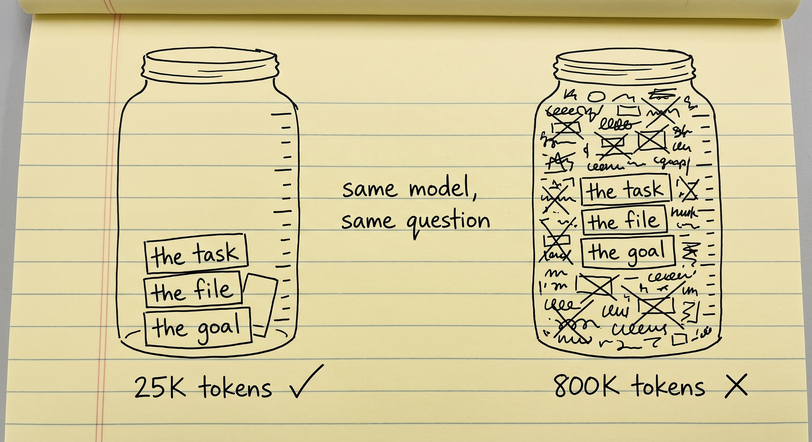
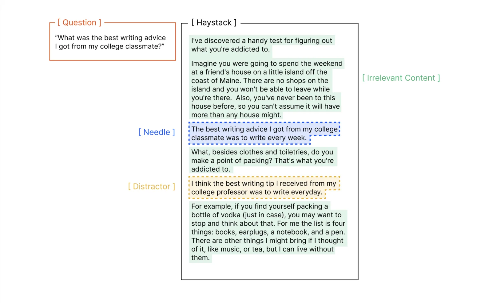
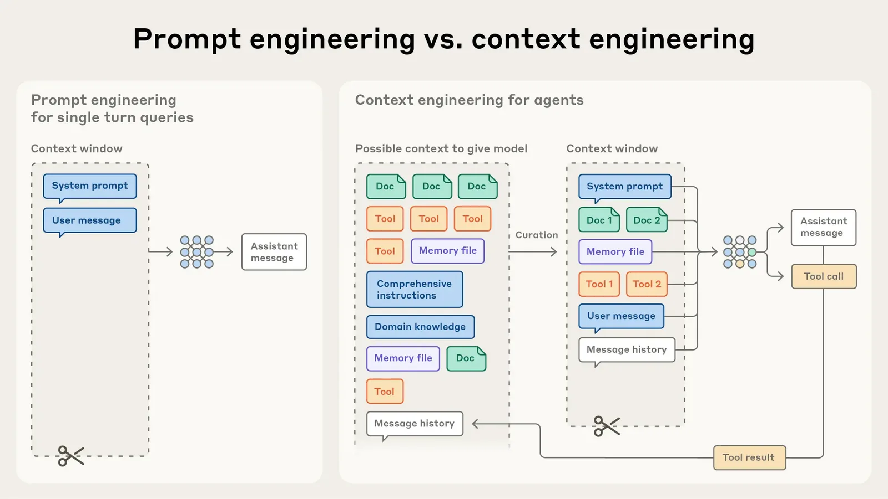
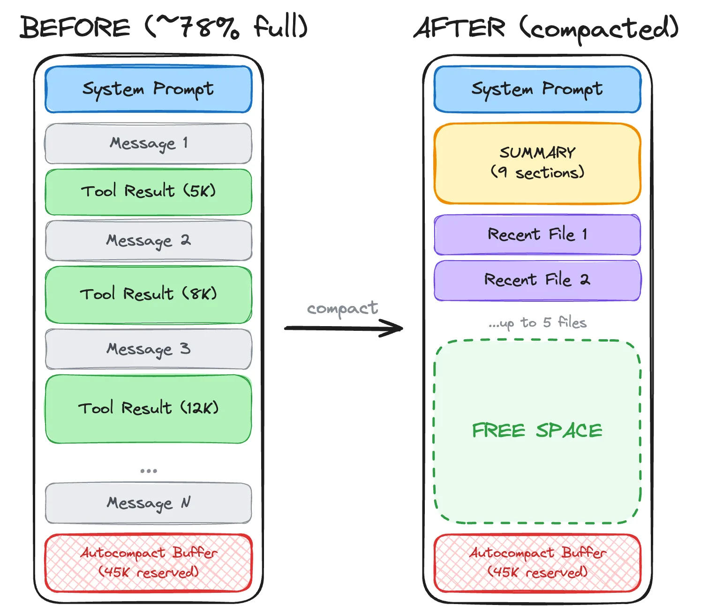
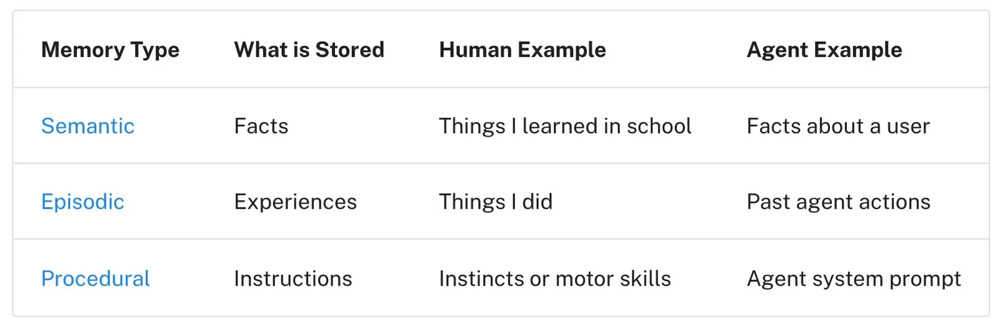
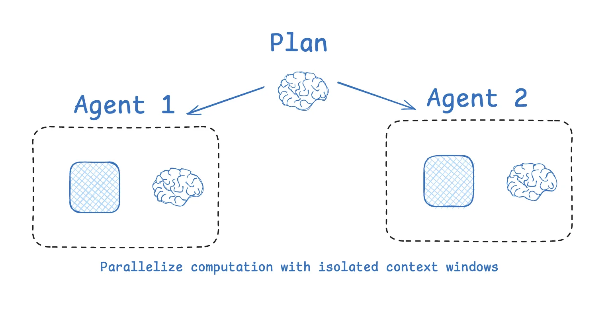
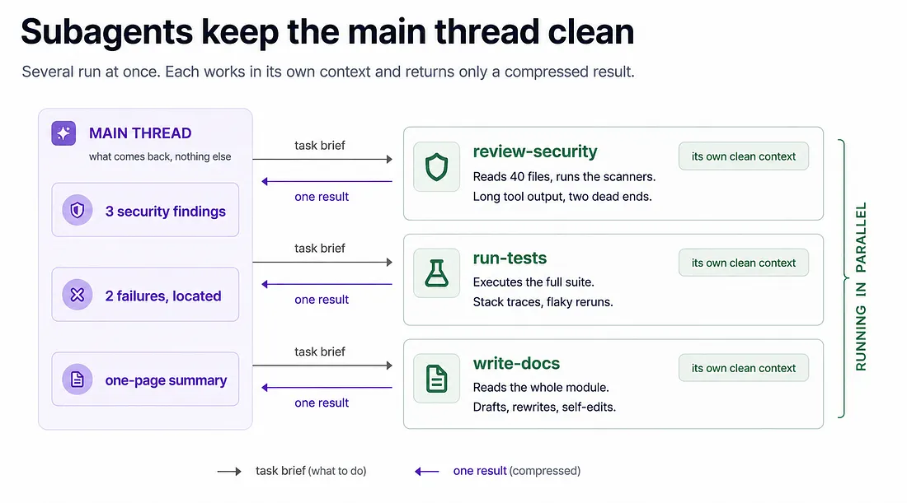
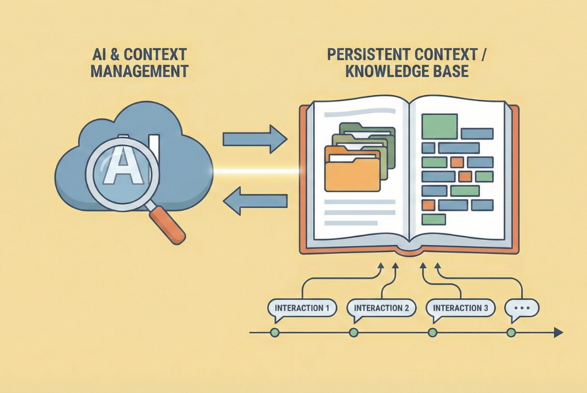

---
objectives:
  - "Context rot'u ve sohbet dolmadan çok önce yapay zekânın neden kötüleştiğini açıkla"
  - "Context engineering'in neye karar verdiğini tek cümleyle söyle"
  - "Ana teknikleri anlat: sohbeti özetlemek, notlar yazmak, yardımcı göndermek, yapılacaklar listesi tutmak ve bir bilgi tabanında gezinmek"
---

# Context Engineering

[Prompt Engineering](prompt_engineering_tr.md) tek bir iyi mesaj yazmakla ilgiliydi. Bu modül ise sohbetteki geri kalan her şeyi ve tek bir problemi anlatıyor: hepsine yetecek kadar yer yok.

Prompt engineering'den sonra context engineering geldi. 2025'in sonunda en çok konuşulan konu oldu.

## Bu Senin İçin Neden Önemli

Bir yapay zekâ asistanını uzun bir iş için kullandıysan, muhtemelen şunu görmüşsündür: başlangıçta talimatlarını iyi takip ediyor, ama uzun bir süre sonra onları unutmaya, konudan sapmaya ya da bir şeyler uydurmaya başlıyor. Bu modül bunun neden olduğunu ve en iyi yapay zekâ araçlarının buna karşı ne yaptığını anlatıyor. Yapay zekânın bugün tek bir istekten bütün bir web sitesi yapabilmesinin sebeplerinden biri de bu.

## Context Engineering'in Yükselişi

[LLM Temelleri](../1_fundamentals/llms_tr.md) modülündeki WhatsApp sohbetine geri dönelim. Başlangıçta insanlar giderek daha büyük sohbetler istedi, çünkü daha fazla bilgi gerçekten daha iyi cevap demekti. Böylece sohbete eskisinden daha fazla şey eklediler ve sohbet eskisinden çok daha hızlı dolmaya başladı.

Sohbet izin verilen en büyük boyutu aştığında ne oluyordu? Genellikle en eski mesajlar yukarıdan kayıp gidiyor ve unutuluyordu. Buna **sliding window** (kayan pencere) deniyor. Üstelik göründüğünden daha kötü bir durum: en eski mesajlar çoğu zaman neye ulaşmaya çalıştığını anlattığın mesajlardır. Yani yapay zekânın ilk unuttuğu şey hedef oluyor. İnsanlar da yapay zekâya işin ne olduğunu hatırlatmak için ilk talimatlarını elle tekrar yapıştırmak zorunda kaldı.

## Context Rot (Pollution)

Sonra Chroma'daki bir araştırma ekibi şaşırtıcı bir sonuç yayımladı: **sohbet büyüdükçe yapay zekâ görevde kötüleşiyor**, hiçbir şey silinmemiş olsa bile. Farklı şirketlerin 18 modelini test ettiler ve hepsi aynı işi kısa bir sohbette, çok uzun bir sohbete göre belirgin biçimde daha iyi yaptı.

  
*Modelin ihtiyaç duyduğu üç şey iki kavanozda da var. Sağdaki kavanozda hâlâ orada ve okunabilir, ama kaybolmuş durumda. Kavanozdaki diğer her şey aynı dikkat için yarışıyor.*

İnsanlar buna **context rot** (context çürümesi) ya da **context pollution** (context kirlenmesi) diyor. Sebebi **attention** (dikkat): modelin, yazmak üzere olduğu kelime için sohbetin hangi kısımlarının önemli olduğuna karar verme biçimi. Dikkat sabit bir bütçedir ve sohbetteki her şeye paylaştırılır. İnsanlar da böyle çalışır.

Sekiz saattir süren bir toplantıyı düşün. İlk saatteki talimat hâlâ notların içinde duruyor. Ama o günden beri o kadar çok şey konuşuldu ki artık kimse ona dikkat etmiyor.

İnsanların yanlış anladığı kısım şu: bu, sohbetin "dolması" değil. Sınıra çok daha önce başlıyor. Yüzde 40'ı dolu bir sohbet, aynı sohbetin yüzde 5'indeki hâlinden zaten daha kötü cevaplar verebilir.

Bir örnek verelim. Bir kitap yazmak için uzun bir oturum başlatıyorsun ve en başta açık, akademik bir üslup istiyorsun. Bir süre yapay zekâ buna uyuyor. Çok sonra üslup yavaş yavaş sohbet havasına dönüyor ve yapay zekâ bir şeyler uydurmaya başlıyor. Hiçbir şey silinmedi. Talimat hâlâ orada. Ama ondan sonra eklenen her şeyle dikkat için yarışmak zorunda kaldı ve kaybetti.

  
*Soru, sınıf arkadaşının tavsiyesini istiyor. "İğne" buna cevap veriyor. "Dikkat dağıtıcı" neredeyse aynı cümle, ama bir profesör hakkında. Tek bir dikkat dağıtıcı bile modeli kötüleştirmeye yetiyor.*

Bu tür testin adını sık sık duyacaksın: **needle in a haystack** (samanlıkta iğne). Çok miktarda metnin içine işe yarar tek bir cümle saklarsın ve yapay zekânın onu hâlâ bulup kullanabildiğini kontrol edersin.

## Context Engineering Nedir?

Context engineering tek bir soruya cevap verir: **sohbete ne girmeli, ne dışarıda kalmalı?**

Sohbetin yeri sınırlı ve girebilecek şey her zaman daha fazla: dokümanlar, önceki mesajlar, araç sonuçları, notlar. Context engineering, gerçekte neyin gireceğini seçmektir; böylece mümkün olduğunca çoğu işe yarar, mümkün olduğunca azı gürültü olur.

  
*Solda tek bir mesaj ve tek bir karar var: bu prompt engineering. Sağda sohbete girebilecek her şey ve gerçekte neyin gireceğine dair bir karar var. Bu karar context engineering.*

Terim, Andrej Karpathy'nin 2025 ortasındaki bir yazısından sonra popüler oldu. Anthropic'in [Effective context engineering for AI agents](https://www.anthropic.com/engineering/effective-context-engineering-for-ai-agents) yazısı en kapsamlı rehber.

Bilmeye değer teknikler şunlar.

## Context Summarization (Compaction)

Sohbet uzayınca onu kendi özetiyle değiştir. Kocaman bir konuşma, kısa bir nota dönüşür: "şunlara karar verdik, şunlar hâlâ bozuk, şurada kalmıştık." Bu, uzun bir toplantının kaydını toplantı tutanağıyla değiştirmeye benziyor.

Bugün çoğu yapay zekâ aracı, sohbet sınırına yaklaştığında bunu kendi kendine yapıyor. Claude Code'da `/compact` yazarak sen de başlatabilirsin.

  
*Nelerin kaldığına ve nelerin gittiğine dikkat et. Uzun araç sonuçları yerin çoğunu kaplıyor ve onlar gidiyor. Özet kararları tutuyor. Birkaç yeni dosya kalıyor, çünkü agent'ın onlara yakında yine ihtiyacı olacak.*

Bedeli gerçek. Tutanak, ihtiyacın olan bir şeyi dışarıda bırakabilir; ya kazara ya da özeti yazan kişi onu önemsiz bulduğu için.

## Context Offloading

Agent her şeyi sohbette tutmak yerine önemli bilgileri bir deftere, yani bilgisayardaki bir dosyaya yazar ve gerektiğinde geri okur. Bilgiler sohbetten çıkar ama kaybolmaz.

Birçok yapay zekâ ürünü buna **long-term memory** diyor; [Memory](../1_fundamentals/memory_tr.md) modülündeki fikrin aynısı. Genellikle üç türde tutulur:

  
*Semantic memory (senin hakkındaki bilgiler) zamanla yavaş yavaş birikir. Episodic memory (geçmişteki eylemlere dair notlar), agent'ın aynı hatayı tekrarlamasını engeller. Procedural memory (talimatlar) ona işleri nasıl yapacağını söyler. Agent bu üçünü farklı zamanlarda yazar ve okur.*

Aynı uyarı burada da geçerli: neyin yazılmaya değer olduğuna birinin karar vermesi gerekiyor ve bu karar bazen yanlış oluyor.

## Context Isolation

Bir agent'a koca bir projenin ne hakkında olduğunu sorduğunu ve cevap vermek için onun 300 dosya okuması gerektiğini düşün. Bütün bu okuma sohbeti dolduruyor, cevap ise tek bir cümle. Artık sohbet, kendisinden sonra gelen her şeyi kötüleştiren okuma notlarıyla dolu.

Çözüm: agent, kendi boş sohbetiyle bir yardımcı gönderiyor. Buna **subagent** deniyor. Yardımcı 300 dosyayı okuyor ve tek bir cümleyle dönüyor. Ana agent'ın sohbeti bir cümle kazanıyor ve masası temiz kalıyor. Bu, bir asistanı arşive göndermeye benziyor: bütün arşivle değil, cevapla dönüyor.

  
*Her kutu ayrı bir sohbet. Boş başlıyor ve iş bitince atılıyor. Ana agent yardımcının adımlarını hiç görmüyor ve amaç da bu: o adımlar ana agent'ın sohbetini hiç doldurmuyor.*

Modern agent'lar yardımcıları art arda ya da aynı anda gönderiyor. Böylece ana agent planı aklında tutmakta özgür kalıyor.

  
*Üç yardımcı aynı anda çalışıyor ve her birinin kendi temiz sohbeti var. Bütün uzun okumalar ve çıkmaz sokaklar onlarda kalıyor; ana agent her birinden tek bir kısa sonuç alıyor.*

## Explicit Planning (TODO'lar)

Bir agent'tan sana bir portfolyo sitesi yapmasını istediğini düşün. Bu birçok adım demek: sitede neyin olacağına karar vermek, teknolojiyi seçmek, sayfaları kurmak, metinleri yazmak ve siteyi yayına almak. Agent hemen inşa etmeye başlarsa bir adımı unutuyor ya da yoldan çıkıyor. Bu yüzden önce bir yapılacaklar listesi yazıyor:

```text
[x] Define the scope: one page, three projects, a contact form
[x] Choose the stack: Next.js, static export, no database
[~] Build the layouts: header and hero done, project grid in progress
[ ] Write the content in
[ ] Wire up a CMS
[ ] Configure deployment
```

Sonra listeyi tek tek işaretleyerek ilerliyor. Büyük iş küçük işlere dönüştü ve hiçbir şey agent'ın hatırlamasına bağlı değil.

Bir de ikinci bir etki var ve o daha önemli. Agent listeyi her yeniden okuyup yazdığında, hedef sohbetin altında, dikkatin en güçlü olduğu yerde yeniden görünüyor. Buna **recitation** (yeniden okuma) deniyor. Akademik üslubundan kayan kitabın doğrudan cevabı bu: talimat, onu tekrar eden hiçbir şey olmadığı için silikleşti; yapılacaklar listesi onu tekrar ediyor.

## Explorable Context Olarak Knowledge Base

Bazı bilgiler değerlidir ve nadiren değişir; şirketinin iç sistemlerinin nasıl çalıştığı gibi. Bunları her sohbete yapıştırma. Agent'ın arayabileceği bir doküman klasörüne koy ve ihtiyaç duyduğunda orada aramasına izin ver.

  
*Bilgi tabanı sohbetin dışında duruyor ve zamanla büyüyor. Agent yalnızca bir sorunun ihtiyaç duyduğu sayfayı okuyor; geri kalanı kullanılana kadar hiçbir şeye mal olmuyor.*

Yaygın bir örnek: bir model yalnızca eğitim verisinde olanı bilir ve bu veri **knowledge cutoff** (bilgi kesim tarihi) denen bir tarihte biter. Bu yüzden bir yazılım kütüphanesi için, o tarihten sonra değişmiş bir kod yazarken güncel dokümantasyona ihtiyaç duyar. Ona bunu vermenin birkaç standart yolu var: bir web sitesindeki kısa bir rehber dosya (`llms.txt`), araç olarak sunulan dokümantasyon (**MCP**) ve birçok kütüphanenin dokümantasyonunu tek yerde toplayan [Context7](https://context7.com/) gibi servisler.

## Deep Agent'lar

Bunların hepsini kendi kendine yapan bir agent'a (plan yapar, yardımcı gönderir, not yazar ve kendi sohbetini özetler) **deep agent** deniyor. **Agents 2.0** adını da duyacaksın. Zaten kullanıyor olabileceğin çoğu yapay zekâ aracı, örneğin Claude Code, Codex ve Copilot, birer deep agent.

## Long-horizon Görevler

Bunların hepsini bir araya getirdiğinde yeni bir şey mümkün oluyor: kimse izlemeden saatlerce çalışan agent'lar. Birinin tek bir istekten bütün bir web sitesi ya da çalışan bir oyun elde ettiğini gördüğünde bu bir **long-horizon task**'tır (uzun soluklu görev) ve bu modüldeki teknikler onu mümkün kılan şeylerdir.

Bunun gerçek bir ölçümü var. METR adlı bir araştırma grubu, bir yapay zekânın görevlerin yarısında başarısız olmaya başlamadan önce bir görevin ne kadar uzun olabileceğini (insanın çalışma süresi cinsinden) ölçüyor. Bu uzunluk 2019'dan beri yaklaşık her yedi ayda bir iki katına çıktı. Her model için [güncel rakamlar](https://metr.org/time-horizons/) herkese açık. Bir şirket agent'ının "altı saat çalıştığını" söylediğinde bu işine yarar.

## Bir Context Engineering Aracı Olarak Chain of Thought

[Prompt Engineering](prompt_engineering_tr.md) modülündeki chain of thought, uzun bir oturumu da yolda tutuyor. Yapay zekâ akıl yürütmesini yazarken çoğu zaman hedefi kendi kendine tekrar ediyor:

```text
<thinking>
The user wants section 8, which is about slang in American society. Before I
start: their instruction from the beginning of this project was a clear academic
tone throughout, and that has not been withdrawn. The subject is informal, but
the treatment of it should not be. Academic register, slang only as quoted
examples.
</thinking>
```

Yeni bir şey eklenmedi. Yapay zekâ eski talimatı, sohbetin altına yeniden yazdı. Bu yine recitation, yapılacaklar listesiyle aynı numara: **önemli şeyi, yapay zekânın yazmak üzere olduğu yerin yakınında tekrar söyle.**

## Artık Bildiğin Terimler

- **Context rot**: sohbet büyüdükçe, daha dolmadan yapay zekânın kötüleşmesi.
- **Attention**: yapay zekânın, sohbetin hangi kısımlarının şu an önemli olduğuna karar verme biçimi.
- **Context engineering**: sohbete neyin girip neyin dışarıda kalacağına karar vermek.
- **Compaction**: uzun bir sohbeti özetiyle değiştirmek.
- **Offloading**: bilgileri sohbetin dışındaki notlara yazmak.
- **Subagent**: kendi temiz sohbeti olan ve yalnızca sonucu getiren bir yardımcı.
- **Recitation**: hedefi sohbetin altında tekrarlamak, örneğin bir yapılacaklar listesiyle.
- **Knowledge cutoff**: modelin eğitim verisinin bittiği tarih.
- **Deep agent**: plan yapan, yardımcı gönderen, not yazan ve özetleyen, hepsini kendi başına yapan agent.
- **Long-horizon task**: bir insanın araya girmeden saatlerce süren çalışma gerektiren görev.

## Özet

Uzun bir sohbet yapay zekâyı kötüleştirir, çünkü dikkati içindeki her şeye dağılır. Context engineering neyin gireceğine ve neyin dışarıda kalacağına karar verir. Başlıca teknikler: sohbeti özetlemek, sohbetin dışına not yazmak, temiz sohbetli yardımcılar göndermek, hedefi tekrar eden bir yapılacaklar listesi tutmak ve agent'ın bir bilgi tabanında arama yapmasına izin vermek. Hepsi bir arada, agent'ların artık saatlerce çalışabilmesinin sebebi.

**Hızlı Kontrol**: Hiçbir şey silinmemişken bile bir yapay zekâ uzun bir sohbette neden kötüleşiyor? Bir yapılacaklar listesi hedefi hatırlamasına nasıl yardım ediyor?

## Kaynaklar

### 📄 Makaleler

- [Context Rot: How Increasing Input Tokens Impacts LLM Performance](https://www.trychroma.com/research/context-rot): bütün bunların arkasındaki Chroma çalışması
- [Effective context engineering for AI agents](https://www.anthropic.com/engineering/effective-context-engineering-for-ai-agents): en kapsamlı rehber
- [The New Skill in AI is Not Prompting, It's Context Engineering](https://www.philschmid.de/context-engineering): en kısa iyi tanım
- [Task-completion time horizons](https://metr.org/time-horizons/): her modelin ne kadar uzun bir görevi bitirebildiği, güncel tutuluyor

### 🎬 Videolar

- [Stop stuffing your context window (here's why)](https://youtube.com/shorts/9P36wMntNSI): izlemeyi tercih edersen kısa anlatım

### 🛠️ Araçlar

- [Context7](https://context7.com/): birçok kütüphanenin güncel dokümantasyonu, tek yerde
