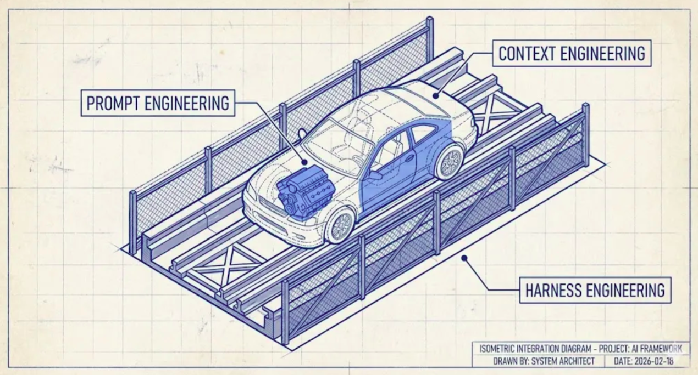
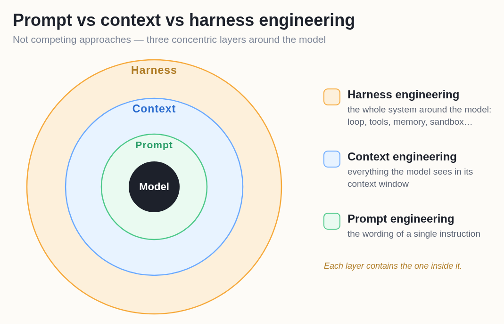
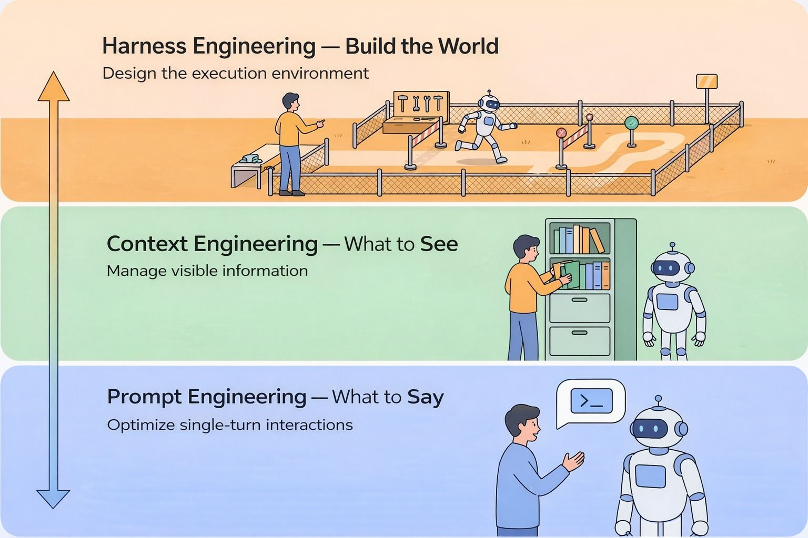
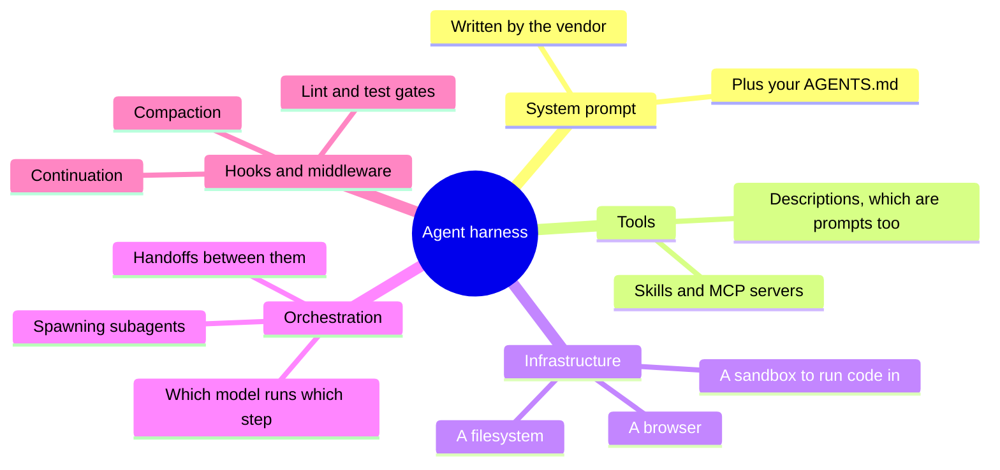
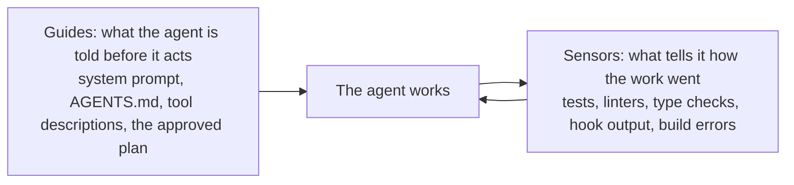
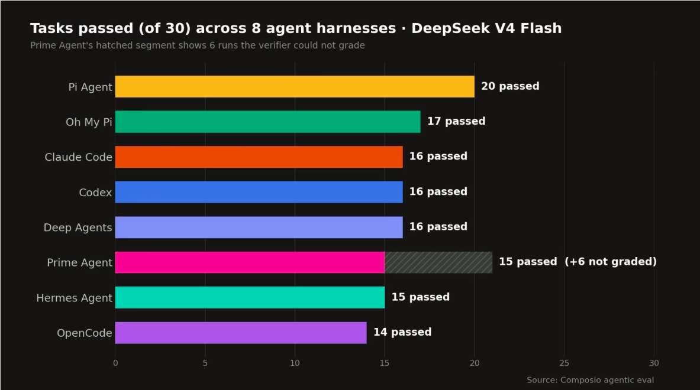

# Harness Engineering

[Code Agents](coding_agents.md) ended with hooks, and hooks were different from everything else in
that module. Everything else is advice that the AI usually follows. A hook runs whether the AI
wants it to or not. That difference is what this whole module is about.

## Why This Matters to You

When a company lets an AI work with real data, real money or real customers, "it usually behaves"
is not enough for some rules. This module explains how those rules are made safe, and why the
same AI model can do very well in one product and badly in another.

## The Problem Prompts Do Not Solve

An AI does not do exactly the same thing every time. Give it the same input twice, and you can get
two different answers. In technical words, it is **non-deterministic**. And an agent that works for
two hours makes thousands of small decisions.

So asking nicely never gives you a guarantee, no matter how often you ask. Say the AI must never
send an email to a customer without a person's approval. You can write "never send an email without
approval" in its instructions. That works most of the time. But for this rule, most of the time is
not good enough. You need something built into the surroundings that behaves the same way every
time, whatever the AI decides.

Designing those surroundings is **harness engineering**.

  
*The engine is the prompt: it makes the power. The car is the context: the body built around the engine. The track and the barriers are the harness. The barriers do not steer. They do not make the car go the right way. They make it impossible to go the wrong way.*

The next two modules use this car picture again, so keep it in mind.

## What an Agent Harness is

The result of harness engineering is called an **agent harness**: the AI model, plus everything
built around it, plus the place where it works.

LangChain says it in one line: **Agent = Model + Harness.** The model brings the intelligence. The
harness turns that intelligence into useful, safe work.

Think of a new employee. They are smart (that is the model). But the office, the procedures, the
access cards, the forms that will not submit without a signature, and the manager's sign-off decide
what they can actually do safely (that is the harness).

This also means the AI products you use are harnesses. Claude Code is a harness. Codex is a harness.
Neither of them is a model. Put a different model inside, and less changes than you would expect.

The harness is the **outer** layer. It does not replace prompt and context work; it contains it.

  
*Each ring contains the one inside it. That is why these are never alternatives. The harness writes the system prompt, summarises the chat and sends the helpers, so your context work happens inside the harness you picked.*

## Four Disciplines, Four Questions

By 2026, this work has split into four jobs, and each asks one plain question.

  
*Read it from the bottom up. Each layer contains the one below it. At the bottom, a person talks to the robot. At the top, the person builds the place where the robot works.*

- **Prompt engineering**: what do I say, and how?
- **Context engineering**: what does the AI see in its chat?
- **Harness engineering**: what world do I build around the AI?
- **Loop engineering**: who decides when it runs again, and when it stops? That is the next module.

## What a Harness is Made Of

In plain words: the instructions the AI reads first, the tools it can use (and their descriptions),
the place it works in (its files, a safe practice area, a browser), the logic that hands work to
helpers, and the hooks that always run at fixed moments.

A clear way to sort all of this is into two kinds:

- **Guides** come before the work: instructions, a checklist, an approved plan.
- **Sensors** check after the work: tests, a reviewer. What they find goes back to the agent so it
  can fix it.

And each check is one of two types. Some checks are run by ordinary software, like a form that
refuses to submit without a signature: they are fast, cheap and give the same answer every time.
Other checks are run by another AI, like a colleague reading the work over: they understand meaning,
but they are slower, cost more and can vary. **Use the fixed, software kind wherever it can do the
job**, because that is exactly the guarantee a prompt cannot give you.

## Some Actual Examples

None of these is big:

- **A sandbox.** The agent works in a separate practice room, with a copy of the files. If it
  deletes everything by mistake, only the copy is lost.
- **A permission gate.** Some doors are locked. The agent can try to send money or delete a folder,
  but it cannot.
- **A test before "done".** When the agent says it has finished, a check runs. If the check fails,
  the agent is told it is not done. The agent does not decide that it finished.
- **A loop detector.** If the agent changes the same file five times, it is probably stuck. Tell it
  to stop and think again.

That last one came with numbers. LangChain made five small changes to the surroundings of their
coding agent: clearer instructions, a final checklist, a short tour of the project at the start, the
loop detector, and more thinking for planning and checking than for routine work. **The model did
not change.** Its score on a standard test (Terminal Bench 2.0) went from 52.8% to 66.5%.

Remember that number. It is the reason this module exists: nearly fourteen points came only from
changing the surroundings.

## No Harness is Best for Every Model

Take one model, give it one set of tasks, and change only the harness. The scores move a lot.

  
*One model, one set of tasks, eight harnesses, and the scores go from 14 to 20 out of 30. The same model does the thinking in every bar. The fastest harness was also the most expensive per success.*

Composio ran one model through eight harnesses, including Claude Code, Codex, OpenCode and Hermes
Agent. The lesson is not "use the winner". It is that **the pairing matters**, like a t-shirt: there
is no single size that fits everybody. Claude Code is tuned for Claude models, and Codex for OpenAI's.
So when you read that a model is "the best", ask: in which harness?

## The Harnesses are Open Now

Many harnesses are open source now, including Claude Code's. So a company can take one that works
and change the parts that do not fit its job: the instructions, a tool description, or the model
inside.

## Words You Now Know

- **Non-deterministic**: the same input can give a different answer each time.
- **Harness**: everything built around the model that makes it work safely: Agent = Model + Harness.
- **Harness engineering**: designing those surroundings.
- **Guides** and **sensors**: what the agent is told before it acts, and what checks the work after.
- **Sandbox**: a separate practice area where mistakes cannot reach your real files.
- **Permission gate**: a rule that blocks an action, whatever the AI decides.

## Summary

An AI is non-deterministic, so instructions get you a good success rate but never a guarantee. The
harness is the part that does not depend on the AI obeying: the sandbox, the permission gates,
the hooks, and the checks that run after the work. The system prompt and AGENTS.md are guides, so
they are still advice. Agent = Model +
Harness. Changing only the harness moved one agent from 52.8% to 66.5%, and the same model scored
from 14 to 20 out of 30 across eight harnesses. There is no best harness, only a best match.

Next: so far a person still sits in the driver's seat. The next module replaces that person.

**Quick check**: An instruction in AGENTS.md and a hook can both stop an agent from touching a file.
Why is only one of them a guarantee? And what did the 52.8% to 66.5% jump change?

## References

### 📄 Articles

- [Harness Engineering: What It Is and How It Complements Context Engineering](https://medium.com/@amirkiarafiei/harness-engineering-what-it-is-and-how-it-complements-context-engineering-6545b40bfc84): the car, the track and the barriers, in full
- [The Anatomy of an Agent Harness](https://www.langchain.com/blog/the-anatomy-of-an-agent-harness): Agent = Model + Harness, and the list of parts
- [Improving Deep Agents with harness engineering](https://www.langchain.com/blog/improving-deep-agents-with-harness-engineering): the five changes and the jump from 52.8% to 66.5%
- [Finding the Best Harness for DeepSeek V4 Flash](https://composio.dev/content/best-agent-harness-deepseek-v4-flash): eight harnesses and one model

### 🎬 Videos

- [Agent Harness Explained in 2 minutes](https://youtube.com/shorts/IVdJj_aNwhE): the short version, if you prefer to watch
