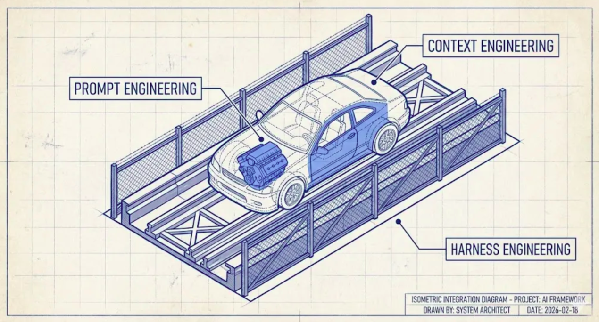
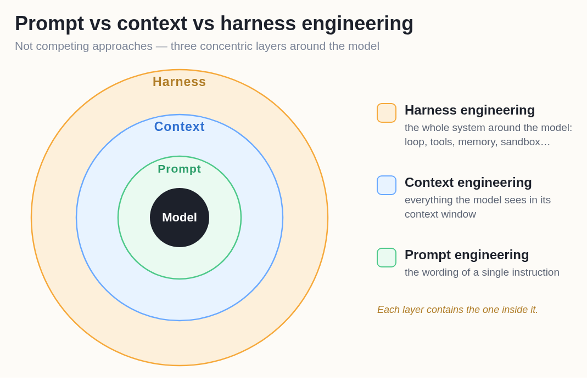
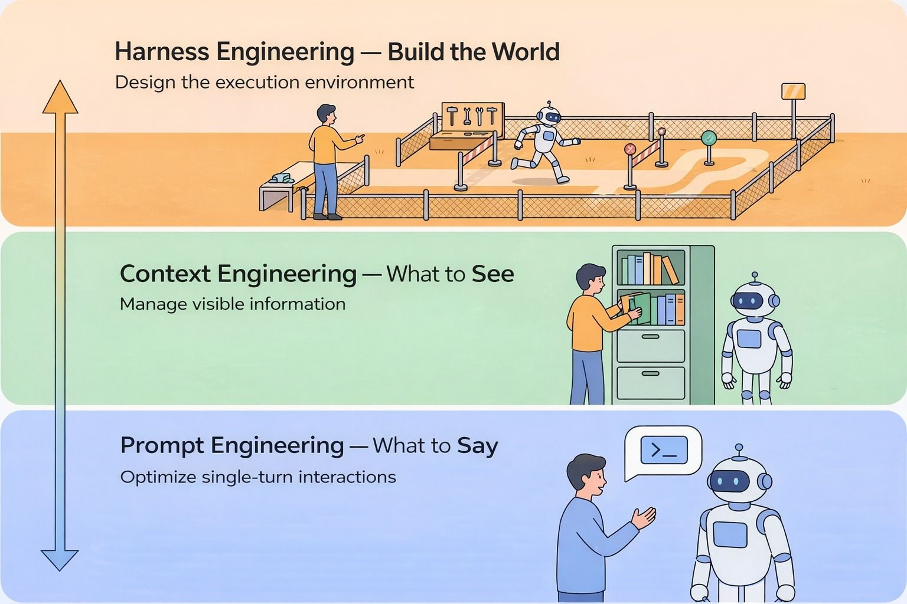
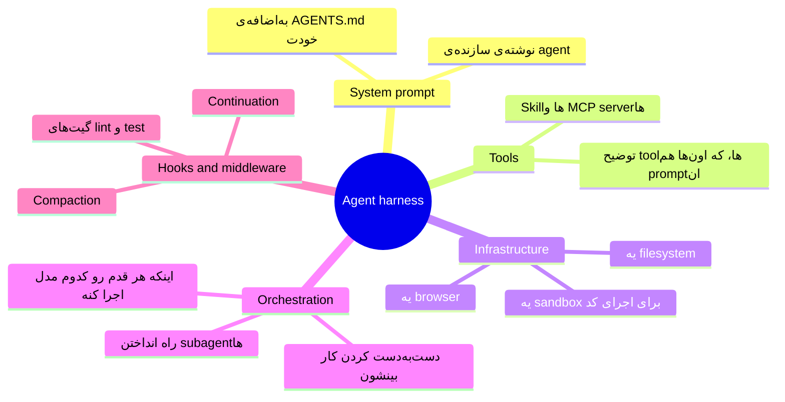
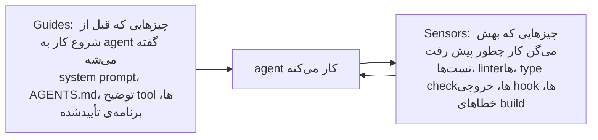
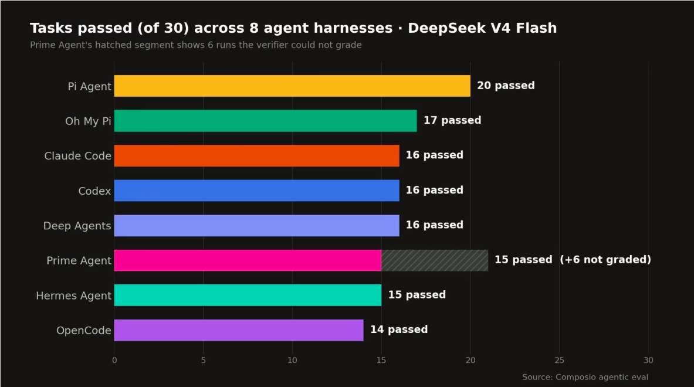

# Harness Engineering

[Code Agent‌ها](coding_agents_fa.md) با hook‌ها تموم شد، و hook‌ها با هر چیز دیگه‌ی اون درس فرق داشتن. بقیه‌ی چیزها توصیه‌ان و AI بیشتر وقت‌ها رعایتشون می‌کنه. hook اجرا می‌شه، چه AI بخواد چه نخواد. کل این درس درباره‌ی همین فرقه.

## چرا این برای تو مهمه

وقتی یه شرکت می‌ذاره یه AI با داده‌ی واقعی، پول واقعی یا مشتری واقعی کار کنه، برای بعضی قانون‌ها «معمولاً درست رفتار می‌کنه» کافی نیست. این درس می‌گه این قانون‌ها چطور مطمئن می‌شن، و چرا یه مدل AI یکی توی یه محصول عالی کار می‌کنه و توی یه محصول دیگه بد.

## مشکلی که دستورها حلش نمی‌کنن

یه AI هر بار دقیقاً یه کار رو انجام نمی‌ده. یه ورودی رو دو بار بدی، ممکنه دو تا جواب متفاوت بگیری. به زبان فنی بهش می‌گن **non-deterministic** (غیرقطعی). و یه agent که دو ساعت کار می‌کنه هزاران تصمیم کوچیک می‌گیره.

پس مؤدبانه خواستن هیچ‌وقت تضمین نمی‌ده، هر چقدر هم تکرار کنی. فرض کن AI نباید بدون تأیید یه آدم برای هیچ مشتری‌ای ایمیل بفرسته. می‌تونی توی دستورهاش بنویسی «بدون تأیید ایمیل نفرست». این بیشتر وقت‌ها جواب می‌ده. ولی برای این قانون، «بیشتر وقت‌ها» کافی نیست. چیزی لازم داری که توی محیط کار ساخته شده باشه و هر بار یه جور رفتار کنه، AI هر تصمیمی که بگیره.

طراحی این محیط کار اسمش **harness engineering**ـه.

  
*موتور همون prompt‌ه: قدرت تولید می‌کنه. ماشین همون context‌ه: بدنه‌ای که دور موتور ساخته شده. پیست و گاردریل‌ها harness‌ان. گاردریل‌ها فرمون نمی‌گیرن و کاری نمی‌کنن که ماشین مسیر درست بره. کاری می‌کنن که نتونه مسیر غلط بره.*

دو درس بعدی دوباره از این تصویر ماشین استفاده می‌کنن، پس یادت بمونه.

## Agent Harness چیه

نتیجه‌ی harness engineering اسمش **agent harness**ـه: مدل AI، به‌اضافه‌ی هر چیزی که دورش ساخته شده، به‌اضافه‌ی جایی که توش کار می‌کنه.

LangChain توی یه خط می‌گه: **Agent = Model + Harness.** مدل هوش رو میاره. harness اون هوش رو به کار مفید و امن تبدیل می‌کنه.

یه کارمند جدید رو در نظر بگیر. باهوشه (این همون مدله). ولی دفتر، روال‌ها، کارت‌های ورود، فرم‌هایی که بدون امضا ثبت نمی‌شن و تأیید مدیر تعیین می‌کنن اون واقعاً چی رو می‌تونه امن انجام بده (این همون harness‌ه).

این یعنی محصول‌های AI‌ای که استفاده می‌کنی هم harness‌ان. Claude Code یه harness‌ه. Codex یه harness‌ه. هیچ‌کدومشون مدل نیستن. یه مدل دیگه بذاری توش، کمتر از اون چیزی که فکر می‌کنی عوض می‌شه.

harness لایه‌ی **بیرونیه**. جای کار prompt و context رو نمی‌گیره؛ اون‌ها رو توی خودش داره.

  
*هر حلقه اونی رو که توشه توی خودش داره. برای همینه که این‌ها هیچ‌وقت جایگزین هم نیستن. harness system prompt رو می‌نویسه، چت رو خلاصه می‌کنه و کمک‌کارها رو می‌فرسته، پس کار context تو توی harness‌ای اتفاق می‌افته که انتخاب کردی.*

## چهار سوال

تا 2026 این کار به چهار شغل تقسیم شده، و هر کدوم یه سوال ساده می‌پرسه.

  
*از پایین به بالا بخونش. هر لایه اونی رو که زیرشه توی خودش داره. پایین، یه آدم با ربات حرف می‌زنه. بالا، آدم جایی رو که ربات توش کار می‌کنه می‌سازه.*

- **Prompt engineering**: چی بگم و چطور؟
- **Context engineering**: AI توی چتش چی می‌بینه؟
- **Harness engineering**: دور AI چه دنیایی بسازم؟
- **Loop engineering**: کی تصمیم می‌گیره دوباره اجرا بشه و کی متوقف بشه؟ این درس بعدیه.

## یه harness از چی ساخته شده

به زبان ساده: دستورهایی که AI اول می‌خونه، ابزارهایی که می‌تونه استفاده کنه (و توضیح‌هاشون)، جایی که توش کار می‌کنه (فایل‌هاش، یه محیط تمرین امن، یه browser)، منطقی که کار رو دست کمک‌کارها می‌ده، و hook‌هایی که همیشه توی لحظه‌های مشخص اجرا می‌شن.

یه راه روشن برای دسته‌بندی همه‌ی این‌ها، تقسیمشون به دو جوره:

- **Guide‌ها** قبل از کار میان: دستورها، یه چک‌لیست، یه برنامه‌ی تأییدشده.
- **Sensor‌ها** بعد از کار چک می‌کنن: تست‌ها، یه بازبین. چیزی که پیدا می‌کنن برمی‌گرده پیش agent که درستش کنه.

و هر چک یکی از دو نوعه. بعضی چک‌ها رو یه نرم‌افزار معمولی انجام می‌ده، مثل فرمی که بدون امضا ثبت نمی‌شه: سریعن، ارزونن و هر بار یه جواب می‌دن. بعضی چک‌های دیگه رو یه AI دیگه انجام می‌ده، مثل یه همکار که کار رو دوباره می‌خونه: معنی رو می‌فهمه، ولی کندتره، گرون‌تره و ممکنه هر بار یه جور جواب بده. **هر جا نوع ثابت و نرم‌افزاری می‌تونه کار رو انجام بده، همون رو استفاده کن**، چون دقیقاً همون تضمینیه که یه prompt نمی‌تونه بده.

## چند تا مثال واقعی

هیچ‌کدومشون بزرگ نیست:

- **یه sandbox.** agent توی یه اتاق تمرین جدا کار می‌کنه، با یه کپی از فایل‌ها. اگه اشتباهی همه‌چی رو پاک کنه، فقط کپی از بین می‌ره.
- **یه دروازه‌ی مجوز.** بعضی درها قفلن. agent می‌تونه سعی کنه پول بفرسته یا یه پوشه رو پاک کنه، ولی نمی‌تونه.
- **یه تست قبل از «تموم شد».** وقتی agent می‌گه کار تموم شده، یه چک اجرا می‌شه. اگه چک رد بشه، به agent گفته می‌شه که کار تموم نشده. این agent نیست که تصمیم می‌گیره کارش تموم شده.
- **یه تشخیص‌دهنده‌ی حلقه.** اگه agent یه فایل رو پنج بار عوض کنه، احتمالاً گیر کرده. بهش بگو وایسه و دوباره فکر کنه.

این آخری با عدد هم اومد. LangChain پنج تغییر کوچیک توی محیط coding agent‌شون داد: دستورهای روشن‌تر، یه چک‌لیست نهایی، یه گشت کوتاه توی پروژه اول کار، تشخیص‌دهنده‌ی حلقه، و فکر کردن بیشتر برای برنامه‌ریزی و بررسی نسبت به کارهای روتین. **مدل عوض نشد.** امتیازش توی یه تست استاندارد (Terminal Bench 2.0) از 52.8% رفت به 66.5%.

این عدد رو یادت نگه دار. دلیل وجود این درسه: تقریباً چهارده امتیاز فقط از عوض کردن محیط کار اومد.

## هیچ harness‌ای برای همه‌ی مدل‌ها بهترین نیست

یه مدل بردار، یه مجموعه کار بده بهش، و فقط harness رو عوض کن. امتیازها حسابی جابه‌جا می‌شن.

  
*یه مدل، یه مجموعه کار، هشت تا harness، و امتیازها از 14 تا 20 از 30 می‌رن. توی هر ستون همون مدل فکر می‌کنه. سریع‌ترین harness برای هر موفقیت گرون‌ترین هم بود.*

Composio یه مدل رو با هشت تا harness اجرا کرد، از جمله Claude Code، Codex، OpenCode و Hermes Agent. درسش این نیست که «برنده رو استفاده کن». اینه که **جور بودن مهمه**، مثل یه تی‌شرت: یه سایز نیست که به همه بخوره. Claude Code برای مدل‌های Claude تنظیم شده و Codex برای مدل‌های OpenAI. پس وقتی می‌خونی یه مدل «بهترینه»، بپرس: توی کدوم harness؟

## Harness‌ها الان باز شدن

خیلی از harness‌ها الان open source ان، از جمله Claude Code. پس یه شرکت می‌تونه یکی رو که کار می‌کنه برداره و بخش‌هایی رو که به کارش نمی‌خوره عوض کنه: دستورها، توضیح یه ابزار، یا مدلی که توشه.

## کلمه‌هایی که الان بلدی

- **Non-deterministic**: یه ورودی هر بار می‌تونه یه جواب متفاوت بده.
- **Harness**: هر چیزی که دور مدل ساخته شده و باعث می‌شه امن کار کنه: Agent = Model + Harness.
- **Harness engineering**: طراحی اون محیط.
- **Guide** و **sensor**: چیزی که قبل از عمل به agent گفته می‌شه، و چیزی که بعدش کار رو چک می‌کنه.
- **Sandbox**: یه محیط تمرین جدا که اشتباه‌ها به فایل‌های واقعیت نمی‌رسن.
- **Permission gate**: قانونی که یه کار رو مسدود می‌کنه، AI هر تصمیمی که بگیره.

## خلاصه

یه AI non-deterministic‌ه، پس دستورها یه نرخ موفقیت خوب می‌دن ولی هیچ‌وقت تضمین نمی‌دن. harness بخشیه که حتی وقتی AI دستورهاش رو رعایت نمی‌کنه، به کار کردن ادامه می‌ده: system prompt، ابزارها و توضیحشون، محیط کار امن و hook‌ها. Agent = Model + Harness. عوض کردن فقط harness یه agent رو از 52.8% به 66.5% رسوند، و همون مدل روی هشت تا harness از 14 تا 20 از 30 امتیاز گرفت. بهترین harness وجود نداره، فقط بهترین جور بودن هست.

درس بعدی: تا الان هنوز یه آدم پشت فرمونه. درس بعدی اون آدم رو عوض می‌کنه.

**بررسی سریع**: یه دستور توی AGENTS.md و یه hook هر دو می‌تونن جلوی دست زدن agent به یه فایل رو بگیرن. چرا فقط یکیشون تضمینه؟ و اون جهش از 52.8% به 66.5% چی رو عوض کرد؟

## منابع

### 📄 مقاله‌ها

- [Harness Engineering: What It Is and How It Complements Context Engineering](https://medium.com/@amirkiarafiei/harness-engineering-what-it-is-and-how-it-complements-context-engineering-6545b40bfc84): ماشین، پیست و گاردریل‌ها، با جزئیات کامل
- [The Anatomy of an Agent Harness](https://www.langchain.com/blog/the-anatomy-of-an-agent-harness): Agent = Model + Harness، و فهرست اجزا
- [Improving Deep Agents with harness engineering](https://www.langchain.com/blog/improving-deep-agents-with-harness-engineering): پنج تغییر و جهش از 52.8% به 66.5%
- [Finding the Best Harness for DeepSeek V4 Flash](https://composio.dev/content/best-agent-harness-deepseek-v4-flash): هشت تا harness و یه مدل

### 🎬 ویدیوها

- [Agent Harness Explained in 2 minutes](https://youtube.com/shorts/IVdJj_aNwhE): نسخه‌ی کوتاه، اگه ترجیح می‌دی ببینی
