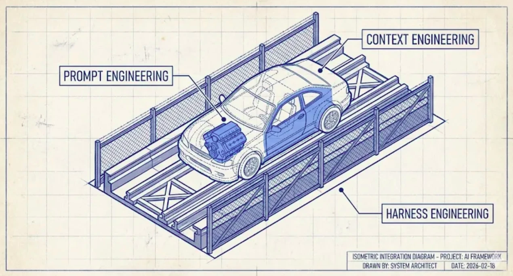
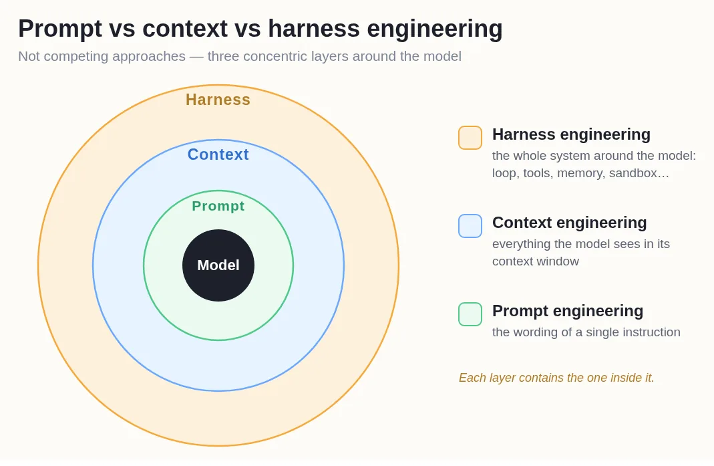
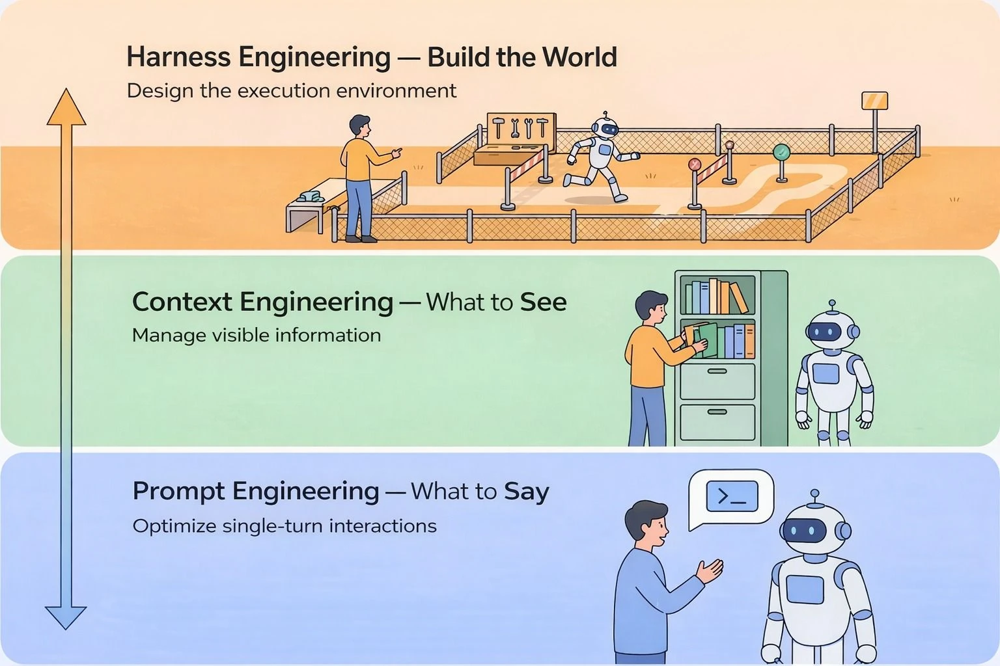
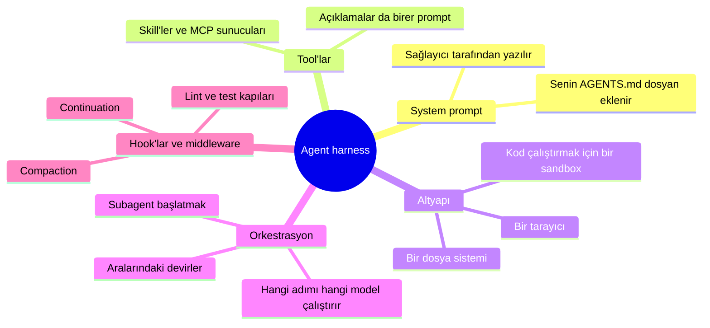
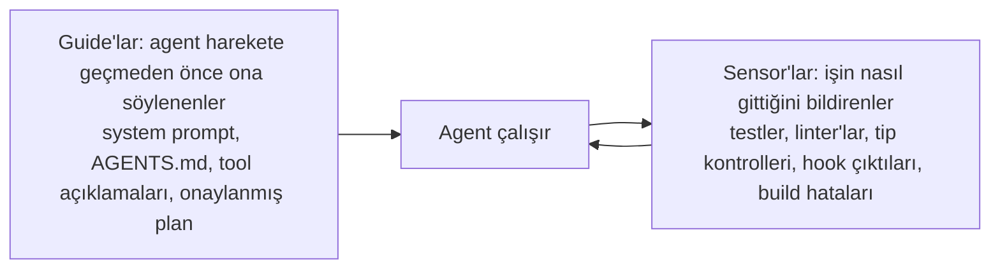
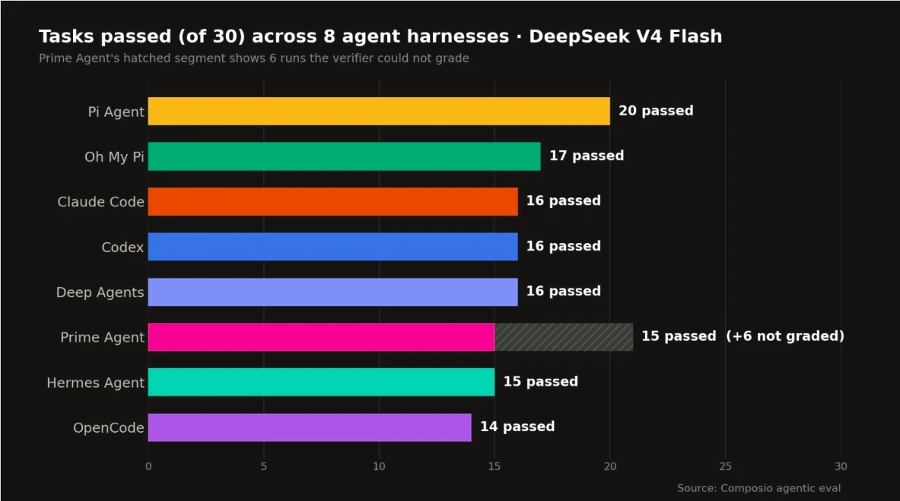

# Harness Engineering

[Code Agent'lar](coding_agents_tr.md) modülü hook'larla bitiyordu ve hook'lar o modüldeki diğer her şeyden farklıydı. Diğer her şey, yapay zekânın çoğu zaman uyduğu bir tavsiyedir. Hook ise yapay zekâ istesin istemesin çalışır. Bu modülün bütün konusu bu fark.

## Bu Senin İçin Neden Önemli

Bir şirket yapay zekânın gerçek verilerle, gerçek parayla ya da gerçek müşterilerle çalışmasına izin verdiğinde, bazı kurallar için "genelde doğru davranıyor" yetmez. Bu modül, o kuralların nasıl güvenli hâle getirildiğini ve aynı yapay zekâ modelinin bir üründe neden çok iyi, başka bir üründe neden kötü çalışabildiğini anlatıyor.

## Promptların Çözemediği Sorun

Bir yapay zekâ her seferinde tam olarak aynı şeyi yapmaz. Ona aynı girdiyi iki kez verirsen iki farklı cevap alabilirsin. Teknik dilde buna **non-deterministic** (deterministik olmayan) deniyor. İki saat boyunca çalışan bir agent ise binlerce küçük karar veriyor.

Ne kadar nazik rica edersen et, bu bir garanti değildir. Yapay zekânın bir müşteriye, bir insanın onayı olmadan asla e-posta göndermemesi gerektiğini düşün. Talimatlarına "onay olmadan asla e-posta gönderme" yazabilirsin. Bu çoğu zaman işe yarar. Ama bu kural için "çoğu zaman" yetmez. Yapay zekâ ne karar verirse versin her seferinde aynı şekilde davranan, ortama yerleştirilmiş bir şeye ihtiyacın var.

Bu ortamı tasarlamaya **harness engineering** deniyor.

  
*Motor, prompt: gücü o üretiyor. Araba, context: motorun etrafına kurulan gövde. Pist ve bariyerler ise harness. Bariyerler direksiyon çevirmiyor. Arabanın doğru yöne gitmesini sağlamıyorlar. Yanlış yöne gitmeyi imkânsız kılıyorlar.*

Sonraki iki modül bu araba resmini yeniden kullanıyor, o yüzden aklında dursun.

## Agent Harness Nedir

Harness engineering'in sonucuna **agent harness** deniyor: yapay zekâ modeli, onun etrafına kurulan her şey ve çalıştığı yer.

LangChain bunu tek satırda söylüyor: **Agent = Model + Harness.** Zekâyı model getiriyor. Harness ise o zekâyı işe yarar ve güvenli bir işe dönüştürüyor.

Yeni bir çalışanı düşün. Zeki biri (model bu). Ama ofis, prosedürler, giriş kartları, imzasız gönderilemeyen formlar ve yöneticinin onayı, onun gerçekte neyi güvenle yapabileceğine karar veriyor (harness bu).

Bu aynı zamanda, kullandığın yapay zekâ ürünlerinin birer harness olduğu anlamına geliyor. Claude Code bir harness. Codex bir harness. İkisi de model değil. İçlerine başka bir model koyarsan, değişen şey beklediğinden az olur.

Harness **en dış** katman. Prompt ve context çalışmasının yerini almıyor; onları içine alıyor.

  
*Her halka, içindekini kapsıyor. Bu yüzden bunlar hiçbir zaman birbirinin alternatifi değil. System prompt'u harness yazıyor, sohbeti harness özetliyor ve yardımcıları harness gönderiyor; yani senin context çalışman, seçtiğin harness'ın içinde gerçekleşiyor.*

## Dört Disiplin, Dört Soru

2026'ya gelindiğinde bu iş dört işe ayrıldı ve her biri tek bir sade soru soruyor.

  
*Aşağıdan yukarıya oku. Her katman, altındaki katmanı kapsıyor. En altta bir insan robotla konuşuyor. En üstte insan, robotun çalıştığı yeri inşa ediyor.*

- **Prompt engineering**: ne söylüyorum ve nasıl söylüyorum?
- **Context engineering**: yapay zekâ sohbetinde ne görüyor?
- **Harness engineering**: yapay zekânın etrafında nasıl bir dünya kuruyorum?
- **Loop engineering**: tekrar ne zaman çalışacağına ve ne zaman duracağına kim karar veriyor? Bu bir sonraki modül.

## Bir Harness Neyden Oluşur

Sade kelimelerle: yapay zekânın ilk okuduğu talimatlar, kullanabildiği araçlar (ve açıklamaları), çalıştığı yer (dosyaları, güvenli bir deneme alanı, bir tarayıcı), işi yardımcılara dağıtan mantık ve sabit anlarda her zaman çalışan hook'lar.

Bütün bunları düzenlemenin net bir yolu, iki türe ayırmak:

- **Guide'lar** işten önce gelir: talimatlar, bir kontrol listesi, onaylanmış bir plan.
- **Sensor'lar** işten sonra kontrol eder: testler, bir gözden geçirici. Buldukları şey agent'a geri döner ve agent onu düzeltebilir.

Her kontrol de iki tipten birine giriyor. Bazı kontrolleri sıradan yazılım çalıştırır; imzasız gönderilmeyen bir form gibi: hızlıdırlar, ucuzdurlar ve her seferinde aynı cevabı verirler. Bazı kontrolleri ise başka bir yapay zekâ çalıştırır; işi bir iş arkadaşının gözden geçirmesi gibi: anlamı kavrarlar, ama daha yavaştırlar, daha pahalıdırlar ve cevapları değişebilir. **Yazılımın yapabildiği her yerde sabit, yazılım tipini kullan**, çünkü bir prompt'un veremediği garanti tam olarak bu.

## Gerçek Örnekler

Hiçbiri büyük değil:

- **Sandbox.** Agent, dosyaların bir kopyasıyla ayrı bir deneme odasında çalışıyor. Yanlışlıkla her şeyi silerse yalnızca kopya kaybolur.
- **İzin kapısı.** Bazı kapılar kilitli. Agent para göndermeyi ya da bir klasörü silmeyi deneyebilir, ama yapamaz.
- **"Bitti"den önce bir test.** Agent işi bitirdiğini söylediğinde bir kontrol çalışıyor. Kontrol başarısız olursa agent'a işin bitmediği söyleniyor. İşin bittiğine agent karar vermiyor.
- **Döngü dedektörü.** Agent aynı dosyayı beş kez değiştirirse muhtemelen takılmıştır. Ona durup yeniden düşünmesini söyle.

Bu sonuncusu rakamlarla geldi. LangChain, kendi code agent'ının ortamında beş küçük değişiklik yaptı: daha net talimatlar, bir son kontrol listesi, başlangıçta projeye kısa bir tur, döngü dedektörü ve rutin işlere göre planlama ile kontrol için daha fazla düşünme. **Model değişmedi.** Standart bir testteki (Terminal Bench 2.0) puanı yüzde 52,8'den yüzde 66,5'e çıktı.

Bu rakamı aklında tut. Bu modülün var olma sebebi o: neredeyse on dört puan yalnızca ortamı değiştirmekten geldi.

## Her Model İçin En İyi Harness Yok

Tek bir model al, ona tek bir görev seti ver ve yalnızca harness'ı değiştir. Puanlar epey oynuyor.

  
*Tek model, tek görev seti, sekiz harness ve puanlar 30 üzerinden 14 ile 20 arasında değişiyor. Her çubukta düşünen aynı model. En hızlı harness, başarı başına en pahalı olan da oldu.*

Composio tek bir modeli, aralarında Claude Code, Codex, OpenCode ve Hermes Agent'ın da bulunduğu sekiz harness'ta çalıştırdı. Dersi "kazananı kullan" değil. Asıl ders **eşleşmenin önemli olduğu**; bir tişört gibi: herkese uyan tek bir beden yok. Claude Code, Claude modelleri için ayarlanmış; Codex ise OpenAI'ınkiler için. Bu yüzden bir modelin "en iyi" olduğunu okuduğunda sor: hangi harness'ta?

## Harness'ler Artık Açık Kaynak

Birçok harness artık açık kaynak; Claude Code'unki de dahil. Bu yüzden bir şirket işe yarayan birini alıp işine uymayan kısımları değiştirebiliyor: talimatları, bir tool açıklamasını ya da içindeki modeli.

## Artık Bildiğin Terimler

- **Non-deterministic**: aynı girdinin her seferinde farklı bir cevap verebilmesi.
- **Harness**: modelin etrafına kurulan ve onun güvenle çalışmasını sağlayan her şey: Agent = Model + Harness.
- **Harness engineering**: bu ortamı tasarlamak.
- **Guide'lar** ve **sensor'lar**: agent harekete geçmeden önce ona söylenenler ve işi sonradan kontrol edenler.
- **Sandbox**: hataların gerçek dosyalarına ulaşamadığı ayrı bir deneme alanı.
- **İzin kapısı**: yapay zekâ ne karar verirse versin bir eylemi engelleyen kural.

## Özet

Bir yapay zekâ deterministik değildir; bu yüzden talimatlar iyi bir başarı oranı sağlar ama asla garanti vermez. Harness, yapay zekânın uymasına bağlı olmayan kısımdır: sandbox, izin kapıları, hook'lar ve iş bittikten sonra çalışan kontroller. System prompt ile AGENTS.md birer rehberdir, yani hâlâ tavsiyedir. Agent = Model + Harness. Yalnızca harness'ı değiştirmek bir agent'ı yüzde 52,8'den yüzde 66,5'e taşıdı ve aynı model, sekiz harness'ta 30 üzerinden 14 ile 20 arasında puan aldı. En iyi harness diye bir şey yok, yalnızca en iyi eşleşme var.

Sırada şu var: şimdiye kadar direksiyonda hâlâ bir insan oturuyordu. Bir sonraki modül o insanın yerine geçiyor.

**Hızlı Kontrol**: AGENTS.md'deki bir talimat da bir hook da bir agent'ın bir dosyaya dokunmasını engelleyebilir. Neden yalnızca biri garanti? Yüzde 52,8'den yüzde 66,5'e çıkış neyi değiştirdi?

## Kaynaklar

### 📄 Makaleler

- [Harness Engineering: What It Is and How It Complements Context Engineering](https://medium.com/@amirkiarafiei/harness-engineering-what-it-is-and-how-it-complements-context-engineering-6545b40bfc84): araba, pist ve bariyerler, ayrıntılı anlatımla
- [The Anatomy of an Agent Harness](https://www.langchain.com/blog/the-anatomy-of-an-agent-harness): Agent = Model + Harness ve parçaların listesi
- [Improving Deep Agents with harness engineering](https://www.langchain.com/blog/improving-deep-agents-with-harness-engineering): beş değişiklik ve yüzde 52,8'den yüzde 66,5'e sıçrama
- [Finding the Best Harness for DeepSeek V4 Flash](https://composio.dev/content/best-agent-harness-deepseek-v4-flash): sekiz harness ve tek model

### 🎬 Videolar

- [Agent Harness Explained in 2 minutes](https://youtube.com/shorts/IVdJj_aNwhE): izlemeyi tercih edersen kısa anlatım
