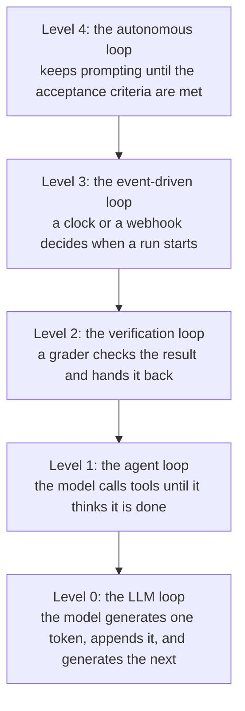

# Loop Engineering

By the end of [Harness Engineering](harness_engineering.md), the agent had an engine, a car body and
a track with barriers. Look at the picture again, and notice who is still in the driver's seat.

You are. You type the request. You read what came back. You decide whether it was good enough and
what happens next. Modern agents already manage their own chat, summarise it, send their own
helpers and keep their own to-do list. And still, a person sits at the centre and presses enter.

This module is about removing that person.

## Why This Matters to You

In the past, people had to sit on top of their agents, check each answer, and step in to keep them
going. Loop engineering hands that job to a script or to another agent, so the work continues for
hours or days without a person. When you hear that an AI "worked all weekend" on a project, this is
how.

## What Loop Engineering is

**Loop engineering** is designing loops that repeat automatically. Each loop carries an agent
through rounds of acting, checking and adjusting, until a defined goal is met. You do not give
instructions turn by turn. You design what starts a round, what checks it, and when it stops.

The last part, **when it stops**, is the most important design choice. Stop too early, and the work
is half done. Never stop, and you keep paying for an agent that goes in circles.

Back to the car. The engine is the prompt, the body is the context, and the track and barriers are the harness.
Until now, a person drove. With loop engineering, the AI drives.

  
*Each panel is a joke about a job title, and the last one is a guess about the future. Read the arrows: first the person points at agents, then the person points at one agent, and that agent points at the others.*

## Loops Happen at Five Levels

When people say "loop engineering", they usually mean the outermost loop. But there are five levels,
and each sits inside the next:



### Level 0: The LLM Loop

The model writes one word, adds it to the text, and writes the next. That is how it produces any
answer at all. Nobody designs this loop.

### Level 1: The Agent Loop

The agent uses a tool, reads the result, and uses another, until it decides it is done. That is the
loop from [AI Agents](../1_fundamentals/agents.md). Every agent product already has it.

### Level 2: The Verification Loop

The agent finishes, and then something checks the work against a standard before anyone accepts it.
If it is not good enough, the feedback goes back to the agent for another round, like a teacher
returning homework to be corrected.

The standard can be anything you can check: all tests pass, a page loads fast enough, or a written
checklist of what good work looks like. Claude Code has a command for this, `/goal`:

```text
/goal get the homepage Lighthouse score to 90 or above, stop after 5 tries
```

Look at the shape: **a target, and a limit**. The limit matters. If success is the only way to stop,
an impossible task never stops.

### Level 3: The Event-driven Loop

Here, something outside decides when a run happens: a schedule, or an event such as a new email or a
new support ticket. The agent stops being something you open and becomes something that runs. For
example: "every morning at 9, read the new support tickets and sort them". In Claude Code:

```text
/loop 5m check my PR, address review comments, and fix failing CI
```

### Level 4: The Autonomous Loop

This is the level that made loop engineering a topic. It started with the **Ralph loop**, named
after the Simpsons character. It is a very simple script that starts the agent, again and again,
until the whole job is done:

```bash
while true; do
  claude -p "$PROMPT"
done
```

If the code means nothing to you, read it as: "forever: start the agent with the same instructions".
Each start gets a fresh, empty chat. So the agent never gets tired or confused by a long chat, the
[context rot](context_engineering.md) problem.

  
*The name comes from the Simpsons character. The joke is friendly: the technique works because it is too simple to be clever, and it keeps going after setbacks that would stop something smarter.*

The one rule that matters most: **one task per round.** Each round:

- reads the plan
- picks the next unfinished item
- does that item
- marks it done
- exits

Then the next round starts clean and picks the next item. This is what pushed agents from hours of
work to days, because no single session has to last that long.

## Agents That Design the Loop

Every loop above was designed by a person. The next step is letting the agent design and run the
loops itself: **agent teams** that share a task list, **dynamic workflows** where the agent writes
the plan as a script for hundreds of helpers, and **recursive language models** that call
themselves to work through more text than one chat can hold. These are covered in the Expert level,
in [Advanced Loop Engineering](../3_expert/advanced_loop_engineering.md).

## The Trend

Put the last four modules side by side, and the direction is clear:

- better models
- then better use of the chat
- then better surroundings around the models
- then better loops around those surroundings

Each step let the agent work longer before a person had to step in. None replaced the one before;
they stacked. That is why this whole part of the course has been one picture, with more parts added.

## Words You Now Know

- **Loop engineering**: designing loops that keep an agent working without a person.
- **Stop condition**: the rule that decides when the loop ends.
- **Verification loop**: something checks the work and sends it back if it is not good enough.
- **Event-driven loop**: a schedule or an event starts the work.
- **Ralph loop**: a simple script that restarts the agent until the job is done, one task per round.

## Summary

People used to sit over their agents and press enter. Loop engineering gives that job to a script or
another agent. The most important choice is when to stop: a target, and a limit. There are five
levels, from one word at a time up to loops that run for days, and the Ralph loop's rule of one task
per round is what made the longest runs possible.

**Quick check**: What does loop engineering remove from the picture? And why does a good loop need
both a target and a limit?

## References

### 📄 Articles

- [The Art of Loop Engineering](https://www.langchain.com/blog/the-art-of-loop-engineering): loop engineering as loops inside loops
- [Loop engineering: Getting started with loops](https://claude.com/blog/getting-started-with-loops): `/goal`, `/loop` and `/schedule`, and how each one stops
- [everything is a ralph loop](https://ghuntley.com/loop/): the original technique, and the one-task-per-round rule

### 🎬 Videos

- [Loop Engineering explained in 8min..](https://www.youtube.com/watch?v=4biXYSNkn9Y): the same subject in eight minutes, if you would rather watch
