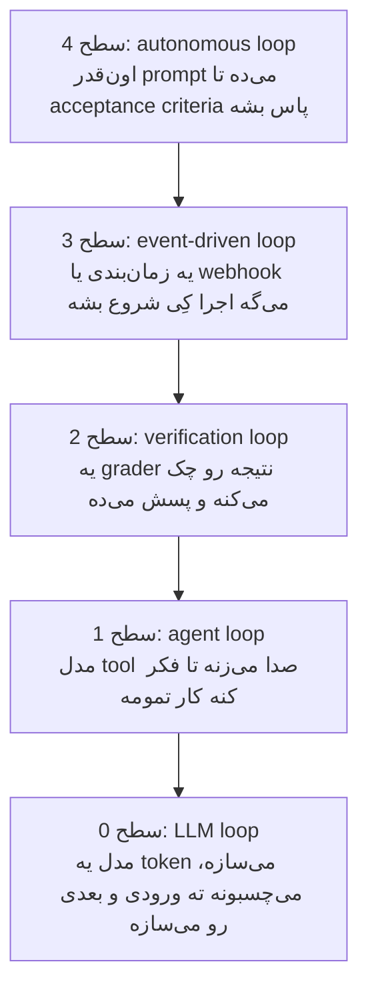

---
objectives:
  - "توضیح بده loop engineering چی رو برمی‌داره: اون آدمی رو که agent رو دوباره راه می‌ندازه"
  - "بگو چرا شرط توقف (stop condition) مهم‌ترین انتخاب طراحیه"
  - "پنج سطح Loop رو اسم ببر، از یه کلمه در هر بار تا چند روز کار بی‌نظارت"
---

# Loop Engineering

آخر [Harness Engineering](harness_engineering_fa.md) agent یه موتور داشت، یه بدنه‌ی ماشین، و یه پیست با گاردریل. دوباره به اون تصویر نگاه کن و ببین پشت فرمون هنوز کی نشسته.

تو. تو درخواست رو تایپ می‌کنی. تو می‌خونی چی برگشته. تو تصمیم می‌گیری به اندازه‌ی کافی خوب بوده یا نه و بعدش چی بشه. agent‌های امروزی چت خودشون رو خودشون مدیریت می‌کنن، خلاصه‌ش می‌کنن، کمک‌کار خودشون رو می‌فرستن و فهرست کار خودشون رو دارن. و با این حال هنوز یه آدم وسط نشسته و enter می‌زنه.

این درس درباره‌ی برداشتن اون آدمه.

## چرا این برای تو مهمه

قبلاً آدم‌ها باید بالای سر agent‌هاشون می‌نشستن، هر جواب رو چک می‌کردن و وسط کار دخالت می‌کردن که ادامه بدن. loop engineering این کار رو می‌سپره به یه script یا یه agent دیگه، و کار ساعت‌ها یا روزها بدون آدم ادامه پیدا می‌کنه. وقتی می‌شنوی یه AI «تمام آخر هفته» روی یه پروژه کار کرده، این‌طوریه.

## Loop Engineering چیه؟

**Loop engineering** یعنی طراحی حلقه‌هایی که خودکار تکرار می‌شن. هر حلقه یه agent رو از دورهای عمل کردن، چک کردن و تنظیم کردن رد می‌کنه، تا یه هدف مشخص برآورده بشه. تو نوبت‌به‌نوبت دستور نمی‌دی. طراحی می‌کنی چی یه دور رو شروع کنه، چی چکش کنه، و کِی متوقف بشه.

بخش آخر، یعنی **کِی متوقف بشه**، مهم‌ترین انتخاب طراحیه. زود متوقف بشه، کار نصفه می‌مونه. هیچ‌وقت متوقف نشه، مدام پول یه agent رو می‌دی که دور خودش می‌چرخه.

برگردیم سر ماشین. موتور همون prompt‌ه، بدنه context‌ه، و پیست و گاردریل‌ها harness‌ان. تا الان یه آدم رانندگی می‌کرد. با loop engineering، خود AI رانندگی می‌کنه.

  
*هر کادر یه شوخی درباره‌ی یه عنوان شغلیه، و آخری یه حدس درباره‌ی آینده‌ست. فلش‌ها رو بخون: اول آدم به agent‌ها اشاره می‌کنه، بعد آدم به یه agent اشاره می‌کنه، و اون agent به بقیه اشاره می‌کنه.*

## پنج سطح Loop

وقتی آدم‌ها می‌گن «loop engineering»، معمولاً منظورشون بیرونی‌ترین حلقه‌ست. ولی پنج سطح هست و هر کدوم توی بعدی جا داره:



### سطح 0: LLM Loop

مدل یه کلمه می‌نویسه، به متن اضافه‌ش می‌کنه و کلمه‌ی بعدی رو می‌نویسه. هر جوابی رو که بده، همین‌جوری می‌سازه. هیچ‌کس این حلقه رو طراحی نمی‌کنه.

### سطح 1: Agent Loop

agent یه ابزار استفاده می‌کنه، نتیجه رو می‌خونه و یکی دیگه استفاده می‌کنه، تا وقتی که خودش تشخیص بده کارش تموم شده. این همون حلقه‌ایه که توی [AI Agents](../1_fundamentals/agents_fa.md) دیدی. هر محصول agent از قبل داردش.

### سطح 2: Verification Loop

agent کارش رو تموم می‌کنه، و بعد یه چیزی کار رو با یه استاندارد می‌سنجه، قبل از این‌که کسی بپذیرتش. اگه به اندازه‌ی کافی خوب نباشه، بازخورد برمی‌گرده پیش agent برای یه دور دیگه، مثل معلمی که تکلیف رو پس می‌ده که اصلاح بشه.

استاندارد می‌تونه هر چیزی باشه که بشه چکش کرد: همه‌ی تست‌ها پاس بشن، یه صفحه به اندازه‌ی کافی سریع باز بشه، یا یه چک‌لیست نوشته‌شده از این‌که کار خوب چه شکلیه. Claude Code برای این یه command داره، `/goal`:

```text
/goal get the homepage Lighthouse score to 90 or above, stop after 5 tries
```

به شکلش نگاه کن: **یه هدف، و یه محدودیت**. محدودیت مهمه. اگه موفقیت تنها راه توقف باشه، یه کار غیرممکن هیچ‌وقت متوقف نمی‌شه.

### سطح 3: Event-driven Loop

این‌جا یه چیز بیرونی تصمیم می‌گیره اجرا کِی اتفاق بیفته: یه زمان‌بندی، یا یه رویداد مثل یه ایمیل جدید یا یه تیکت پشتیبانی جدید. agent دیگه چیزی نیست که بازش کنی و چیزی می‌شه که اجرا می‌شه. مثلاً: «هر روز ساعت 9 صبح تیکت‌های جدید پشتیبانی رو بخون و دسته‌بندی کن». توی Claude Code:

```text
/loop 5m check my PR, address review comments, and fix failing CI
```

### سطح 4: Autonomous Loop

این همون سطحیه که loop engineering رو یه موضوع کرد. با **Ralph loop** شروع شد، که اسمش از شخصیت Simpsons گرفته شده. یه script خیلی ساده‌ست که agent رو بارها و بارها راه می‌ندازه، تا کل کار تموم بشه:

```bash
while true; do
  claude -p "$PROMPT"
done
```

اگه این کد برات معنی نداره، این‌طوری بخونش: «تا ابد: agent رو با همون دستورها راه بنداز». هر بار راه‌افتادن یه چت تازه و خالی می‌گیره. پس agent هیچ‌وقت از یه چت بلند خسته یا گیج نمی‌شه، یعنی همون مشکل [context rot](context_engineering_fa.md).

  
*اسم از شخصیت Simpsons گرفته شده. شوخی دوستانه‌ست: این تکنیک کار می‌کنه چون اون‌قدر ساده‌ست که زرنگی توش نیست، و بعد از شکست‌هایی که یه چیز باهوش‌تر رو متوقف می‌کنن، ادامه می‌ده.*

مهم‌ترین قانون: **هر دور یه کار.** هر دور:

- برنامه رو می‌خونه
- کار نیمه‌تموم بعدی رو برمی‌داره
- همون کار رو انجام می‌ده
- تموم‌شده علامتش می‌زنه
- خارج می‌شه

بعد دور بعدی تمیز شروع می‌شه و کار بعدی رو برمی‌داره. این چیزیه که agent‌ها رو از ساعت‌ها کار به روزها رسوند، چون هیچ session‌ای لازم نیست اون‌قدر دووم بیاره.

## Agent‌هایی که خودشون loop رو طراحی می‌کنن

هر حلقه‌ای که بالا گفتیم رو یه آدم طراحی کرده بود. قدم بعدی اینه که بذاری خود agent حلقه‌ها رو طراحی کنه و اجرا کنه: **agent team**‌هایی که یه فهرست کار مشترک دارن، **dynamic workflow**‌هایی که agent برنامه رو به شکل یه script برای صدها کمک‌کار می‌نویسه، و **recursive language model**‌هایی که خودشون رو صدا می‌زنن که متنی بیشتر از ظرفیت یه چت رو پردازش کنن. این‌ها توی سطح Expert و درس [Advanced Loop Engineering](../3_expert/advanced_loop_engineering.md) توضیح داده می‌شن.

## روند کلی

چهار درس آخر رو کنار هم بذار، جهت کاملاً روشنه:

- مدل‌های بهتر
- بعد استفاده‌ی بهتر از چت
- بعد محیط بهتر دور مدل‌ها
- بعد حلقه‌های بهتر دور اون محیط‌ها

هر قدم باعث شد agent قبل از این‌که آدم دخالت کنه، مدت بیشتری کار کنه. هیچ‌کدوم جای قبلی رو نگرفتن؛ روی هم سوار شدن. برای همینه که کل این بخش از دوره یه تصویر بوده، که هی بخش‌های بیشتری بهش اضافه شده.

## کلمه‌هایی که الان بلدی

- **Loop engineering**: طراحی حلقه‌هایی که agent رو بدون آدم به کار کردن ادامه می‌دن.
- **Stop condition** (شرط توقف): قانونی که تعیین می‌کنه حلقه کِی تموم می‌شه.
- **Verification loop**: یه چیزی کار رو چک می‌کنه و اگه به اندازه‌ی کافی خوب نباشه پسش می‌فرسته.
- **Event-driven loop**: یه زمان‌بندی یا یه رویداد کار رو شروع می‌کنه.
- **Ralph loop**: یه script ساده که agent رو مدام دوباره راه می‌ندازه تا کار تموم بشه، هر دور یه کار.

## خلاصه

آدم‌ها قبلاً بالای سر agent‌هاشون می‌نشستن و enter می‌زدن. loop engineering این کار رو می‌ده به یه script یا یه agent دیگه. مهم‌ترین انتخاب اینه که کِی متوقف بشه: یه هدف، و یه محدودیت. پنج سطح هست، از یه کلمه در هر لحظه تا حلقه‌هایی که روزها اجرا می‌شن، و قانون «هر دور یه کار» توی Ralph loop همون چیزیه که طولانی‌ترین اجراها رو ممکن کرد.

**بررسی سریع**: loop engineering چی رو از تصویر برمی‌داره؟ و چرا یه حلقه‌ی خوب هم هدف لازم داره هم محدودیت؟

## منابع

### 📄 مقاله‌ها

- [The Art of Loop Engineering](https://www.langchain.com/blog/the-art-of-loop-engineering): loop engineering به شکل حلقه‌هایی توی حلقه‌ها
- [Loop engineering: Getting started with loops](https://claude.com/blog/getting-started-with-loops): `/goal`، `/loop` و `/schedule`، و این‌که هر کدوم چطور متوقف می‌شن
- [everything is a ralph loop](https://ghuntley.com/loop/): تکنیک اصلی، و قانون «هر دور یه کار»

### 🎬 ویدیوها

- [Loop Engineering explained in 8min..](https://www.youtube.com/watch?v=4biXYSNkn9Y): همین موضوع توی هشت دقیقه، اگه ترجیح می‌دی ببینی
