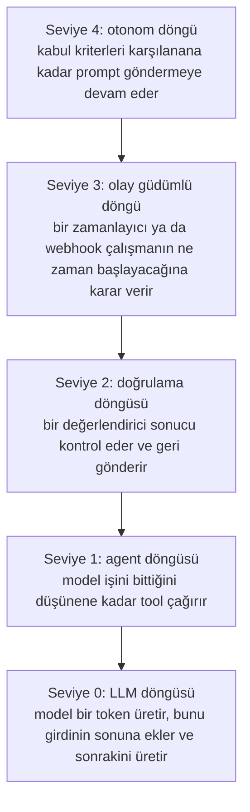

# Loop Engineering

[Harness Engineering](harness_engineering_tr.md) modülünün sonunda agent'ın bir motoru, bir araba gövdesi ve bariyerli bir pisti vardı. Resme yeniden bak ve direksiyonda hâlâ kimin oturduğuna dikkat et.

Sen oturuyorsun. İsteği sen yazıyorsun. Gelen cevabı sen okuyorsun. Yeterince iyi olup olmadığına ve sonra ne olacağına sen karar veriyorsun. Modern agent'lar kendi sohbetlerini yönetiyor, özetliyor, kendi yardımcılarını gönderiyor ve kendi yapılacaklar listelerini tutuyor. Yine de merkezde bir insan oturuyor ve enter'a basıyor.

Bu modül, o insanı çıkarmakla ilgili.

## Bu Senin İçin Neden Önemli

Eskiden insanlar agent'larının başında oturmak, her cevabı kontrol etmek ve çalışmayı sürdürmek için araya girmek zorundaydı. Loop engineering bu işi bir script'e ya da başka bir agent'a veriyor; böylece iş, bir insan olmadan saatlerce ya da günlerce sürüyor. Bir yapay zekânın bir proje üzerinde "bütün hafta sonu çalıştığını" duyduğunda, bu böyle oluyor.

## Loop Engineering Nedir

**Loop engineering**, kendiliğinden tekrar eden döngüler tasarlamaktır. Her döngü, tanımlı bir hedefe ulaşılana kadar bir agent'ı hareket etme, kontrol etme ve ayarlama turlarından geçirir. Talimatları tur tur sen vermezsin. Bir turu neyin başlattığını, neyin kontrol ettiğini ve ne zaman duracağını tasarlarsın.

Sonuncusu, yani **ne zaman duracağı**, en önemli tasarım kararı. Çok erken durursan iş yarım kalır. Hiç durmazsan, daireler çizen bir agent için ödeme yapmaya devam edersin.

Arabaya dönelim. Motor prompt, gövde context, pist ve bariyerler ise harness. Şimdiye kadar arabayı bir insan sürdü. Loop engineering ile arabayı yapay zekâ sürüyor.

  
*Her panel bir iş unvanıyla ilgili bir şaka, sonuncusu ise geleceğe dair bir tahmin. Oklara bak: önce insan agent'ları gösteriyor, sonra insan tek bir agent'ı gösteriyor ve o agent diğerlerini gösteriyor.*

## Döngüler Beş Seviyede Oluşur

İnsanlar "loop engineering" dediğinde genellikle en dıştaki döngüyü kastediyor. Ama beş seviye var ve her biri bir sonrakinin içinde duruyor:



### Seviye 0: LLM Loop

Model bir kelime yazıyor, onu metne ekliyor ve sonrakini yazıyor. Herhangi bir cevabı bu şekilde üretiyor. Bu döngüyü kimse tasarlamıyor.

### Seviye 1: Agent Loop

Agent bir araç kullanıyor, sonucu okuyor ve işini bittiğine karar verene kadar başka bir araç kullanıyor. Bu, [AI Agent'lar](../1_fundamentals/agents_tr.md) modülündeki döngü. Her agent ürününde zaten var.

### Seviye 2: Verification Loop

Agent işi bitiriyor ve sonra biri kabul etmeden önce bir şey işi bir standarda göre kontrol ediyor. Yeterince iyi değilse geri bildirim, bir tur daha için agent'a dönüyor; bir öğretmenin ödevi düzeltilsin diye geri vermesi gibi.

Standart, kontrol edebileceğin herhangi bir şey olabilir: bütün testler geçiyor, bir sayfa yeterince hızlı yükleniyor ya da iyi işin neye benzediğini anlatan yazılı bir kontrol listesi. Claude Code'un bunun için bir komutu var, `/goal`:

```text
/goal get the homepage Lighthouse score to 90 or above, stop after 5 tries
```

Şekle bak: **bir hedef ve bir sınır**. Sınır önemli. Durmanın tek yolu başarı ise, imkânsız bir görev hiç durmaz.

### Seviye 3: Event-driven Loop

Burada dışarıdaki bir şey, bir çalışmanın ne zaman olacağına karar veriyor: bir takvim ya da yeni bir e-posta veya yeni bir destek talebi gibi bir olay. Agent, senin açtığın bir şey olmaktan çıkıp kendi kendine çalışan bir şey oluyor. Örneğin: "her sabah saat 9'da yeni destek taleplerini oku ve sırala". Claude Code'da:

```text
/loop 5m check my PR, address review comments, and fix failing CI
```

### Seviye 4: Autonomous Loop

Loop engineering'i bir konu hâline getiren seviye bu. **Ralph loop** ile başladı; adını Simpsonlar karakterinden alıyor. Bütün iş bitene kadar agent'ı tekrar tekrar başlatan çok basit bir script:

```bash
while true; do
  claude -p "$PROMPT"
done
```

Kod sana bir şey ifade etmiyorsa şöyle oku: "sonsuza kadar: agent'ı aynı talimatlarla başlat". Her başlangıç yeni, boş bir sohbet alıyor. Yani agent, uzun bir sohbetin yol açtığı [context rot](context_engineering_tr.md) sorunu yüzünden hiç yorulmuyor ya da karışmıyor.

  
*Ad, Simpsonlar karakterinden geliyor. Şaka dostça: teknik, akıllı olamayacak kadar basit olduğu için işe yarıyor ve daha akıllı bir şeyi durduracak aksiliklerden sonra da devam ediyor.*

En önemli kural şu: **her turda tek görev.** Her tur:

- planı okur
- bitmemiş bir sonraki maddeyi seçer
- o maddeyi yapar
- bitti diye işaretler
- çıkar

Sonra bir sonraki tur temiz başlar ve sıradaki maddeyi seçer. Agent'ları saatlerce çalışmadan günlerce çalışmaya taşıyan şey bu, çünkü hiçbir tek oturumun o kadar uzun sürmesi gerekmiyor.

## Döngüyü Tasarlayan Agent'lar

Yukarıdaki her döngüyü bir insan tasarladı. Sonraki adım, döngüleri agent'ın kendisinin tasarlayıp çalıştırmasına izin vermek: bir görev listesini paylaşan **agent ekipleri**, agent'ın planı yüzlerce yardımcı için bir script olarak yazdığı **dinamik iş akışları** ve tek bir sohbetin alabileceğinden daha fazla metni işlemek için kendilerini çağıran **recursive language model**'ler. Bunlar Uzman seviyesindeki [İleri Seviye Loop Engineering](../3_expert/advanced_loop_engineering_tr.md) modülünde anlatılıyor.

## Eğilim

Son dört modülü yan yana koyduğunda yön net:

- daha iyi modeller
- sonra sohbetin daha iyi kullanımı
- sonra modellerin etrafında daha iyi bir ortam
- sonra o ortamın etrafında daha iyi döngüler

Her adım, bir insan araya girmeden önce agent'ın daha uzun çalışmasına izin verdi. Hiçbiri bir öncekinin yerini almadı; üst üste bindiler. Kursun bu bölümünün baştan beri tek bir resim olmasının, yani üzerine yeni parçaların eklenmesinin sebebi bu.

## Artık Bildiğin Terimler

- **Loop engineering**: bir agent'ın bir insan olmadan çalışmaya devam etmesini sağlayan döngüler tasarlamak.
- **Stop condition (durma koşulu)**: döngünün ne zaman biteceğine karar veren kural.
- **Verification loop (doğrulama döngüsü)**: bir şeyin işi kontrol edip yeterince iyi değilse geri göndermesi.
- **Event-driven loop (olay güdümlü döngü)**: bir takvimin ya da bir olayın işi başlatması.
- **Ralph loop**: iş bitene kadar agent'ı yeniden başlatan, her turda tek görev yaptıran basit bir script.

## Özet

İnsanlar eskiden agent'larının başında oturup enter'a basıyordu. Loop engineering bu işi bir script'e ya da başka bir agent'a veriyor. En önemli karar ne zaman duracağı: bir hedef ve bir sınır. Her seferinde bir kelimeden günlerce çalışan döngülere kadar beş seviye var ve Ralph loop'un her turda tek görev kuralı, en uzun çalışmaları mümkün kılan şey oldu.

**Hızlı Kontrol**: Loop engineering resimden neyi çıkarıyor? İyi bir döngünün neden hem bir hedefe hem de bir sınıra ihtiyacı var?

## Kaynaklar

### 📄 Makaleler

- [The Art of Loop Engineering](https://www.langchain.com/blog/the-art-of-loop-engineering): iç içe döngüler olarak loop engineering
- [Loop engineering: Getting started with loops](https://claude.com/blog/getting-started-with-loops): `/goal`, `/loop` ve `/schedule`, ve her birinin nasıl durduğu
- [everything is a ralph loop](https://ghuntley.com/loop/): özgün teknik ve her turda tek görev kuralı

### 🎬 Videolar

- [Loop Engineering explained in 8min..](https://www.youtube.com/watch?v=4biXYSNkn9Y): izlemeyi tercih edersen aynı konu sekiz dakikada
