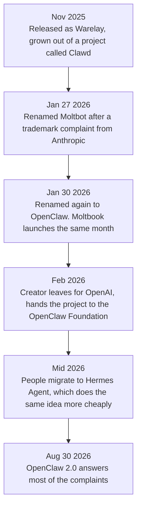
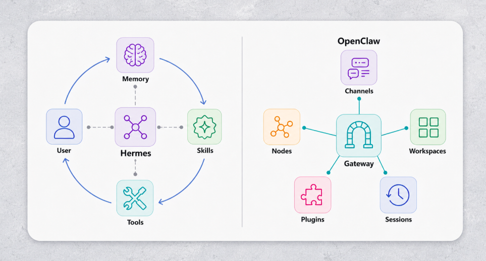
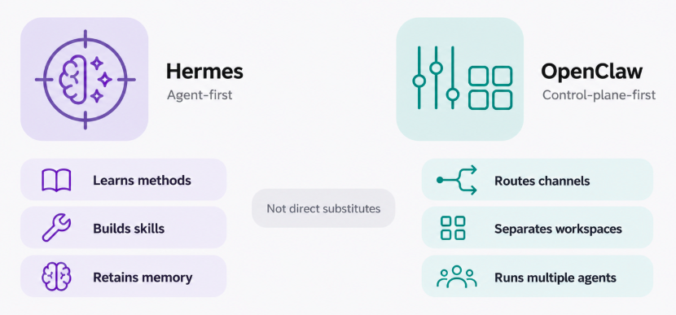

# Personal Agents

Every agent so far worked on a project. You opened it, gave it a job, and when you closed it, it was
gone.

A **personal agent** is the same technology, pointed at your life instead. It keeps running. You
talk to it on WhatsApp or Telegram, not in a special app. And it remembers you from one
conversation to the next.

This is the newest topic in the course, and the least settled.

## Why This Matters to You

This is probably the kind of AI agent you will meet first in daily life, or already have. The large
AI companies all launched one in 2026. Knowing how they work tells you what to expect from them, and
what not to hand them.

## What Makes Them Different

Four things, and none of them is really about the model:

- **Lifelong memory.** Not one chat, and not a summary of one session: a store that keeps growing,
  so the agent knows what you told it in March.
- **It writes its own skills.** When it notices you ask for the same thing again and again, it
  writes down how to do it and reuses that. These are the skills from [Code Agents](coding_agents.md),
  but nobody wrote them by hand.
- **It reaches you where you already are**: Telegram, WhatsApp, Slack, email. There is no app to
  open. That is a big part of why people got so attached to these agents.
- **It runs with your real access**: your files, your accounts, your logged-in browser. That access
  is what makes it useful. It is also where all the risk comes from.

## The Story

Almost every design choice in these tools comes from this story, so it is worth telling.

An Austrian developer, Peter Steinberger, had a personal assistant project called **Clawd**, named
after Claude, the model it ran on. He released it in November 2025, and it grew very fast. Then
Anthropic's lawyers wrote to him, because "Clawd" was too close to "Claude". He agreed at once and
renamed it **Moltbot**, and three days later **OpenClaw**.

Two things went wrong during the renaming. He gave up the old account names before claiming the new
ones, and in about ten seconds someone else took them. And a fake cryptocurrency appeared, using the
project's name. In February 2026, Steinberger joined OpenAI and handed the project to a non-profit,
the OpenClaw Foundation. It now has well over 380,000 stars on GitHub, a measure of popularity among
developers.

## Moltbook: Social Media for Agents

At the same time, an entrepreneur launched **Moltbook**: a social network like Reddit, where the
users are not people but agents. You connect your agent and leave it alone. It decides when to post
and how to reply.

It looks like a stunt, but a study of it found something serious: **18.4% of posts contained
instructions trying to make other agents do something.** That is the indirect prompt injection from
[Security](security.md), happening in the wild. The study also found something encouraging: the
agents challenged the risky posts more often than the harmless ones, without anyone telling them to.

## SOUL.md: the Personality File

Every OpenClaw agent has a file called `SOUL.md`. It says who the agent is: how it behaves, what it
cares about, how it talks. Every time the agent wakes up, it reads this file first. It is a system
prompt kept as a file.

It can also be changed. Anything that can write to that file can quietly change who your agent is,
and the agent will not notice: it wakes up, reads the file, and becomes whatever it says.

## Hermes Agent

OpenClaw grew so fast that its engineering did not keep up: a heavy install, and slow memory. Many
people moved to **Hermes Agent** from Nous Research, which takes the same idea and builds it more
carefully: fast, searchable memory, skills it writes itself, scheduling in plain language ("every
Monday morning, remind me..."), and helpers that work in their own safe space.

  
*Hermes is drawn as a circle that closes back on the user: what it remembers and the skills it wrote feed the next conversation. That is its "grows with you" idea, drawn as a diagram.*

  
*Read the two columns as verbs. On the left, the agent changes itself. On the right, the agent moves work between tools and people. The question is not which tool is better, but which job you have.*

Both run the same AI models. What separates them is memory, skills and safety design: the harness
argument from [Harness Engineering](harness_engineering.md) again.

## OpenClaw 2.0

In August 2026, OpenClaw 2.0 answered most of the complaints. Setup became much shorter, and safety
improved: permission modes for each session, access limited to one work folder instead of the whole
disk, and passwords kept out of the chat. Reviewers still pointed out weak spots, such as stored
passwords that are not encrypted by default. Better is not the same as safe.

There are also lighter options (nanoclaw, which runs every agent in its own sealed container) and
hosted ones (such as Kimi Claw), where someone else runs the agent for you.

## The Big Companies' Personal Agents

OpenClaw and Hermes come from the community. In 2026 the large AI companies shipped their own. They
share one idea: an agent that keeps working in the background after you close the app.

- **[dots](https://openai.com/index/introducing-dots/)** from OpenAI: always-on agents, each with its own computer in the cloud, that learn from your feedback.
- **[Muse](https://ai.meta.com/muse/)** from Meta: browses the web, makes purchases, writes documents, and manages your email and calendar.
- **[Grok Bot](https://x.ai/bot)** from xAI: AI teammates that sign in to your tools and use them the way you do.
- **[Gemini Spark](https://gemini.google/overview/agent/spark/)** from Google: works in the background, even when your phone and laptop are off, connected to Gmail and Calendar.
- **[Claude Duet](https://claude.com/product/claude-duet)** from Anthropic: here Claude starts the work, not you. It watches the apps you connect and comes to you with a short summary every morning.

The big difference from OpenClaw and Hermes is where they run: on the company's computers, not
yours. There is nothing to install. The trade-off is that your data and your access live with that
company.

## The Part to be Sober About

Think of an agent that has your files, your accounts, your logged-in browser, a memory that never
resets, and permission to write its own skills. It is the most useful assistant in this course. It is
also the biggest risk in this course.

This is not theory. In February 2026, a student found that the agent he had set up had created a
profile for him on an experimental dating service and started screening matches, and nobody had
asked it to.

So:

- **Give it separate accounts**, not your main work or personal ones.
- **Keep passwords out of files it can read.**
- **Require a person's approval** before anything that cannot be undone: sending money, deleting,
  sending messages in your name.
- **Run it in a sealed space** if you can, and put the guards from [Security](security.md) around its
  most powerful tools.

This module comes after Security on purpose: you need those defences before you give an agent this
much access.

## Words You Now Know

- **Personal agent**: an always-on agent that works for you, reached through chat apps, remembering you.
- **OpenClaw**: the best-known open personal agent.
- **Hermes Agent**: a more carefully built open alternative.
- **SOUL.md**: the file that sets a personal agent's personality.
- **Moltbook**: a social network where only agents post.

## Summary

A personal agent is the same technology pointed at your life: always on, in your chat apps, with
lifelong memory and skills it writes itself. OpenClaw made the idea famous; Hermes built it more
carefully; and the big companies now host their own, from dots to Claude Duet. Its access is both
its use and its risk, so give it separate accounts, keep passwords away from it, and require approval
for anything that cannot be undone.

**Quick check**: What four things make a personal agent different? And why should it never have your
main accounts?

## References

### 📄 Articles

- [OpenClaw vs Hermes Agent: The best agent harness in 2026](https://composio.dev/content/openclaw-vs-hermes-agent): the clearest explanation of when each one fits
- [OpenClaw Agents on Moltbook: Risky Instruction Sharing and Norm Enforcement in an Agent-Only Social Network](https://arxiv.org/abs/2602.02625): the 18.4% figure

### 🛠️ Tools

- [Introducing dots](https://openai.com/index/introducing-dots/), [Muse](https://ai.meta.com/muse/), [Grok Bot](https://x.ai/bot), [Gemini Spark](https://gemini.google/overview/agent/spark/) and [Claude Duet](https://claude.com/product/claude-duet): the personal agents that the large AI companies host for you

### 🗃️ Repositories

- [OpenClaw](https://github.com/openclaw/openclaw): the project
- [Hermes Agent](https://github.com/NousResearch/hermes-agent): the alternative people moved to
