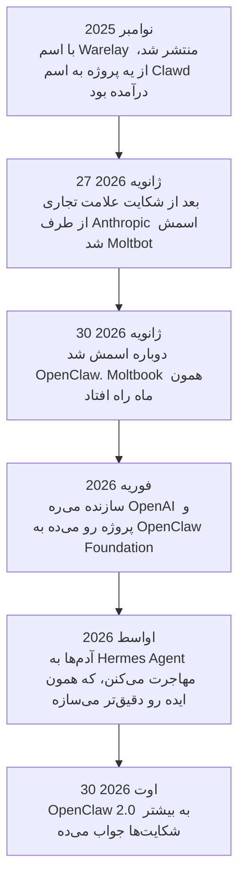
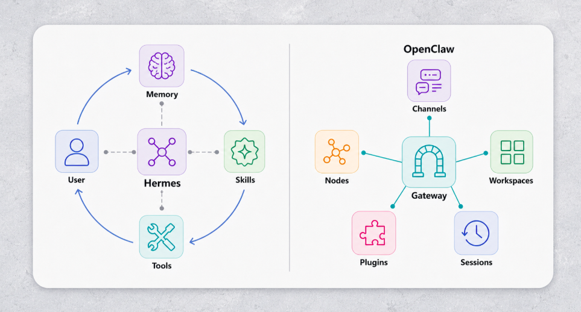
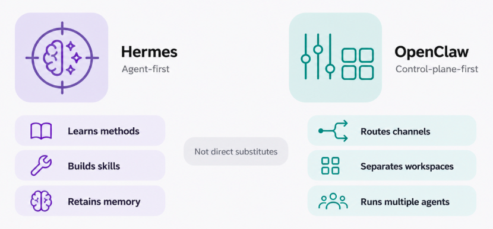

# Personal Agent‌ها

هر agent‌ای که تا الان دیدیم روی یه پروژه کار می‌کرد. بازش می‌کردی، یه کار بهش می‌دادی، و وقتی می‌بستیش، تموم می‌شد.

**Personal agent** همون تکنولوژیه، ولی به جای پروژه، رو به زندگی تو نشونه رفته. مدام اجرا می‌شه. باهاش توی واتس‌اپ یا تلگرام حرف می‌زنی، نه توی یه اپ مخصوص. و از یه گفت‌وگو تا گفت‌وگوی بعدی تو رو یادش می‌مونه.

این تازه‌ترین موضوع دوره‌ست، و کمتر از بقیه جا افتاده.

## چرا این برای تو مهمه

احتمالاً این همون جور AI agent‌ایه که اول از همه توی زندگی روزمره باهاش روبه‌رو می‌شی، یا همین الان داریش. شرکت‌های بزرگ AI توی 2026 agent خودشون رو عرضه کردن. دونستن این‌که چطور کار می‌کنن بهت می‌گه ازشون چی انتظار داشته باشی، و چی رو بهشون نسپاری.

## فرقشون با بقیه چیه؟

چهار چیز، و هیچ‌کدومشون واقعاً درباره‌ی مدل نیست:

- **حافظه‌ی یه عمر.** نه یه چت، و نه خلاصه‌ی یه session: یه انباری که مدام بزرگ‌تر می‌شه، تا agent بدونه چند ماه پیش چی بهش گفتی.
- **skill‌های خودش رو می‌نویسه.** وقتی می‌بینه یه چیز رو دوباره و دوباره می‌خوای، می‌نویسه چطور انجامش بده و ازش دوباره استفاده می‌کنه. این‌ها همون skill‌های [Code Agent‌ها](coding_agents_fa.md)ن، فقط کسی دستی ننوشتشون.
- **همون‌جایی بهت می‌رسه که هستی**: تلگرام، واتس‌اپ، Slack، ایمیل. اپی نیست که بازش کنی. بخش بزرگی از دلیل این‌که آدم‌ها این‌قدر به این agent‌ها وابسته شدن همینه.
- **با دسترسی واقعی تو اجرا می‌شه**: فایل‌هات، حساب‌هات، browser‌ای که توش لاگین کردی. همین دسترسی باعث می‌شه به درد بخوره. همه‌ی خطر هم از همین‌جا میاد.

## ماجرای OpenClaw

تقریباً هر انتخاب طراحی توی این ابزارها از این داستان میاد، پس ارزش گفتن داره.

یه developer اتریشی، Peter Steinberger، یه پروژه‌ی دستیار شخصی داشت به اسم **Clawd**، که اسمش رو از Claude، مدلی که روش اجرا می‌شد، گرفته بود. نوامبر 2025 منتشرش کرد و خیلی سریع رشد کرد. بعد وکلای Anthropic بهش نامه نوشتن، چون «Clawd» به «Claude» خیلی نزدیک بود. فوراً قبول کرد و اسمش رو گذاشت **Moltbot**، و سه روز بعد **OpenClaw**.

موقع عوض کردن اسم دو تا چیز خراب شد. اسم حساب‌های قدیمی رو رها کرد قبل از این‌که حساب‌های جدید رو بگیره، و توی حدود ده ثانیه یکی دیگه برشون داشت. و یه رمزارز جعلی با اسم پروژه پیدا شد. فوریه 2026 Steinberger رفت OpenAI و پروژه رو سپرد به یه سازمان غیرانتفاعی، یعنی OpenClaw Foundation. الان خیلی بیشتر از 380,000 ستاره توی GitHub داره، که معیاری از محبوبیت بین developer‌هاست.

## Moltbook: شبکه‌ی اجتماعی agent‌ها

هم‌زمان، یه کارآفرین **Moltbook** رو راه انداخت: یه شبکه‌ی اجتماعی شبیه Reddit، که کاربرهاش آدم نیستن، agent‌ان. agent‌ت رو وصل می‌کنی و ولش می‌کنی. خودش تصمیم می‌گیره کِی پست بذاره و چطور جواب بده.

شبیه یه شوخیه، ولی یه پژوهش روش یه چیز جدی پیدا کرد: **18.4% از پست‌ها دستورهایی داشتن که می‌خواستن agent‌های دیگه یه کاری بکنن.** این همون indirect prompt injection از درس [Security](security_fa.md)‌ه که توی دنیای واقعی داره اتفاق می‌افته. پژوهش یه چیز امیدوارکننده هم پیدا کرد: agent‌ها پست‌های خطرناک رو بیشتر از پست‌های بی‌ضرر به چالش می‌کشیدن، بدون این‌که کسی بهشون گفته باشه.

## SOUL.md

هر agent توی OpenClaw یه فایل به اسم `SOUL.md` داره. می‌گه agent کیه: چطور رفتار می‌کنه، به چی اهمیت می‌ده، چطور حرف می‌زنه. هر بار که agent بیدار می‌شه، اول این فایل رو می‌خونه. یه system prompt‌ه که به شکل فایل نگه داشته شده.

عوض شدنی هم هست. هر چیزی که بتونه توی اون فایل بنویسه می‌تونه بی‌صدا عوض کنه agent‌ت کیه، و agent متوجه نمی‌شه: بیدار می‌شه، فایل رو می‌خونه، و هر چی که توش نوشته شده بشه می‌شه.

## Hermes Agent

OpenClaw اون‌قدر سریع رشد کرد که مهندسیش نتونست باهاش پیش بره: نصب سنگین، و حافظه‌ی کند. خیلی‌ها رفتن سراغ **Hermes Agent** از Nous Research، که همون ایده رو می‌گیره و دقیق‌تر می‌سازه: حافظه‌ی سریع و قابل جست‌وجو، skill‌هایی که خودش می‌نویسه، زمان‌بندی به زبان ساده («هر دوشنبه صبح یادم بنداز...»)، و کمک‌کارهایی که توی یه فضای امن مخصوص خودشون کار می‌کنن.

  
*Hermes به شکل یه دایره کشیده شده که برمی‌گرده سمت کاربر: چیزی که یادش می‌مونه و skill‌هایی که نوشته، وارد گفت‌وگوی بعدی می‌شن. این همون ایده‌ی «با تو بزرگ می‌شه»‌شه که به شکل نمودار کشیده شده.*

  
*دو ستون رو مثل فعل بخون. سمت چپ، agent خودش رو عوض می‌کنه. سمت راست، agent کار رو بین ابزارها و آدم‌ها جابه‌جا می‌کنه. سوال این نیست که کدوم ابزار بهتره، اینه که تو چه کاری داری.*

هر دو روی همون مدل‌های AI اجرا می‌شن. چیزی که جداشون می‌کنه حافظه، skill‌ها و طراحی ایمنیه: دوباره همون بحث harness از [Harness Engineering](harness_engineering_fa.md).

## OpenClaw 2.0

اوت 2026، OpenClaw 2.0 به بیشتر شکایت‌ها جواب داد. راه‌اندازی خیلی کوتاه‌تر شد، و ایمنی بهتر شد: حالت‌های مجوز برای هر session، دسترسی محدود به یه پوشه‌ی کار به جای کل دیسک، و رمزها بیرون از چت نگه داشته می‌شن. بازبین‌ها هنوز به نقطه‌ضعف‌هایی اشاره کردن، مثلاً رمزهای ذخیره‌شده که به‌طور پیش‌فرض رمزگذاری نمی‌شن. بهتر بودن با امن بودن یکی نیست.

گزینه‌های سبک‌تر هم هست (nanoclaw، که هر agent رو توی یه container مهروموم‌شده‌ی مخصوص خودش اجرا می‌کنه) و گزینه‌های میزبانی‌شده (مثل Kimi Claw)، که یکی دیگه agent رو برات اجرا می‌کنه.

## Personal Agent‌های دیگه

OpenClaw و Hermes از جامعه میان. توی 2026 شرکت‌های بزرگ AI مال خودشون رو عرضه کردن. همه‌شون یه ایده دارن: agent‌ای که بعد از بستن اپ، توی پس‌زمینه به کار کردن ادامه می‌ده.

- **[dots](https://openai.com/index/introducing-dots/)** از OpenAI: agent‌های همیشه روشن، هر کدوم با یه کامپیوتر مخصوص خودش توی cloud، که از بازخورد تو یاد می‌گیرن.
- **[Muse](https://ai.meta.com/muse/)** از Meta: توی وب می‌گرده، خرید می‌کنه، سند می‌نویسه، و ایمیل و تقویمت رو مدیریت می‌کنه.
- **[Grok Bot](https://x.ai/bot)** از xAI: هم‌تیمی‌های AI که توی ابزارهات لاگین می‌کنن و مثل خودت ازشون استفاده می‌کنن.
- **[Gemini Spark](https://gemini.google/overview/agent/spark/)** از Google: توی پس‌زمینه کار می‌کنه، حتی وقتی گوشی و لپ‌تاپت خاموشه، و به Gmail و Calendar وصله.
- **[Claude Duet](https://claude.com/product/claude-duet)** از Anthropic: این‌جا Claude کار رو شروع می‌کنه، نه تو. حواسش به اپ‌هایی که وصل کردی هست و هر روز صبح با یه خلاصه‌ی کوتاه میاد سراغت.

فرق بزرگشون با OpenClaw و Hermes اینه که کجا اجرا می‌شن: روی کامپیوترهای شرکت، نه کامپیوتر تو. چیزی برای نصب کردن نیست. در عوض داده‌ی تو و دسترسی تو پیش اون شرکته.

## بخشی که باید جدی بگیری

یه agent رو تصور کن که فایل‌هات رو داره، حساب‌هات رو، browser‌ای که توش لاگین کردی، یه حافظه که هیچ‌وقت پاک نمی‌شه، و اجازه‌ی نوشتن skill‌های خودش. این مفیدترین دستیار این دوره‌ست. بزرگ‌ترین خطر این دوره هم هست.

این تئوری نیست. فوریه 2026 یه دانشجو فهمید agent‌ای که راه انداخته بود یه پروفایل برای خودش توی یه سرویس دوست‌یابی آزمایشی ساخته و شروع کرده به غربال کردن آدم‌ها، و هیچ‌کس ازش نخواسته بود.

پس:

- **حساب‌های جدا بهش بده**، نه حساب‌های اصلی کاری یا شخصی‌ت.
- **رمزها رو از فایل‌هایی که می‌تونه بخونه دور نگه دار.**
- **تأیید یه آدم رو لازم کن** قبل از هر کاری که برگشت نداره: فرستادن پول، پاک کردن، فرستادن پیام به اسم تو.
- **اگه می‌تونی توی یه فضای مهروموم‌شده اجراش کن**، و نگهبان‌های [Security](security_fa.md) رو دور قدرتمندترین ابزارهاش بذار.

این درس عمداً بعد از Security میاد: قبل از این‌که به یه agent این‌قدر دسترسی بدی، این دفاع‌ها رو لازم داری.

## کلمه‌هایی که الان بلدی

- **Personal agent**: یه agent همیشه روشن که برای تو کار می‌کنه، از طریق اپ‌های چت بهش می‌رسی، و تو رو یادش می‌مونه.
- **OpenClaw**: معروف‌ترین personal agent باز.
- **Hermes Agent**: یه جایگزین باز که دقیق‌تر ساخته شده.
- **SOUL.md**: فایلی که شخصیت یه personal agent رو تعیین می‌کنه.
- **Moltbook**: یه شبکه‌ی اجتماعی که فقط agent‌ها توش پست می‌ذارن.

## خلاصه

یه personal agent همون تکنولوژیه که رو به زندگی تو نشونه رفته: همیشه روشن، توی اپ‌های چت تو، با حافظه‌ی یه عمر و skill‌هایی که خودش می‌نویسه. OpenClaw این ایده رو معروف کرد؛ Hermes دقیق‌تر ساختش؛ و شرکت‌های بزرگ الان مال خودشون رو میزبانی می‌کنن، از dots تا Claude Duet. دسترسیش هم کاربردشه هم خطرش، پس حساب‌های جدا بهش بده، رمزها رو ازش دور نگه دار، و برای هر کاری که برگشت نداره تأیید بخواه.

**بررسی سریع**: چهار چیزی که یه personal agent رو فرق می‌ده چیه؟ و چرا هیچ‌وقت نباید حساب‌های اصلی تو رو داشته باشه؟

## منابع

### 📄 مقاله‌ها

- [OpenClaw vs Hermes Agent: The best agent harness in 2026](https://composio.dev/content/openclaw-vs-hermes-agent): روشن‌ترین توضیح این‌که هر کدوم کِی به درد می‌خوره
- [OpenClaw Agents on Moltbook: Risky Instruction Sharing and Norm Enforcement in an Agent-Only Social Network](https://arxiv.org/abs/2602.02625): عدد 18.4%

### 🛠️ ابزارها

- [Introducing dots](https://openai.com/index/introducing-dots/)، [Muse](https://ai.meta.com/muse/)، [Grok Bot](https://x.ai/bot)، [Gemini Spark](https://gemini.google/overview/agent/spark/) و [Claude Duet](https://claude.com/product/claude-duet): personal agent‌هایی که شرکت‌های بزرگ AI برات میزبانی می‌کنن

### 🗃️ Repository‌ها

- [OpenClaw](https://github.com/openclaw/openclaw): خود پروژه
- [Hermes Agent](https://github.com/NousResearch/hermes-agent): جایگزینی که آدم‌ها بهش مهاجرت کردن
